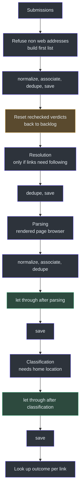
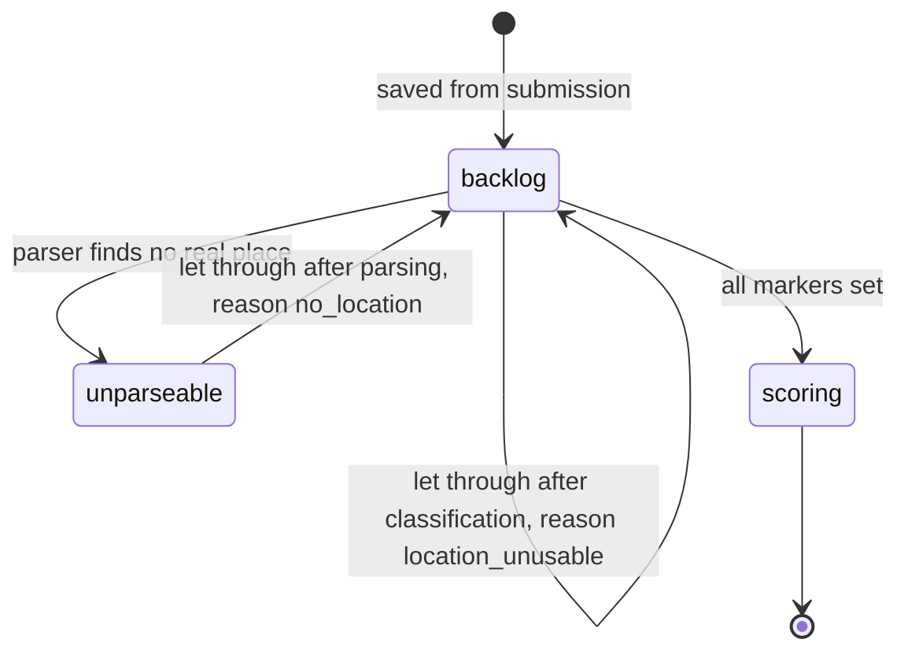
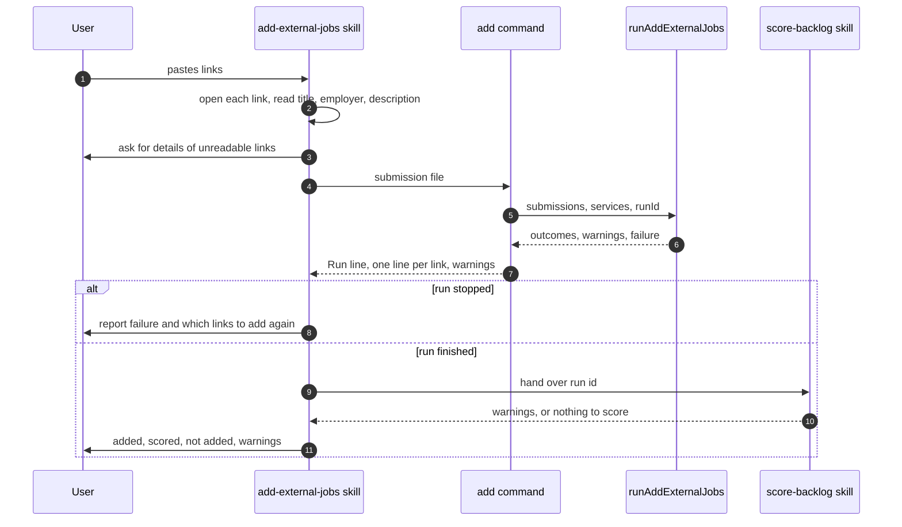
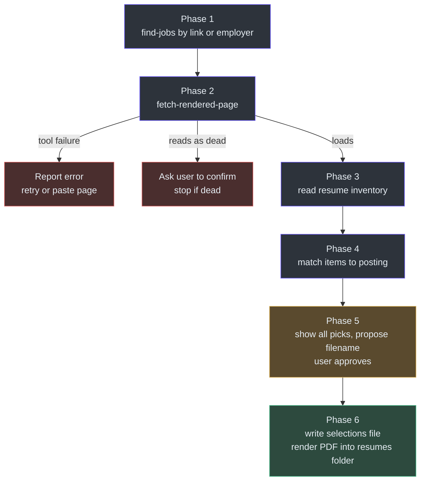

# External Jobs and Resumes

## Overview

A job search only finds jobs its collectors know how to pull. The user also finds jobs on their own: a link from a friend, a post on a social site, a company page. This page covers how those jobs get into the same database and the same scoring, and how the user then makes a resume for one of them.

There are three agent skills and two commands here.

| Skill or command | Purpose | Source |
| --- | --- | --- |
| `add-external-jobs` skill | Reads each pasted link, runs the add command, then scores the backlog and reports | [SKILL.md:11-94](https://github.com/mablahblah/job-assistant/blob/main/.claude/skills/add-external-jobs/SKILL.md#L11-L94) |
| `npm run add-external-jobs` | Runs only the user's links through the job search's steps | [scripts/add-external-jobs.ts:24-88](https://github.com/mablahblah/job-assistant/blob/main/scripts/add-external-jobs.ts#L24-L88) |
| `generate-resume` skill | Finds a saved job, reads the live posting, picks resume items, renders a PDF | [SKILL.md:22-199](https://github.com/mablahblah/job-assistant/blob/main/.claude/skills/generate-resume/SKILL.md#L22-L199) |
| `npm run fetch-rendered-page` | Prints a page's finished HTML after its scripts have run | [scripts/fetch-rendered-page.ts:13-34](https://github.com/mablahblah/job-assistant/blob/main/scripts/fetch-rendered-page.ts#L13-L34) |

### At a glance

| Component | Responsibility | Key file | Source |
| --- | --- | --- | --- |
| `runAddExternalJobs` | Runs the pipeline handlers for only the ids it saved this run | `lib/orchestrators/add-external-jobs.ts` | [add-external-jobs.ts:85-327](https://github.com/mablahblah/job-assistant/blob/main/lib/orchestrators/add-external-jobs.ts#L85-L327) |
| `letJobsThrough` | Keeps a job in the backlog when the pipeline cannot judge it, and records why | `lib/handlers/let-through.ts` | [let-through.ts:68-103](https://github.com/mablahblah/job-assistant/blob/main/lib/handlers/let-through.ts#L68-L103) |
| `addedJobsReport` | Turns outcomes, warnings and failure into printed lines | `lib/utils/added-jobs-report.ts` | [added-jobs-report.ts:18-56](https://github.com/mablahblah/job-assistant/blob/main/lib/utils/added-jobs-report.ts#L18-L56) |
| `createRenderedPageFetcher` | One page, one headless browser, closed afterward | `lib/tools/rendered-page-fetcher.ts` | [rendered-page-fetcher.ts:112-131](https://github.com/mablahblah/job-assistant/blob/main/lib/tools/rendered-page-fetcher.ts#L112-L131) |
| `createRenderedPageBrowser` | One browser, many pages, used by the add run's parsing step | `lib/tools/rendered-page-fetcher.ts` | [rendered-page-fetcher.ts:145-164](https://github.com/mablahblah/job-assistant/blob/main/lib/tools/rendered-page-fetcher.ts#L145-L164) |

## Adding external jobs

### Why a separate runner

The job search reads whole tables: every job waiting at each step, whenever it was collected. If the add command did the same, it would also push the user's older waiting jobs through the steps. So this runner reads back only the ids it has saved during this run. A job that was already waiting before the run is never touched ([lib/orchestrators/add-external-jobs.ts:1-5](https://github.com/mablahblah/job-assistant/blob/main/lib/orchestrators/add-external-jobs.ts#L1-L5)). It collects from no job source.

It reuses the same handlers as the job search. It does not copy their logic. This follows the rule that each job in the pipeline has one implementation, and that no part assumes it is inside a job search ([.claude/rules/part-ownership.md](https://github.com/mablahblah/job-assistant/blob/main/.claude/rules/part-ownership.md)). See [The Job Search Run](../architecture/job-search-run.md).

### The submission

Each submission has a `link` and optionally a `title`, `employer` and `description` ([add-external-jobs.ts:37-42](https://github.com/mablahblah/job-assistant/blob/main/lib/orchestrators/add-external-jobs.ts#L37-L42)). The skill reads each posting first and fills these fields in, because the agent can read a page that a collector cannot ([SKILL.md:23-32](https://github.com/mablahblah/job-assistant/blob/main/.claude/skills/add-external-jobs/SKILL.md#L23-L32)). A link whose page will not open is set aside, and the user is asked for a title and employer. If the user does not know them, the link is kept with neither. The agent must not guess ([SKILL.md:16](https://github.com/mablahblah/job-assistant/blob/main/.claude/skills/add-external-jobs/SKILL.md#L16)).

Every added job is filed under the collector name `user` ([add-external-jobs.ts:34-35](https://github.com/mablahblah/job-assistant/blob/main/lib/orchestrators/add-external-jobs.ts#L34-L35)). A link that is not a web address is refused with a warning and never becomes a job ([add-external-jobs.ts:121-124](https://github.com/mablahblah/job-assistant/blob/main/lib/orchestrators/add-external-jobs.ts#L121-L124)).

### The steps, in order

<!-- Sources: lib/orchestrators/add-external-jobs.ts:119-248, 266-323 -->

Each stretch ends at the database, and the next stretch asks the database for the tracked ids at the right marker. The lookups use `findBacklogByIds` with a step name: `"resolution"`, `"parsing"` and `"classification"` ([add-external-jobs.ts:161](https://github.com/mablahblah/job-assistant/blob/main/lib/orchestrators/add-external-jobs.ts#L161), [add-external-jobs.ts:189](https://github.com/mablahblah/job-assistant/blob/main/lib/orchestrators/add-external-jobs.ts#L189), [add-external-jobs.ts:238](https://github.com/mablahblah/job-assistant/blob/main/lib/orchestrators/add-external-jobs.ts#L238)). The `tracked` set grows with every id a save hands back. A job merged into an existing row continues under that row's id ([add-external-jobs.ts:95-100](https://github.com/mablahblah/job-assistant/blob/main/lib/orchestrators/add-external-jobs.ts#L95-L100)). See [Dedupe and Save](../pipeline/dedupe-and-save.md), [Resolution](../pipeline/resolution.md) and [Parsing](../pipeline/parsing.md).

Details that differ from a job search:

| Detail | What the code does | Why | Source |
| --- | --- | --- | --- |
| Rechecked verdicts reset | A link matching a saved job with status `expired`, `too far`, `unresolvable` or `unparseable` is sent back to `backlog` with the resolved, parsed and classified markers cleared | Adding a link again means "look at this again". Other statuses, such as `app. sent`, stay as they are | [add-external-jobs.ts:150-159](https://github.com/mablahblah/job-assistant/blob/main/lib/orchestrators/add-external-jobs.ts#L150-L159), [job-status.ts:79-94](https://github.com/mablahblah/job-assistant/blob/main/lib/utils/job-status.ts#L79-L94) |
| Browser only if needed | The resolution browser is opened only when `unresolved.length > 0` | A headed browser holds the machine while it runs | [add-external-jobs.ts:162-168](https://github.com/mablahblah/job-assistant/blob/main/lib/orchestrators/add-external-jobs.ts#L162-L168) |
| Parsing reads even unresolved jobs | The parsing lookup does not ask whether the link was followed | A job whose link was refused is still read and marked unparseable, which lets it be let through | [add-external-jobs.ts:187-189](https://github.com/mablahblah/job-assistant/blob/main/lib/orchestrators/add-external-jobs.ts#L187-L189) |
| Parsing browser starts lazily | The rendered page browser is created on the first page read and closed in `finally` | Many postings, one browser start-up | [add-external-jobs.ts:190-204](https://github.com/mablahblah/job-assistant/blob/main/lib/orchestrators/add-external-jobs.ts#L190-L204) |
| Home location read late | The location setting is read just before classification | A missing location stops the run after the first three stretches have finished | [add-external-jobs.ts:224-235](https://github.com/mablahblah/job-assistant/blob/main/lib/orchestrators/add-external-jobs.ts#L224-L235) |
| No scoring here | The runner never scores. The skill calls `score-backlog` afterward | Scoring needs an agent, see [Scoring](scoring.md) | [SKILL.md:68-72](https://github.com/mablahblah/job-assistant/blob/main/.claude/skills/add-external-jobs/SKILL.md#L68-L72) |

### The let-through protection

The user picked these jobs by hand, so a job the pipeline cannot read should not be dropped. In a normal job search, a job with no usable place ends up as `unparseable` or never gets classified. A hand-added job often has no listing page to resolve and no location text to check. Rather than leaving it stuck unjudged, `letJobsThrough` lets it through to scoring and records why ([lib/handlers/let-through.ts:1-5](https://github.com/mablahblah/job-assistant/blob/main/lib/handlers/let-through.ts#L1-L5)).

It runs at two positions, chosen by the `after` option.

| Position | Condition | Result | Trace reason | Source |
| --- | --- | --- | --- | --- |
| `after: "parsing"` | Job status is `unparseable` | Status back to `backlog`, with resolved, parsed and classified all set true | `no_location` | [let-through.ts:38-47](https://github.com/mablahblah/job-assistant/blob/main/lib/handlers/let-through.ts#L38-L47) |
| `after: "classification"` | Job is still in the backlog (or has no status) and was never marked classified | Marked classified, stays in the backlog | `location_unusable` | [let-through.ts:51-61](https://github.com/mablahblah/job-assistant/blob/main/lib/handlers/let-through.ts#L51-L61) |

The second case means the map could not find a place for the job. Marking it classified keeps it from being picked up again ([let-through.ts:51-54](https://github.com/mablahblah/job-assistant/blob/main/lib/handlers/let-through.ts#L51-L54)).

<!-- Sources: lib/handlers/let-through.ts:38-61, lib/orchestrators/add-external-jobs.ts:217-246 -->

The handler follows the usual handler rules. It copies each job, raises no warnings, and writes a trace row of event `job_let_through` for each job it lets through. It writes a row only when it has a trace service, a run id and a step name. A job with no id or collector is let through silently ([let-through.ts:75-99](https://github.com/mablahblah/job-assistant/blob/main/lib/handlers/let-through.ts#L75-L99)). Because the closed set of reasons is a TypeScript type, a word the step has no right to write fails to compile ([let-through.ts:23-25](https://github.com/mablahblah/job-assistant/blob/main/lib/handlers/let-through.ts#L23-L25)).

A let-through job is not scored with certainty. The report flags it as "could not be judged for certain" and prints each reason ([lib/utils/added-jobs-report.ts:35-37](https://github.com/mablahblah/job-assistant/blob/main/lib/utils/added-jobs-report.ts#L35-L37)).

### Reporting where each link landed

After the steps finish or stop, the runner builds one outcome per submission. Each starts as "not saved" or "not a web address". A lookup then finds the job by the same link key that duplicate checking uses, so two links to one posting land on one job ([add-external-jobs.ts:254-281](https://github.com/mablahblah/job-assistant/blob/main/lib/orchestrators/add-external-jobs.ts#L254-L281)). The outcome takes the job's status, and the last reason from this run's trace rows. For a job at `backlog` the reason is null, because nothing needs explaining. The let-through reasons come from `resolution_failed` and `job_let_through` rows ([add-external-jobs.ts:297-317](https://github.com/mablahblah/job-assistant/blob/main/lib/orchestrators/add-external-jobs.ts#L297-L317)).

<!-- Sources: .claude/skills/add-external-jobs/SKILL.md:23-94, scripts/add-external-jobs.ts:56-84 -->

The command prints `Run: {run-id}` first so the scoring skill can file its trace rows under the same run ([scripts/add-external-jobs.ts:56-59](https://github.com/mablahblah/job-assistant/blob/main/scripts/add-external-jobs.ts#L56-L59)). The skill does not score after a stopped run, and it leaves out the run summary ([SKILL.md:19-20](https://github.com/mablahblah/job-assistant/blob/main/.claude/skills/add-external-jobs/SKILL.md#L19-L20)).

A schema check runs first, before the browser, for a specific reason. The trace service swallows writes it cannot make, so on a mismatched database the run would work for minutes and end with no record of having done so ([scripts/add-external-jobs.ts:40-48](https://github.com/mablahblah/job-assistant/blob/main/scripts/add-external-jobs.ts#L40-L48)). Failures are tracked the same way as in other orchestrators, with `createFailureTracker` ([add-external-jobs.ts:86-93](https://github.com/mablahblah/job-assistant/blob/main/lib/orchestrators/add-external-jobs.ts#L86-L93)). `FinishedHandler` is imported from the job search runner so a stopped run can list the steps that finished ([add-external-jobs.ts:32](https://github.com/mablahblah/job-assistant/blob/main/lib/orchestrators/add-external-jobs.ts#L32), [added-jobs-report.ts:47-53](https://github.com/mablahblah/job-assistant/blob/main/lib/utils/added-jobs-report.ts#L47-L53)).

## Resumes

### Why `fetch-rendered-page` exists

Many job postings build their text in the browser with scripts. A plain HTTP fetch hands back an empty shell. The resume skill needs the finished page, so it calls `npm run fetch-rendered-page` ([scripts/fetch-rendered-page.ts:1-4](https://github.com/mablahblah/job-assistant/blob/main/scripts/fetch-rendered-page.ts#L1-L4)). The script is a thin wrapper. Its core function takes the fetcher and the output functions as arguments, so tests can drive it without a browser. It returns exit code 0 and prints the HTML, or returns 1 with a "Failed to fetch rendered page" message ([fetch-rendered-page.ts:13-34](https://github.com/mablahblah/job-assistant/blob/main/scripts/fetch-rendered-page.ts#L13-L34)). The `main` call is guarded so that importing the module runs nothing ([fetch-rendered-page.ts:46-49](https://github.com/mablahblah/job-assistant/blob/main/scripts/fetch-rendered-page.ts#L46-L49)).

The tool is separate from `fetch-page.ts`, which reads raw script-free text with no browser ([rendered-page-fetcher.ts:1-8](https://github.com/mablahblah/job-assistant/blob/main/lib/tools/rendered-page-fetcher.ts#L1-L8)).

| Setting | Value | Reason | Source |
| --- | --- | --- | --- |
| Load wait | `load` event, 30 seconds | Job pages that keep polling never go network-idle, so waiting for quiet would never finish | [rendered-page-fetcher.ts:79-88](https://github.com/mablahblah/job-assistant/blob/main/lib/tools/rendered-page-fetcher.ts#L79-L88), [rendered-page-fetcher.ts:34](https://github.com/mablahblah/job-assistant/blob/main/lib/tools/rendered-page-fetcher.ts#L34) |
| Job data wait | Up to 5 seconds for a `script[type="application/ld+json"]` element to attach | Search-engine job data appeared within 1.4 seconds on the pages measured | [rendered-page-fetcher.ts:36-42](https://github.com/mablahblah/job-assistant/blob/main/lib/tools/rendered-page-fetcher.ts#L36-L42) |
| If job data never shows | The page is returned as it stands | Only a page that never finishes loading is a failure | [rendered-page-fetcher.ts:99-109](https://github.com/mablahblah/job-assistant/blob/main/lib/tools/rendered-page-fetcher.ts#L99-L109) |
| Browser mode | Headless | Refusals seen so far came from aggregator redirect links, which this tool rarely fetches | [rendered-page-fetcher.ts:72-77](https://github.com/mablahblah/job-assistant/blob/main/lib/tools/rendered-page-fetcher.ts#L72-L77) |
| Launcher | Passed in as an argument | A caller can hand in a fake browser | [rendered-page-fetcher.ts:67-70](https://github.com/mablahblah/job-assistant/blob/main/lib/tools/rendered-page-fetcher.ts#L67-L70) |

The tool offers two builders, as the tools rule allows. One opens and closes a browser per page. The other keeps one browser open for many pages and is what the add run's parsing step uses ([rendered-page-fetcher.ts:9-13](https://github.com/mablahblah/job-assistant/blob/main/lib/tools/rendered-page-fetcher.ts#L9-L13), [.claude/rules/tools.md](https://github.com/mablahblah/job-assistant/blob/main/.claude/rules/tools.md)).

### The `generate-resume` skill

The skill builds a tailored PDF resume for one saved job. It is **pick-only**. It never writes, rewords or invents resume text. It only chooses which existing items are shown ([SKILL.md:3](https://github.com/mablahblah/job-assistant/blob/main/.claude/skills/generate-resume/SKILL.md#L3), [SKILL.md:26](https://github.com/mablahblah/job-assistant/blob/main/.claude/skills/generate-resume/SKILL.md#L26)). The resume content and the PDF renderer live in a separate portfolio project outside this repository. This page describes the procedure only, not any resume content.

<!-- Sources: .claude/skills/generate-resume/SKILL.md:32-199 -->

| Phase | What the agent does | Source |
| --- | --- | --- |
| 1. Find the job | Splits the request into link, employer and role words. Runs `find-jobs` with the link and employer but never the role. If the employer has several jobs, it picks the one the role words describe, or asks | [SKILL.md:32-64](https://github.com/mablahblah/job-assistant/blob/main/.claude/skills/generate-resume/SKILL.md#L32-L64) |
| 2. Fetch the posting | Fetches `resolved_url` if present, else `original_url`. A fetch failure is a fact about the tool, never about the job. A dead-looking page is confirmed with the user, and the job status is left untouched | [SKILL.md:66-98](https://github.com/mablahblah/job-assistant/blob/main/.claude/skills/generate-resume/SKILL.md#L66-L98) |
| 3. Read the inventory | Runs the portfolio project's inventory command and reads titles, summary parts, skills, tools and experience bullets, each with an `id` | [SKILL.md:100-124](https://github.com/mablahblah/job-assistant/blob/main/.claude/skills/generate-resume/SKILL.md#L100-L124) |
| 4. Match | Chooses items that answer the posting. Strengths are ranked, because the summary names them in order. No word may appear in every chosen strength. Work lines and skills must fit their limits | [SKILL.md:126-146](https://github.com/mablahblah/job-assistant/blob/main/.claude/skills/generate-resume/SKILL.md#L126-L146) |
| 5. Approval | Shows every item, chosen and rejected, with a reason for each chosen one. Proposes a filename. Nothing is generated until the user approves both | [SKILL.md:148-157](https://github.com/mablahblah/job-assistant/blob/main/.claude/skills/generate-resume/SKILL.md#L148-L157) |
| 6. Generate | Writes a selections file, runs the renderer, reads its errors, corrects and retries, then saves the PDF into the project's `resumes` folder | [SKILL.md:159-198](https://github.com/mablahblah/job-assistant/blob/main/.claude/skills/generate-resume/SKILL.md#L159-L198) |

Design choices worth knowing:

- The skill is pick-only because a resume is a statement about a real person. Selection can be checked. Generated text cannot ([SKILL.md:26](https://github.com/mablahblah/job-assistant/blob/main/.claude/skills/generate-resume/SKILL.md#L26)).
- The summary is built from fixed words with slots for an opener, three strengths and an achievement. The script prints each chosen item's summary text exactly, so the "no shared word" check swaps a strength instead of rewording it ([SKILL.md:110-113](https://github.com/mablahblah/job-assistant/blob/main/.claude/skills/generate-resume/SKILL.md#L110-L113), [SKILL.md:129-130](https://github.com/mablahblah/job-assistant/blob/main/.claude/skills/generate-resume/SKILL.md#L129-L130)).
- Allowed tools are listed in the skill's front matter, which limits the commands the agent can run to `find-jobs`, `fetch-rendered-page`, the renderer and a few file operations ([SKILL.md:11-19](https://github.com/mablahblah/job-assistant/blob/main/.claude/skills/generate-resume/SKILL.md#L11-L19)).
- Generated PDFs go to `resumes/`, which is an untracked folder in this repository.

The skill relies on `find-jobs`, which is described in [Status Changes and the Work Log](status-change-and-work-log.md).

## Related Pages

| Page | Relationship |
| --- | --- |
| [The Job Search Run](../architecture/job-search-run.md) | The handlers the add run reuses |
| [Resolution](../pipeline/resolution.md) | How links are followed before parsing |
| [Parsing](../pipeline/parsing.md) | The step that uses the rendered page browser |
| [Scoring](scoring.md) | Run by the skill after a finished add |
| [Status Changes and the Work Log](status-change-and-work-log.md) | `find-jobs`, shared with the resume skill |
| [Testing](../quality/testing.md) | Many `add-external-jobs-*.flow.test.ts` files cover this runner |
| [Commands and Skills](../../getting-started/commands-and-skills.md) | The commands these skills call |

## References

- [lib/orchestrators/add-external-jobs.ts](https://github.com/mablahblah/job-assistant/blob/main/lib/orchestrators/add-external-jobs.ts)
- [scripts/add-external-jobs.ts](https://github.com/mablahblah/job-assistant/blob/main/scripts/add-external-jobs.ts)
- [lib/handlers/let-through.ts](https://github.com/mablahblah/job-assistant/blob/main/lib/handlers/let-through.ts)
- [lib/utils/added-jobs-report.ts](https://github.com/mablahblah/job-assistant/blob/main/lib/utils/added-jobs-report.ts)
- [lib/tools/rendered-page-fetcher.ts](https://github.com/mablahblah/job-assistant/blob/main/lib/tools/rendered-page-fetcher.ts)
- [scripts/fetch-rendered-page.ts](https://github.com/mablahblah/job-assistant/blob/main/scripts/fetch-rendered-page.ts)
- [.claude/skills/add-external-jobs/SKILL.md](https://github.com/mablahblah/job-assistant/blob/main/.claude/skills/add-external-jobs/SKILL.md)
- [.claude/skills/generate-resume/SKILL.md](https://github.com/mablahblah/job-assistant/blob/main/.claude/skills/generate-resume/SKILL.md)
