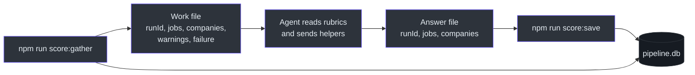
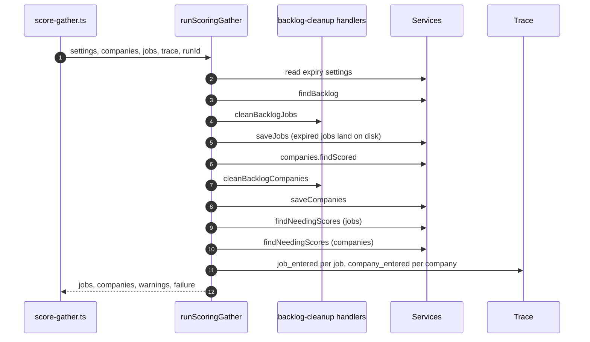
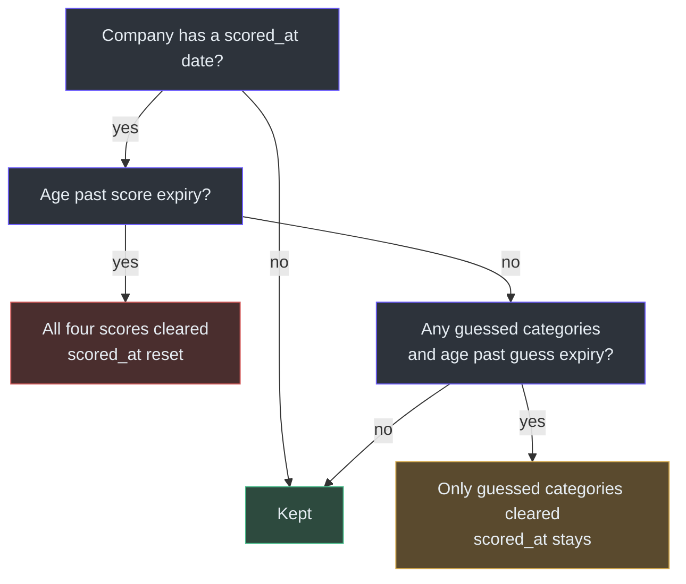
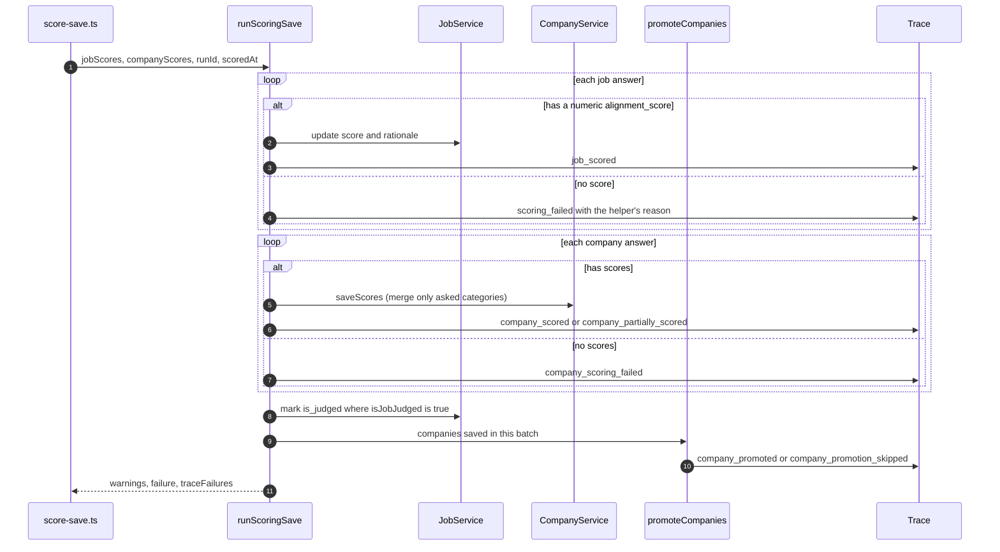
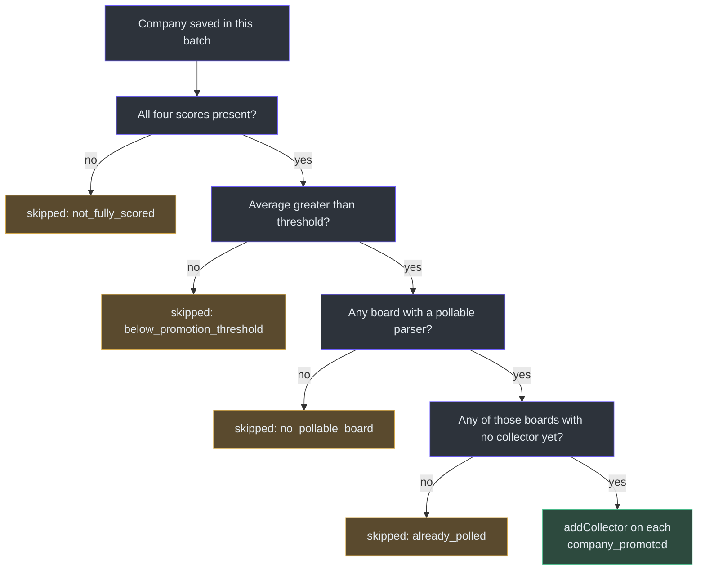

# Scoring

## Overview

A job search can collect, clean and sort jobs with plain code. It cannot decide whether a job is a good fit, or whether an employer is a good place to work. That takes judgment and live web research, which an agent does.

A pipeline run cannot stop and wait for an agent to think. So scoring is split into two commands with the agent between them. The first command, `score:gather`, writes out everything that needs a score. The agent works it out. The second command, `score:save`, writes the answers back. This is stated in the orchestrator's own header comment ([lib/orchestrators/scoring.ts:1-8](https://github.com/mablahblah/job-assistant/blob/main/lib/orchestrators/scoring.ts#L1-L8)).

The `score-backlog` skill runs the whole loop. The `job-search` skill calls it straight after the pipeline finishes, handing over the run identifier so scoring records join the same run ([.claude/skills/job-search/SKILL.md:48](https://github.com/mablahblah/job-assistant/blob/main/.claude/skills/job-search/SKILL.md#L48)). See [The Job Search Run](../architecture/job-search-run.md) for the deterministic half.

### At a glance

| Component | Responsibility | Key file | Source |
| --- | --- | --- | --- |
| `runScoringGather` | Cleans stale scores, lists who still needs a score, leaves a trace row for each | `lib/orchestrators/scoring.ts` | [scoring.ts:47-184](https://github.com/mablahblah/job-assistant/blob/main/lib/orchestrators/scoring.ts#L47-L184) |
| `runScoringSave` | Writes the agent's answers, marks jobs as judged, promotes companies | `lib/orchestrators/scoring.ts` | [scoring.ts:228-450](https://github.com/mablahblah/job-assistant/blob/main/lib/orchestrators/scoring.ts#L228-L450) |
| `score:gather` command | Opens the database, runs the gather, writes a JSON work file | `scripts/score-gather.ts` | [score-gather.ts:25-117](https://github.com/mablahblah/job-assistant/blob/main/scripts/score-gather.ts#L25-L117) |
| `score:save` command | Reads the agent's answer file, runs the save, optionally prints the run summary | `scripts/score-save.ts` | [score-save.ts:43-137](https://github.com/mablahblah/job-assistant/blob/main/scripts/score-save.ts#L43-L137) |
| `promoteCompanies` | Moves a well-scored company onto a polling list | `lib/handlers/company-promotion.ts` | [company-promotion.ts:103-163](https://github.com/mablahblah/job-assistant/blob/main/lib/handlers/company-promotion.ts#L103-L163) |
| `isJobJudged` | Decides whether scoring has judged a job | `lib/utils/job-judged.ts` | [job-judged.ts:15-22](https://github.com/mablahblah/job-assistant/blob/main/lib/utils/job-judged.ts#L15-L22) |
| `score-backlog` skill | Tells the agent what to do in four phases | `.claude/skills/score-backlog/SKILL.md` | [SKILL.md:17-126](https://github.com/mablahblah/job-assistant/blob/main/.claude/skills/score-backlog/SKILL.md#L17-L126) |

## The two-command shape

<!-- Sources: lib/orchestrators/scoring.ts:1-8, scripts/score-gather.ts:83-91, scripts/score-save.ts:59-65 -->

The work file and the answer file are plain JSON. The gather command writes `runId`, `jobs`, `companies`, `warnings` and `failure` ([scripts/score-gather.ts:84-91](https://github.com/mablahblah/job-assistant/blob/main/scripts/score-gather.ts#L84-L91)). The save command reads `runId`, `jobs` and `companies` back. It treats the file as untrusted and casts it once, in one place ([scripts/score-save.ts:24-31](https://github.com/mablahblah/job-assistant/blob/main/scripts/score-save.ts#L24-L31), [scripts/score-save.ts:61-65](https://github.com/mablahblah/job-assistant/blob/main/scripts/score-save.ts#L61-L65)).

Both commands refuse to run if the database does not match the schema the code expects. They call `schemaHasDrifted` first and set a failing exit code ([scripts/score-gather.ts:48-51](https://github.com/mablahblah/job-assistant/blob/main/scripts/score-gather.ts#L48-L51), [scripts/score-save.ts:71-74](https://github.com/mablahblah/job-assistant/blob/main/scripts/score-save.ts#L71-L74)).

## Gather: cleaning first, then listing

The gather does cleanup before it asks who needs a score. The order matters. If a company's old score were cleared after the list was read, that company would be missing from its own re-score. The code comments say this directly ([lib/orchestrators/scoring.ts:113-116](https://github.com/mablahblah/job-assistant/blob/main/lib/orchestrators/scoring.ts#L113-L116)).

<!-- Sources: lib/orchestrators/scoring.ts:68-175 -->

### Who counts as needing a score

| Kind | Rule | Source |
| --- | --- | --- |
| Job | Status is `backlog`, no alignment score yet, and the link is followed, the posting is read and the job is classified | [job-service.ts:469-486](https://github.com/mablahblah/job-assistant/blob/main/lib/services/job-service.ts#L469-L486) |
| Company | Has at least one backlog job, and at least one of its four category scores is empty | [company-service.ts:272-288](https://github.com/mablahblah/job-assistant/blob/main/lib/services/company-service.ts#L272-L288) |

The four categories are employee satisfaction, customer satisfaction, work/life balance and political alignment. They live in one list, `SCORE_CATEGORIES`, so a fifth category joins every check by being added there ([lib/services/company-service.ts:16-21](https://github.com/mablahblah/job-assistant/blob/main/lib/services/company-service.ts#L16-L21)).

### Scores that go stale

Backlog cleanup empties old company scores so employers get researched again. The two ages come from settings. The seed values are 90 days for a full score and 30 days for a guessed category ([scripts/db-seed.ts:58-65](https://github.com/mablahblah/job-assistant/blob/main/scripts/db-seed.ts#L58-L65)).

<!-- Sources: lib/handlers/backlog-cleanup.ts:203-246 -->

Full expiry is checked first. A company old enough to lose everything should not keep its researched scores while losing only its guesses ([backlog-cleanup.ts:221-229](https://github.com/mablahblah/job-assistant/blob/main/lib/handlers/backlog-cleanup.ts#L221-L229)). A guess is a placeholder, so it goes stale sooner ([backlog-cleanup.ts:231-243](https://github.com/mablahblah/job-assistant/blob/main/lib/handlers/backlog-cleanup.ts#L231-L243)). The age test is inclusive: a score exactly at the limit counts as expired ([lib/utils/job-age.ts:61-63](https://github.com/mablahblah/job-assistant/blob/main/lib/utils/job-age.ts#L61-L63)).

## The agent's work: four phases

The `score-backlog` skill is the procedure the agent follows ([SKILL.md](https://github.com/mablahblah/job-assistant/blob/main/.claude/skills/score-backlog/SKILL.md)).

| Phase | What happens | Source |
| --- | --- | --- |
| 1. Gather | Run `score:gather`, read the work file, stop on a failure or when both lists are empty | [SKILL.md:17-37](https://github.com/mablahblah/job-assistant/blob/main/.claude/skills/score-backlog/SKILL.md#L17-L37) |
| 2. Companies | One helper per company, because a company means live web research | [SKILL.md:39-61](https://github.com/mablahblah/job-assistant/blob/main/.claude/skills/score-backlog/SKILL.md#L39-L61) |
| 3. Jobs | Jobs with a posting description go to helpers 10 at a time. A job with no description gets its own helper, which must open the posting first | [SKILL.md:63-97](https://github.com/mablahblah/job-assistant/blob/main/.claude/skills/score-backlog/SKILL.md#L63-L97) |
| 4. Save | Write the answer file and run `score:save` after each batch. Add `--summary` on the last batch | [SKILL.md:99-126](https://github.com/mablahblah/job-assistant/blob/main/.claude/skills/score-backlog/SKILL.md#L99-L126) |

Saving each batch as it returns is deliberate. A run that stops halfway keeps the research it already paid for ([SKILL.md:111](https://github.com/mablahblah/job-assistant/blob/main/.claude/skills/score-backlog/SKILL.md#L111), [scripts/score-save.ts:1-5](https://github.com/mablahblah/job-assistant/blob/main/scripts/score-save.ts#L1-L5)).

### The two rubrics

| Rubric | What it scores | Scale | Source |
| --- | --- | --- | --- |
| Job rubric | How well a job fits the candidate. 4-5 for senior or lead design roles with real ownership in complex domains. 2-3 for visual-heavy, large-process or research-heavy roles. 1 for management or pure marketing design | 1 to 5 | [job-rubric.md:6-28](https://github.com/mablahblah/job-assistant/blob/main/.claude/skills/score-backlog/job-rubric.md#L6-L28) |
| Company rubric | Four categories, each backed by a web search: Glassdoor or Blind, Trustpilot or BBB, work/life signals, and political alignment | 1 to 5 | [company-rubric.md:3-25](https://github.com/mablahblah/job-assistant/blob/main/.claude/skills/score-backlog/company-rubric.md#L3-L25) |

The job rubric is paired with a candidate profile. The real profile is private and untracked. A made-up example shows the shape: who the candidate is, the target role, core strengths and a skills inventory ([.alignment-info.example.md:1-30](https://github.com/mablahblah/job-assistant/blob/main/.claude/skills/score-backlog/.alignment-info.example.md#L1-L30)). Splitting public rules from the private profile means the scoring rules can be shared while the person stays private.

### Guessed categories

When a company has no public information for a category, the rubric tells the helper to award a 3 and mark it guessed ([company-rubric.md:27-29](https://github.com/mablahblah/job-assistant/blob/main/.claude/skills/score-backlog/company-rubric.md#L27-L29)). The helper returns `guessed: true` for that category ([SKILL.md:55-57](https://github.com/mablahblah/job-assistant/blob/main/.claude/skills/score-backlog/SKILL.md#L55-L57)).

Why track it? A guess is not research. Marking it lets cleanup expire it after 30 days instead of 90. It also keeps a company from being promoted on guesses alone: a flat 3 everywhere averages 3, below the 3.5 promotion bar ([scripts/db-seed.ts:55-60](https://github.com/mablahblah/job-assistant/blob/main/scripts/db-seed.ts#L55-L60)).

## Save: one entry at a time

The save is built so one bad entry costs only itself. Each job write and each company write sits in its own `try`. A failure records a trace row with reason `db_write_failed` and a warning, then the loop continues ([lib/orchestrators/scoring.ts:303-318](https://github.com/mablahblah/job-assistant/blob/main/lib/orchestrators/scoring.ts#L303-L318), [lib/orchestrators/scoring.ts:368-382](https://github.com/mablahblah/job-assistant/blob/main/lib/orchestrators/scoring.ts#L368-L382)).

<!-- Sources: lib/orchestrators/scoring.ts:272-441, lib/handlers/company-promotion.ts:103-163 -->

| Detail | What the code does | Why | Source |
| --- | --- | --- | --- |
| Job's collector | Looked up from the job row, not from the answer | An answer carries only an id | [scoring.ts:263-270](https://github.com/mablahblah/job-assistant/blob/main/lib/orchestrators/scoring.ts#L263-L270) |
| Failure reasons | Jobs: `no_posting_url`, `posting_unreadable`, `scoring_agent_failed`. Companies: `no_company_name`, `scoring_agent_failed` | A closed list of words | [scoring.ts:186-187](https://github.com/mablahblah/job-assistant/blob/main/lib/orchestrators/scoring.ts#L186-L187) |
| Partial company writes | `saveScores` writes only the categories it was given and rebuilds the guessed list | A company is re-picked when any category is empty, so a write must not blank the other three | [company-service.ts:366-397](https://github.com/mablahblah/job-assistant/blob/main/lib/services/company-service.ts#L366-L397) |
| Guessed marker in the trace | Any guessed category makes the trace event `company_partially_scored` with reason `insufficient_research` | The run summary can tell full research from partial | [scoring.ts:338-358](https://github.com/mablahblah/job-assistant/blob/main/lib/orchestrators/scoring.ts#L338-L358) |
| Judged pass | Runs after the company half | An employer scored in the same batch counts | [scoring.ts:386-419](https://github.com/mablahblah/job-assistant/blob/main/lib/orchestrators/scoring.ts#L386-L419) |

### What "judged" means

`isJobJudged` returns true when the job has a fit score. It also returns true when the employer holds any category score, even if the job's own score failed. The reason is that the agent sometimes cannot open a posting, and the job has still been looked at through its employer ([lib/utils/job-judged.ts:1-5](https://github.com/mablahblah/job-assistant/blob/main/lib/utils/job-judged.ts#L1-L5), [lib/utils/job-judged.ts:15-22](https://github.com/mablahblah/job-assistant/blob/main/lib/utils/job-judged.ts#L15-L22)). The marker is not traced. It only changes how the dashboard shows a job ([scoring.ts:386-391](https://github.com/mablahblah/job-assistant/blob/main/lib/orchestrators/scoring.ts#L386-L391)). See [Judging Steps](../pipeline/judging-steps.md).

## Promotion onto a polling list

A company that scores well is worth watching directly. Promotion does not change the company. It changes the board rows in the ATS slug table by filling in the collector that polls that board from now on ([company-promotion.ts:1-6](https://github.com/mablahblah/job-assistant/blob/main/lib/handlers/company-promotion.ts#L1-L6)). After that, the company's postings arrive first-hand instead of through an aggregator. See [Collection](../pipeline/collection.md).

<!-- Sources: lib/handlers/company-promotion.ts:57-101 -->

Key rules, all read from the handler:

- The bar is strict. An average exactly equal to the threshold does not qualify ([company-promotion.ts:81-84](https://github.com/mablahblah/job-assistant/blob/main/lib/handlers/company-promotion.ts#L81-L84)). The seed value is 3.5 ([scripts/db-seed.ts:60](https://github.com/mablahblah/job-assistant/blob/main/scripts/db-seed.ts#L60)).
- A parser maps to a collector through one table, `POLLABLE_COLLECTORS_BY_PARSER`. Ten sources are listed. A parser missing from it can be read but not polled, which is why a Dribbble company is never promoted ([company-promotion.ts:27-42](https://github.com/mablahblah/job-assistant/blob/main/lib/handlers/company-promotion.ts#L27-L42)).
- A failed board lookup costs only that company. It becomes a warning, and the company is judged again next run ([company-promotion.ts:126-143](https://github.com/mablahblah/job-assistant/blob/main/lib/handlers/company-promotion.ts#L126-L143)).
- Trace rows are written only when the caller passes a trace, a run id and a step name. That lets the function run outside a job search ([company-promotion.ts:111-122](https://github.com/mablahblah/job-assistant/blob/main/lib/handlers/company-promotion.ts#L111-L122)).
- Promotion runs only when the batch saved at least one company, so a jobs-only batch does not read the setting ([scoring.ts:421-441](https://github.com/mablahblah/job-assistant/blob/main/lib/orchestrators/scoring.ts#L421-L441)).

## Failure reporting

Both orchestrators use a shared failure tracker. `at("name", fn)` runs a step, records its name and reason if it throws, and lets one outer `catch` end the run. The result then reports `failure.at` and `failure.reason` ([scoring.ts:60-66](https://github.com/mablahblah/job-assistant/blob/main/lib/orchestrators/scoring.ts#L60-L66), [scoring.ts:442-449](https://github.com/mablahblah/job-assistant/blob/main/lib/orchestrators/scoring.ts#L442-L449)). The commands print `Run stopped at ...` and set a failing exit code, so the skill checks status rather than guessing from text ([SKILL.md:130](https://github.com/mablahblah/job-assistant/blob/main/.claude/skills/score-backlog/SKILL.md#L130)). See [Tracing and the Run Summary](../architecture/tracing-and-run-summary.md).

## Related Pages

| Page | Relationship |
| --- | --- |
| [The Job Search Run](../architecture/job-search-run.md) | The deterministic run that scoring follows |
| [Judging Steps](../pipeline/judging-steps.md) | Pipeline steps that gate which jobs reach scoring |
| [Services](../data/services.md) | `CompanyService`, `JobService` and `AtsSlugService` used here |
| [Tracing and the Run Summary](../architecture/tracing-and-run-summary.md) | How the trace rows scoring writes become the summary |
| [Collection](../pipeline/collection.md) | The collectors a promoted company's board joins |
| [The Read-Only Dashboard](../dashboard/dashboard.md) | Shows scores and the judged marker |
| [Commands and Skills](../../getting-started/commands-and-skills.md) | Where `score:gather` and `score:save` sit among all commands |

## References

- [lib/orchestrators/scoring.ts](https://github.com/mablahblah/job-assistant/blob/main/lib/orchestrators/scoring.ts)
- [scripts/score-gather.ts](https://github.com/mablahblah/job-assistant/blob/main/scripts/score-gather.ts)
- [scripts/score-save.ts](https://github.com/mablahblah/job-assistant/blob/main/scripts/score-save.ts)
- [lib/handlers/company-promotion.ts](https://github.com/mablahblah/job-assistant/blob/main/lib/handlers/company-promotion.ts)
- [lib/handlers/backlog-cleanup.ts](https://github.com/mablahblah/job-assistant/blob/main/lib/handlers/backlog-cleanup.ts)
- [lib/utils/job-judged.ts](https://github.com/mablahblah/job-assistant/blob/main/lib/utils/job-judged.ts)
- [.claude/skills/score-backlog/SKILL.md](https://github.com/mablahblah/job-assistant/blob/main/.claude/skills/score-backlog/SKILL.md)
