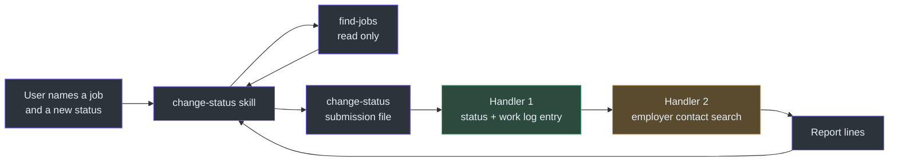
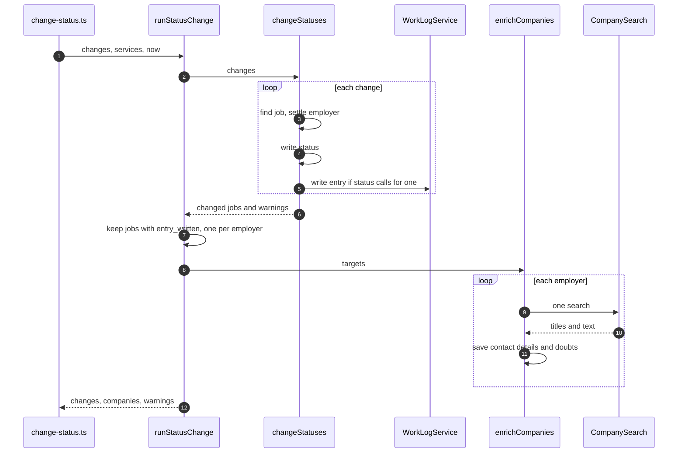
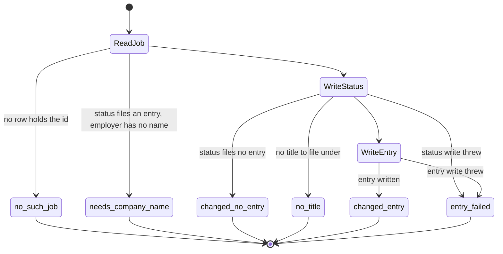
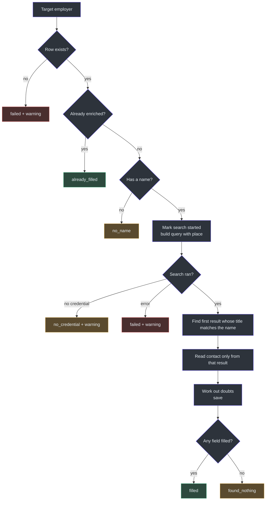

# Status Changes and the Work Log

## Overview

Everything else in this app runs inside a job search. A status change does not. It happens because the user says a job moved: they applied, had a phone screen, or had an interview. This is the first command that no job search starts ([scripts/change-status.ts:1-4](https://github.com/mablahblah/job-assistant/blob/main/scripts/change-status.ts#L1-L4)).

Three of those statuses matter in law. Each one files a **work log entry**, which is a record for the Texas Workforce Commission (TWC). The record cannot be rebuilt once its week has passed ([lib/handlers/status-change.ts:6-8](https://github.com/mablahblah/job-assistant/blob/main/lib/handlers/status-change.ts#L6-L8)). So the code is built around one rule: write the filing exactly once, or fail loudly enough that the user can act.

This page covers two commands and one skill. `find-jobs` finds the job the user means. `change-status` writes the status and the entry. The `change-status` skill drives both.

### At a glance

| Component | Responsibility | Key file | Source |
| --- | --- | --- | --- |
| `find-jobs` | Read-only lookup of jobs by link, else by employer name | `scripts/find-jobs.ts` | [find-jobs.ts:65-82](https://github.com/mablahblah/job-assistant/blob/main/scripts/find-jobs.ts#L65-L82) |
| `change-status` | Validates a submission file, then runs the orchestrator | `scripts/change-status.ts` | [change-status.ts:37-160](https://github.com/mablahblah/job-assistant/blob/main/scripts/change-status.ts#L37-L160) |
| `runStatusChange` | Calls the two handlers in a fixed order | `lib/orchestrators/status-change.ts` | [status-change.ts:43-93](https://github.com/mablahblah/job-assistant/blob/main/lib/orchestrators/status-change.ts#L43-L93) |
| `changeStatuses` | Writes each status and its work log entry | `lib/handlers/status-change.ts` | [status-change.ts:65-188](https://github.com/mablahblah/job-assistant/blob/main/lib/handlers/status-change.ts#L65-L188) |
| `enrichCompanies` | Searches for each employer's address, phone and website | `lib/handlers/enrichment.ts` | [enrichment.ts:54-186](https://github.com/mablahblah/job-assistant/blob/main/lib/handlers/enrichment.ts#L54-L186) |
| `activityFromStatus` | Maps a status to the TWC wording | `lib/utils/work-log-activity.ts` | [work-log-activity.ts:18-30](https://github.com/mablahblah/job-assistant/blob/main/lib/utils/work-log-activity.ts#L18-L30) |
| Work log service | The only writer of the work log table | `lib/services/work-log-service.ts` | [work-log-service.ts:34-58](https://github.com/mablahblah/job-assistant/blob/main/lib/services/work-log-service.ts#L34-L58) |
| Company search tool | One paid web search about an employer | `lib/tools/company-search.ts` | [company-search.ts:69-105](https://github.com/mablahblah/job-assistant/blob/main/lib/tools/company-search.ts#L69-L105) |

## The whole flow

<!-- Sources: .claude/skills/change-status/SKILL.md:22-84, lib/orchestrators/status-change.ts:57-86 -->

## Finding the job: `find-jobs`

The user has no job id. A person names a job by pasting its link or by saying who is hiring ([scripts/find-jobs.ts:1-6](https://github.com/mablahblah/job-assistant/blob/main/scripts/find-jobs.ts#L1-L6)). So this command turns those words into ids. It only reads. A search that matches nothing is a normal answer, not a failure ([find-jobs.ts:8-9](https://github.com/mablahblah/job-assistant/blob/main/scripts/find-jobs.ts#L8-L9)).

| Step | What happens | Source |
| --- | --- | --- |
| 1. Clean the link | The link is reduced to a match key the same way stored links were, so share-button tracking values do not block a match | [find-jobs.ts:110-116](https://github.com/mablahblah/job-assistant/blob/main/scripts/find-jobs.ts#L110-L116) |
| 2. Try the link | A link can point at one exact job, so it goes first. A match answers with `found_by: "link"` | [find-jobs.ts:71-77](https://github.com/mablahblah/job-assistant/blob/main/scripts/find-jobs.ts#L71-L77) |
| 3. Fall back to the employer | If the link matched nothing, the employer name part searches that employer's jobs. Answer: `found_by: "employer"` | [find-jobs.ts:79-81](https://github.com/mablahblah/job-assistant/blob/main/scripts/find-jobs.ts#L79-L81) |
| 4. Report the link problem | `link_problem` is `no_match`, `not_a_link` or `null` | [find-jobs.ts:18-19](https://github.com/mablahblah/job-assistant/blob/main/scripts/find-jobs.ts#L18-L19) |

The role is never searched in code. The agent reads the employer's jobs and picks the one the user's role words describe ([find-jobs.ts:4-6](https://github.com/mablahblah/job-assistant/blob/main/scripts/find-jobs.ts#L4-L6)). The skill says why: the user writes shorthand that no stored title contains ([SKILL.md:17](https://github.com/mablahblah/job-assistant/blob/main/.claude/skills/change-status/SKILL.md#L17)).

The `--statuses` flag narrows the search. The skill picks it from the status being set. For example, moving a job to `screening` searches only jobs already applied for ([SKILL.md:33-39](https://github.com/mablahblah/job-assistant/blob/main/.claude/skills/change-status/SKILL.md#L33-L39)). A trailing comma in the flag is dropped, and an empty flag means no narrowing ([find-jobs.ts:30-41](https://github.com/mablahblah/job-assistant/blob/main/scripts/find-jobs.ts#L30-L41)).

## Which statuses file an entry

The app accepts twelve statuses ([lib/utils/job-status.ts:24-41](https://github.com/mablahblah/job-assistant/blob/main/lib/utils/job-status.ts#L24-L41)). Only three write a work log entry. They are listed once, in `WORK_LOG_STATUSES` ([job-status.ts:49-53](https://github.com/mablahblah/job-assistant/blob/main/lib/utils/job-status.ts#L49-L53)). The statuses `test` and `offer` are active job states but are not filing activities ([job-status.ts:46-48](https://github.com/mablahblah/job-assistant/blob/main/lib/utils/job-status.ts#L46-L48)).

| Status the user sets | Wording filed with the TWC | Source |
| --- | --- | --- |
| `app. sent` | `Applied for job` | [work-log-activity.ts:19](https://github.com/mablahblah/job-assistant/blob/main/lib/utils/work-log-activity.ts#L19) |
| `screening` | `Had phone screen` | [work-log-activity.ts:20](https://github.com/mablahblah/job-assistant/blob/main/lib/utils/work-log-activity.ts#L20) |
| `interview` | `Had interview` | [work-log-activity.ts:21](https://github.com/mablahblah/job-assistant/blob/main/lib/utils/work-log-activity.ts#L21) |
| Any other status | No entry | [work-log-activity.ts:27-30](https://github.com/mablahblah/job-assistant/blob/main/lib/utils/work-log-activity.ts#L27-L30) |

The three phrases are fixed values. The TWC rejects a filing whose wording the form does not recognize ([work-log-activity.ts:1-4](https://github.com/mablahblah/job-assistant/blob/main/lib/utils/work-log-activity.ts#L1-L4)). The map is typed against the status list, so adding a status without wording fails to compile instead of silently writing nothing ([work-log-activity.ts:15-17](https://github.com/mablahblah/job-assistant/blob/main/lib/utils/work-log-activity.ts#L15-L17)).

The trigger is the status that arrives, not the path the job service took. A job going from backlog to `app. sent` takes a different service path than a job already active. Hooking the entry to a path would skip the first entry of nearly every job ([lib/handlers/status-change.ts:10-15](https://github.com/mablahblah/job-assistant/blob/main/lib/handlers/status-change.ts#L10-L15)).

## Why legal writes happen before searches

The orchestrator calls two handlers in a fixed order. Every status and every entry in the batch is written before the first search starts. The comment states the reason. Searches are slow and a time limit can cut them short. A command cut short should lose searches and never lose a filing ([lib/orchestrators/status-change.ts:4-13](https://github.com/mablahblah/job-assistant/blob/main/lib/orchestrators/status-change.ts#L4-L13)). Two handlers called in order make this structural rather than a comment someone can move.

<!-- Sources: lib/orchestrators/status-change.ts:57-92, lib/handlers/status-change.ts:65-188, lib/handlers/enrichment.ts:54-186 -->

### Per job: the order inside `applyChange`

| Order | Step | Why | Source |
| --- | --- | --- | --- |
| 1 | Read the job first | The job service would create a row for an unknown id and fail with a message about a missing column, which names the wrong fault. Reading first returns `no_such_job` | [status-change.ts:68-75](https://github.com/mablahblah/job-assistant/blob/main/lib/handlers/status-change.ts#L68-L75) |
| 2 | Settle the employer | A supplied name finds or creates that employer and links the job. The link is written first because an active job is frozen to everything but its status | [status-change.ts:85-106](https://github.com/mablahblah/job-assistant/blob/main/lib/handlers/status-change.ts#L85-L106) |
| 3 | Stop if the filing has no employer name | An entry naming a blank employer is the one thing the asking exists to prevent. The job keeps its old status | [status-change.ts:108-110](https://github.com/mablahblah/job-assistant/blob/main/lib/handlers/status-change.ts#L108-L110) |
| 4 | Write the status | Written before the entry | [status-change.ts:114-128](https://github.com/mablahblah/job-assistant/blob/main/lib/handlers/status-change.ts#L114-L128) |
| 5 | Write the entry | Employer name, job title and wording are copied onto the row | [status-change.ts:138-153](https://github.com/mablahblah/job-assistant/blob/main/lib/handlers/status-change.ts#L138-L153) |

No database transaction exists anywhere in this codebase, so nothing can undo either write. The protection is the order plus a failure the user can see ([status-change.ts:114-116](https://github.com/mablahblah/job-assistant/blob/main/lib/handlers/status-change.ts#L114-L116)).

The name check asks whether a usable name exists, not whether an employer is attached. Every hiring board the app polls creates an employer row with a slug and no name, so the obvious check would pass while the name is still blank ([status-change.ts:54-63](https://github.com/mablahblah/job-assistant/blob/main/lib/handlers/status-change.ts#L54-L63)).

### The work log service writes loudly

The work log service has no `try` block, on purpose. The trace service swallows a failed write and counts it, because losing a trace row costs less than losing a run. A work log row is a filing, so a failure must reach the caller ([work-log-service.ts:46-52](https://github.com/mablahblah/job-assistant/blob/main/lib/services/work-log-service.ts#L46-L52)). The entry stores the employer name and job title as plain copies, and the job id has no relation. A filing already made survives the job or employer changing or going away ([work-log-service.ts:4-8](https://github.com/mablahblah/job-assistant/blob/main/lib/services/work-log-service.ts#L4-L8)). Nothing revises an entry, so the service has no update ([work-log-service.ts:10-13](https://github.com/mablahblah/job-assistant/blob/main/lib/services/work-log-service.ts#L10-L13)). See [Services](../data/services.md).

### Outcomes

<!-- Sources: lib/handlers/status-change.ts:72-153, lib/types/changed-job.ts:8-13 -->

The outcome set is closed. A skill reads it to decide whether to come back and ask for an employer name ([lib/types/changed-job.ts:1-7](https://github.com/mablahblah/job-assistant/blob/main/lib/types/changed-job.ts#L1-L7)). The report builder fails to compile if an outcome has no printed line ([status-change-report.ts:39-44](https://github.com/mablahblah/job-assistant/blob/main/lib/utils/status-change-report.ts#L39-L44)). The two wordings "needs an employer name" and "no job holds that id" are fixed, because the skill must tell them apart ([status-change-report.ts:9-12](https://github.com/mablahblah/job-assistant/blob/main/lib/utils/status-change-report.ts#L9-L12)).

## Checking the submission before touching anything

`change-status` reads a JSON array from `--in`. A bad status anywhere refuses the whole submission before the database is opened. Half a batch landing is worse than none, because the user would have to work out which half ([change-status.ts:5-9](https://github.com/mablahblah/job-assistant/blob/main/scripts/change-status.ts#L5-L9), [change-status.ts:100-108](https://github.com/mablahblah/job-assistant/blob/main/scripts/change-status.ts#L100-L108)). Each refusal names the entry's position so a skill-written file can be fixed without counting ([change-status.ts:62-63](https://github.com/mablahblah/job-assistant/blob/main/scripts/change-status.ts#L62-L63)). The schema drift check then runs before any write ([change-status.ts:115-118](https://github.com/mablahblah/job-assistant/blob/main/scripts/change-status.ts#L115-L118)).

## The employer contact search

A TWC filing asks for an address, a phone number and a website. After the entries are safe, the second handler searches for them ([lib/handlers/enrichment.ts:1-7](https://github.com/mablahblah/job-assistant/blob/main/lib/handlers/enrichment.ts#L1-L7)).

<!-- Sources: lib/handlers/enrichment.ts:54-167 -->

| Rule | Why | Source |
| --- | --- | --- |
| Only jobs whose entry was written send their employer to the search | A job with no filing has no contact details to appear on | [orchestrator status-change.ts:65-69](https://github.com/mablahblah/job-assistant/blob/main/lib/orchestrators/status-change.ts#L65-L69) |
| One search per employer per batch | A search that found nothing leaves the employer open, so ten jobs at one unfindable employer would pay for ten searches | [orchestrator status-change.ts:72-84](https://github.com/mablahblah/job-assistant/blob/main/lib/orchestrators/status-change.ts#L72-L84) |
| Skip employers already filled in | The service is paid per search | [enrichment.ts:9-10](https://github.com/mablahblah/job-assistant/blob/main/lib/handlers/enrichment.ts#L9-L10), [enrichment.ts:73-82](https://github.com/mablahblah/job-assistant/blob/main/lib/handlers/enrichment.ts#L73-L82) |
| Never search a blank name | A query from a blank name matches every result and returns a stranger's address | [enrichment.ts:11-13](https://github.com/mablahblah/job-assistant/blob/main/lib/handlers/enrichment.ts#L11-L13) |
| Add the job's matched place to the query | A common employer name finds the wrong business on its own | [lib/utils/enrichment-query.ts:4-6](https://github.com/mablahblah/job-assistant/blob/main/lib/utils/enrichment-query.ts#L4-L6) |
| Match the name first, read values only from that result | Scanning every result for a value while checking the name on only the first could take an unrelated organization's address | [enrichment.ts:136-142](https://github.com/mablahblah/job-assistant/blob/main/lib/handlers/enrichment.ts#L136-L142) |
| A name matches when either string contains the other, and a blank never matches | An empty string is contained by every string | [lib/utils/enrichment-name-match.ts:19-26](https://github.com/mablahblah/job-assistant/blob/main/lib/utils/enrichment-name-match.ts#L19-L26) |
| A search that found nothing leaves the employer open | There is no permanently failed employer. It is asked about again next time | [company-service.ts:419-445](https://github.com/mablahblah/job-assistant/blob/main/lib/services/company-service.ts#L419-L445) |

### Doubts

After a search fills details in, the code raises **doubts**. A doubt is a detail worth checking before the user files. There are three ([lib/utils/enrichment-doubts.ts:19-23](https://github.com/mablahblah/job-assistant/blob/main/lib/utils/enrichment-doubts.ts#L19-L23)).

| Doubt | Raised when | Source |
| --- | --- | --- |
| `missing_address` | No address was found. The address is the field the form needs most | [enrichment-doubts.ts:41-42](https://github.com/mablahblah/job-assistant/blob/main/lib/utils/enrichment-doubts.ts#L41-L42) |
| `address_outside_us` | An address exists but has no state and ZIP pattern and no "United States" | [enrichment-doubts.ts:14](https://github.com/mablahblah/job-assistant/blob/main/lib/utils/enrichment-doubts.ts#L14), [enrichment-doubts.ts:43-45](https://github.com/mablahblah/job-assistant/blob/main/lib/utils/enrichment-doubts.ts#L43-L45) |
| `missing_phone` | No phone was found | [enrichment-doubts.ts:47-49](https://github.com/mablahblah/job-assistant/blob/main/lib/utils/enrichment-doubts.ts#L47-L49) |

A missing website raises nothing, because the form does not ask for one ([enrichment-doubts.ts:51](https://github.com/mablahblah/job-assistant/blob/main/lib/utils/enrichment-doubts.ts#L51)). A missing address and an outside-US address are one decision, since an absent address cannot also be foreign. The file notes that two of six measured employers returned no contact details at all, so doubts are an ordinary result ([enrichment-doubts.ts:5-7](https://github.com/mablahblah/job-assistant/blob/main/lib/utils/enrichment-doubts.ts#L5-L7)).

### The search tool

The tool wraps a paid Apify actor and returns only a title and a text snippet per result ([company-search.ts:42-58](https://github.com/mablahblah/job-assistant/blob/main/lib/tools/company-search.ts#L42-L58), [company-search.ts:99-102](https://github.com/mablahblah/job-assistant/blob/main/lib/tools/company-search.ts#L99-L102)). The token is read at call time from `APIFY_API_TOKEN`, and a missing one throws a dedicated `MissingSearchCredentialError` ([company-search.ts:72-77](https://github.com/mablahblah/job-assistant/blob/main/lib/tools/company-search.ts#L72-L77)). A separate error type lets the run say different things about a never-set credential and a failing service ([company-search.ts:32-34](https://github.com/mablahblah/job-assistant/blob/main/lib/tools/company-search.ts#L32-L34)). The call has a 60 second limit, handed to the service so it stops the paid run and not only our wait ([company-search.ts:27-30](https://github.com/mablahblah/job-assistant/blob/main/lib/tools/company-search.ts#L27-L30)). The actual call is injected, which keeps the tool testable without paying for a real search ([company-search.ts:19-25](https://github.com/mablahblah/job-assistant/blob/main/lib/tools/company-search.ts#L19-L25)). See [Testing](../quality/testing.md).

The search is awaited in full. The earlier code started it and never waited, and Node kills work still in flight at exit, so the lookup ran only some of the time ([change-status.ts:129-131](https://github.com/mablahblah/job-assistant/blob/main/scripts/change-status.ts#L129-L131)).

## The skill's four phases

| Phase | What the agent does | Source |
| --- | --- | --- |
| 1. Read the request | Split into one item per job. Match each status to one of the twelve. Stop if one matches none | [SKILL.md:22-29](https://github.com/mablahblah/job-assistant/blob/main/.claude/skills/change-status/SKILL.md#L22-L29) |
| 2. Find each job | Run `find-jobs`. Ask only if the result is empty or ambiguous. Never widen a search without asking | [SKILL.md:31-56](https://github.com/mablahblah/job-assistant/blob/main/.claude/skills/change-status/SKILL.md#L31-L56) |
| 3. Change the statuses | Write a scratch file and run `change-status` | [SKILL.md:58-70](https://github.com/mablahblah/job-assistant/blob/main/.claude/skills/change-status/SKILL.md#L58-L70) |
| 4. Finish held-back jobs | Ask the user for the employer name of any job that needed one, then run again naming only those jobs | [SKILL.md:72-84](https://github.com/mablahblah/job-assistant/blob/main/.claude/skills/change-status/SKILL.md#L72-L84) |

There is no dashboard page that announces a filing in this phase. The printed report is where the user learns a legal record exists ([change-status.ts:11-12](https://github.com/mablahblah/job-assistant/blob/main/scripts/change-status.ts#L11-L12)). The dashboard does have a work log view, covered in [The Read-Only Dashboard](../dashboard/dashboard.md).

No trace rows are written anywhere in this flow. A hand-made change is not a job passing through a pipeline step, and counting it would put work in the funnel that the pipeline never did ([lib/handlers/status-change.ts:17-19](https://github.com/mablahblah/job-assistant/blob/main/lib/handlers/status-change.ts#L17-L19)). That is why the report is built from handler results rather than from the shared run summary ([status-change-report.ts:5-7](https://github.com/mablahblah/job-assistant/blob/main/lib/utils/status-change-report.ts#L5-L7)). See [Tracing and the Run Summary](../architecture/tracing-and-run-summary.md).

## Related Pages

| Page | Relationship |
| --- | --- |
| [Services](../data/services.md) | The job, company and work log services this flow writes through |
| [Data Model](../data/data-model.md) | The job, company and work log tables |
| [The Read-Only Dashboard](../dashboard/dashboard.md) | Shows the work log grouped into weeks |
| [Scoring](scoring.md) | The other agent-driven workflow, built on the same orchestrator pattern |
| [Tracing and the Run Summary](../architecture/tracing-and-run-summary.md) | Why this flow has its own report instead |
| [Commands and Skills](../../getting-started/commands-and-skills.md) | `find-jobs` and `change-status` among all commands |

## References

- [scripts/find-jobs.ts](https://github.com/mablahblah/job-assistant/blob/main/scripts/find-jobs.ts)
- [scripts/change-status.ts](https://github.com/mablahblah/job-assistant/blob/main/scripts/change-status.ts)
- [lib/orchestrators/status-change.ts](https://github.com/mablahblah/job-assistant/blob/main/lib/orchestrators/status-change.ts)
- [lib/handlers/status-change.ts](https://github.com/mablahblah/job-assistant/blob/main/lib/handlers/status-change.ts)
- [lib/handlers/enrichment.ts](https://github.com/mablahblah/job-assistant/blob/main/lib/handlers/enrichment.ts)
- [lib/services/work-log-service.ts](https://github.com/mablahblah/job-assistant/blob/main/lib/services/work-log-service.ts)
- [lib/tools/company-search.ts](https://github.com/mablahblah/job-assistant/blob/main/lib/tools/company-search.ts)
- [.claude/skills/change-status/SKILL.md](https://github.com/mablahblah/job-assistant/blob/main/.claude/skills/change-status/SKILL.md)
