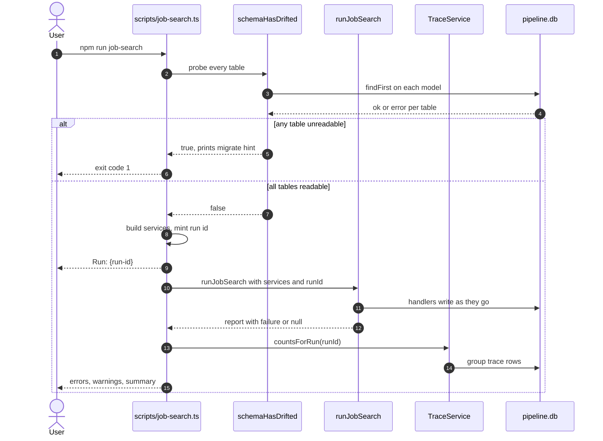
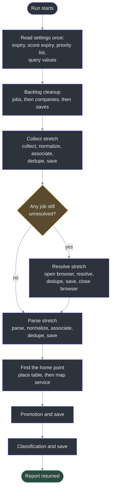
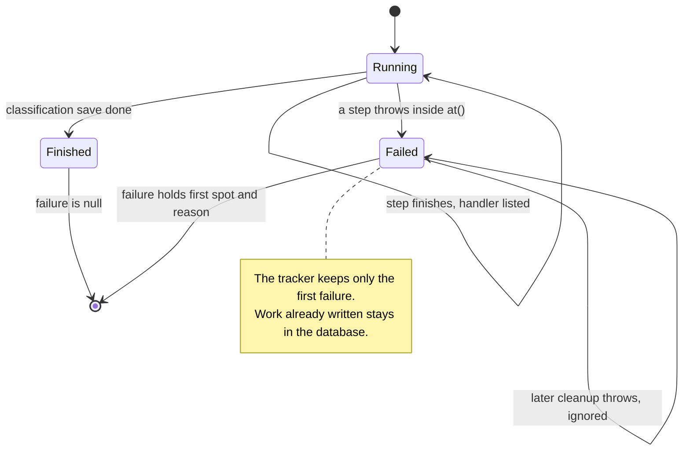

# The Job Search Run

## Overview

`npm run job-search` is one command that runs the whole deterministic pipeline. "Deterministic" means no agent has to judge anything while it runs. Scoring, which does need an agent, runs afterward through its own commands (see [Scoring](../agent-workflows/scoring.md)).

The run has two layers. A thin script, `scripts/job-search.ts`, builds what the run shares and prints the result. An orchestrator, `runJobSearch`, decides which handlers run and in what order. This split is stated in the script's first lines: "Which steps run, and in what order, is the orchestrator's to know rather than this script's" ([scripts/job-search.ts:1-3](https://github.com/mablahblah/job-assistant/blob/main/scripts/job-search.ts#L1-L3)).

The most important design choice is that every step ends in a database write. If a later step fails, the earlier steps have already saved their work. The orchestrator's header says so directly ([lib/orchestrators/job-search.ts:1-16](https://github.com/mablahblah/job-assistant/blob/main/lib/orchestrators/job-search.ts#L1-L16)).

| Component | Responsibility | Key file | Source |
|---|---|---|---|
| Script | Checks the database, builds services, mints the run id, prints results | `scripts/job-search.ts` | [scripts/job-search.ts:40-140](https://github.com/mablahblah/job-assistant/blob/main/scripts/job-search.ts#L40-L140) |
| Orchestrator | Calls every handler in order and turns a throw into a report | `lib/orchestrators/job-search.ts` | [lib/orchestrators/job-search.ts:151-667](https://github.com/mablahblah/job-assistant/blob/main/lib/orchestrators/job-search.ts#L151-L667) |
| Failure tracker | Names the spot a run stopped at and keeps the first failure | `lib/utils/run-failure.ts` | [lib/utils/run-failure.ts:18-39](https://github.com/mablahblah/job-assistant/blob/main/lib/utils/run-failure.ts#L18-L39) |
| Schema check | Refuses to start when the database does not match the code | `lib/db/schema-check.ts`, `lib/db/schema-drift.ts` | [lib/db/schema-drift.ts:17-28](https://github.com/mablahblah/job-assistant/blob/main/lib/db/schema-drift.ts#L17-L28) |
| Let-through handler | Sends hand-added jobs on to scoring when the pipeline cannot judge them. Not used by this orchestrator. | `lib/handlers/let-through.ts` | [lib/handlers/let-through.ts:68-103](https://github.com/mablahblah/job-assistant/blob/main/lib/handlers/let-through.ts#L68-L103) |

## The command, step by step

The script runs these actions in order ([scripts/job-search.ts:40-137](https://github.com/mablahblah/job-assistant/blob/main/scripts/job-search.ts#L40-L137)).

1. It reads the optional `--limit N` flag. A limit of 0 reaches no source at all, which is how the tests run the command without touching a job site ([scripts/job-search.ts:27-38](https://github.com/mablahblah/job-assistant/blob/main/scripts/job-search.ts#L27-L38)).
2. It opens the database and runs the schema check. If the check fails, it sets the exit code to 1 and returns before anything else ([scripts/job-search.ts:49-52](https://github.com/mablahblah/job-assistant/blob/main/scripts/job-search.ts#L49-L52)).
3. It builds the services and the geocoder ([scripts/job-search.ts:54-70](https://github.com/mablahblah/job-assistant/blob/main/scripts/job-search.ts#L54-L70)).
4. It mints a run id with `crypto.randomUUID()` and prints `Run: {run-id}` first. The scoring skill reads that line so it can file its own trace rows under the same run ([scripts/job-search.ts:73-76](https://github.com/mablahblah/job-assistant/blob/main/scripts/job-search.ts#L73-L76)).
5. It reads the clock once into `collectedAt`, so every job in a run shares one timestamp even when collection takes minutes ([scripts/job-search.ts:77-79](https://github.com/mablahblah/job-assistant/blob/main/scripts/job-search.ts#L77-L79)).
6. It calls `runJobSearch` ([scripts/job-search.ts:81-97](https://github.com/mablahblah/job-assistant/blob/main/scripts/job-search.ts#L81-L97)).
7. It prints errors, warnings, the failure if there is one, the trace failure count, and the summary ([scripts/job-search.ts:99-130](https://github.com/mablahblah/job-assistant/blob/main/scripts/job-search.ts#L99-L130)).
8. It sets the exit code to 1 if the run failed, and always disconnects from the database ([scripts/job-search.ts:132-139](https://github.com/mablahblah/job-assistant/blob/main/scripts/job-search.ts#L132-L139)).

<!-- Sources: scripts/job-search.ts:49-52, scripts/job-search.ts:73-76, scripts/job-search.ts:81-97, scripts/job-search.ts:123-130, lib/db/schema-drift.ts:17-28, lib/db/schema-check.ts:37-47 -->

### Why the schema check comes first

The check exists because of a real failure. A column was added to the schema but never pushed to the live database. Every trace write of that run failed, the trace service swallowed each one, and the whole run's history was lost without a word ([lib/db/schema-check.ts:1-11](https://github.com/mablahblah/job-assistant/blob/main/lib/db/schema-check.ts#L1-L11)).

The check does not compare column lists. It reads one row from each table. Prisma names every column it knows in the SELECT it builds, so a read that succeeds proves the database holds them all. Nothing in the check has to be kept in step with the schema by hand ([lib/db/schema-check.ts:7-11](https://github.com/mablahblah/job-assistant/blob/main/lib/db/schema-check.ts#L7-L11)). A test reads the list of checked models against `schema.prisma`, so the list cannot go stale unnoticed ([lib/db/schema-check.ts:21-33](https://github.com/mablahblah/job-assistant/blob/main/lib/db/schema-check.ts#L21-L33)).

Every probe runs, even after a failure, so one trip through the rebuild loop fixes every table ([lib/db/schema-check.ts:49-63](https://github.com/mablahblah/job-assistant/blob/main/lib/db/schema-check.ts#L49-L63)). On failure the user sees three lines: the mismatch, the tables that could not be read, and `Migrate it with: npm run db:migrate` ([lib/db/schema-drift.ts:24-26](https://github.com/mablahblah/job-assistant/blob/main/lib/db/schema-drift.ts#L24-L26)). More on this on [Database Commands and Safety](../data/database-commands.md).

## The pipeline order

The orchestrator runs three stretches after an opening cleanup. Each stretch ends with a save. The table lists every handler call. The "Handler label" is the name the orchestrator records in its finished list. The "Trace step" is the step name written on trace rows.

| # | Handler label | Handler | Trace step | Source |
|---|---|---|---|---|
| 1 | `backlog_cleanup` | `cleanBacklogJobs` | `backlog_cleanup` | [lib/orchestrators/job-search.ts:222-230](https://github.com/mablahblah/job-assistant/blob/main/lib/orchestrators/job-search.ts#L222-L230) |
| 2 | `backlog_cleanup_companies` | `cleanBacklogCompanies` | `backlog_cleanup` | [lib/orchestrators/job-search.ts:239-248](https://github.com/mablahblah/job-assistant/blob/main/lib/orchestrators/job-search.ts#L239-L248) |
| 3 | `backlog_cleanup_company_save` | `saveCompanies` | `post_backlog_cleanup_save` | [lib/orchestrators/job-search.ts:252-259](https://github.com/mablahblah/job-assistant/blob/main/lib/orchestrators/job-search.ts#L252-L259) |
| 4 | `post_backlog_cleanup_save` | `saveJobs` | `post_backlog_cleanup_save` | [lib/orchestrators/job-search.ts:262-271](https://github.com/mablahblah/job-assistant/blob/main/lib/orchestrators/job-search.ts#L262-L271) |
| 5 | `collection` | `collectJobs` | `collection` (set inside the handler) | [lib/orchestrators/job-search.ts:276-287](https://github.com/mablahblah/job-assistant/blob/main/lib/orchestrators/job-search.ts#L276-L287) |
| 6 | `post_collection_normalization` | `normalizeJobs` | same | [lib/orchestrators/job-search.ts:307-314](https://github.com/mablahblah/job-assistant/blob/main/lib/orchestrators/job-search.ts#L307-L314) |
| 7 | `post_collection_association` | `associateCompanies` | same | [lib/orchestrators/job-search.ts:320-328](https://github.com/mablahblah/job-assistant/blob/main/lib/orchestrators/job-search.ts#L320-L328) |
| 8 | `post_collection_dedupe` | `dedupeJobs` | same | [lib/orchestrators/job-search.ts:334-344](https://github.com/mablahblah/job-assistant/blob/main/lib/orchestrators/job-search.ts#L334-L344) |
| 9 | `post_collection_save` | `saveJobs` | same | [lib/orchestrators/job-search.ts:351-360](https://github.com/mablahblah/job-assistant/blob/main/lib/orchestrators/job-search.ts#L351-L360) |
| 10 | `resolution` | `resolveJobs` | same | [lib/orchestrators/job-search.ts:390-403](https://github.com/mablahblah/job-assistant/blob/main/lib/orchestrators/job-search.ts#L390-L403) |
| 11 | `post_resolution_dedupe` | `dedupeJobs` | same | [lib/orchestrators/job-search.ts:408-418](https://github.com/mablahblah/job-assistant/blob/main/lib/orchestrators/job-search.ts#L408-L418) |
| 12 | `post_resolution_save` | `saveJobs` | same | [lib/orchestrators/job-search.ts:424-433](https://github.com/mablahblah/job-assistant/blob/main/lib/orchestrators/job-search.ts#L424-L433) |
| 13 | `parsing` | `parseJobs` | same | [lib/orchestrators/job-search.ts:480-489](https://github.com/mablahblah/job-assistant/blob/main/lib/orchestrators/job-search.ts#L480-L489) |
| 14 | `post_parsing_normalization` | `normalizeJobs` | same | [lib/orchestrators/job-search.ts:507-514](https://github.com/mablahblah/job-assistant/blob/main/lib/orchestrators/job-search.ts#L507-L514) |
| 15 | `post_parsing_association` | `associateCompanies` | same | [lib/orchestrators/job-search.ts:517-525](https://github.com/mablahblah/job-assistant/blob/main/lib/orchestrators/job-search.ts#L517-L525) |
| 16 | `post_parsing_dedupe` | `dedupeJobs` | same | [lib/orchestrators/job-search.ts:528-538](https://github.com/mablahblah/job-assistant/blob/main/lib/orchestrators/job-search.ts#L528-L538) |
| 17 | `post_parsing_save` | `saveJobs` | same | [lib/orchestrators/job-search.ts:541-550](https://github.com/mablahblah/job-assistant/blob/main/lib/orchestrators/job-search.ts#L541-L550) |
| 18 | `promotion` | `promoteJobs` | same | [lib/orchestrators/job-search.ts:586-592](https://github.com/mablahblah/job-assistant/blob/main/lib/orchestrators/job-search.ts#L586-L592) |
| 19 | `post_promotion_save` | `saveJobs` | same | [lib/orchestrators/job-search.ts:594-603](https://github.com/mablahblah/job-assistant/blob/main/lib/orchestrators/job-search.ts#L594-L603) |
| 20 | `classification` | `classifyJobs` | same | [lib/orchestrators/job-search.ts:612-625](https://github.com/mablahblah/job-assistant/blob/main/lib/orchestrators/job-search.ts#L612-L625) |
| 21 | `post_classification_save` | `saveJobs` | same | [lib/orchestrators/job-search.ts:627-636](https://github.com/mablahblah/job-assistant/blob/main/lib/orchestrators/job-search.ts#L627-L636) |

For rows 2 and 3, the label is not a trace step, as the comment on `FinishedHandler.step` says ([lib/orchestrators/job-search.ts:47-51](https://github.com/mablahblah/job-assistant/blob/main/lib/orchestrators/job-search.ts#L47-L51)). The trace step is passed separately as `backlog_cleanup` and `post_backlog_cleanup_save`. The label is only used for the "Finished before it stopped" list.

<!-- Sources: lib/orchestrators/job-search.ts:192-216, lib/orchestrators/job-search.ts:222-272, lib/orchestrators/job-search.ts:276-361, lib/orchestrators/job-search.ts:369-457, lib/orchestrators/job-search.ts:464-551, lib/orchestrators/job-search.ts:558-637 -->

## Each stretch in detail

### Settings read once

Before any handler runs, the orchestrator reads the settings the whole run shares. It reads the expiry threshold, the two score-expiry limits, the source priority list and the identifying query values ([lib/orchestrators/job-search.ts:188-216](https://github.com/mablahblah/job-assistant/blob/main/lib/orchestrators/job-search.ts#L188-L216)). The reason is consistency. Backlog cleanup, promotion and classification all judge age. A run where they disagreed about what counts as expired would contradict itself ([lib/orchestrators/job-search.ts:189-191](https://github.com/mablahblah/job-assistant/blob/main/lib/orchestrators/job-search.ts#L189-L191)).

A missing setting throws, because the settings service throws on a missing value. The title vocabularies are read after collection but before the handlers that use them, "deliberately", so a missing vocabulary stops the whole run instead of looking like one handler failing ([lib/orchestrators/job-search.ts:294-302](https://github.com/mablahblah/job-assistant/blob/main/lib/orchestrators/job-search.ts#L294-L302)).

### Backlog cleanup opens the run

Cleanup runs first so the backlog that collection is about to add to has already been swept ([lib/orchestrators/job-search.ts:218-221](https://github.com/mablahblah/job-assistant/blob/main/lib/orchestrators/job-search.ts#L218-L221)). It has a job half and a company half. The company half empties stale employer scores, and the orchestrator copies the two counts into the report ([lib/orchestrators/job-search.ts:249-250](https://github.com/mablahblah/job-assistant/blob/main/lib/orchestrators/job-search.ts#L249-L250)).

### The collect stretch

Collection takes no list. It builds the first one from the collectors and returns jobs, errors and warnings ([lib/orchestrators/job-search.ts:276-292](https://github.com/mablahblah/job-assistant/blob/main/lib/orchestrators/job-search.ts#L276-L292)). The orchestrator then runs normalization, association, dedupe and save over the same list. See [Collection](../pipeline/collection.md), [Normalization and Association](../pipeline/normalization-and-association.md) and [Dedupe and Save](../pipeline/dedupe-and-save.md).

### The resolution stretch

This stretch takes nothing from the collect stretch. It asks the database for every job still needing a source link, whenever it was collected. That means it also picks up jobs from earlier runs ([lib/orchestrators/job-search.ts:364-369](https://github.com/mablahblah/job-assistant/blob/main/lib/orchestrators/job-search.ts#L364-L369)).

If the list is empty, no browser is launched. A headed browser holds the machine for as long as it runs, so an empty list must never reach the launch ([lib/orchestrators/job-search.ts:371-373](https://github.com/mablahblah/job-assistant/blob/main/lib/orchestrators/job-search.ts#L371-L373)). The three pacing settings are read before the browser opens, so a missing setting costs no browser ([lib/orchestrators/job-search.ts:374-386](https://github.com/mablahblah/job-assistant/blob/main/lib/orchestrators/job-search.ts#L374-L386)).

The browser is closed in a `finally` block under its own name, `browser_close`. A browser that will not shut is then reported as that, not as whatever ran before it ([lib/orchestrators/job-search.ts:451-456](https://github.com/mablahblah/job-assistant/blob/main/lib/orchestrators/job-search.ts#L451-L456)). After the save, the resolved list is merged into the report by job id. The later version wins because its fields are newer. A job without an id is appended, because two jobs without ids are two jobs ([lib/orchestrators/job-search.ts:436-450](https://github.com/mablahblah/job-assistant/blob/main/lib/orchestrators/job-search.ts#L436-L450)). See [Resolution](../pipeline/resolution.md).

### The parsing stretch

Parsing also reads its own list: jobs already resolved but not yet parsed ([lib/orchestrators/job-search.ts:459-464](https://github.com/mablahblah/job-assistant/blob/main/lib/orchestrators/job-search.ts#L459-L464)). It has no length check, because "five handlers over an empty list cost nothing". It opens a browser lazily, only on the first page a parser asks to be rendered, and reuses that session. The browser closes in a `finally`, but only if one was opened ([lib/orchestrators/job-search.ts:466-501](https://github.com/mablahblah/job-assistant/blob/main/lib/orchestrators/job-search.ts#L466-L501)).

Normalization runs before association here. Association matches on the cleaned company name, and normalization is what cleans it. Running association first would split one employer across two company rows ([lib/orchestrators/job-search.ts:504-506](https://github.com/mablahblah/job-assistant/blob/main/lib/orchestrators/job-search.ts#L504-L506)). See [Parsing](../pipeline/parsing.md).

### The home point, promotion and classification

Before promotion, the orchestrator settles the point every job is measured against. It reads the location and radius settings, looks the location text up in the place table, and only asks the map service when the table has never seen it ([lib/orchestrators/job-search.ts:553-575](https://github.com/mablahblah/job-assistant/blob/main/lib/orchestrators/job-search.ts#L553-L575)). If the location cannot be placed, the run stops, "because measuring against nothing would mark every job as not matching" ([lib/orchestrators/job-search.ts:555-557](https://github.com/mablahblah/job-assistant/blob/main/lib/orchestrators/job-search.ts#L555-L557)). This happens after parsing has been saved, so parsing's work survives.

Promotion runs near the end, not at the start. An expired job only earns a fresh date once collection has found the new listing and dedupe has merged it in ([lib/orchestrators/job-search.ts:579-581](https://github.com/mablahblah/job-assistant/blob/main/lib/orchestrators/job-search.ts#L579-L581)). Classification reads its list after promotion's save, so jobs returned to the backlog are judged by this run ([lib/orchestrators/job-search.ts:606-610](https://github.com/mablahblah/job-assistant/blob/main/lib/orchestrators/job-search.ts#L606-L610)). See [Judging Steps](../pipeline/judging-steps.md).

## Failure handling

A throw anywhere in the chain stops the run where it happened. It does not escape to the caller. One `try` and one empty `catch` wrap the body ([lib/orchestrators/job-search.ts:188-658](https://github.com/mablahblah/job-assistant/blob/main/lib/orchestrators/job-search.ts#L188-L658)). The catch is empty on purpose. It has nothing to read off the throw, because the failure tracker already named the spot and wrote the reason on the way past ([lib/orchestrators/job-search.ts:653-657](https://github.com/mablahblah/job-assistant/blob/main/lib/orchestrators/job-search.ts#L653-L657)).

<!-- Sources: lib/utils/run-failure.ts:18-39, lib/orchestrators/job-search.ts:163-186, lib/orchestrators/job-search.ts:653-666 -->

### The failure tracker

Every lookup and handler call goes through a wrapper named `at(spot, run)`. If `run` throws, `at` records the spot and the reason, then re-throws ([lib/utils/run-failure.ts:23-33](https://github.com/mablahblah/job-assistant/blob/main/lib/utils/run-failure.ts#L23-L33)). The tracker keeps only the first failure it sees, using `failure ??= ...` ([lib/utils/run-failure.ts:30](https://github.com/mablahblah/job-assistant/blob/main/lib/utils/run-failure.ts#L30)).

This is a bug fix recorded in the file's header. Three runners had each kept their own copy, and two of them overwrote the first failure with the last one. Cleanup runs after the thing it cleans up after. A browser that will not shut throws second and would bury the reason the run actually stopped ([lib/utils/run-failure.ts:1-6](https://github.com/mablahblah/job-assistant/blob/main/lib/utils/run-failure.ts#L1-L6)).

The spot name is passed in as text, not tracked in a variable. A handler added later cannot be reported under the last handler's name ([lib/orchestrators/job-search.ts:163-168](https://github.com/mablahblah/job-assistant/blob/main/lib/orchestrators/job-search.ts#L163-L168)).

### What the report holds

| Field | Meaning | Source |
|---|---|---|
| `jobs` | Every job the run acted on, joined across stretches | [lib/orchestrators/job-search.ts:74](https://github.com/mablahblah/job-assistant/blob/main/lib/orchestrators/job-search.ts#L74) |
| `companyScoresCleared`, `companyGuessesCleared` | How many companies lost all four scores, and how many lost only guessed ones | [lib/orchestrators/job-search.ts:75-78](https://github.com/mablahblah/job-assistant/blob/main/lib/orchestrators/job-search.ts#L75-L78) |
| `errors`, `warnings` | Collection issues the user needs to see | [lib/orchestrators/job-search.ts:79-80](https://github.com/mablahblah/job-assistant/blob/main/lib/orchestrators/job-search.ts#L79-L80) |
| `handlers` | One entry per handler that finished, in order. A handler that threw has no entry. | [lib/orchestrators/job-search.ts:81-84](https://github.com/mablahblah/job-assistant/blob/main/lib/orchestrators/job-search.ts#L81-L84) |
| `failure` | Where the run stopped and why, or `null`. Always present. | [lib/orchestrators/job-search.ts:85-88](https://github.com/mablahblah/job-assistant/blob/main/lib/orchestrators/job-search.ts#L85-L88) |
| `traceFailures` | How many trace writes the run lost. Always present, `0` when nothing failed. | [lib/orchestrators/job-search.ts:89-92](https://github.com/mablahblah/job-assistant/blob/main/lib/orchestrators/job-search.ts#L89-L92) |

### What a stopped run keeps

| Stopped at | Already in the database | Not done |
|---|---|---|
| A settings read | Nothing from this run | Everything |
| Collection | The backlog cleanup writes | Normalization onward |
| Resolution | Collect stretch saved | Dedupe, save and parsing for resolution |
| Home location | Parse stretch saved | Promotion and classification |
| Classification | Everything up to promotion's save | Classification save |

This table is inferred from the order of writes in the code, not from a test. The statement it rests on is in the header: "Every step has already written to the database by the time a later one can fail" ([lib/orchestrators/job-search.ts:13-16](https://github.com/mablahblah/job-assistant/blob/main/lib/orchestrators/job-search.ts#L13-L16)).

### What the script prints on failure

When `report.failure` is set, the script prints `Run stopped at {spot}: {reason}`, then `Finished before it stopped:` and one line per finished handler with its entry count. This list is printed only on failure, because a clean run has no question to answer about which steps got that far ([scripts/job-search.ts:102-111](https://github.com/mablahblah/job-assistant/blob/main/scripts/job-search.ts#L102-L111)). The summary still prints afterward, because the trace rows are already written. The block the run died in is marked `stopped early` ([scripts/job-search.ts:123-130](https://github.com/mablahblah/job-assistant/blob/main/scripts/job-search.ts#L123-L130)). See [Tracing and the Run Summary](./tracing-and-run-summary.md).

### Lost trace rows

A trace write that fails is counted and never thrown. The trace service increments a counter and carries on ([lib/services/trace-service.ts:136-143](https://github.com/mablahblah/job-assistant/blob/main/lib/services/trace-service.ts#L136-L143)). The orchestrator reads that count once the run is over, whether it finished or stopped, and puts it in the report ([lib/orchestrators/job-search.ts:660-663](https://github.com/mablahblah/job-assistant/blob/main/lib/orchestrators/job-search.ts#L660-L663)). The script prints `Trace failures: {n}` when it is above zero ([scripts/job-search.ts:113-115](https://github.com/mablahblah/job-assistant/blob/main/scripts/job-search.ts#L113-L115)).

## The let-through handler

`lib/handlers/let-through.ts` is not part of the job search. The add-external-jobs orchestrator calls it at two positions ([lib/orchestrators/add-external-jobs.ts:217-218](https://github.com/mablahblah/job-assistant/blob/main/lib/orchestrators/add-external-jobs.ts#L217-L218), [lib/orchestrators/add-external-jobs.ts:243-244](https://github.com/mablahblah/job-assistant/blob/main/lib/orchestrators/add-external-jobs.ts#L243-L244)). A hand-added job often cannot be judged. It has no listing page to resolve and no location text to check. Without a rule, such a job would stay stuck, so the handler lets it through to scoring and records why ([lib/handlers/let-through.ts:1-5](https://github.com/mablahblah/job-assistant/blob/main/lib/handlers/let-through.ts#L1-L5)).

| Position (`after`) | Condition | What changes | Trace reason | Source |
|---|---|---|---|---|
| `parsing` | Job status is `unparseable` | Status becomes `backlog`, and `is_resolved`, `is_parsed`, `is_classified` become true | `no_location` | [lib/handlers/let-through.ts:38-47](https://github.com/mablahblah/job-assistant/blob/main/lib/handlers/let-through.ts#L38-L47) |
| `classification` | Still in the backlog and `is_classified` is not true | `is_classified` becomes true. The job stays in the backlog. | `location_unusable` | [lib/handlers/let-through.ts:51-61](https://github.com/mablahblah/job-assistant/blob/main/lib/handlers/let-through.ts#L51-L61) |

It writes the event `job_let_through` ([lib/handlers/let-through.ts:21](https://github.com/mablahblah/job-assistant/blob/main/lib/handlers/let-through.ts#L21)). It returns a copy of each job and never changes the one handed in ([lib/handlers/let-through.ts:32-33](https://github.com/mablahblah/job-assistant/blob/main/lib/handlers/let-through.ts#L32-L33)). A job without an id or a collector is let through silently, because a trace row is keyed by both ([lib/handlers/let-through.ts:82-84](https://github.com/mablahblah/job-assistant/blob/main/lib/handlers/let-through.ts#L82-L84)). The two trace step names, `post_parsing_let_through` and `post_classification_let_through`, are documented in the Trace model comment ([prisma/schema.prisma:372-378](https://github.com/mablahblah/job-assistant/blob/main/prisma/schema.prisma#L372-L378)). See [External Jobs and Resumes](../agent-workflows/external-jobs-and-resumes.md).

## Contradictions found

| Source | Says | Code says |
|---|---|---|
| `docs/architecture.md`, "The collection step" | Seven collectors produce the job list | The collector registry lists 14 collectors ([lib/collectors/registry.ts:19-34](https://github.com/mablahblah/job-assistant/blob/main/lib/collectors/registry.ts#L19-L34)) |
| `docs/architecture.md`, "The parsing step" | Four parsers exist, and a job whose domain none owns is set aside as `unparseable` | The parser registry maps 11 owned domains to dedicated parsers ([lib/parsers/registry.ts:37-49](https://github.com/mablahblah/job-assistant/blob/main/lib/parsers/registry.ts#L37-L49)), and any other web link goes to the general parser ([lib/parsers/registry.ts:72-75](https://github.com/mablahblah/job-assistant/blob/main/lib/parsers/registry.ts#L72-L75)). See [Parsing](../pipeline/parsing.md). |
| `lib/orchestrators/job-search.ts:47-51` | `FinishedHandler.step` is the `Trace.step` name | For the two company cleanup handlers the label differs from the trace step |

## Related Pages

| Page | Relationship |
|---|---|
| [System Design](./system-design.md) | The handler contract and ownership rules this run follows |
| [Tracing and the Run Summary](./tracing-and-run-summary.md) | How trace rows from this run become the printed summary |
| [Database Commands and Safety](../data/database-commands.md) | The schema check and the migrate command it points to |
| [Services](../data/services.md) | The services the script builds and hands in |
| [Collection](../pipeline/collection.md) | The first handler in the run |
| [Judging Steps](../pipeline/judging-steps.md) | Backlog cleanup, promotion and classification |
| [Commands and Skills](../../getting-started/commands-and-skills.md) | How this command fits with the skills around it |

## References

- [scripts/job-search.ts:1-145](https://github.com/mablahblah/job-assistant/blob/main/scripts/job-search.ts#L1-L145) - the command
- [lib/orchestrators/job-search.ts:1-667](https://github.com/mablahblah/job-assistant/blob/main/lib/orchestrators/job-search.ts#L1-L667) - the orchestrator
- [lib/orchestrators/add-external-jobs.ts:1-50](https://github.com/mablahblah/job-assistant/blob/main/lib/orchestrators/add-external-jobs.ts#L1-L50) - the other runner, which uses let-through
- [lib/handlers/let-through.ts:1-103](https://github.com/mablahblah/job-assistant/blob/main/lib/handlers/let-through.ts#L1-L103) - let-through
- [lib/db/schema-check.ts:1-63](https://github.com/mablahblah/job-assistant/blob/main/lib/db/schema-check.ts#L1-L63) - the table probes
- [lib/db/schema-drift.ts:1-28](https://github.com/mablahblah/job-assistant/blob/main/lib/db/schema-drift.ts#L1-L28) - the message and the stop
- [lib/utils/run-failure.ts:1-39](https://github.com/mablahblah/job-assistant/blob/main/lib/utils/run-failure.ts#L1-L39) - the failure tracker
- [lib/services/trace-service.ts:115-148](https://github.com/mablahblah/job-assistant/blob/main/lib/services/trace-service.ts#L115-L148) - write and failure count
