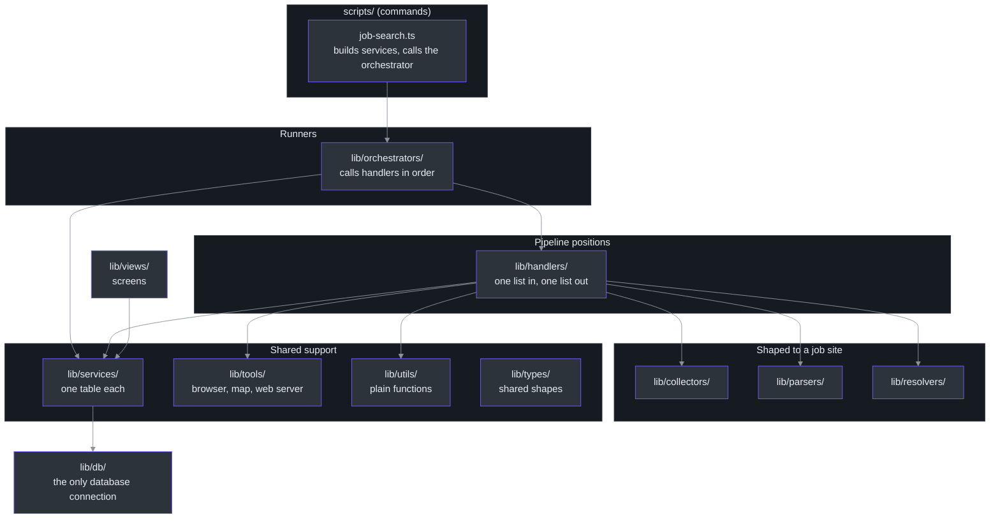
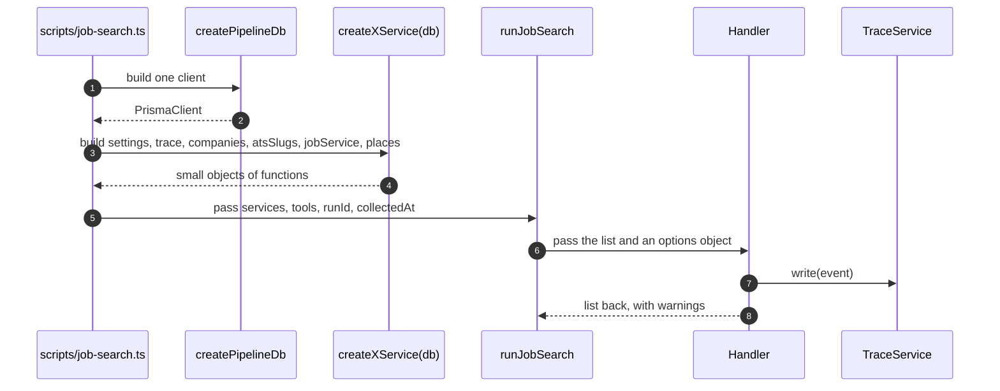
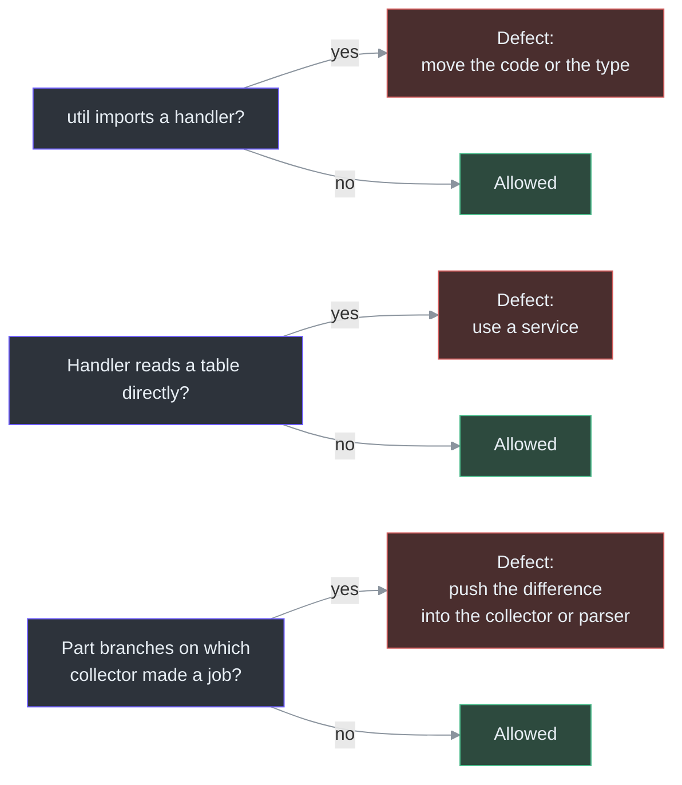

# System Design

## Overview

This app is one pipeline. The only code written to fit a particular job site is the collectors and the parsers. Everything else acts on a job's data and cannot tell where the job came from. That one idea explains the whole folder layout.

The code is sorted by the kind of thing each file is, not by feature. A file in `lib/` always sits in a folder named for its kind. `lib/` holds no loose file of its own ([.claude/rules/naming.md:9](https://github.com/mablahblah/job-assistant/blob/main/.claude/rules/naming.md#L9)). This makes a new rule easy to place: you ask "what kind of part is this?" and the answer is the folder.

Each kind has a short rule file in `.claude/rules/`. Those rules are the source for most of this page. Where a rule says something the code can check, this page cites the code as well.

| Concept | What it means in plain words | Where it is defined | Source |
|---|---|---|---|
| Part kind | A category of code with one job: collector, handler, service, and so on | `lib/{kind}/` folders | [.claude/rules/naming.md:11-23](https://github.com/mablahblah/job-assistant/blob/main/.claude/rules/naming.md#L11-L23) |
| Handler | Code that runs at one position in the pipeline and works on a whole list | `lib/handlers/` | [.claude/rules/handler-contract.md:9](https://github.com/mablahblah/job-assistant/blob/main/.claude/rules/handler-contract.md#L9) |
| Orchestrator | The runner that calls handlers in order and hands each one what it needs | `lib/orchestrators/` | [lib/orchestrators/job-search.ts:151](https://github.com/mablahblah/job-assistant/blob/main/lib/orchestrators/job-search.ts#L151) |
| Service | A small object that owns one table or one row | `lib/services/` | [.claude/rules/services.md:7](https://github.com/mablahblah/job-assistant/blob/main/.claude/rules/services.md#L7) |
| Tool | A wrapper around something outside the app, such as a browser | `lib/tools/` | [.claude/rules/tools.md:7](https://github.com/mablahblah/job-assistant/blob/main/.claude/rules/tools.md#L7) |
| Util | A plain function that takes values and returns values | `lib/utils/` | [.claude/rules/utils.md:7](https://github.com/mablahblah/job-assistant/blob/main/.claude/rules/utils.md#L7) |

## The folder map

Eleven folders make up `lib/`. The table lists each one with what it holds. The "never does" column comes from the ownership rules.

<!-- Sources: .claude/rules/naming.md:11-23, scripts/job-search.ts:54-97, lib/orchestrators/job-search.ts:151-186, lib/db/pipeline-db.ts:14-18 -->

The arrows show who calls whom. Two arrows deserve a note. Handlers reach the database only through services, and services reach it only through the client they are built from. Only `lib/db/` builds a database connection ([.claude/rules/naming.md:25](https://github.com/mablahblah/job-assistant/blob/main/.claude/rules/naming.md#L25)).

| Folder | Holds | Example file | Source |
|---|---|---|---|
| `lib/collectors/` | Code that pulls a raw job list from one source | `lib/collectors/registry.ts` | [.claude/rules/naming.md:13](https://github.com/mablahblah/job-assistant/blob/main/.claude/rules/naming.md#L13) |
| `lib/db/` | The database connection, its environment variable, and the schema check | `lib/db/pipeline-db.ts` | [.claude/rules/naming.md:14](https://github.com/mablahblah/job-assistant/blob/main/.claude/rules/naming.md#L14) |
| `lib/handlers/` | Code that runs at one pipeline position | `lib/handlers/save.ts` | [.claude/rules/naming.md:15](https://github.com/mablahblah/job-assistant/blob/main/.claude/rules/naming.md#L15) |
| `lib/orchestrators/` | The runner that calls every handler in order | `lib/orchestrators/job-search.ts` | [.claude/rules/naming.md:16](https://github.com/mablahblah/job-assistant/blob/main/.claude/rules/naming.md#L16) |
| `lib/parsers/` | Code that reads one source's job posting | `lib/parsers/registry.ts` | [.claude/rules/naming.md:17](https://github.com/mablahblah/job-assistant/blob/main/.claude/rules/naming.md#L17) |
| `lib/resolvers/` | Code that follows a job link toward its source posting | `lib/resolvers/resolve-job-url.ts` | [.claude/rules/naming.md:18](https://github.com/mablahblah/job-assistant/blob/main/.claude/rules/naming.md#L18) |
| `lib/services/` | Code that owns one table or one row | `lib/services/job-service.ts` | [.claude/rules/naming.md:19](https://github.com/mablahblah/job-assistant/blob/main/.claude/rules/naming.md#L19) |
| `lib/tools/` | Wrappers around something outside the app, and their interfaces | `lib/tools/geocoder.ts` | [.claude/rules/naming.md:20](https://github.com/mablahblah/job-assistant/blob/main/.claude/rules/naming.md#L20) |
| `lib/types/` | Shapes shared across folders, with no logic | `lib/types/job-list-entry.ts` | [.claude/rules/naming.md:21](https://github.com/mablahblah/job-assistant/blob/main/.claude/rules/naming.md#L21) |
| `lib/utils/` | Plain functions taking values and returning values | `lib/utils/job-status.ts` | [.claude/rules/naming.md:22](https://github.com/mablahblah/job-assistant/blob/main/.claude/rules/naming.md#L22) |
| `lib/views/` | Code that turns data into a screen | see [Dashboard](../dashboard/dashboard.md) | [.claude/rules/naming.md:23](https://github.com/mablahblah/job-assistant/blob/main/.claude/rules/naming.md#L23) |

The kind of a file is decided by what it does, not by who calls it ([.claude/rules/naming.md:9](https://github.com/mablahblah/job-assistant/blob/main/.claude/rules/naming.md#L9)). A util read by only one folder still lives in `lib/utils/` ([.claude/rules/utils.md:11](https://github.com/mablahblah/job-assistant/blob/main/.claude/rules/utils.md#L11)).

## What each kind owns and never does

The ownership table is the center of the design. Each row gives a part one job and names the one thing it must never do. The "never" column is what keeps parts from growing into each other.

| Part | Owns | Never does | Source |
|---|---|---|---|
| Collector | Gathers raw jobs and every field its source gives for free. Writes each into a `raw_` field exactly as it arrived. | Interpret anything. | [.claude/rules/part-ownership.md:33](https://github.com/mablahblah/job-assistant/blob/main/.claude/rules/part-ownership.md#L33) |
| Normalizer | Reshapes raw data that is already there into the fields that matter. | Go looking. An empty `raw_` field stays empty. | [.claude/rules/part-ownership.md:34](https://github.com/mablahblah/job-assistant/blob/main/.claude/rules/part-ownership.md#L34) |
| Resolver | Follows a job's link to the employer's own posting. | Read anything off the page it lands on. | [.claude/rules/part-ownership.md:35](https://github.com/mablahblah/job-assistant/blob/main/.claude/rules/part-ownership.md#L35) |
| Parser | Makes the final attempt at filling `raw_` fields, including reading a salary out of the description. | Format what it extracts. | [.claude/rules/part-ownership.md:36](https://github.com/mablahblah/job-assistant/blob/main/.claude/rules/part-ownership.md#L36) |
| Company association | Decides which employer a job belongs to, and creates one if none exists. | Invent a name from a board slug, or a slug from a name. | [.claude/rules/part-ownership.md:37](https://github.com/mablahblah/job-assistant/blob/main/.claude/rules/part-ownership.md#L37) |
| Dedupe | Reduces the job list using identity tests that have all their fields on both sides. | Merge two jobs when no test has the fields it needs. | [.claude/rules/part-ownership.md:38](https://github.com/mablahblah/job-assistant/blob/main/.claude/rules/part-ownership.md#L38) |
| Save | Creates, updates and deletes rows, and owns the merge rule every caller shares. | Decide which employer a job belongs to. | [.claude/rules/part-ownership.md:39](https://github.com/mablahblah/job-assistant/blob/main/.claude/rules/part-ownership.md#L39) |
| Classification | Judgements about the job: is the location a match, has it expired. | Reshape a value or go looking for a missing one. | [.claude/rules/part-ownership.md:40](https://github.com/mablahblah/job-assistant/blob/main/.claude/rules/part-ownership.md#L40) |
| Scoring | Alignment, employer scores, and promoting an employer to be watched directly. | Reach the database except through the services that own each table. | [.claude/rules/part-ownership.md:41](https://github.com/mablahblah/job-assistant/blob/main/.claude/rules/part-ownership.md#L41) |
| Backlog cleanup | Expires a backlog job once it passes the age limit, and empties an employer's scores once they pass their own age limit, guessed scores sooner. | Delete a job or an employer. | [.claude/rules/part-ownership.md:42](https://github.com/mablahblah/job-assistant/blob/main/.claude/rules/part-ownership.md#L42) |

### Reshaping versus going looking

The line between a normalizer and a parser is the most useful test in the design. Reshaping changes a value that is already there. Going looking produces a value that is not. If a field is empty and something has to find it, that is a parser's job, wherever it happens ([.claude/rules/part-ownership.md:48-50](https://github.com/mablahblah/job-assistant/blob/main/.claude/rules/part-ownership.md#L48-L50)). This is why a parser hands its findings back to the normalizer instead of formatting them. See [Parsing](../pipeline/parsing.md) and [Normalization and Association](../pipeline/normalization-and-association.md).

### Seven jobs that exist exactly once

Seven jobs have one implementation each: removing duplicates, saving and updating, following a job's link to its source, tidying names, matching a location against the user's own, clearing out the backlog, and recording what happened ([.claude/rules/part-ownership.md:13-17](https://github.com/mablahblah/job-assistant/blob/main/.claude/rules/part-ownership.md#L13-L17)). A second implementation is a defect, not a variation. The reason is practical. If dedupe existed twice, the two copies would drift, and one job could be a duplicate in one place and unique in another.

### Who sets a status

A step sets only the status that names its own outcome ([.claude/rules/part-ownership.md:44-46](https://github.com/mablahblah/job-assistant/blob/main/.claude/rules/part-ownership.md#L44-L46)).

| Step | Status it sets |
|---|---|
| Resolution | `unresolvable` |
| Parser | `unparseable`, or `expired` for a dead page |
| Classification | `too far`, or `expired` for an old posting |
| Backlog cleanup | `expired` |
| Promotion, and letting an added job through | `backlog` |
| A status change by hand | whatever the user chose |

The twelve valid statuses live in one list in code ([lib/utils/job-status.ts:24-37](https://github.com/mablahblah/job-assistant/blob/main/lib/utils/job-status.ts#L24-L37)). See [Data Model](../data/data-model.md) for what the statuses mean.

## The handler contract

A handler is the unit of work in the pipeline. The contract keeps every handler the same shape, so the orchestrator can call them all the same way.

| Rule | Plain meaning | Source |
|---|---|---|
| Takes a list, acts on every entry, returns that list | Handlers work on whole lists, not single jobs | [.claude/rules/handler-contract.md:9](https://github.com/mablahblah/job-assistant/blob/main/.claude/rules/handler-contract.md#L9) |
| The list comes back as `jobs` or `companies`, never both | One result carries one list, so a count is never ambiguous | [.claude/rules/handler-contract.md:11](https://github.com/mablahblah/job-assistant/blob/main/.claude/rules/handler-contract.md#L11) |
| Runs once per position, never inside another handler's loop | Loops belong to the orchestrator | [.claude/rules/handler-contract.md:13](https://github.com/mablahblah/job-assistant/blob/main/.claude/rules/handler-contract.md#L13) |
| Per-entry work lives in a helper | `normalizeJob` does one job. `normalizeJobs` is the handler. | [.claude/rules/handler-contract.md:15](https://github.com/mablahblah/job-assistant/blob/main/.claude/rules/handler-contract.md#L15) |
| Reads no database beyond the trace service | Everything else arrives as an argument | [.claude/rules/handler-contract.md:17](https://github.com/mablahblah/job-assistant/blob/main/.claude/rules/handler-contract.md#L17) |
| One handler serves every position it runs at | `dedupeJobs` runs three times with the same code | [.claude/rules/handler-contract.md:19](https://github.com/mablahblah/job-assistant/blob/main/.claude/rules/handler-contract.md#L19) |

The orchestrator enforces the "jobs or companies" rule in the type system. A handler result is either `{ jobs }` or `{ companies }`, and the other name is typed as `never` so a result carrying both will not compile ([lib/orchestrators/job-search.ts:58-67](https://github.com/mablahblah/job-assistant/blob/main/lib/orchestrators/job-search.ts#L58-L67)).

The naming is fixed too. A handler function is a verb and a plural noun, such as `normalizeJobs` or `saveJobs`. Its options and result types are `{Function}Options` and `{Function}Result`. Its parameters are the list, then an options object ([.claude/rules/handler-contract.md:23-27](https://github.com/mablahblah/job-assistant/blob/main/.claude/rules/handler-contract.md#L23-L27)).

### Trace rows versus warnings

A handler can report two different things, and the contract keeps them apart ([.claude/rules/handler-contract.md:31-39](https://github.com/mablahblah/job-assistant/blob/main/.claude/rules/handler-contract.md#L31-L39)).

| Kind | Purpose | Where it goes | Who sees it |
|---|---|---|---|
| Trace row | Analytics. Records that something happened. | Written straight to the database by the handler through the trace service | Nobody is told. It is read back later. |
| Warning | Validation. Something is wrong that the user must know. | Returned by the handler, passed up by the caller | The agent presents it to the user |

One event can be both. A salary that could not be read writes a trace row and returns a warning. A handler never returns trace events for its caller to write. See [Tracing and the Run Summary](./tracing-and-run-summary.md).

## Services and tools are handed in

Neither a handler nor an orchestrator builds its own database client or browser. The command script builds them and passes them down. This is called dependency injection: the caller hands in what the code needs.

<!-- Sources: scripts/job-search.ts:42-97, lib/db/pipeline-db.ts:14-18, lib/orchestrators/job-search.ts:95-149, lib/handlers/let-through.ts:68-103 -->

The script builds every service from the one client at the top of `main` ([scripts/job-search.ts:54-70](https://github.com/mablahblah/job-assistant/blob/main/scripts/job-search.ts#L54-L70)). The orchestrator lists each of them as a required option and explains why. For example, `companies` is required so a caller cannot forget association and have the orchestrator silently skip it ([lib/orchestrators/job-search.ts:98-101](https://github.com/mablahblah/job-assistant/blob/main/lib/orchestrators/job-search.ts#L98-L101)).

The orchestrator also reads no clock and mints no run id. Both arrive as arguments: `collectedAt` is "the instant every age in the run is measured against", and `runId` is "minted by the caller" ([lib/orchestrators/job-search.ts:131-139](https://github.com/mablahblah/job-assistant/blob/main/lib/orchestrators/job-search.ts#L131-L139)). This makes the run repeatable in tests.

### Services

A service owns exactly one table or one row and reaches the database only through the client it is built from ([.claude/rules/services.md:7](https://github.com/mablahblah/job-assistant/blob/main/.claude/rules/services.md#L7)). The naming is fixed.

| Item | Pattern | Example |
|---|---|---|
| File | `lib/services/{subject}-service.ts` | `settings-service.ts` |
| Type | `{Subject}Service` | `SettingsService` |
| Builder | `create{Subject}Service(db)` | `createSettingsService(db)` |
| Shared stand-in | `fake{Subject}Service()` in `{subject}-service.fake.ts` | `fakeSettingsService()` |
| Row it reads back | `{Subject}Record` | `CompanyRecord` |

Source for the table: [.claude/rules/services.md:9-13](https://github.com/mablahblah/job-assistant/blob/main/.claude/rules/services.md#L9-L13). The full list of services is on [Services](../data/services.md).

### Tools

A tool wraps one thing outside the app, owns no table, and takes no job list ([.claude/rules/tools.md:7](https://github.com/mablahblah/job-assistant/blob/main/.claude/rules/tools.md#L7)). A tool that keeps something open between calls, such as a browser, is set up by a builder that starts with `create`, for example `createResolutionBrowser()`. A tool that makes one request per call exports plain functions ([.claude/rules/tools.md:10-11](https://github.com/mablahblah/job-assistant/blob/main/.claude/rules/tools.md#L10-L11)).

The orchestrator shows the pattern. It takes `openBrowser`, a factory, rather than a browser. It takes `parserFor` and `launchParsingBrowser` as optional "substitution points" so tests can run offline ([lib/orchestrators/job-search.ts:114-124](https://github.com/mablahblah/job-assistant/blob/main/lib/orchestrators/job-search.ts#L114-L124)). The real script hands over `createResolutionBrowser` by name ([scripts/job-search.ts:87-90](https://github.com/mablahblah/job-assistant/blob/main/scripts/job-search.ts#L87-L90)).

### Stand-ins instead of mocks

Every service and many tools have a shared stand-in, a `.fake.ts` file. The settings stand-in answers real seeded defaults instead of empty values, because "zero is not a blank for any of these settings" ([lib/services/settings-service.fake.ts:5-10](https://github.com/mablahblah/job-assistant/blob/main/lib/services/settings-service.fake.ts#L5-L10)). The work-log stand-in sorts its list the way the real service does, so a page test cannot pass against an order the database never produces ([lib/services/work-log-service.fake.ts:30-35](https://github.com/mablahblah/job-assistant/blob/main/lib/services/work-log-service.fake.ts#L30-L35)). See [Testing](../quality/testing.md).

## Direction of dependency

Plain functions sit at the bottom. A util "never imports from `lib/handlers/` or `lib/orchestrators/`, including imports that bring in only types" ([.claude/rules/utils.md:13](https://github.com/mablahblah/job-assistant/blob/main/.claude/rules/utils.md#L13)). A test enforces it: `lib/utils/import-direction.test.ts` exists for this purpose (inferred: from its name, not read).

<!-- Sources: .claude/rules/part-ownership.md:9-11, .claude/rules/part-ownership.md:52-54, .claude/rules/handler-contract.md:17 -->

## No part assumes it is inside a job search

The same saving code runs for a job search, for a status change made by hand, and for scoring. Nothing in a part depends on a run id, on being partway through a list, or on another part having run first. A caller hands down whatever a part needs, including which step name to record against ([.claude/rules/part-ownership.md:19-23](https://github.com/mablahblah/job-assistant/blob/main/.claude/rules/part-ownership.md#L19-L23)).

The proof is in the code. `letJobsThrough` writes a trace row only when it is handed `trace`, `runId` and `step`. Without them "a step ... still does its work and stays silent", which "is what lets the same function run outside a job search" ([lib/handlers/let-through.ts:86-90](https://github.com/mablahblah/job-assistant/blob/main/lib/handlers/let-through.ts#L86-L90)).

Each stretch of the pipeline also ends at the database. A stretch writes its results and stops. The next stretch asks the database for the jobs carrying the right marker ([.claude/rules/part-ownership.md:25-27](https://github.com/mablahblah/job-assistant/blob/main/.claude/rules/part-ownership.md#L25-L27)). The orchestrator's header says the same: "the database is the only handoff between steps" ([lib/orchestrators/job-search.ts:5-8](https://github.com/mablahblah/job-assistant/blob/main/lib/orchestrators/job-search.ts#L5-L8)). The run is walked through step by step on [The Job Search Run](./job-search-run.md).

## Knowledge about a job site is data, never code

The project's working agreement says a rule may read a list of websites but may not contain one. Source-specific judgement lives in collectors and parsers and nowhere else (`CLAUDE.md`, "Working Agreements"). The code follows this by storing site knowledge in the database.

| Knowledge | Where it lives | Why it is data | Source |
|---|---|---|---|
| Which source wins a contested field | `Setting.source_priority_list`, one ordered list of `parser:{name}` and `collector:{name}` entries | The user reorders it by hand, and a seed never reorders it | [prisma/schema.prisma:301-309](https://github.com/mablahblah/job-assistant/blob/main/prisma/schema.prisma#L301-L309) |
| Which query values identify a job | `Setting.identifying_query_values` | UltiPro keeps a job's only identity in a query value | [prisma/schema.prisma:310-315](https://github.com/mablahblah/job-assistant/blob/main/prisma/schema.prisma#L310-L315) |
| Title vocabulary | `Setting.title_head_nouns`, `title_levels`, `title_suffixes`, `title_removal_words` | The lists grow from real titles, not from a list fitted in advance | [scripts/db-seed.ts:16-51](https://github.com/mablahblah/job-assistant/blob/main/scripts/db-seed.ts#L16-L51) |
| Which boards an employer posts on | The `AtsSlug` table | Promotion fills a collector in later | [prisma/schema.prisma:212-218](https://github.com/mablahblah/job-assistant/blob/main/prisma/schema.prisma#L212-L218) |
| Resolution pacing | `Setting.resolution_fast_concurrency` and two siblings | The setting names no host. Which host ends up slow is decided by how it behaved during the run. | [prisma/schema.prisma:316-322](https://github.com/mablahblah/job-assistant/blob/main/prisma/schema.prisma#L316-L322) |

When a collector or parser is added or renamed, the seed must run in the same change. It appends the new name to the bottom of the priority list, because a source missing from the list "ranks below every source in it, so it loses every field two sources contest" ([.claude/rules/source-registry.md:7-9](https://github.com/mablahblah/job-assistant/blob/main/.claude/rules/source-registry.md#L7-L9)). See [Database Commands and Safety](../data/database-commands.md).

## Design decisions at a glance

| Decision | Reason | Cost |
|---|---|---|
| Folders by kind, not by feature | A new rule has one obvious home | A feature touches several folders |
| Every step ends in a database write | A run that stops keeps its finished work | Each step re-reads its list from the database |
| Handlers take and return lists | The orchestrator treats all steps alike | A one-job tool must call the per-entry helper |
| Services and tools are passed in | Tests run offline against stand-ins | Option lists in the orchestrator are long |
| Site knowledge is data | A new site changes a row, not a rule | A seed must run when a source is added |

## Related Pages

| Page | Relationship |
|---|---|
| [The Job Search Run](./job-search-run.md) | Walks the orchestrator that applies these rules |
| [Tracing and the Run Summary](./tracing-and-run-summary.md) | How the trace rows a handler writes become the printed summary |
| [Services](../data/services.md) | Every service that follows the service rule |
| [Data Model](../data/data-model.md) | The tables services own |
| [Project Rules](../quality/project-rules.md) | The full set of rule files |
| [Testing](../quality/testing.md) | How stand-ins and flow tests use this design |
| [Contributor Guide](../../onboarding/contributor-guide.md) | Where to put new code |

## References

- [.claude/rules/part-ownership.md:5-50](https://github.com/mablahblah/job-assistant/blob/main/.claude/rules/part-ownership.md#L5-L50) - ownership table, status rule, dependency direction
- [.claude/rules/naming.md:5-51](https://github.com/mablahblah/job-assistant/blob/main/.claude/rules/naming.md#L5-L51) - folders, files, values
- [.claude/rules/handler-contract.md:5-41](https://github.com/mablahblah/job-assistant/blob/main/.claude/rules/handler-contract.md#L5-L41) - handler shape, naming, trace and warnings
- [.claude/rules/services.md:5-13](https://github.com/mablahblah/job-assistant/blob/main/.claude/rules/services.md#L5-L13) - service naming
- [.claude/rules/tools.md:5-13](https://github.com/mablahblah/job-assistant/blob/main/.claude/rules/tools.md#L5-L13) - tool naming
- [.claude/rules/source-registry.md:5-9](https://github.com/mablahblah/job-assistant/blob/main/.claude/rules/source-registry.md#L5-L9) - seed after registry changes
- [lib/orchestrators/job-search.ts:1-149](https://github.com/mablahblah/job-assistant/blob/main/lib/orchestrators/job-search.ts#L1-L149) - header comment and options
- [scripts/job-search.ts:40-97](https://github.com/mablahblah/job-assistant/blob/main/scripts/job-search.ts#L40-L97) - where services are built
