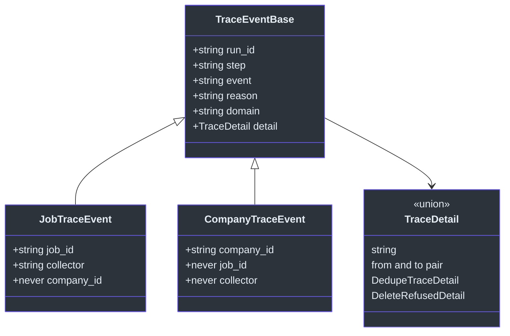
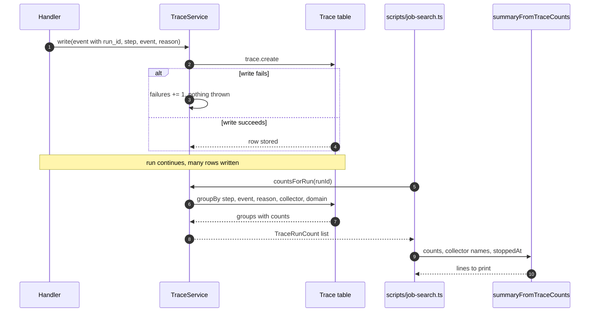
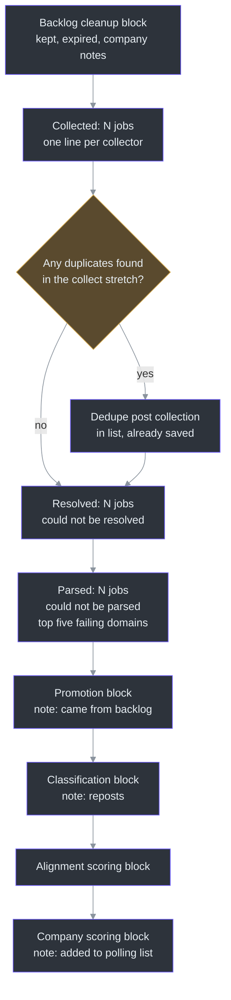

# Tracing and the Run Summary

## Overview

A job search touches hundreds of jobs. A returned list can say how many jobs came out the end. It cannot say how many came from one collector, or why 40 jobs were dropped. Those numbers exist only if each step writes down what it did while it did it.

The Trace table holds those records. It has one row per event in a job's path through the pipeline. A job "enters at collection, passes through each step, and either reaches the end or hits a dead end recording when and why" ([prisma/schema.prisma:357-359](https://github.com/mablahblah/job-assistant/blob/main/prisma/schema.prisma#L357-L359)). The summary printed at the end of a run is rebuilt from these rows, not from what the run returned.

| Component | Responsibility | Key file | Source |
|---|---|---|---|
| `Trace` model | One row per event, with step, event, reason, collector and domain | `prisma/schema.prisma` | [prisma/schema.prisma:618-650](https://github.com/mablahblah/job-assistant/blob/main/prisma/schema.prisma#L618-L650) |
| Trace service | Writes every row, counts rows by group, reads a job's rows back | `lib/services/trace-service.ts` | [lib/services/trace-service.ts:115-194](https://github.com/mablahblah/job-assistant/blob/main/lib/services/trace-service.ts#L115-L194) |
| Detail cut | Limits a row's detail text to 200 characters | `lib/utils/trace-detail.ts` | [lib/utils/trace-detail.ts:9-15](https://github.com/mablahblah/job-assistant/blob/main/lib/utils/trace-detail.ts#L9-L15) |
| Summary builder | Turns counted groups into the lines the command prints | `lib/utils/run-summary.ts` | [lib/utils/run-summary.ts:150-417](https://github.com/mablahblah/job-assistant/blob/main/lib/utils/run-summary.ts#L150-L417) |
| Summary rule | What the summary must look like | `.claude/rules/run-summary.md` | [.claude/rules/run-summary.md:5-90](https://github.com/mablahblah/job-assistant/blob/main/.claude/rules/run-summary.md#L5-L90) |
| Proof test | Runs a real job search and reads rows back with raw SQL | `lib/orchestrators/trace-proof.test.ts` | [lib/orchestrators/trace-proof.test.ts:1-5](https://github.com/mablahblah/job-assistant/blob/main/lib/orchestrators/trace-proof.test.ts#L1-L5) |

## The shape of a trace row

Each row answers five questions. Which run? Which job or company? Where in the pipeline? What happened? Why?

| Column | Meaning | Nullable | Source |
|---|---|---|---|
| `id` | Auto-increment integer, so two events in the same millisecond keep a reliable order | no | [prisma/schema.prisma:619-621](https://github.com/mablahblah/job-assistant/blob/main/prisma/schema.prisma#L619-L621) |
| `run_id` | The job search during which the event happened | no | [prisma/schema.prisma:622-623](https://github.com/mablahblah/job-assistant/blob/main/prisma/schema.prisma#L622-L623) |
| `job_id` | The job described. A plain column with no relation, so a trace outlives its job. Empty on a company event. | yes | [prisma/schema.prisma:624-627](https://github.com/mablahblah/job-assistant/blob/main/prisma/schema.prisma#L624-L627) |
| `company_id` | The company described, on company events. A row names a job or a company, never both. | yes | [prisma/schema.prisma:628-631](https://github.com/mablahblah/job-assistant/blob/main/prisma/schema.prisma#L628-L631) |
| `step` | Where in the pipeline the event happened | no | [prisma/schema.prisma:632-633](https://github.com/mablahblah/job-assistant/blob/main/prisma/schema.prisma#L632-L633) |
| `event` | What happened | no | [prisma/schema.prisma:634-635](https://github.com/mablahblah/job-assistant/blob/main/prisma/schema.prisma#L634-L635) |
| `reason` | Why a dead end happened, where the event was one | yes | [prisma/schema.prisma:636-637](https://github.com/mablahblah/job-assistant/blob/main/prisma/schema.prisma#L636-L637) |
| `collector` | Which collector produced the job. Empty on a company event. | yes | [prisma/schema.prisma:638-640](https://github.com/mablahblah/job-assistant/blob/main/prisma/schema.prisma#L638-L640) |
| `domain` | The domain a failing source owns. A column of its own so it can be grouped. | yes | [prisma/schema.prisma:641-646](https://github.com/mablahblah/job-assistant/blob/main/prisma/schema.prisma#L641-L646) |
| `detail` | JSON specific to one event. "Nothing that gets counted goes here." | yes | [prisma/schema.prisma:647-648](https://github.com/mablahblah/job-assistant/blob/main/prisma/schema.prisma#L647-L648) |
| `created_at` | When the row was written | no | [prisma/schema.prisma:649](https://github.com/mablahblah/job-assistant/blob/main/prisma/schema.prisma#L649) |

The split between `reason`/`domain` and `detail` is the key design choice. `detail` is JSON with a different shape per event, and SQLite cannot group a web address out of it. A counted value must be groupable, so it gets its own column ([prisma/schema.prisma:641-646](https://github.com/mablahblah/job-assistant/blob/main/prisma/schema.prisma#L641-L646)).

### Types that stop a row naming both a job and a company

The trace service uses TypeScript types to enforce the "never both" rule. A job event requires `job_id` and `collector` and types `company_id` as `never`. A company event requires `company_id` and types `job_id` and `collector` as `never`. Spelling both as `never` is "what makes a row carrying a job and a company fail to compile" ([lib/services/trace-service.ts:63-74](https://github.com/mablahblah/job-assistant/blob/main/lib/services/trace-service.ts#L63-L74)).



<!-- Sources: lib/services/trace-service.ts:33-74 -->

The detail union has four shapes ([lib/services/trace-service.ts:37-41](https://github.com/mablahblah/job-assistant/blob/main/lib/services/trace-service.ts#L37-L41)).

| Shape | Written by | Holds | Source |
|---|---|---|---|
| Plain string | Most events | A dead end names the offending value | [lib/services/trace-service.ts:33-36](https://github.com/mablahblah/job-assistant/blob/main/lib/services/trace-service.ts#L33-L36) |
| `{ from, to }` | Normalization | The value before and after | [lib/services/trace-service.ts:39](https://github.com/mablahblah/job-assistant/blob/main/lib/services/trace-service.ts#L39) |
| `DedupeTraceDetail` | Dedupe, when a job merges away | The id it became, the clause that matched, and enough of the losing side to check the merge | [lib/services/trace-service.ts:16-23](https://github.com/mablahblah/job-assistant/blob/main/lib/services/trace-service.ts#L16-L23) |
| `DeleteRefusedDetail` | Save, when the active-status guardrail refuses a delete | The row that blocked it and its status | [lib/services/trace-service.ts:28-31](https://github.com/mablahblah/job-assistant/blob/main/lib/services/trace-service.ts#L28-L31) |

Normalization detail is cut to 200 characters. The longest real title measured is 131 characters and the longest real company name is 50, so 200 fits every real value and still cuts a description a bug put in the wrong field ([lib/utils/trace-detail.ts:1-9](https://github.com/mablahblah/job-assistant/blob/main/lib/utils/trace-detail.ts#L1-L9)). The front of the value survives, because that identifies the row ([lib/utils/trace-detail.ts:11-15](https://github.com/mablahblah/job-assistant/blob/main/lib/utils/trace-detail.ts#L11-L15)).

## The vocabularies

The Trace model's comment is the vocabulary. Handler rules say a step name "is one of the values listed in the `Trace` model's comment" ([.claude/rules/handler-contract.md:41](https://github.com/mablahblah/job-assistant/blob/main/.claude/rules/handler-contract.md#L41)). A test in `prisma/schema.test.ts` checks the dedupe reasons against the schema comment so the two cannot drift ([lib/types/job-list-entry.ts:32-35](https://github.com/mablahblah/job-assistant/blob/main/lib/types/job-list-entry.ts#L32-L35)).

### Steps

Steps are listed in pipeline order. The comment states "Every one of them writes today" ([prisma/schema.prisma:363-370](https://github.com/mablahblah/job-assistant/blob/main/prisma/schema.prisma#L363-L370)).

| Group | Steps | Source |
|---|---|---|
| Cleanup | `backlog_cleanup`, `post_backlog_cleanup_save` | [prisma/schema.prisma:363-364](https://github.com/mablahblah/job-assistant/blob/main/prisma/schema.prisma#L363-L364) |
| Collect stretch | `collection`, `post_collection_normalization`, `post_collection_association`, `post_collection_dedupe`, `post_collection_save` | [prisma/schema.prisma:364-366](https://github.com/mablahblah/job-assistant/blob/main/prisma/schema.prisma#L364-L366) |
| Resolve stretch | `resolution`, `post_resolution_dedupe`, `post_resolution_save` | [prisma/schema.prisma:366-367](https://github.com/mablahblah/job-assistant/blob/main/prisma/schema.prisma#L366-L367) |
| Parse stretch | `parsing`, `post_parsing_normalization`, `post_parsing_association`, `post_parsing_dedupe`, `post_parsing_save` | [prisma/schema.prisma:367-368](https://github.com/mablahblah/job-assistant/blob/main/prisma/schema.prisma#L367-L368) |
| Judging | `promotion`, `post_promotion_save`, `classification`, `post_classification_save` | [prisma/schema.prisma:368-369](https://github.com/mablahblah/job-assistant/blob/main/prisma/schema.prisma#L368-L369) |
| Written by scoring commands | `scoring`, `company_promotion` | [prisma/schema.prisma:369](https://github.com/mablahblah/job-assistant/blob/main/prisma/schema.prisma#L369) |
| Written only by adding jobs by hand | `post_parsing_let_through`, `post_classification_let_through` | [prisma/schema.prisma:372-378](https://github.com/mablahblah/job-assistant/blob/main/prisma/schema.prisma#L372-L378) |

### Events

Every event about a job carries the `job_` prefix, so the subject of a row reads off its event name alone ([prisma/schema.prisma:390-391](https://github.com/mablahblah/job-assistant/blob/main/prisma/schema.prisma#L390-L391)). Company events use `company_` names. The table lists the main events by step.

| Step | Events | Source |
|---|---|---|
| Collection | `job_collected`, `job_abandoned`, `job_resolved` (for a job a collector resolved itself) | [prisma/schema.prisma:391-392](https://github.com/mablahblah/job-assistant/blob/main/prisma/schema.prisma#L391-L392) |
| Normalization | `job_updated`, `normalization_failed` | [prisma/schema.prisma:393-394](https://github.com/mablahblah/job-assistant/blob/main/prisma/schema.prisma#L393-L394) |
| Association | `company_associated`, `company_dbrow_updated`, `association_failed`, `company_update_failed` | [prisma/schema.prisma:395-398](https://github.com/mablahblah/job-assistant/blob/main/prisma/schema.prisma#L395-L398) |
| Save | `job_dbrow_created`, `job_dbrow_updated`, `job_dbrow_status_updated`, `job_dbrow_deleted`, `job_dbrow_delete_refused` | [prisma/schema.prisma:399-408](https://github.com/mablahblah/job-assistant/blob/main/prisma/schema.prisma#L399-L408) |
| Dedupe | `job_abandoned`, `job_added_to_list` | [prisma/schema.prisma:409-413](https://github.com/mablahblah/job-assistant/blob/main/prisma/schema.prisma#L409-L413) |
| Resolution | `job_resolved`, `resolution_failed` | [prisma/schema.prisma:414-415](https://github.com/mablahblah/job-assistant/blob/main/prisma/schema.prisma#L414-L415) |
| Parsing | `job_parsed`, `parsing_failed` | [prisma/schema.prisma:420-424](https://github.com/mablahblah/job-assistant/blob/main/prisma/schema.prisma#L420-L424) |
| Judging | `job_entered`, `job_kept`, `job_expired`, `job_promoted`, `job_reposted`, `job_classified`, `classification_failed` | [prisma/schema.prisma:429-440](https://github.com/mablahblah/job-assistant/blob/main/prisma/schema.prisma#L429-L440) |
| Scoring | `job_scored`, `scoring_failed`, `company_scored`, `company_partially_scored`, `company_scoring_failed` | [prisma/schema.prisma:588-603](https://github.com/mablahblah/job-assistant/blob/main/prisma/schema.prisma#L588-L603) |
| Company promotion | `company_entered`, `company_promoted`, `company_promotion_skipped` | [prisma/schema.prisma:608-612](https://github.com/mablahblah/job-assistant/blob/main/prisma/schema.prisma#L608-L612) |

`job_abandoned` ends a job's path. It makes no claim about whether a row existed. What became of the row is a separate event: `job_dbrow_deleted` if save carried out the delete, or `job_dbrow_delete_refused` if the active-status guardrail kept it ([prisma/schema.prisma:442-447](https://github.com/mablahblah/job-assistant/blob/main/prisma/schema.prisma#L442-L447)).

### Reasons

A reason names why a dead end happened ([prisma/schema.prisma:449-450](https://github.com/mablahblah/job-assistant/blob/main/prisma/schema.prisma#L449-L450)). One rule governs all of them: a reason string is never shared by two different populations, with a narrow exception. A step and an event may share a word where they describe one population split by where it happened. Examples are `location_unusable` (written by normalization and classification) and `past_expiration_threshold` (written by every expiry) ([prisma/schema.prisma:469-472](https://github.com/mablahblah/job-assistant/blob/main/prisma/schema.prisma#L469-L472), [prisma/schema.prisma:562-573](https://github.com/mablahblah/job-assistant/blob/main/prisma/schema.prisma#L562-L573)).

| Step | Reasons | Source |
|---|---|---|
| Collection | Six usability codes: `no_original_url`, `original_url_not_a_url`, `no_raw_title`, `no_company_identity`, `posting_date_unparseable`, `posting_updated_date_unparseable` | [prisma/schema.prisma:452-457](https://github.com/mablahblah/job-assistant/blob/main/prisma/schema.prisma#L452-L457) |
| Normalization | Nine, such as `title_normalized`, `missing_role_noun`, `salary_unusable`, `work_mode_unusable`, plus `location_unusable` | [prisma/schema.prisma:459-472](https://github.com/mablahblah/job-assistant/blob/main/prisma/schema.prisma#L459-L472) |
| Association | `matched_by_slug`, `matched_by_name`, `company_created`, `company_name_filled`, `no_company_name`, `company_name_clash` | [prisma/schema.prisma:474-485](https://github.com/mablahblah/job-assistant/blob/main/prisma/schema.prisma#L474-L485) |
| Dedupe | `hard_match_in_list`, `repost_match_in_list`, `matched_db_row`, `matched_list_entry` | [prisma/schema.prisma:494-502](https://github.com/mablahblah/job-assistant/blob/main/prisma/schema.prisma#L494-L502) |
| Resolution | Ten, such as `link_left_site`, `stayed_on_site`, `page_refused`, `page_unavailable`, `dead_end`, `blacklisted_url` | [prisma/schema.prisma:509-529](https://github.com/mablahblah/job-assistant/blob/main/prisma/schema.prisma#L509-L529) |
| Parsing | `dead_page`, `no_location` | [prisma/schema.prisma:548-557](https://github.com/mablahblah/job-assistant/blob/main/prisma/schema.prisma#L548-L557) |
| Judging | `past_expiration_threshold`, `no_location_match`, `location_unusable` | [prisma/schema.prisma:562-573](https://github.com/mablahblah/job-assistant/blob/main/prisma/schema.prisma#L562-L573) |

Only some reasons warn the user. The comment names them: `salary_unusable`, `work_mode_unusable`, `no_company_name` and `company_name_clash` ([prisma/schema.prisma:467-469](https://github.com/mablahblah/job-assistant/blob/main/prisma/schema.prisma#L467-L469), [prisma/schema.prisma:485](https://github.com/mablahblah/job-assistant/blob/main/prisma/schema.prisma#L485)). The rest are analytics only. Each warning is also a trace row, which follows the "one event produces both" rule from [System Design](./system-design.md#trace-rows-versus-warnings).

## Why there is no run table

A run is identified by the id written on every event it produces. A table holding one row per run "earns nothing" ([docs/architecture.md:298](https://github.com/mablahblah/job-assistant/blob/main/docs/architecture.md#L298)). The same row of that document also rules out shipped macro queries. The funnel questions are answered by SQL written where it is asked, in a test file or at the command line, so no query code lives in `lib/` ([docs/architecture.md:298](https://github.com/mablahblah/job-assistant/blob/main/docs/architecture.md#L298)).

The proof test shows this in action. It runs two real runs against one scratch database and answers funnel questions with raw SQL grouped by `run_id` and `collector` ([lib/orchestrators/trace-proof.test.ts:227-260](https://github.com/mablahblah/job-assistant/blob/main/lib/orchestrators/trace-proof.test.ts#L227-L260), [lib/orchestrators/trace-proof.test.ts:276-310](https://github.com/mablahblah/job-assistant/blob/main/lib/orchestrators/trace-proof.test.ts#L276-L310)).

A second consequence follows. Scoring runs in a different process from the job search, yet its rows belong to the same run. The job search prints `Run: {run-id}` first so the scoring skill can read that line and "file its own trace rows under the same run" ([scripts/job-search.ts:73-76](https://github.com/mablahblah/job-assistant/blob/main/scripts/job-search.ts#L73-L76)). One run's rows stay countable together without any run record.

## How a row is written

Handlers write their own trace rows. The caller hands a handler the trace service, the run id and the step name, because the same handler runs at more than one position ([.claude/rules/handler-contract.md:37](https://github.com/mablahblah/job-assistant/blob/main/.claude/rules/handler-contract.md#L37)). A handler handed none of them writes no trace and still does its work.

The write never throws. The trace service wraps the create in a `try` and counts the failure ([lib/services/trace-service.ts:119-144](https://github.com/mablahblah/job-assistant/blob/main/lib/services/trace-service.ts#L119-L144)). The comment gives the reason: this runs inside the collection step's per-collector block, where a throw reads as a collector failure and costs every remaining job from that source. "Losing a trace row is better than losing the rest of the run" ([lib/services/trace-service.ts:137-143](https://github.com/mablahblah/job-assistant/blob/main/lib/services/trace-service.ts#L137-L143)).

`countsForRun` is the opposite. A throw there "is left to travel", because a summary that silently read back nothing would tell the user the run did nothing, "which is worse than an error reaching them instead" ([lib/services/trace-service.ts:150-153](https://github.com/mablahblah/job-assistant/blob/main/lib/services/trace-service.ts#L150-L153)).

The work-log service takes the opposite choice from the trace service for the same reason. A work log row is a legal filing that cannot be regenerated, so its write has no `try` ([lib/services/work-log-service.ts:45-52](https://github.com/mablahblah/job-assistant/blob/main/lib/services/work-log-service.ts#L45-L52)).



<!-- Sources: lib/services/trace-service.ts:119-170, scripts/job-search.ts:123-130, lib/utils/run-summary.ts:150-157 -->

## Rebuilding the summary

The summary is built by one function, `summaryFromTraceCounts(counts, collectors, stoppedAt)`. Its header explains the design. The value `runJobSearch` returns carries list lengths only. It cannot say how many jobs came from one collector or how many duplicates were reposts. Every number broken out by collector or reason "exists only in the trace rows" ([lib/utils/run-summary.ts:1-6](https://github.com/mablahblah/job-assistant/blob/main/lib/utils/run-summary.ts#L1-L6)).

### The count helper

`countsForRun` groups rows by five columns and returns one count per group ([lib/services/trace-service.ts:154-158](https://github.com/mablahblah/job-assistant/blob/main/lib/services/trace-service.ts#L154-L158)). Every number in the summary is the same question asked with different values: how many rows match this step, event and reason. A single helper, `total`, answers it by adding the counts of matching groups ([lib/utils/run-summary.ts:9-14](https://github.com/mablahblah/job-assistant/blob/main/lib/utils/run-summary.ts#L9-L14)).

### The block layout

The three judging steps and the scoring steps print one shape. The shape is written once in `stepBlock` ([lib/utils/run-summary.ts:85-148](https://github.com/mablahblah/job-assistant/blob/main/lib/utils/run-summary.ts#L85-L148)).

| Part | How it is built | Source |
|---|---|---|
| Heading | The step name and the number of entries, from the `{subject}_entered` rows | [lib/utils/run-summary.ts:110-120](https://github.com/mablahblah/job-assistant/blob/main/lib/utils/run-summary.ts#L110-L120) |
| Stopped marker | ` — stopped early` is added when the step is where the run stopped | [lib/utils/run-summary.ts:116-119](https://github.com/mablahblah/job-assistant/blob/main/lib/utils/run-summary.ts#L116-L119) |
| Outcome lines | One per way a job left, right-aligned to the heading's width. A zero earns no line. | [lib/utils/run-summary.ts:122-138](https://github.com/mablahblah/job-assistant/blob/main/lib/utils/run-summary.ts#L122-L138) |
| Notes | After a blank line, prefixed `Note:`. A note is true of the jobs but is not a way out. | [lib/utils/run-summary.ts:140-145](https://github.com/mablahblah/job-assistant/blob/main/lib/utils/run-summary.ts#L140-L145) |

The width is taken from the heading's own count, not shared across steps, "because the lines beneath a heading are read as summing to it and to nothing else" ([lib/utils/run-summary.ts:95-97](https://github.com/mablahblah/job-assistant/blob/main/lib/utils/run-summary.ts#L95-L97)).

An example from the rule file shows the output ([.claude/rules/run-summary.md:47-55](https://github.com/mablahblah/job-assistant/blob/main/.claude/rules/run-summary.md#L47-L55)).

```
Classification (157 jobs)
   32 jobs expired (reason: past_expiration_threshold)
   64 jobs were close enough
   48 jobs too far (reason: no_location_match)
   13 jobs could not be judged (reason: location_unusable)

  Note: 12 of these were also flagged as reposts
```

### What the summary prints



<!-- Sources: lib/utils/run-summary.ts:186-200, lib/utils/run-summary.ts:205-218, lib/utils/run-summary.ts:257-269, lib/utils/run-summary.ts:274-301, lib/utils/run-summary.ts:312-324, lib/utils/run-summary.ts:333-352, lib/utils/run-summary.ts:356-414 -->

| Block | What it counts | Notable detail | Source |
|---|---|---|---|
| Backlog cleanup | `job_kept` and `job_expired` | Notes for companies that lost a stale score or a stale guessed score. The event separates the two, because both carry the same reason. | [lib/utils/run-summary.ts:164-198](https://github.com/mablahblah/job-assistant/blob/main/lib/utils/run-summary.ts#L164-L198) |
| Collected | `job_collected` rows | Every collector gets a line, even at zero. A collector that collected nothing writes no row, so omitting it would read as "we did not run it". | [lib/utils/run-summary.ts:202-219](https://github.com/mablahblah/job-assistant/blob/main/lib/utils/run-summary.ts#L202-L219) |
| Dedupe | `job_abandoned` rows at `post_collection_dedupe` | Prints only if there is something to say. A heading over nothing "only asks the reader what happened". | [lib/utils/run-summary.ts:237-269](https://github.com/mablahblah/job-assistant/blob/main/lib/utils/run-summary.ts#L237-L269) |
| Resolved | `job_resolved` at the `resolution` step only | The step filter matters. Collection writes `job_resolved` too, and counting those would credit resolution with work it never did. | [lib/utils/run-summary.ts:271-282](https://github.com/mablahblah/job-assistant/blob/main/lib/utils/run-summary.ts#L271-L282) |
| Parsed | `job_parsed`, `parsing_failed` | Lists the top five failing domains, highest cost first, ties by name. The label is `no parser` or `parser failed`. | [lib/utils/run-summary.ts:285-301](https://github.com/mablahblah/job-assistant/blob/main/lib/utils/run-summary.ts#L285-L301), [lib/utils/run-summary.ts:52-83](https://github.com/mablahblah/job-assistant/blob/main/lib/utils/run-summary.ts#L52-L83) |
| Promotion | `job_promoted` | A note says these came from the backlog, not from this run's collection | [lib/utils/run-summary.ts:306-324](https://github.com/mablahblah/job-assistant/blob/main/lib/utils/run-summary.ts#L306-L324) |
| Classification | `job_classified`, `job_expired`, two `classification_failed` reasons | A repost count is a note, never a line | [lib/utils/run-summary.ts:326-352](https://github.com/mablahblah/job-assistant/blob/main/lib/utils/run-summary.ts#L326-L352) |
| Alignment scoring and company scoring | The `scoring` step, split by subject | Read the same step. The subject, `job` or `company`, tells the two apart. | [lib/utils/run-summary.ts:354-414](https://github.com/mablahblah/job-assistant/blob/main/lib/utils/run-summary.ts#L354-L414) |

Two small rules show attention to the reader. Counts use the right singular or plural word, even for one: `1 job`, `2 jobs`, and zero keeps the plural ([lib/utils/run-summary.ts:16-24](https://github.com/mablahblah/job-assistant/blob/main/lib/utils/run-summary.ts#L16-L24)). The sort of failing domains breaks ties by name "so the list is stable between runs" ([lib/utils/run-summary.ts:74-78](https://github.com/mablahblah/job-assistant/blob/main/lib/utils/run-summary.ts#L74-L78)).

## The summary rules

`.claude/rules/run-summary.md` governs this file. The table lists each rule and whether the code follows it.

| Rule | Plain meaning | Followed in code? | Source |
|---|---|---|---|
| Every step prints | A step with no work shows its heading and its zero | Yes for the `stepBlock` steps. The heading prints at zero. | [.claude/rules/run-summary.md:7-13](https://github.com/mablahblah/job-assistant/blob/main/.claude/rules/run-summary.md#L7-L13), [lib/utils/run-summary.ts:125-131](https://github.com/mablahblah/job-assistant/blob/main/lib/utils/run-summary.ts#L125-L131) |
| A heading carries what entered | The number is the jobs handed to the step | Yes for `stepBlock` steps | [.claude/rules/run-summary.md:15-19](https://github.com/mablahblah/job-assistant/blob/main/.claude/rules/run-summary.md#L15-L19) |
| The lines account for every job | Each job leaves by exactly one line, and lines sum to the heading | By design in `stepBlock`. Not checked by code here. | [.claude/rules/run-summary.md:21-23](https://github.com/mablahblah/job-assistant/blob/main/.claude/rules/run-summary.md#L21-L23) |
| A reason names why a job left the happy path | The text is the value written to `Trace.reason` | Yes | [.claude/rules/run-summary.md:32-36](https://github.com/mablahblah/job-assistant/blob/main/.claude/rules/run-summary.md#L32-L36), [lib/utils/run-summary.ts:136](https://github.com/mablahblah/job-assistant/blob/main/lib/utils/run-summary.ts#L136) |
| A note is not a path | Notes sit after a blank line and never count toward the heading | Yes | [.claude/rules/run-summary.md:43-45](https://github.com/mablahblah/job-assistant/blob/main/.claude/rules/run-summary.md#L43-L45), [lib/utils/run-summary.ts:143-145](https://github.com/mablahblah/job-assistant/blob/main/lib/utils/run-summary.ts#L143-L145) |
| A step the run died inside says so | ` — stopped early` on the heading | Yes | [.claude/rules/run-summary.md:80-86](https://github.com/mablahblah/job-assistant/blob/main/.claude/rules/run-summary.md#L80-L86), [lib/utils/run-summary.ts:119](https://github.com/mablahblah/job-assistant/blob/main/lib/utils/run-summary.ts#L119) |
| The numbers come from trace rows | Never from what a handler returned | Yes | [.claude/rules/run-summary.md:88-90](https://github.com/mablahblah/job-assistant/blob/main/.claude/rules/run-summary.md#L88-L90), [lib/utils/run-summary.ts:1-6](https://github.com/mablahblah/job-assistant/blob/main/lib/utils/run-summary.ts#L1-L6) |

### Where the code differs from the rule file

The rule file and the code do not fully agree. These are observations from reading both.

| Rule says | Code does | Source |
|---|---|---|
| Collection's heading carries the sources it ran, for example `Collection (7 sources)`, with each source nested below | Prints `Collected: N jobs` and a `  - {collector} collected N jobs` line per collector. There is no `Collection` heading with a source count. | [.claude/rules/run-summary.md:73-78](https://github.com/mablahblah/job-assistant/blob/main/.claude/rules/run-summary.md#L73-L78), [lib/utils/run-summary.ts:205-219](https://github.com/mablahblah/job-assistant/blob/main/lib/utils/run-summary.ts#L205-L219) |
| Every step prints, even at zero | The Dedupe block prints only when a count is above zero. `Resolved:` and `Parsed:` print as one headline line with no entered count, not as blocks with a heading. | [lib/utils/run-summary.ts:255-269](https://github.com/mablahblah/job-assistant/blob/main/lib/utils/run-summary.ts#L255-L269), [lib/utils/run-summary.ts:274-301](https://github.com/mablahblah/job-assistant/blob/main/lib/utils/run-summary.ts#L274-L301) |
| Sub-steps nest | Only the per-collector lines and the failing-domain lines nest | [.claude/rules/run-summary.md:68-78](https://github.com/mablahblah/job-assistant/blob/main/.claude/rules/run-summary.md#L68-L78) |

The rule file reads as the target shape. The deterministic steps from collection through parsing do not yet follow the block shape that backlog cleanup, promotion, classification and scoring do (inferred from comparing the two files, not stated in either).

## A schema comment that is out of date

A job search, scoring's two commands and adding jobs by hand all write trace rows ([prisma/schema.prisma:360-361](https://github.com/mablahblah/job-assistant/blob/main/prisma/schema.prisma#L360-L361)). Scoring and company promotion are the two steps the pipeline itself never reaches ([prisma/schema.prisma:380-383](https://github.com/mablahblah/job-assistant/blob/main/prisma/schema.prisma#L380-L383)), and adding jobs by hand writes two steps a job search never reaches ([prisma/schema.prisma:372-378](https://github.com/mablahblah/job-assistant/blob/main/prisma/schema.prisma#L372-L378)). The add-external-jobs runner also reads a job's rows back through the trace service, using `rowsForJobs`, and asks for the narrower `TraceService & TraceJobRowsReader` type ([lib/services/trace-service.ts:100-105](https://github.com/mablahblah/job-assistant/blob/main/lib/services/trace-service.ts#L100-L105), [lib/orchestrators/add-external-jobs.ts:66](https://github.com/mablahblah/job-assistant/blob/main/lib/orchestrators/add-external-jobs.ts#L66)).

## Related Pages

| Page | Relationship |
|---|---|
| [The Job Search Run](./job-search-run.md) | The run that writes these rows and prints this summary |
| [System Design](./system-design.md) | The handler contract that says who writes trace rows |
| [Data Model](../data/data-model.md) | The `Trace` table in the context of every other model |
| [Services](../data/services.md) | The trace service among the other services |
| [Judging Steps](../pipeline/judging-steps.md) | The steps whose blocks share `stepBlock` |
| [Scoring](../agent-workflows/scoring.md) | The commands that write `scoring` and `company_promotion` rows |
| [Testing](../quality/testing.md) | The `-events.test.ts` files that check trace rows |

## References

- [prisma/schema.prisma:357-650](https://github.com/mablahblah/job-assistant/blob/main/prisma/schema.prisma#L357-L650) - the Trace model and its vocabulary comment
- [lib/services/trace-service.ts:1-194](https://github.com/mablahblah/job-assistant/blob/main/lib/services/trace-service.ts#L1-L194) - the service
- [lib/utils/run-summary.ts:1-417](https://github.com/mablahblah/job-assistant/blob/main/lib/utils/run-summary.ts#L1-L417) - the summary builder
- [lib/utils/trace-detail.ts:1-15](https://github.com/mablahblah/job-assistant/blob/main/lib/utils/trace-detail.ts#L1-L15) - the detail cut
- [.claude/rules/run-summary.md:1-90](https://github.com/mablahblah/job-assistant/blob/main/.claude/rules/run-summary.md#L1-L90) - the summary rule
- [.claude/rules/handler-contract.md:29-41](https://github.com/mablahblah/job-assistant/blob/main/.claude/rules/handler-contract.md#L29-L41) - who writes trace rows
- [lib/orchestrators/trace-proof.test.ts:1-5](https://github.com/mablahblah/job-assistant/blob/main/lib/orchestrators/trace-proof.test.ts#L1-L5) - the end-to-end proof
- [docs/architecture.md:298](https://github.com/mablahblah/job-assistant/blob/main/docs/architecture.md#L298) - why there is no run table
