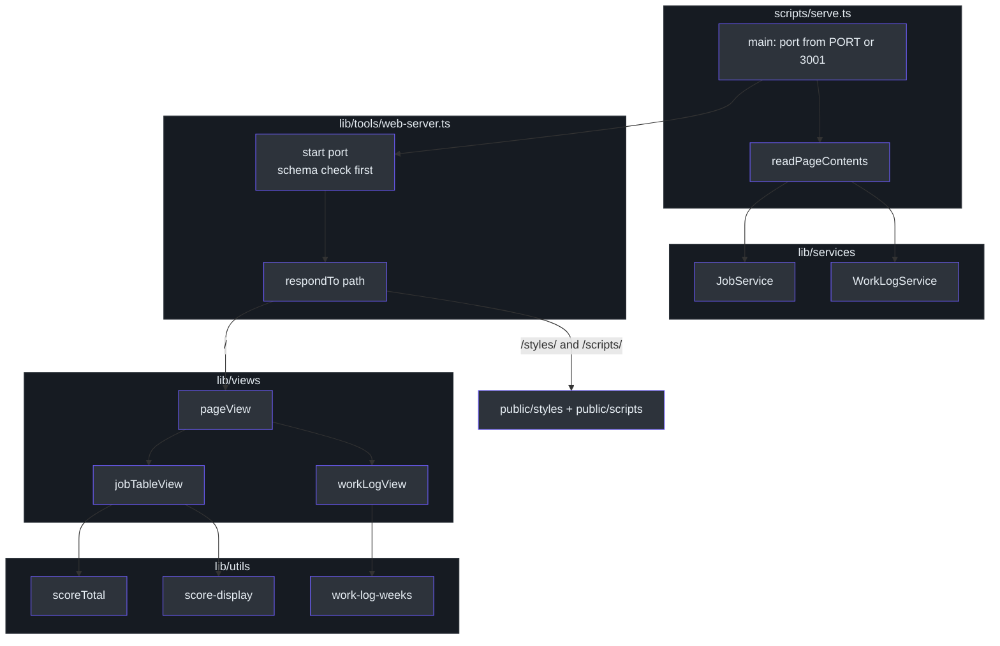
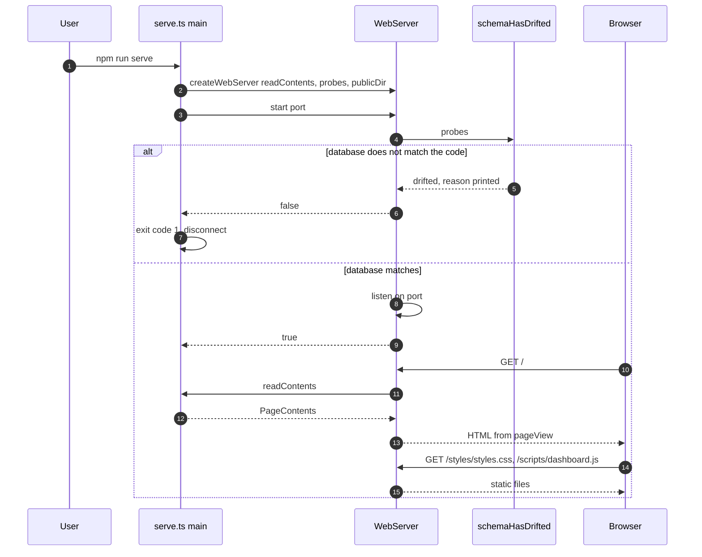
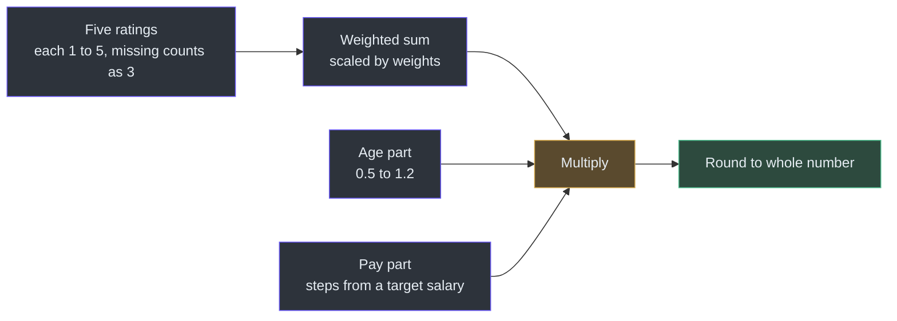
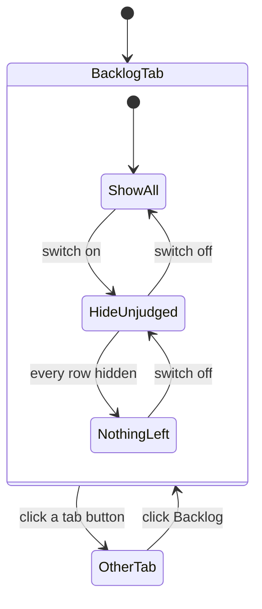

# The Read-Only Dashboard

## Overview

The pipeline decides things about jobs. The dashboard shows what it decided. It is a small web page with four tabs: Backlog, Active Jobs, Disqualified and Work Log. It changes nothing. Every write to the database happens in a command, never on this page.

Because the page only reads, the command that starts it owns almost nothing. It gathers four lists and hands the web server a way to read them ([scripts/serve.ts:1-3](https://github.com/mablahblah/job-assistant/blob/main/scripts/serve.ts#L1-L3)). Three design choices shape everything else:

- **One page, one request.** All four lists are built at once. The page is small and read-only, so one address that shows where every job stands beats a round trip per tab ([lib/views/page.ts:1-4](https://github.com/mablahblah/job-assistant/blob/main/lib/views/page.ts#L1-L4)).
- **Refuse to start on a bad database.** A page that starts and shows an empty table looks exactly like an empty backlog. So the server checks the schema first and will not listen if it does not match ([lib/tools/web-server.ts:114-120](https://github.com/mablahblah/job-assistant/blob/main/lib/tools/web-server.ts#L114-L120)).
- **Views are the only place HTML is built.** A view takes values and returns HTML. It reaches no database ([.claude/rules/views.md:7](https://github.com/mablahblah/job-assistant/blob/main/.claude/rules/views.md#L7)).

### At a glance

| Component | Responsibility | Key file | Source |
| --- | --- | --- | --- |
| `readPageContents` | Reads the three job lists and the work log from services | `scripts/serve.ts` | [serve.ts:25-51](https://github.com/mablahblah/job-assistant/blob/main/scripts/serve.ts#L25-L51) |
| `createWebServer` | Answers requests, checks the schema, listens on a port | `lib/tools/web-server.ts` | [web-server.ts:63-146](https://github.com/mablahblah/job-assistant/blob/main/lib/tools/web-server.ts#L63-L146) |
| `pageView` | Builds the whole document: tabs, four panels, script tag | `lib/views/page.ts` | [page.ts:17-80](https://github.com/mablahblah/job-assistant/blob/main/lib/views/page.ts#L17-L80) |
| `jobTableView` | One table used for all three job lists | `lib/views/job-table.ts` | [job-table.ts:236-267](https://github.com/mablahblah/job-assistant/blob/main/lib/views/job-table.ts#L236-L267) |
| `workLogView` | A sidebar of benefit weeks and the entries filed in each | `lib/views/work-log.ts` | [work-log.ts:71-127](https://github.com/mablahblah/job-assistant/blob/main/lib/views/work-log.ts#L71-L127) |
| `scoreTotal` | Works out a job's total on every page build | `lib/utils/score-total.ts` | [score-total.ts:83-97](https://github.com/mablahblah/job-assistant/blob/main/lib/utils/score-total.ts#L83-L97) |
| Week helpers | Group entries by Sunday-to-Saturday week | `lib/utils/work-log-weeks.ts` | [work-log-weeks.ts:10-61](https://github.com/mablahblah/job-assistant/blob/main/lib/utils/work-log-weeks.ts#L10-L61) |
| Browser script | Tab switching, week switching, the hide-unjudged switch | `public/scripts/dashboard.js` | [dashboard.js:5-90](https://github.com/mablahblah/job-assistant/blob/main/public/scripts/dashboard.js#L5-L90) |

## Architecture

<!-- Sources: scripts/serve.ts:25-80, lib/tools/web-server.ts:85-136, lib/views/page.ts:17-80, lib/views/job-table.ts:236-267 -->

## Starting the server

`npm run serve` runs `scripts/serve.ts` ([package.json:6](https://github.com/mablahblah/job-assistant/blob/main/package.json#L6)). The schema check lives inside the server instead of the command, unlike every other command. A dashboard has to refuse to listen, not just exit ([serve.ts:5-7](https://github.com/mablahblah/job-assistant/blob/main/scripts/serve.ts#L5-L7)).

<!-- Sources: scripts/serve.ts:60-80, lib/tools/web-server.ts:85-136 -->

| Detail | What the code does | Why | Source |
| --- | --- | --- | --- |
| Port | `PORT` environment variable if it is a positive whole number, else 3001 | An unset, empty or unreadable value must not become port 0, which would be a port nobody was told about | [serve.ts:19-20](https://github.com/mablahblah/job-assistant/blob/main/scripts/serve.ts#L19-L20), [serve.ts:53-58](https://github.com/mablahblah/job-assistant/blob/main/scripts/serve.ts#L53-L58) |
| Database left open | `main` never disconnects on success | This command never finishes a task. It answers requests until stopped by hand | [serve.ts:77-79](https://github.com/mablahblah/job-assistant/blob/main/scripts/serve.ts#L77-L79) |
| Import guard | `main` runs only when the file is the entry point | Importing the module for a test must not bind a real port | [serve.ts:82-88](https://github.com/mablahblah/job-assistant/blob/main/scripts/serve.ts#L82-L88) |
| Same drift check as commands | `start` calls `schemaHasDrifted` | One database fault is explained one way, whichever command reached it | [web-server.ts:118-120](https://github.com/mablahblah/job-assistant/blob/main/lib/tools/web-server.ts#L118-L120) |

### Why it is a tool

`createWebServer` lives in `lib/tools/`, not `lib/services/`. It wraps the port it listens on and the request library behind it, both outside the app ([web-server.ts:1-3](https://github.com/mablahblah/job-assistant/blob/main/lib/tools/web-server.ts#L1-L3)). It splits answering a request (`respondTo`) from listening (`start`). Every real request goes through `respondTo`, so a made-up request in a test proves the same behavior a browser gets, with no port opened ([web-server.ts:5-6](https://github.com/mablahblah/job-assistant/blob/main/lib/tools/web-server.ts#L5-L6), [web-server.ts:123-124](https://github.com/mablahblah/job-assistant/blob/main/lib/tools/web-server.ts#L123-L124)). See [Testing](../quality/testing.md).

### What the server will answer

| Request path | Answer | Source |
| --- | --- | --- |
| Contains `..` | 404, before anything is opened | [web-server.ts:86-88](https://github.com/mablahblah/job-assistant/blob/main/lib/tools/web-server.ts#L86-L88) |
| `/` | 200 with the page. If the read throws, 500 with a plain page that names the database problem | [web-server.ts:90-105](https://github.com/mablahblah/job-assistant/blob/main/lib/tools/web-server.ts#L90-L105) |
| `/styles/...` or `/scripts/...` | The file from `public/`, only if it ends in `.css` or `.js` | [web-server.ts:43-48](https://github.com/mablahblah/job-assistant/blob/main/lib/tools/web-server.ts#L43-L48), [web-server.ts:107-109](https://github.com/mablahblah/job-assistant/blob/main/lib/tools/web-server.ts#L107-L109) |
| Anything else | 404 | [web-server.ts:111](https://github.com/mablahblah/job-assistant/blob/main/lib/tools/web-server.ts#L111) |

The 500 page exists because a blank tab says nothing about what went wrong ([web-server.ts:50-61](https://github.com/mablahblah/job-assistant/blob/main/lib/tools/web-server.ts#L50-L61)). A missing static file is ordinary and prints nothing. Any other read fault, such as a refused permission, is logged, so the reader does not hunt for a typo that is not there ([web-server.ts:74-81](https://github.com/mablahblah/job-assistant/blob/main/lib/tools/web-server.ts#L74-L81)).

## The four lists

`readPageContents` reads the lists with one query per status group, all at once ([serve.ts:29-34](https://github.com/mablahblah/job-assistant/blob/main/scripts/serve.ts#L29-L34)).

| Tab | Statuses | Source of the list | Sorted by | Source |
| --- | --- | --- | --- | --- |
| Backlog | `backlog` | `findByStatuses(["backlog"])` | Highest score total first | [serve.ts:30](https://github.com/mablahblah/job-assistant/blob/main/scripts/serve.ts#L30), [job-table.ts:220-226](https://github.com/mablahblah/job-assistant/blob/main/lib/views/job-table.ts#L220-L226) |
| Active Jobs | `app. sent`, `screening`, `interview`, `test`, `offer` | `ACTIVE_STATUSES` | Last changed first | [job-status.ts:8-14](https://github.com/mablahblah/job-assistant/blob/main/lib/utils/job-status.ts#L8-L14), [job-table.ts:227](https://github.com/mablahblah/job-assistant/blob/main/lib/views/job-table.ts#L227) |
| Disqualified | `expired`, `too far`, `won't apply`, `unresolvable`, `unparseable`, `rejected` | `RULED_OUT_STATUSES` | Last changed first | [job-status.ts:63-75](https://github.com/mablahblah/job-assistant/blob/main/lib/utils/job-status.ts#L63-L75) |
| Work Log | Every work log entry | `workLog.findAll()` | Grouped by week | [serve.ts:33](https://github.com/mablahblah/job-assistant/blob/main/scripts/serve.ts#L33) |

The status lists come from the one file that declares them. The page and the pipeline cannot disagree about what a list covers ([serve.ts:22-24](https://github.com/mablahblah/job-assistant/blob/main/scripts/serve.ts#L22-L24)). The service reads each job together with its employer, because four of the five ratings behind a job's total sit on the employer ([job-service.ts:535-541](https://github.com/mablahblah/job-assistant/blob/main/lib/services/job-service.ts#L535-L541)). The work log entry stores the employer name when filed, but not contact details, which a search finds later. So the page reads the employer through the job the entry names, once for all entries. A job that has been deleted shows the details as not found rather than as an error ([serve.ts:36-48](https://github.com/mablahblah/job-assistant/blob/main/scripts/serve.ts#L36-L48)). See [Services](../data/services.md).

The tab bar shows counts for the three job lists. The work log has no count on purpose. It is filed a week at a time, so a total across every week says nothing the user can act on ([page.ts:20-27](https://github.com/mablahblah/job-assistant/blob/main/lib/views/page.ts#L20-L27)).

## The job table

One table builds all three job lists. A single list of column definitions builds both the headings and every row, so a column cannot be added to one and forgotten in the other ([job-table.ts:1-3](https://github.com/mablahblah/job-assistant/blob/main/lib/views/job-table.ts#L1-L3)). The `Column` interface holds the heading and the cell builder together for the same reason ([job-table.ts:22-27](https://github.com/mablahblah/job-assistant/blob/main/lib/views/job-table.ts#L22-L27)).

| Column | Shows | Notes | Source |
| --- | --- | --- | --- |
| Score (backlog) or Status (other lists) | The total, or the status badge | The total leads the backlog because the question there is whether to apply. Once a job is applied for or ruled out, the status leads | [job-table.ts:109-132](https://github.com/mablahblah/job-assistant/blob/main/lib/views/job-table.ts#L109-L132) |
| Role | Employer and linked title | The link is the followed source posting, with the found address as a fallback | [job-table.ts:134-142](https://github.com/mablahblah/job-assistant/blob/main/lib/views/job-table.ts#L134-L142) |
| Type | An icon for remote, hybrid or in-office | Uses the matched mode, else the collected list | [job-table.ts:62-68](https://github.com/mablahblah/job-assistant/blob/main/lib/views/job-table.ts#L62-L68), [job-table.ts:144-152](https://github.com/mablahblah/job-assistant/blob/main/lib/views/job-table.ts#L144-L152) |
| Location | Matched place, else normalized, else raw | Ruled-out jobs often never reached classification, so they fall back to what was collected | [job-table.ts:47-57](https://github.com/mablahblah/job-assistant/blob/main/lib/views/job-table.ts#L47-L57) |
| Posted | Relative date, plus an `RP` pill for a repost | Classification only marks a repost when both dates exist | [job-table.ts:159-172](https://github.com/mablahblah/job-assistant/blob/main/lib/views/job-table.ts#L159-L172) |
| Salary | Range and period, or `?` | A period the pipeline cannot read prints `?` instead of a guessed figure | [job-table.ts:70-85](https://github.com/mablahblah/job-assistant/blob/main/lib/views/job-table.ts#L70-L85) |
| Five ratings | Job alignment, employee, customer, work/life, political | A missing rating prints `?` | [job-table.ts:87-97](https://github.com/mablahblah/job-assistant/blob/main/lib/views/job-table.ts#L87-L97), [job-table.ts:205-209](https://github.com/mablahblah/job-assistant/blob/main/lib/views/job-table.ts#L205-L209) |
| Avg | Mean of the ratings given | Shown on narrow screens in place of the five. Its tooltip carries the five numbers | [job-table.ts:179-195](https://github.com/mablahblah/job-assistant/blob/main/lib/views/job-table.ts#L179-L195) |

Every value that came from outside is passed through `escapeHtml` before it goes into a tag ([job-table.ts:5](https://github.com/mablahblah/job-assistant/blob/main/lib/views/job-table.ts#L5), [job-table.ts:131](https://github.com/mablahblah/job-assistant/blob/main/lib/views/job-table.ts#L131)). Each list has its own empty message, and none reads like a failure ([job-table.ts:14-20](https://github.com/mablahblah/job-assistant/blob/main/lib/views/job-table.ts#L14-L20)).

### Unjudged jobs

A job the pipeline never finished judging must not look like one that passed every check. In the backlog, an unjudged job shows a warning icon where its total would be. The tooltip names each unfinished step: link not followed, posting not read, location not checked. If all three finished, it reads "Not scored" ([job-table.ts:99-107](https://github.com/mablahblah/job-assistant/blob/main/lib/views/job-table.ts#L99-L107), [job-table.ts:116-120](https://github.com/mablahblah/job-assistant/blob/main/lib/views/job-table.ts#L116-L120)). The marker comes from `is_judged`, set during scoring. See [Scoring](../agent-workflows/scoring.md#what-judged-means).

The page tags unjudged backlog rows with `data-unjudged`. The browser script only hides and shows them, so it works nothing out on its own ([job-table.ts:230-234](https://github.com/mablahblah/job-assistant/blob/main/lib/views/job-table.ts#L230-L234)). The toggle counts hidden jobs too, so the user sees how much of the backlog is unchecked either way ([page.ts:37-44](https://github.com/mablahblah/job-assistant/blob/main/lib/views/page.ts#L37-L44)).

## The score total

The total is worked out as the page is built, not read from a stored column. An employer rescored after its jobs were saved moves all of its jobs at once, which a stored number could not do ([score-total.ts:1-3](https://github.com/mablahblah/job-assistant/blob/main/lib/utils/score-total.ts#L1-L3)).

<!-- Sources: lib/utils/score-total.ts:8-97 -->

`total = round(weightedSum x agePart x payPart)`, from [score-total.ts:96](https://github.com/mablahblah/job-assistant/blob/main/lib/utils/score-total.ts#L96).

| Category | Weight at 5 of 5 | Source |
| --- | --- | --- |
| Job alignment | 40 | [score-total.ts:16](https://github.com/mablahblah/job-assistant/blob/main/lib/utils/score-total.ts#L16) |
| Employee satisfaction | 25 | [score-total.ts:12](https://github.com/mablahblah/job-assistant/blob/main/lib/utils/score-total.ts#L12) |
| Work/life balance | 25 | [score-total.ts:14](https://github.com/mablahblah/job-assistant/blob/main/lib/utils/score-total.ts#L14) |
| Political alignment | 25 | [score-total.ts:15](https://github.com/mablahblah/job-assistant/blob/main/lib/utils/score-total.ts#L15) |
| Customer satisfaction | 10 | [score-total.ts:13](https://github.com/mablahblah/job-assistant/blob/main/lib/utils/score-total.ts#L13) |

The weights add up to 125, the sum before the age and pay parts multiply it ([score-total.ts:8-10](https://github.com/mablahblah/job-assistant/blob/main/lib/utils/score-total.ts#L8-L10)). Each rating is divided by 5 and multiplied by its weight ([score-total.ts:86-94](https://github.com/mablahblah/job-assistant/blob/main/lib/utils/score-total.ts#L86-L94)).

**Missing ratings count as 3.** A freshly collected job has no scores, because scoring runs after the pipeline. Counting a missing score as zero would bury every new job under the ones an agent has already reached. Three is neither for nor against ([score-total.ts:21-25](https://github.com/mablahblah/job-assistant/blob/main/lib/utils/score-total.ts#L21-L25)).

**Age part.** It is read from the first posting date, never the updated date, because an update says the posting changed, not that the role went live then ([score-total.ts:35-48](https://github.com/mablahblah/job-assistant/blob/main/lib/utils/score-total.ts#L35-L48)).

| Age of posting | Multiplier | Source |
| --- | --- | --- |
| No date | 1 | [score-total.ts:43](https://github.com/mablahblah/job-assistant/blob/main/lib/utils/score-total.ts#L43) |
| Under 1 day | 1.2 | [score-total.ts:45](https://github.com/mablahblah/job-assistant/blob/main/lib/utils/score-total.ts#L45) |
| 1 to 3 days | 1 | [score-total.ts:46](https://github.com/mablahblah/job-assistant/blob/main/lib/utils/score-total.ts#L46) |
| Over 3 days | 1 minus 0.05 per extra day, never below 0.5 | [score-total.ts:47](https://github.com/mablahblah/job-assistant/blob/main/lib/utils/score-total.ts#L47) |

An old posting that is still open is still a real opening, so it never falls past half ([score-total.ts:35-38](https://github.com/mablahblah/job-assistant/blob/main/lib/utils/score-total.ts#L35-L38)).

**Pay part.** Figures are turned into a yearly amount with a period table. A period outside the known five returns 1, because the figures are probably not yearly and reading them as a yearly salary would wrongly halve the total ([score-total.ts:59-63](https://github.com/mablahblah/job-assistant/blob/main/lib/utils/score-total.ts#L59-L63)). A range that contains the target salary scores 1. A range below it loses 0.1 for each 25,000 step below the top of the range. A range above it gains 0.1 for each step above the bottom of the range ([score-total.ts:27-29](https://github.com/mablahblah/job-assistant/blob/main/lib/utils/score-total.ts#L27-L29), [score-total.ts:50-52](https://github.com/mablahblah/job-assistant/blob/main/lib/utils/score-total.ts#L50-L52), [score-total.ts:68-72](https://github.com/mablahblah/job-assistant/blob/main/lib/utils/score-total.ts#L68-L72)). A single figure is read as a plain number, because it carries no evidence of which end of a band it was ([score-total.ts:74-80](https://github.com/mablahblah/job-assistant/blob/main/lib/utils/score-total.ts#L74-L80)).

Score colors come from `scoreBand`: 90 and above is good, 70 and above is ok, below that is bad. Single ratings use the same names at 4 and above, 3 and above, and below 3. A missing value gets its own band so it never reads as a bad score ([lib/utils/score-display.ts:8-28](https://github.com/mablahblah/job-assistant/blob/main/lib/utils/score-display.ts#L8-L28)). The tooltip on a total shows only the job's own reasoning. The employer's four categories ran to about 2,848 characters, more than a browser tooltip can show ([lib/utils/score-reasoning.ts:1-9](https://github.com/mablahblah/job-assistant/blob/main/lib/utils/score-reasoning.ts#L1-L9)).

## The work log tab

This tab is what the user copies from when filling in the Texas Workforce Commission form on that site ([work-log.ts:1-4](https://github.com/mablahblah/job-assistant/blob/main/lib/views/work-log.ts#L1-L4)). The filing side is covered in [Status Changes and the Work Log](../agent-workflows/status-change-and-work-log.md).

| Behavior | What the code does | Why | Source |
| --- | --- | --- | --- |
| Weeks run Sunday to Saturday | `weekStart` finds the Sunday at midnight, in local time | A benefit week is a run of local days, not a fixed number of hours | [work-log-weeks.ts:1-15](https://github.com/mablahblah/job-assistant/blob/main/lib/utils/work-log-weeks.ts#L1-L15) |
| Every week is listed | `weekList` lists each week from the first filing to today, newest first | A week with no filings still owes activities, so it is the one most worth seeing | [work-log-weeks.ts:17-32](https://github.com/mablahblah/job-assistant/blob/main/lib/utils/work-log-weeks.ts#L17-L32), [work-log.ts:78-85](https://github.com/mablahblah/job-assistant/blob/main/lib/views/work-log.ts#L78-L85) |
| Week from the written date | `groupByWeek` keys on the entry's own `created_at` | That is the week the form is filed for | [work-log-weeks.ts:34-48](https://github.com/mablahblah/job-assistant/blob/main/lib/utils/work-log-weeks.ts#L34-L48) |
| Week label | Span of days, with the year on the closing day | A week that crosses new year still reads correctly | [work-log-weeks.ts:50-61](https://github.com/mablahblah/job-assistant/blob/main/lib/utils/work-log-weeks.ts#L50-L61) |
| Fields from the entry | Date, employer name and job title read off the entry, never the job | A filing records what was true when it was made, so a later rename must not change it | [work-log.ts:13-22](https://github.com/mablahblah/job-assistant/blob/main/lib/views/work-log.ts#L13-L22) |
| Missing contact details | Shows "Company info not found" | The job may have been deleted or never linked to an employer. The user has to find the details, not assume a blank | [work-log.ts:24-31](https://github.com/mablahblah/job-assistant/blob/main/lib/views/work-log.ts#L24-L31) |
| Result field | Always `Application filed` | The only wording the form accepts in this field | [work-log.ts:9-11](https://github.com/mablahblah/job-assistant/blob/main/lib/views/work-log.ts#L9-L11) |
| Empty week | "No activities this week." | Says so, rather than leaving a blank | [work-log.ts:102-105](https://github.com/mablahblah/job-assistant/blob/main/lib/views/work-log.ts#L102-L105) |

## The browser script

`public/scripts/dashboard.js` is plain JavaScript with no dependencies. It does three things.

<!-- Sources: public/scripts/dashboard.js:5-89 -->

| Behavior | How | Source |
| --- | --- | --- |
| Tab switching | Click toggles `is-hidden` on panels. Elements marked `data-shows-on`, such as the hide switch, appear only on their tab | [dashboard.js:6-29](https://github.com/mablahblah/job-assistant/blob/main/public/scripts/dashboard.js#L6-L29) |
| Week switching | Same pattern for the work log sidebar and week sections | [dashboard.js:31-48](https://github.com/mablahblah/job-assistant/blob/main/public/scripts/dashboard.js#L31-L48) |
| Hide unjudged | Toggles `is-hidden` on tagged rows. If no row is left, swaps the table for a message "No Judged Backlog Jobs" | [dashboard.js:50-71](https://github.com/mablahblah/job-assistant/blob/main/public/scripts/dashboard.js#L50-L71), [job-table.ts:248-253](https://github.com/mablahblah/job-assistant/blob/main/lib/views/job-table.ts#L248-L253) |
| Remember the switch | Stored in `localStorage`, inside `try` blocks. Nothing stored means off. Blocked storage still lets the switch work for the visit | [dashboard.js:73-89](https://github.com/mablahblah/job-assistant/blob/main/public/scripts/dashboard.js#L73-L89) |

The server always draws the switch off. The script restores the saved choice ([page.ts:37-39](https://github.com/mablahblah/job-assistant/blob/main/lib/views/page.ts#L37-L39)). The page links an icon stylesheet from `unpkg.com` (Phosphor icons) and its own `/styles/styles.css`, so the icons need network access in the browser ([page.ts:52-54](https://github.com/mablahblah/job-assistant/blob/main/lib/views/page.ts#L52-L54)). The stylesheet has these responsive rules ([public/styles/styles.css:488-530](https://github.com/mablahblah/job-assistant/blob/main/public/styles/styles.css#L488-L530)).

| Screen width | What changes | Source |
| --- | --- | --- |
| Under 1440 pixels | The Location column is hidden | [styles.css:501-505](https://github.com/mablahblah/job-assistant/blob/main/public/styles/styles.css#L501-L505) |
| 1024 pixels and under | The five individual rating columns are hidden and the Avg column is shown | [styles.css:508-517](https://github.com/mablahblah/job-assistant/blob/main/public/styles/styles.css#L508-L517) |
| 767 pixels and under | The Salary column is hidden and the work log sidebar stacks above the entries | [styles.css:519-530](https://github.com/mablahblah/job-assistant/blob/main/public/styles/styles.css#L519-L530) |

## Why views are the only place HTML is built

| Rule | Where it is stated | Effect |
| --- | --- | --- |
| A view takes values and returns HTML and reaches no database | [views.md:7](https://github.com/mablahblah/job-assistant/blob/main/.claude/rules/views.md#L7) | A page can be proved from made-up values |
| Files are `lib/views/{subject}.ts` with a `{subject}View` function | [views.md:9-10](https://github.com/mablahblah/job-assistant/blob/main/.claude/rules/views.md#L9-L10) | A reader knows where a screen is built |
| A util answers one small question. A view owns a whole screen, or a part of one | [views.md:11](https://github.com/mablahblah/job-assistant/blob/main/.claude/rules/views.md#L11) | `scoreTotal` is a util. `jobTableView` is a view |

The web server tool imports `pageView` directly, but it hands the data in through `readContents` and never queries a table itself ([web-server.ts:14](https://github.com/mablahblah/job-assistant/blob/main/lib/tools/web-server.ts#L14), [web-server.ts:95](https://github.com/mablahblah/job-assistant/blob/main/lib/tools/web-server.ts#L95)). The line between data and presentation therefore runs through `readPageContents` in the command and `PageContents` in `page.ts`.

## Related Pages

| Page | Relationship |
| --- | --- |
| [Scoring](../agent-workflows/scoring.md) | Produces the ratings and the judged marker the table shows |
| [Status Changes and the Work Log](../agent-workflows/status-change-and-work-log.md) | Writes the entries the Work Log tab displays |
| [Services](../data/services.md) | `JobService` and `WorkLogService`, the dashboard's only readers |
| [Data Model](../data/data-model.md) | The job, company and work log tables |
| [Testing](../quality/testing.md) | How a web server with no open port is tested |
| [Project Rules](../quality/project-rules.md) | The views rule and the rest of `.claude/rules/` |
| [Commands and Skills](../../getting-started/commands-and-skills.md) | `npm run serve` among the commands |

## References

- [scripts/serve.ts](https://github.com/mablahblah/job-assistant/blob/main/scripts/serve.ts)
- [lib/tools/web-server.ts](https://github.com/mablahblah/job-assistant/blob/main/lib/tools/web-server.ts)
- [lib/views/page.ts](https://github.com/mablahblah/job-assistant/blob/main/lib/views/page.ts)
- [lib/views/job-table.ts](https://github.com/mablahblah/job-assistant/blob/main/lib/views/job-table.ts)
- [lib/views/work-log.ts](https://github.com/mablahblah/job-assistant/blob/main/lib/views/work-log.ts)
- [lib/utils/score-total.ts](https://github.com/mablahblah/job-assistant/blob/main/lib/utils/score-total.ts)
- [lib/utils/work-log-weeks.ts](https://github.com/mablahblah/job-assistant/blob/main/lib/utils/work-log-weeks.ts)
- [public/scripts/dashboard.js](https://github.com/mablahblah/job-assistant/blob/main/public/scripts/dashboard.js)
- [.claude/rules/views.md](https://github.com/mablahblah/job-assistant/blob/main/.claude/rules/views.md)
