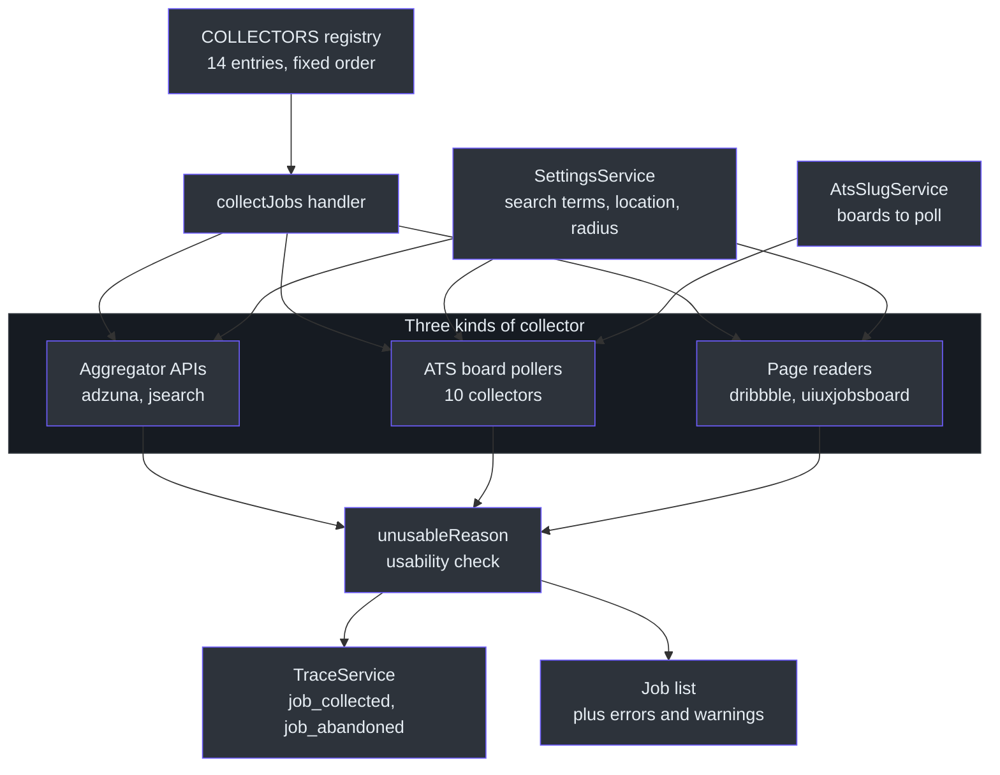
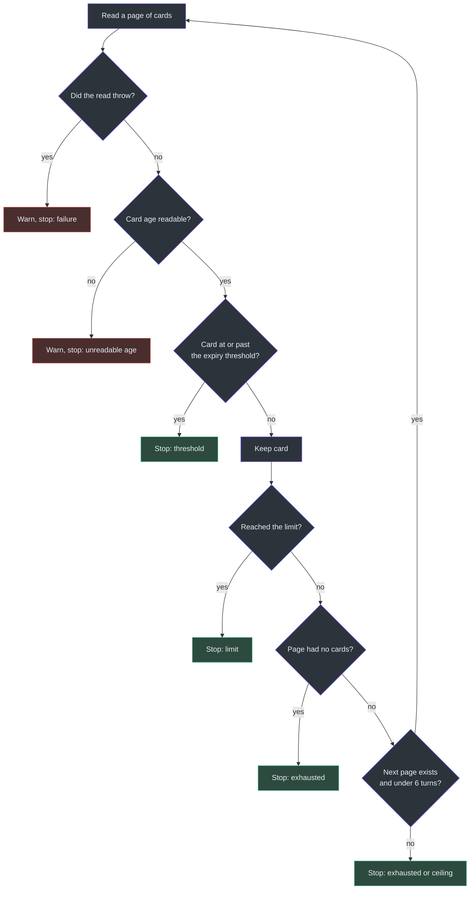
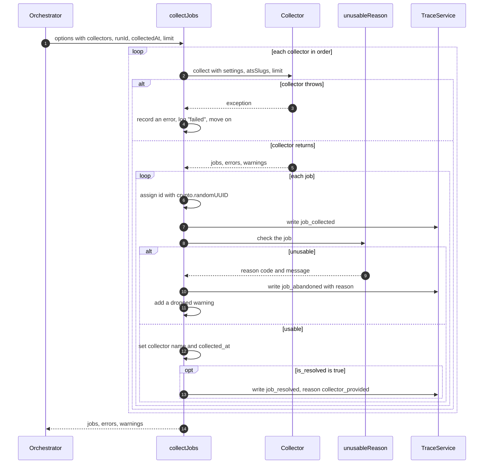
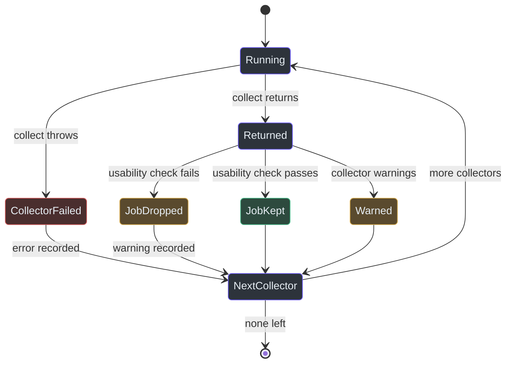

# Collection

## Overview

Collection is the first step of every job search. Its job is to build the first job list. Nothing earlier exists, so this is the one handler that takes no list as input ([lib/handlers/collection.ts:1-5](https://github.com/mablahblah/job-assistant/blob/main/lib/handlers/collection.ts#L1-L5)).

The design has one rule behind it. Only collectors and parsers know about a particular job site. Every later step works on a job's data alone and cannot tell where the job came from ([.claude/rules/part-ownership.md:9](https://github.com/mablahblah/job-assistant/blob/main/.claude/rules/part-ownership.md#L9)). So each collector hides one source's quirks behind one small contract, and the handler knows only that contract.

A collector gathers raw jobs and every field its source hands over for free. It writes each into a `raw_` field exactly as it arrived. It does not interpret anything ([.claude/rules/part-ownership.md:33](https://github.com/mablahblah/job-assistant/blob/main/.claude/rules/part-ownership.md#L33)).

`docs/architecture.md` describes seven collectors. The code lists 14 ([lib/collectors/registry.ts:19-34](https://github.com/mablahblah/job-assistant/blob/main/lib/collectors/registry.ts#L19-L34)). This page follows the code.

### At a glance

| Component | Responsibility | Key file | Source |
|---|---|---|---|
| `Collector` contract | The two-method shape every collector implements: a `name` and a `collect` function | `lib/collectors/collector.ts` | [lib/collectors/collector.ts:28-33](https://github.com/mablahblah/job-assistant/blob/main/lib/collectors/collector.ts#L28-L33) |
| `COLLECTORS` registry | The ordered list of collectors a search runs. Being listed here is the only way to join | `lib/collectors/registry.ts` | [lib/collectors/registry.ts:19-34](https://github.com/mablahblah/job-assistant/blob/main/lib/collectors/registry.ts#L19-L34) |
| `collectJobs` handler | Runs each collector in turn, isolates failures, tags each job, runs the usability check | `lib/handlers/collection.ts` | [lib/handlers/collection.ts:54-175](https://github.com/mablahblah/job-assistant/blob/main/lib/handlers/collection.ts#L54-L175) |
| `unusableReason` | Says why a job cannot travel, or returns null when it can | `lib/utils/job-usable.ts` | [lib/utils/job-usable.ts:45-92](https://github.com/mablahblah/job-assistant/blob/main/lib/utils/job-usable.ts#L45-L92) |
| `readAtsBoards` | Reads the list of boards one ATS collector polls from the database | `lib/collectors/ats-boards.ts` | [lib/collectors/ats-boards.ts:25-36](https://github.com/mablahblah/job-assistant/blob/main/lib/collectors/ats-boards.ts#L25-L36) |
| `matchesSearchTerms` | The shared title filter that ATS collectors apply to a whole-board reply | `lib/utils/search-term-analyzer.ts` | [lib/utils/search-term-analyzer.ts:30-41](https://github.com/mablahblah/job-assistant/blob/main/lib/utils/search-term-analyzer.ts#L30-L41) |
| `paginate` | The shared page loop for the two page-reading collectors | `lib/collectors/paginate.ts` | [lib/collectors/paginate.ts:95-195](https://github.com/mablahblah/job-assistant/blob/main/lib/collectors/paginate.ts#L95-L195) |
| `fetchWithTimeout`, `safeJson`, `httpError` | Shared request helpers: a 15 second timeout, a named JSON failure, a readable status message | `lib/utils/fetch-utils.ts` | [lib/utils/fetch-utils.ts:4-42](https://github.com/mablahblah/job-assistant/blob/main/lib/utils/fetch-utils.ts#L4-L42) |

## Architecture

The handler sits between the registry and the rest of the pipeline. It hands every collector a context with the settings, the ATS slug service (the table of known hiring-system boards) and a job limit ([lib/collectors/collector.ts:9-17](https://github.com/mablahblah/job-assistant/blob/main/lib/collectors/collector.ts#L9-L17)). A collector hands back jobs, errors and warnings, however its run went ([lib/collectors/collector.ts:22-26](https://github.com/mablahblah/job-assistant/blob/main/lib/collectors/collector.ts#L22-L26)).

<!-- Sources: lib/collectors/registry.ts:19-34, lib/collectors/collector.ts:9-33, lib/handlers/collection.ts:54-175, lib/utils/job-usable.ts:45-92 -->

## The 14 collectors

The three kinds differ in how they reach the source and in what the source already tells them.

- **Aggregator APIs** search many employers at once. Their links are redirects, so the job still needs resolution ([lib/collectors/adzuna.ts:56-57](https://github.com/mablahblah/job-assistant/blob/main/lib/collectors/adzuna.ts#L56-L57)).
- **ATS board pollers** read one employer's board on a hiring system such as Greenhouse. The board list comes from the database. The link they build is already the employer's own posting, so the job is marked resolved ([lib/collectors/greenhouse.ts:22-36](https://github.com/mablahblah/job-assistant/blob/main/lib/collectors/greenhouse.ts#L22-L36)).
- **Page readers** fetch a website's results page and read the job cards off it ([lib/tools/fetch-page.ts:1-3](https://github.com/mablahblah/job-assistant/blob/main/lib/tools/fetch-page.ts#L1-L3)).

"Arrives resolved" means the collector sets `is_resolved: true` and fills `resolved_url`. The [resolution step](./resolution.md) then skips the job.

| # | Collector | Kind of source | How it reaches the source | Arrives resolved? | Source |
|---|---|---|---|---|---|
| 1 | `adzuna` | Aggregator API | GET to Adzuna's search API. Two searches per term: remote nationwide, and anchored to the user's location and radius. Needs `ADZUNA_APP_ID` and `ADZUNA_API_KEY` | No. The link is a redirect | [lib/collectors/adzuna.ts:119-184](https://github.com/mablahblah/job-assistant/blob/main/lib/collectors/adzuna.ts#L119-L184), [lib/collectors/adzuna.ts:72](https://github.com/mablahblah/job-assistant/blob/main/lib/collectors/adzuna.ts#L72) |
| 2 | `jsearch` | Aggregator API | GET to JSearch through RapidAPI. All terms fold into one query, so a run is two requests: remote and local. Needs `RAPIDAPI_KEY` | No. The link is a redirect | [lib/collectors/jsearch.ts:112-157](https://github.com/mablahblah/job-assistant/blob/main/lib/collectors/jsearch.ts#L112-L157), [lib/collectors/jsearch.ts:77](https://github.com/mablahblah/job-assistant/blob/main/lib/collectors/jsearch.ts#L77) |
| 3 | `greenhouse` | ATS board poller | GET to the Greenhouse boards API for each board slug | Yes | [lib/collectors/greenhouse.ts:39-91](https://github.com/mablahblah/job-assistant/blob/main/lib/collectors/greenhouse.ts#L39-L91), [lib/collectors/greenhouse.ts:33](https://github.com/mablahblah/job-assistant/blob/main/lib/collectors/greenhouse.ts#L33) |
| 4 | `lever` | ATS board poller | GET to the Lever postings API for each board slug. The reply names no employer, so the job keeps the slug | Yes | [lib/collectors/lever.ts:36-52](https://github.com/mablahblah/job-assistant/blob/main/lib/collectors/lever.ts#L36-L52), [lib/collectors/lever.ts:29](https://github.com/mablahblah/job-assistant/blob/main/lib/collectors/lever.ts#L29) |
| 5 | `ashby` | ATS board poller | GET to Ashby's job board API for each slug. Ashby supplies the posting link itself | Yes | [lib/collectors/ashby.ts:42-58](https://github.com/mablahblah/job-assistant/blob/main/lib/collectors/ashby.ts#L42-L58), [lib/collectors/ashby.ts:35](https://github.com/mablahblah/job-assistant/blob/main/lib/collectors/ashby.ts#L35) |
| 6 | `dribbble` | Page reader | Fetches Dribbble's jobs page twice per term (location, remote) and reads the cards | Yes. The card link is the posting | [lib/collectors/dribbble.ts:76-169](https://github.com/mablahblah/job-assistant/blob/main/lib/collectors/dribbble.ts#L76-L169), [lib/collectors/dribbble.ts:70](https://github.com/mablahblah/job-assistant/blob/main/lib/collectors/dribbble.ts#L70) |
| 7 | `uiuxjobsboard` | Page reader | Fetches one page per matched category. Search terms are matched to the site's six fixed categories, not sent as a query | No | [lib/collectors/uiuxjobsboard.ts:61-162](https://github.com/mablahblah/job-assistant/blob/main/lib/collectors/uiuxjobsboard.ts#L61-L162), [lib/collectors/uiuxjobsboard.ts:55](https://github.com/mablahblah/job-assistant/blob/main/lib/collectors/uiuxjobsboard.ts#L55) |
| 8 | `workday` | ATS board poller | POST to Workday's job-search endpoint, one search per term, 20 results a page, up to 50 pages | Yes | [lib/collectors/workday.ts:88-153](https://github.com/mablahblah/job-assistant/blob/main/lib/collectors/workday.ts#L88-L153), [lib/collectors/workday.ts:46](https://github.com/mablahblah/job-assistant/blob/main/lib/collectors/workday.ts#L46) |
| 9 | `ultipro` | ATS board poller | POST to UltiPro's list endpoint. It takes no search text, so each board is read in full, 200 jobs a page, then filtered | Yes | [lib/collectors/ultipro.ts:87-131](https://github.com/mablahblah/job-assistant/blob/main/lib/collectors/ultipro.ts#L87-L131), [lib/collectors/ultipro.ts:44](https://github.com/mablahblah/job-assistant/blob/main/lib/collectors/ultipro.ts#L44) |
| 10 | `gem` | ATS board poller | GET to the Gem job-board API. The whole list arrives in one reply. The reply names no employer | Yes | [lib/collectors/gem.ts:38-54](https://github.com/mablahblah/job-assistant/blob/main/lib/collectors/gem.ts#L38-L54), [lib/collectors/gem.ts:31](https://github.com/mablahblah/job-assistant/blob/main/lib/collectors/gem.ts#L31) |
| 11 | `smartrecruiters` | ATS board poller | GET to the SmartRecruiters postings API, 100 per page, until a page is empty or the total is reached | Yes | [lib/collectors/smartrecruiters.ts:76-119](https://github.com/mablahblah/job-assistant/blob/main/lib/collectors/smartrecruiters.ts#L76-L119), [lib/collectors/smartrecruiters.ts:40](https://github.com/mablahblah/job-assistant/blob/main/lib/collectors/smartrecruiters.ts#L40) |
| 12 | `bamboohr` | ATS board poller | GET to the board's careers list address on `{slug}.bamboohr.com`, with an explicit accept header so it answers with data and not a web page | Yes | [lib/collectors/bamboohr.ts:43-59](https://github.com/mablahblah/job-assistant/blob/main/lib/collectors/bamboohr.ts#L43-L59), [lib/collectors/bamboohr.ts:36](https://github.com/mablahblah/job-assistant/blob/main/lib/collectors/bamboohr.ts#L36) |
| 13 | `rippling` | ATS board poller | GET to Rippling's board API. The listing names no employer, so the parser fills the name later | Yes | [lib/collectors/rippling.ts:39-55](https://github.com/mablahblah/job-assistant/blob/main/lib/collectors/rippling.ts#L39-L55), [lib/collectors/rippling.ts:32](https://github.com/mablahblah/job-assistant/blob/main/lib/collectors/rippling.ts#L32) |
| 14 | `workable` | ATS board poller | GET to Workable's widget API. The widget names the employer, so the job keeps both the name and the slug | Yes | [lib/collectors/workable.ts:46-62](https://github.com/mablahblah/job-assistant/blob/main/lib/collectors/workable.ts#L46-L62), [lib/collectors/workable.ts:39](https://github.com/mablahblah/job-assistant/blob/main/lib/collectors/workable.ts#L39) |

Totals: 2 aggregators, 10 ATS pollers, 2 page readers. 11 of the 14 arrive resolved. The three that do not are `adzuna`, `jsearch` and `uiuxjobsboard`. The `uiuxjobsboard` card builder leaves `resolved_url` unset ([lib/collectors/uiuxjobsboard.ts:45-59](https://github.com/mablahblah/job-assistant/blob/main/lib/collectors/uiuxjobsboard.ts#L45-L59)). Dribbble sets it, with this reason in the code: three listings were measured sharing one "View job" link, and following them would give three different jobs one resolved link, which dedupe reads as proof that they are one job ([lib/collectors/dribbble.ts:54-58](https://github.com/mablahblah/job-assistant/blob/main/lib/collectors/dribbble.ts#L54-L58)).

Every collector's `name` matches its filename, and it joins the pipeline only by being listed in the registry ([.claude/rules/sources.md:11-14](https://github.com/mablahblah/job-assistant/blob/main/.claude/rules/sources.md#L11-L14)). Adding or renaming one also means running `npm run db:seed`, so the new name joins the source priority list used by [dedupe](./dedupe-and-save.md) ([.claude/rules/source-registry.md:7-9](https://github.com/mablahblah/job-assistant/blob/main/.claude/rules/source-registry.md#L7-L9)).

### How an ATS collector decides what to poll

An ATS board poller does not hold a list of boards in code. The list lives in the ATS slug table. A row that carries a collector name is a board polled every run. A row with none is only a board the company is known to post on ([lib/collectors/ats-boards.ts:14-19](https://github.com/mablahblah/job-assistant/blob/main/lib/collectors/ats-boards.ts#L14-L19)).

`readAtsBoards` turns the rows into boards. If a collector has none, it returns a warning, so a collector switched off on purpose can be told apart from one emptied by accident ([lib/collectors/ats-boards.ts:21-35](https://github.com/mablahblah/job-assistant/blob/main/lib/collectors/ats-boards.ts#L21-L35)). This also follows the project rule that knowledge about a job site is data, never code. See [Project Rules](../quality/project-rules.md).

Most boards cannot be searched, so the collector fetches the whole reply and filters titles itself. `matchesSearchTerms` stems both the title and the term, then needs every word of at least one term to be present in the title ([lib/utils/search-term-analyzer.ts:27-41](https://github.com/mablahblah/job-assistant/blob/main/lib/utils/search-term-analyzer.ts#L27-L41)). Words of three characters or fewer are not stemmed, because the stemmer turns "uxs" into "ux" ([lib/utils/search-term-analyzer.ts:7-14](https://github.com/mablahblah/job-assistant/blob/main/lib/utils/search-term-analyzer.ts#L7-L14)). A blank term never matches, so one stray blank in settings does not match every job ([lib/utils/search-term-analyzer.ts:35-38](https://github.com/mablahblah/job-assistant/blob/main/lib/utils/search-term-analyzer.ts#L35-L38)).

The mapping of a raw posting to job fields lives in a shared `*-fields` util for each hiring system, for example `jobFieldsFromGreenhousePosting`. The collector and the parser both use it, so they cannot disagree about what a field means ([lib/collectors/greenhouse.ts:22-32](https://github.com/mablahblah/job-assistant/blob/main/lib/collectors/greenhouse.ts#L22-L32)). See [Parsing](./parsing.md).

### How the page readers stop

Dribbble and the UI/UX Jobs Board share `paginate`. It knows nothing about a browser. The caller supplies a way to read cards and a way to go to the next page ([lib/collectors/paginate.ts:1-4](https://github.com/mablahblah/job-assistant/blob/main/lib/collectors/paginate.ts#L1-L4)).

<!-- Sources: lib/collectors/paginate.ts:57-59, lib/collectors/paginate.ts:95-195 -->

Two design choices are worth knowing.

- An unreadable age stops the search with a warning. Failing open would let a reworded site rewrite its whole history every run in silence ([lib/collectors/paginate.ts:124-130](https://github.com/mablahblah/job-assistant/blob/main/lib/collectors/paginate.ts#L124-L130)).
- Two self-checks guard against a broken card selector. One fires when no cards are found. One fires when fewer than half the matched elements yield a card ([lib/collectors/paginate.ts:177-192](https://github.com/mablahblah/job-assistant/blob/main/lib/collectors/paginate.ts#L177-L192)). `noCardsWarnings` then says one line for the whole collector if every search was empty, and one line per search if only some were ([lib/collectors/paginate.ts:208-214](https://github.com/mablahblah/job-assistant/blob/main/lib/collectors/paginate.ts#L208-L214)).

Both page readers currently pass `advance: async () => false`, because each site serves its whole result set on one page. The paging code stays wired up for the day that changes ([lib/collectors/dribbble.ts:125-128](https://github.com/mablahblah/job-assistant/blob/main/lib/collectors/dribbble.ts#L125-L128), [lib/collectors/uiuxjobsboard.ts:117-121](https://github.com/mablahblah/job-assistant/blob/main/lib/collectors/uiuxjobsboard.ts#L117-L121)).

The UI/UX Jobs Board browses by six fixed categories. `matchCategories` picks a category when every word of a search term appears in its label ([lib/utils/match-categories.ts:10-13](https://github.com/mablahblah/job-assistant/blob/main/lib/utils/match-categories.ts#L10-L13)). If no category matches, the collector returns a warning, not an error ([lib/collectors/uiuxjobsboard.ts:73-78](https://github.com/mablahblah/job-assistant/blob/main/lib/collectors/uiuxjobsboard.ts#L73-L78)).

## The collection handler

`collectJobs` runs the collectors one after another in registry order. Running in sequence means a job list reads the way the run happened, and one collector's failure cannot cancel another's work ([lib/handlers/collection.ts:68-70](https://github.com/mablahblah/job-assistant/blob/main/lib/handlers/collection.ts#L68-L70)).

<!-- Sources: lib/handlers/collection.ts:54-175, lib/utils/job-usable.ts:45-92 -->

### What the handler guarantees

| Behaviour | Why it exists | Source |
|---|---|---|
| A thrown collector becomes one error. The others still run | One source dropping out must not cost the run the others | [lib/handlers/collection.ts:165-171](https://github.com/mablahblah/job-assistant/blob/main/lib/handlers/collection.ts#L165-L171) |
| The log says "failed", not "found=0" | Zero would read as a quiet week when the collector actually fell over | [lib/handlers/collection.ts:168-170](https://github.com/mablahblah/job-assistant/blob/main/lib/handlers/collection.ts#L168-L170) |
| Each job gets a fresh id the moment it enters the loop | A job dropped by the usability check still needs an id to name it in a trace event | [lib/handlers/collection.ts:86-90](https://github.com/mablahblah/job-assistant/blob/main/lib/handlers/collection.ts#L86-L90) |
| The handler writes `collector` and `collected_at` onto a copy | Collection is the authority on which collector found a job. No collector can supply the first-seen date | [lib/handlers/collection.ts:122-131](https://github.com/mablahblah/job-assistant/blob/main/lib/handlers/collection.ts#L122-L131) |
| `collected_at` arrives as an argument | Collection reads no clock, so one run shares a single date and a test can pin it | [lib/handlers/collection.ts:21-24](https://github.com/mablahblah/job-assistant/blob/main/lib/handlers/collection.ts#L21-L24) |
| A `limit` of 0 returns at once | `??` is used, not `||`, because 0 is a real value meaning collect nothing | [lib/handlers/collection.ts:55-66](https://github.com/mablahblah/job-assistant/blob/main/lib/handlers/collection.ts#L55-L66) |
| A `job_resolved` trace row is written for collector-resolved jobs | "Saved minus resolved" would count two different populations, because resolution also handles jobs an earlier run collected | [lib/handlers/collection.ts:133-147](https://github.com/mablahblah/job-assistant/blob/main/lib/handlers/collection.ts#L133-L147) |
| The log shows `kept=` and `dropped=` | A count of what the collector handed over would hide the jobs that did not survive | [lib/handlers/collection.ts:159-164](https://github.com/mablahblah/job-assistant/blob/main/lib/handlers/collection.ts#L159-L164) |

Progress lines go to stderr by default, so a job list printed on stdout stays clean ([lib/handlers/collection.ts:35-37](https://github.com/mablahblah/job-assistant/blob/main/lib/handlers/collection.ts#L35-L37)). The trace service never throws, so a failed diagnostics write cannot cancel a run ([lib/handlers/collection.ts:29-32](https://github.com/mablahblah/job-assistant/blob/main/lib/handlers/collection.ts#L29-L32)). See [Tracing and Run Summary](../architecture/tracing-and-run-summary.md).

## The usability check

A job that cannot travel is dropped at collection. Otherwise it would fail somewhere later, where what went wrong is harder to read ([lib/handlers/collection.ts:102-103](https://github.com/mablahblah/job-assistant/blob/main/lib/handlers/collection.ts#L102-L103)). The rule is: a field that is empty and needed, or filled and unusable, drops the job. A field that is empty and merely expected is fine ([lib/utils/job-usable.ts:1-4](https://github.com/mablahblah/job-assistant/blob/main/lib/utils/job-usable.ts#L1-L4)).

| Code | Fails when | Why it matters downstream | Source |
|---|---|---|---|
| `no_original_url` | The link is missing or blank | Nothing can resolve, parse, dedupe by URL or apply without a link | [lib/utils/job-usable.ts:46-50](https://github.com/mablahblah/job-assistant/blob/main/lib/utils/job-usable.ts#L46-L50) |
| `original_url_not_a_url` | The `URL` constructor rejects it | The constructor is the one already-correct answer to what counts as a link | [lib/utils/job-usable.ts:52-62](https://github.com/mablahblah/job-assistant/blob/main/lib/utils/job-usable.ts#L52-L62) |
| `no_raw_title` | The title is missing or blank | Classification, content dedupe and scoring all read the title | [lib/utils/job-usable.ts:64-67](https://github.com/mablahblah/job-assistant/blob/main/lib/utils/job-usable.ts#L64-L67) |
| `no_company_identity` | Both the company name and the board slug are missing | Either one alone is enough, because association matches slug first and name second | [lib/utils/job-usable.ts:69-78](https://github.com/mablahblah/job-assistant/blob/main/lib/utils/job-usable.ts#L69-L78) |
| `posting_date_unparseable` | The date is set and is an Invalid Date | An invalid date would travel unnoticed and throw at save time | [lib/utils/job-usable.ts:33-39](https://github.com/mablahblah/job-assistant/blob/main/lib/utils/job-usable.ts#L33-L39), [lib/utils/job-usable.ts:80-82](https://github.com/mablahblah/job-assistant/blob/main/lib/utils/job-usable.ts#L80-L82) |
| `posting_updated_date_unparseable` | Same, for the updated date | Same | [lib/utils/job-usable.ts:84-89](https://github.com/mablahblah/job-assistant/blob/main/lib/utils/job-usable.ts#L84-L89) |

An absent date is fine. JSearch leaves `posting_date` off some postings by design, and a parser fills it later ([lib/utils/job-usable.ts:33-36](https://github.com/mablahblah/job-assistant/blob/main/lib/utils/job-usable.ts#L33-L36)). The code, not the message, is what gets counted, because a message can embed a value such as the bad URL and split one failure into many groups ([lib/utils/job-usable.ts:7-9](https://github.com/mablahblah/job-assistant/blob/main/lib/utils/job-usable.ts#L7-L9)).

A dropped job is named by its title or its link, whichever survived. The code uses `||` because a blank title is one of the reasons a job gets dropped ([lib/handlers/collection.ts:46-52](https://github.com/mablahblah/job-assistant/blob/main/lib/handlers/collection.ts#L46-L52)). The next stage is [Normalization and Association](./normalization-and-association.md), which reads the company name or slug that this check guarantees.

## Failure model

<!-- Sources: lib/handlers/collection.ts:70-171, lib/collectors/collector.ts:19-26 -->

Collectors also degrade on their own. Inside a collector, a dead board or a dead search is a warning, not an error, so the other boards still get their turn ([lib/collectors/greenhouse.ts:54-69](https://github.com/mablahblah/job-assistant/blob/main/lib/collectors/greenhouse.ts#L54-L69), [lib/collectors/adzuna.ts:78-83](https://github.com/mablahblah/job-assistant/blob/main/lib/collectors/adzuna.ts#L78-L83)). Missing API keys are the exception. `adzuna` and `jsearch` return an error naming the missing variable ([lib/collectors/adzuna.ts:123-131](https://github.com/mablahblah/job-assistant/blob/main/lib/collectors/adzuna.ts#L123-L131), [lib/collectors/jsearch.ts:116-123](https://github.com/mablahblah/job-assistant/blob/main/lib/collectors/jsearch.ts#L116-L123)). Errors and warnings are shown in the run summary. See [Job Search Run](../architecture/job-search-run.md).

## Things the code leaves open

- Adzuna returns one fixed page of 50. When more matched, the collector warns and does not fetch further pages. Whether to page is left until these numbers are read ([lib/collectors/adzuna.ts:103-113](https://github.com/mablahblah/job-assistant/blob/main/lib/collectors/adzuna.ts#L103-L113)).
- The code that saves a page fixture for the two page readers is commented out on purpose. A real job search used to overwrite the saved fixture and dirty the working tree each run ([lib/collectors/dribbble.ts:147-163](https://github.com/mablahblah/job-assistant/blob/main/lib/collectors/dribbble.ts#L147-L163)).
- Adzuna's minimum salary is an inline constant and not a setting. The comment says it moves to settings the day a second source needs it ([lib/collectors/adzuna.ts:10-22](https://github.com/mablahblah/job-assistant/blob/main/lib/collectors/adzuna.ts#L10-L22)).

## Related Pages

| Page | Relationship |
|---|---|
| [Normalization and Association](./normalization-and-association.md) | The next step. Reshapes the raw fields collectors wrote and attaches each job to a company |
| [Dedupe and Save](./dedupe-and-save.md) | Uses the source priority list that names every collector |
| [Resolution](./resolution.md) | Skips jobs a collector already marked resolved |
| [Parsing](./parsing.md) | Fills the description and other fields ATS collectors leave unread |
| [Job Search Run](../architecture/job-search-run.md) | The orchestrator that calls `collectJobs` first |
| [Tracing and Run Summary](../architecture/tracing-and-run-summary.md) | Where `job_collected` and `job_abandoned` rows end up |
| [Services](../data/services.md) | The settings and ATS slug services handed to every collector |
| [Project Rules](../quality/project-rules.md) | The part-ownership and sources rules cited above |

## References

- [lib/collectors/collector.ts](https://github.com/mablahblah/job-assistant/blob/main/lib/collectors/collector.ts) - the contract
- [lib/collectors/registry.ts](https://github.com/mablahblah/job-assistant/blob/main/lib/collectors/registry.ts) - the ordered list
- [lib/handlers/collection.ts](https://github.com/mablahblah/job-assistant/blob/main/lib/handlers/collection.ts) - the handler
- [lib/utils/job-usable.ts](https://github.com/mablahblah/job-assistant/blob/main/lib/utils/job-usable.ts) - the usability check
- [.claude/rules/sources.md](https://github.com/mablahblah/job-assistant/blob/main/.claude/rules/sources.md) - naming and joining rules
