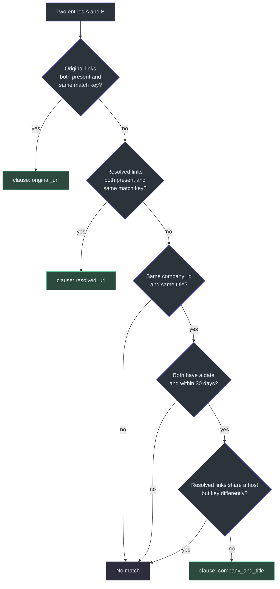
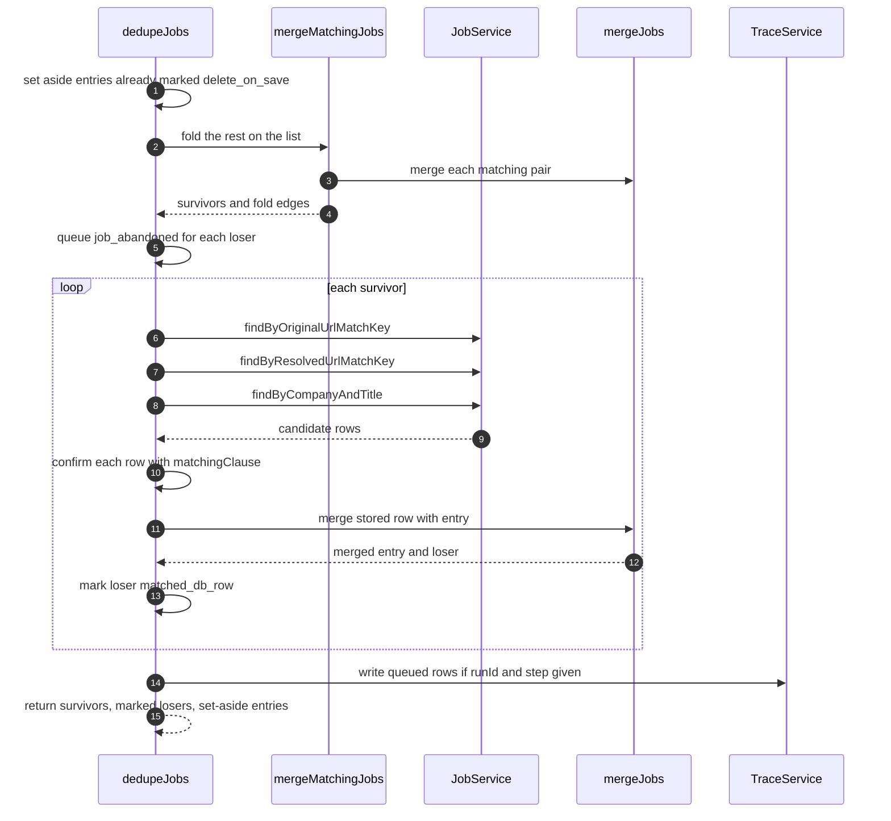
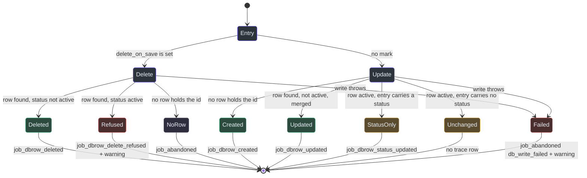
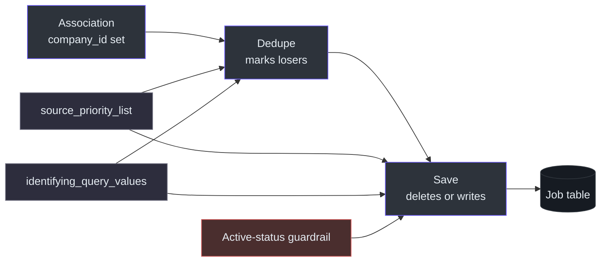

# Dedupe and Save

## Overview

The same job shows up many times. An aggregator and the employer's own board can list one role. One collector can re-find the same job every week. A repost can carry a new date. If the pipeline kept every copy, the user would read, score and apply to the same role again and again.

Two handlers handle this, and they are deliberately separate.

- **Dedupe** decides which jobs are the same and merges them. It reads the job table through the service it is handed and **never writes or deletes a row**. A loser stays on the returned list carrying a `delete_on_save` mark ([lib/handlers/dedupe.ts:1-10](https://github.com/mablahblah/job-assistant/blob/main/lib/handlers/dedupe.ts#L1-L10)).
- **Save** turns the list into database rows. It creates what is new, updates what exists, and deletes what dedupe marked ([lib/handlers/save.ts:1-6](https://github.com/mablahblah/job-assistant/blob/main/lib/handlers/save.ts#L1-L6)).

The split follows a project rule that each of these tasks exists exactly once. Removing duplicates is one implementation. Saving and updating is another ([.claude/rules/part-ownership.md:15-17](https://github.com/mablahblah/job-assistant/blob/main/.claude/rules/part-ownership.md#L15-L17)). Every rule about what a write does lives in the job service, and the save handler only loops and records the answer ([lib/handlers/save.ts:7-10](https://github.com/mablahblah/job-assistant/blob/main/lib/handlers/save.ts#L7-L10)).

Dedupe has three **identity clauses** (original link, resolved link, company and title), run in **two passes** (list, then database). Dedupe and save each run at three positions in a search: after collection, after resolution and after parsing ([lib/orchestrators/job-search.ts:335-358](https://github.com/mablahblah/job-assistant/blob/main/lib/orchestrators/job-search.ts#L335-L358), [lib/orchestrators/job-search.ts:409-431](https://github.com/mablahblah/job-assistant/blob/main/lib/orchestrators/job-search.ts#L409-L431), [lib/orchestrators/job-search.ts:529-548](https://github.com/mablahblah/job-assistant/blob/main/lib/orchestrators/job-search.ts#L529-L548)).

### At a glance

| Component | Responsibility | Key file | Source |
|---|---|---|---|
| `dedupeJobs` | Two-pass handler: list compare, then database compare | `lib/handlers/dedupe.ts` | [lib/handlers/dedupe.ts:77-229](https://github.com/mablahblah/job-assistant/blob/main/lib/handlers/dedupe.ts#L77-L229) |
| `matchingClause` | Says whether two entries are one job and names the first clause that fires | `lib/utils/job-identity.ts` | [lib/utils/job-identity.ts:108-117](https://github.com/mablahblah/job-assistant/blob/main/lib/utils/job-identity.ts#L108-L117) |
| `mergeMatchingJobs` | Pass one: folds entries that match each other on the list | `lib/utils/job-dedupe.ts` | [lib/utils/job-dedupe.ts:46-93](https://github.com/mablahblah/job-assistant/blob/main/lib/utils/job-dedupe.ts#L46-L93) |
| `mergeJobs` and `pickWinner` | The one merge rule: field contest, id survivor, date pooling | `lib/utils/job-merge.ts` | [lib/utils/job-merge.ts:138-162](https://github.com/mablahblah/job-assistant/blob/main/lib/utils/job-merge.ts#L138-L162), [lib/utils/job-merge.ts:200-272](https://github.com/mablahblah/job-assistant/blob/main/lib/utils/job-merge.ts#L200-L272) |
| `sideRank` | Ranks a collector or parser against the priority list | `lib/utils/source-priority.ts` | [lib/utils/source-priority.ts:61-74](https://github.com/mablahblah/job-assistant/blob/main/lib/utils/source-priority.ts#L61-L74) |
| `poolJobDates` | Keeps the earliest date as posted and the latest as updated | `lib/utils/job-dates.ts` | [lib/utils/job-dates.ts:22-53](https://github.com/mablahblah/job-assistant/blob/main/lib/utils/job-dates.ts#L22-L53) |
| `matchLabel` | Names a fold a hard match or a repost match from the date gap | `lib/utils/job-match-label.ts` | [lib/utils/job-match-label.ts:28-36](https://github.com/mablahblah/job-assistant/blob/main/lib/utils/job-match-label.ts#L28-L36) |
| `urlMatchKey` | Turns a link into a key that ignores tracking noise | `lib/utils/url-match-key.ts` | [lib/utils/url-match-key.ts:14-64](https://github.com/mablahblah/job-assistant/blob/main/lib/utils/url-match-key.ts#L14-L64) |
| `saveJobs` | Loops over the list: delete if marked, otherwise create or update | `lib/handlers/save.ts` | [lib/handlers/save.ts:147-200](https://github.com/mablahblah/job-assistant/blob/main/lib/handlers/save.ts#L147-L200) |
| `createJobService` | Owns every Job write, the merge on arrival and the active-status guardrail | `lib/services/job-service.ts` | [lib/services/job-service.ts:282-388](https://github.com/mablahblah/job-assistant/blob/main/lib/services/job-service.ts#L282-L388) |

## How two jobs are recognised as one

### The three identity clauses

`matchingClause` tries the clauses in order and names the first that fires. A shared link is proof and stands alone. Company and title is a guess, so it is tried last and only where dates back it up ([lib/utils/job-identity.ts:5-9](https://github.com/mablahblah/job-assistant/blob/main/lib/utils/job-identity.ts#L5-L9)). The clause name is written into a trace row, so the strings are never reworded ([lib/utils/job-identity.ts:7-8](https://github.com/mablahblah/job-assistant/blob/main/lib/utils/job-identity.ts#L7-L8)). No clause reads which collector found a job, as the part-ownership rule requires ([lib/utils/job-identity.ts:105-107](https://github.com/mablahblah/job-assistant/blob/main/lib/utils/job-identity.ts#L105-L107)).

| Order | Clause | Fires when | Why it is built this way | Source |
|---|---|---|---|---|
| 1 | `original_url` | Both sides have an original link and their match keys are equal | A shared link is proof. A missing field or a link that does not parse silences the clause, so two absent links never match | [lib/utils/job-identity.ts:24-33](https://github.com/mablahblah/job-assistant/blob/main/lib/utils/job-identity.ts#L24-L33), [lib/utils/job-identity.ts:113](https://github.com/mablahblah/job-assistant/blob/main/lib/utils/job-identity.ts#L113) |
| 2 | `resolved_url` | Same test on the resolved links | Two aggregator links can lead to one employer posting | [lib/utils/job-identity.ts:114](https://github.com/mablahblah/job-assistant/blob/main/lib/utils/job-identity.ts#L114) |
| 3 | `company_and_title` | Same `company_id`, same normalized `title`, latest dates within 30 days, and the shared-host veto does not block | Catches reposts and cross-source copies when no link is shared | [lib/utils/job-identity.ts:83-103](https://github.com/mablahblah/job-assistant/blob/main/lib/utils/job-identity.ts#L83-L103), [lib/utils/job-identity.ts:115](https://github.com/mablahblah/job-assistant/blob/main/lib/utils/job-identity.ts#L115) |

Every field the third clause reads must be present on both sides. If a date is missing on either side, the clause stays silent and does not compare a real date against nothing ([lib/utils/job-identity.ts:35-40](https://github.com/mablahblah/job-assistant/blob/main/lib/utils/job-identity.ts#L35-L40), [lib/utils/job-identity.ts:95-97](https://github.com/mablahblah/job-assistant/blob/main/lib/utils/job-identity.ts#L95-L97)). This is the project rule that dedupe only merges when a test has all its fields on both sides ([.claude/rules/part-ownership.md:38](https://github.com/mablahblah/job-assistant/blob/main/.claude/rules/part-ownership.md#L38)).

It uses the normalized title and not `raw_title`. Matching one role across sources that spell it differently is the reason [normalization](./normalization-and-association.md) exists ([lib/utils/job-identity.ts:91-93](https://github.com/mablahblah/job-assistant/blob/main/lib/utils/job-identity.ts#L91-L93)). The 30 day window is a measured choice: it covers 81% of reposts measured in the old database ([lib/utils/job-identity.ts:76-79](https://github.com/mablahblah/job-assistant/blob/main/lib/utils/job-identity.ts#L76-L79)).

**The shared-host veto.** Two posting ids on one job board are two openings at that company, not one job seen twice. If both resolved links share a host but key differently, the third clause is blocked ([lib/utils/job-identity.ts:53-74](https://github.com/mablahblah/job-assistant/blob/main/lib/utils/job-identity.ts#L53-L74)). The veto applies only when both sides carry a resolved link that parses.

### The link match key

`urlMatchKey` builds a key that two links to one posting both produce. It keeps the scheme, host (with port) and path, drops a trailing slash and the fragment, and keeps path case because a posting id can be case-sensitive ([lib/utils/url-match-key.ts:28-38](https://github.com/mablahblah/job-assistant/blob/main/lib/utils/url-match-key.ts#L28-L38)). Most query values are tracking noise, so they are dropped ([lib/utils/url-match-key.ts:7-9](https://github.com/mablahblah/job-assistant/blob/main/lib/utils/url-match-key.ts#L7-L9)). A few sources carry their only identity in a query value. UltiPro's `opportunityid` is the named example. The list `identifyingQueryValues` says which to keep, and an empty list drops the whole query ([lib/utils/url-match-key.ts:9-13](https://github.com/mablahblah/job-assistant/blob/main/lib/utils/url-match-key.ts#L9-L13)). Kept values are sorted so order does not matter ([lib/utils/url-match-key.ts:60-63](https://github.com/mablahblah/job-assistant/blob/main/lib/utils/url-match-key.ts#L60-L63)).

That list comes from settings, is read once per run and stops the run if missing, because linking without it would fold different openings into one ([lib/orchestrators/job-search.ts:211-216](https://github.com/mablahblah/job-assistant/blob/main/lib/orchestrators/job-search.ts#L211-L216)). It is passed to both dedupe passes and to save, so every pass keys links the same way ([lib/handlers/dedupe.ts:32-35](https://github.com/mablahblah/job-assistant/blob/main/lib/handlers/dedupe.ts#L32-L35), [lib/handlers/save.ts:23-26](https://github.com/mablahblah/job-assistant/blob/main/lib/handlers/save.ts#L23-L26)).

<!-- Sources: lib/utils/job-identity.ts:24-117, lib/utils/url-match-key.ts:14-64 -->

## The two passes

`dedupeJobs` compares the list first and then the database. Comparing the list first means each surviving job costs one set of lookups, and not one per duplicate ([lib/handlers/dedupe.ts:1-5](https://github.com/mablahblah/job-assistant/blob/main/lib/handlers/dedupe.ts#L1-L5)).

| Step | What happens | Source |
|---|---|---|
| Set aside | An entry that already carries `delete_on_save` was decided earlier. It is held out of both passes, because `mergeJobs` never carries that mark onto a merged entry and a winner would lose it | [lib/handlers/dedupe.ts:97-110](https://github.com/mablahblah/job-assistant/blob/main/lib/handlers/dedupe.ts#L97-L110) |
| Pass one | `mergeMatchingJobs` folds entries that match each other. Each loser is marked and a `job_abandoned` trace row is queued | [lib/handlers/dedupe.ts:112-132](https://github.com/mablahblah/job-assistant/blob/main/lib/handlers/dedupe.ts#L112-L132) |
| Collect list ids | Every id handed in, set-aside entries included. A stored row wearing one of these is a list entry's own row and not a second job | [lib/handlers/dedupe.ts:134-141](https://github.com/mablahblah/job-assistant/blob/main/lib/handlers/dedupe.ts#L134-L141) |
| Pass two | Each survivor is compared with stored rows through three lookups | [lib/handlers/dedupe.ts:143-206](https://github.com/mablahblah/job-assistant/blob/main/lib/handlers/dedupe.ts#L143-L206) |
| Write traces | Only if `trace`, `runId` and `step` are all present | [lib/handlers/dedupe.ts:208-226](https://github.com/mablahblah/job-assistant/blob/main/lib/handlers/dedupe.ts#L208-L226) |
| Return | `[...survivors, ...marked, ...setAside]` | [lib/handlers/dedupe.ts:228](https://github.com/mablahblah/job-assistant/blob/main/lib/handlers/dedupe.ts#L228) |

### Pass one: the fold on the list

Each entry is carried against the survivors gathered so far. When it matches one, the two merge and the merged entry replaces that survivor. The merged entry then looks for its next match, until nothing matches and it joins the survivors ([lib/utils/job-dedupe.ts:36-45](https://github.com/mablahblah/job-assistant/blob/main/lib/utils/job-dedupe.ts#L36-L45)). Matching chains. A can fold into B, and the merged entry may then match C even if A and C never matched, because the merge pools both sides' dates and links ([lib/utils/job-dedupe.ts:37-40](https://github.com/mablahblah/job-assistant/blob/main/lib/utils/job-dedupe.ts#L37-L40)).

Each fold records one edge: the loser, the entry it became, and the clause. It is kept per edge and not per final survivor, so a chain of three draws as two steps ([lib/utils/job-dedupe.ts:6-14](https://github.com/mablahblah/job-assistant/blob/main/lib/utils/job-dedupe.ts#L6-L14)).

**Hard match vs repost match.** The reason on a pass-one loser comes from `matchLabel`, which reads the merged entry's pooled dates ([lib/utils/job-dedupe.ts:74-77](https://github.com/mablahblah/job-assistant/blob/main/lib/utils/job-dedupe.ts#L74-L77)).

| Label | When | Meaning | Source |
|---|---|---|---|
| `hard_match_in_list` | Pooled posted and updated dates are under 24 hours apart, or there is only one date or none | Two sources disagreeing about when one posting went live, or one copy seen twice | [lib/utils/job-match-label.ts:28-36](https://github.com/mablahblah/job-assistant/blob/main/lib/utils/job-match-label.ts#L28-L36) |
| `repost_match_in_list` | The gap is 24 hours or more | A real republication | [lib/utils/job-match-label.ts:21-24](https://github.com/mablahblah/job-assistant/blob/main/lib/utils/job-match-label.ts#L21-L24) |

The label picks a trace reason and nothing else. It sets no flag and writes no date ([lib/utils/job-match-label.ts:21-26](https://github.com/mablahblah/job-assistant/blob/main/lib/utils/job-match-label.ts#L21-L26)). The 24 hour gap is a constant here and not a setting, because it describes source behaviour. Classification has its own tunable repost gap, and the two must move independently ([lib/utils/job-match-label.ts:13-19](https://github.com/mablahblah/job-assistant/blob/main/lib/utils/job-match-label.ts#L13-L19)). Whether a gap is a real repost is a judgement about the job and belongs to classification ([lib/utils/job-dates.ts:20-21](https://github.com/mablahblah/job-assistant/blob/main/lib/utils/job-dates.ts#L20-L21)). See [Judging Steps](./judging-steps.md).

### Pass two: the fold against the database

For each survivor, `findMatchingRows` asks the job service up to three questions. All three run every time, because each asks something different and each can name a row the other two missed ([lib/handlers/dedupe.ts:241-243](https://github.com/mablahblah/job-assistant/blob/main/lib/handlers/dedupe.ts#L241-L243)).

| Lookup | Asks | Source |
|---|---|---|
| `findByOriginalUrlMatchKey` | Which rows have this original-link key | [lib/handlers/dedupe.ts:244-250](https://github.com/mablahblah/job-assistant/blob/main/lib/handlers/dedupe.ts#L244-L250), [lib/services/job-service.ts:397-399](https://github.com/mablahblah/job-assistant/blob/main/lib/services/job-service.ts#L397-L399) |
| `findByResolvedUrlMatchKey` | Which rows have this resolved-link key | [lib/handlers/dedupe.ts:252-258](https://github.com/mablahblah/job-assistant/blob/main/lib/handlers/dedupe.ts#L252-L258), [lib/services/job-service.ts:401-403](https://github.com/mablahblah/job-assistant/blob/main/lib/services/job-service.ts#L401-L403) |
| `findByCompanyAndTitle` | Which rows share this company id and title | [lib/handlers/dedupe.ts:260-266](https://github.com/mablahblah/job-assistant/blob/main/lib/handlers/dedupe.ts#L260-L266), [lib/services/job-service.ts:408-410](https://github.com/mablahblah/job-assistant/blob/main/lib/services/job-service.ts#L408-L410) |

Rows come back from indexed columns that match on columns alone. Each row is then confirmed by `matchingClause`, because company and title also needs the date window and the veto, and only the clause applies those ([lib/handlers/dedupe.ts:268-276](https://github.com/mablahblah/job-assistant/blob/main/lib/handlers/dedupe.ts#L268-L276)). A row on the list's own id set is skipped, so one entry cannot claim another entry's row ([lib/handlers/dedupe.ts:286-289](https://github.com/mablahblah/job-assistant/blob/main/lib/handlers/dedupe.ts#L286-L289)).

If two list entries reach the same stored row, they are one job seen twice. The second joins the first one's claim and does not stand beside it ([lib/handlers/dedupe.ts:168-185](https://github.com/mablahblah/job-assistant/blob/main/lib/handlers/dedupe.ts#L168-L185)).

A stored row is passed to the merge as the earlier side. Order settles two things: the tie-break, which the later side wins, and the collection date, which the earlier side supplies ([lib/handlers/dedupe.ts:191-194](https://github.com/mablahblah/job-assistant/blob/main/lib/handlers/dedupe.ts#L191-L194)).

If a lookup throws, the entry is left exactly as it arrived and a `lookup_failed` warning is raised. The code states why: under-merging leaves a duplicate the user can see and delete, while over-merging destroys a job nobody knows is gone ([lib/handlers/dedupe.ts:152-166](https://github.com/mablahblah/job-assistant/blob/main/lib/handlers/dedupe.ts#L152-L166)).

<!-- Sources: lib/handlers/dedupe.ts:77-229, lib/utils/job-dedupe.ts:46-93, lib/services/job-service.ts:397-410 -->

### Trace reasons dedupe writes

| Event | Reason | Meaning | Source |
|---|---|---|---|
| `job_abandoned` | `hard_match_in_list`, `repost_match_in_list` | A pass-one loser | [lib/handlers/dedupe.ts:121-131](https://github.com/mablahblah/job-assistant/blob/main/lib/handlers/dedupe.ts#L121-L131) |
| `job_abandoned` | `matched_db_row` | An entry or row that lost a merge against a stored row | [lib/handlers/dedupe.ts:328-339](https://github.com/mablahblah/job-assistant/blob/main/lib/handlers/dedupe.ts#L328-L339) |
| `job_added_to_list` | `matched_list_entry` | A stored row that joined the list. It lost nothing, so it carries no detail | [lib/handlers/dedupe.ts:198-201](https://github.com/mablahblah/job-assistant/blob/main/lib/handlers/dedupe.ts#L198-L201) |

Each loser's detail records the entry it became, the clause, the company, the title, the original link and the posting date. The `became` value names the immediate partner and never the final survivor of a chain ([lib/handlers/dedupe.ts:341-359](https://github.com/mablahblah/job-assistant/blob/main/lib/handlers/dedupe.ts#L341-L359)). The four reasons are defined once, and a test checks that the schema comment matches ([lib/types/job-list-entry.ts:32-41](https://github.com/mablahblah/job-assistant/blob/main/lib/types/job-list-entry.ts#L32-L41)).

`job_abandoned` says a job's path ended. It makes no claim about whether a row existed. Whether a row is really deleted is save's to say ([lib/handlers/dedupe.ts:324-327](https://github.com/mablahblah/job-assistant/blob/main/lib/handlers/dedupe.ts#L324-L327)).

## The merge rule

`mergeJobs(earlier, later, priorityList, collectedAt)` is the single rule for what a combined job looks like. Dedupe uses it for in-memory pairs. The job service uses it when an entry arrives for a stored row ([lib/services/job-service.ts:344](https://github.com/mablahblah/job-assistant/blob/main/lib/services/job-service.ts#L344)). One rule serves both, so the two cannot disagree.

### Two winners

A merge needs two answers. They often differ, because a better source can arrive on a side that was never saved ([lib/utils/job-merge.ts:102-104](https://github.com/mablahblah/job-assistant/blob/main/lib/utils/job-merge.ts#L102-L104)).

| Winner | Decides | Rule | Source |
|---|---|---|---|
| **Data winner** | Whose value wins a contested field | Lower rank wins. A listed source beats an unlisted one. An exact tie goes to the later copy. With neither listed, the earlier copy stands | [lib/utils/job-merge.ts:133-162](https://github.com/mablahblah/job-assistant/blob/main/lib/utils/job-merge.ts#L133-L162) |
| **Id winner** | Whose `id` and `created_at` survive | A side with `created_at` already holds a database row. Between two rows the older wins. A row beats a never-saved entry whatever the list says. With neither saved, the data winner's id is used | [lib/utils/job-merge.ts:110-131](https://github.com/mablahblah/job-assistant/blob/main/lib/utils/job-merge.ts#L110-L131) |

The older row's id wins because it carries the earlier first-seen date, its own trace rows and the work log entry pointing at its id ([lib/utils/job-merge.ts:110-115](https://github.com/mablahblah/job-assistant/blob/main/lib/utils/job-merge.ts#L110-L115)). See [Status Change and Work Log](../agent-workflows/status-change-and-work-log.md).

### The source priority list

`source_priority_list` is an ordered setting of lines such as `collector:greenhouse` and `parser:ashby`. A lower number is better ([lib/utils/source-priority.ts:1-5](https://github.com/mablahblah/job-assistant/blob/main/lib/utils/source-priority.ts#L1-L5), [lib/utils/source-priority.ts:51-52](https://github.com/mablahblah/job-assistant/blob/main/lib/utils/source-priority.ts#L51-L52)).

`sideRank` works like this:

- A side with a parser on the list ranks at the parser's entry alone, because its details came from the parser, even if its collector sits higher ([lib/utils/source-priority.ts:52-55](https://github.com/mablahblah/job-assistant/blob/main/lib/utils/source-priority.ts#L52-L55)).
- Otherwise it ranks at its collector's entry.
- A rank of `null` means the side is nowhere on the list. That is not the same as ranking last. Two absent sides leave the stored value standing. Two tied sides let the later copy win ([lib/utils/source-priority.ts:58-60](https://github.com/mablahblah/job-assistant/blob/main/lib/utils/source-priority.ts#L58-L60)).
- Junk lines are skipped. Only the first colon splits kind from name, so a name with more colons is kept whole ([lib/utils/source-priority.ts:14-19](https://github.com/mablahblah/job-assistant/blob/main/lib/utils/source-priority.ts#L14-L19)).

This is why adding a collector means running `npm run db:seed`: a source missing from the list ranks below every listed source and loses every contested field ([.claude/rules/source-registry.md:9](https://github.com/mablahblah/job-assistant/blob/main/.claude/rules/source-registry.md#L9)).

### Field by field

Fields fall into groups, and each group has its own rule.

| Group | Fields | Rule | Source |
|---|---|---|---|
| Contested | Company name and slug, raw and normalized title, both links, raw and normalized location and mode lists, salary fields, description | A filled value beats an empty one. When both sides speak, the data winner is heard | [lib/utils/job-merge.ts:7-23](https://github.com/mablahblah/job-assistant/blob/main/lib/utils/job-merge.ts#L7-L23), [lib/utils/job-merge.ts:164-174](https://github.com/mablahblah/job-assistant/blob/main/lib/utils/job-merge.ts#L164-L174) |
| Raw salary | `salary_min`, `salary_max`, `salary_period`, `salary_currency`, `salary_unit` | Contested key by key, so a better source publishing only a period cannot wipe the figures beside it | [lib/utils/job-merge.ts:176-193](https://github.com/mablahblah/job-assistant/blob/main/lib/utils/job-merge.ts#L176-L193) |
| Written through | `company_id`, scores, phase gates (`is_resolved`, `is_parsed`, `is_classified`, `is_judged`), `status`, location match fields, `is_repost` | The later side lands. An explicit `null` is a real value. Only an absent key leaves the stored value | [lib/utils/job-merge.ts:25-51](https://github.com/mablahblah/job-assistant/blob/main/lib/utils/job-merge.ts#L25-L51), [lib/utils/job-merge.ts:224-230](https://github.com/mablahblah/job-assistant/blob/main/lib/utils/job-merge.ts#L224-L230) |
| Winner written | `collector`, `parser` | Taken from the data winner | [lib/utils/job-merge.ts:54](https://github.com/mablahblah/job-assistant/blob/main/lib/utils/job-merge.ts#L54), [lib/utils/job-merge.ts:232-237](https://github.com/mablahblah/job-assistant/blob/main/lib/utils/job-merge.ts#L232-L237) |
| Write once | `id`, `collected_at` | Set when the job first appears. The earlier side supplies the collection date | [lib/utils/job-merge.ts:57](https://github.com/mablahblah/job-assistant/blob/main/lib/utils/job-merge.ts#L57), [lib/utils/job-merge.ts:252-254](https://github.com/mablahblah/job-assistant/blob/main/lib/utils/job-merge.ts#L252-L254) |
| Pooled dates | `posting_date`, `posting_updated_date` | Gathered from both sides | [lib/utils/job-merge.ts:60](https://github.com/mablahblah/job-assistant/blob/main/lib/utils/job-merge.ts#L60) |
| Never on the entry | `modified_at`, the two link match keys | The database or the job service builds them at write time. A key settled in the merge could disagree with the link the contest picked | [lib/utils/job-merge.ts:62-72](https://github.com/mablahblah/job-assistant/blob/main/lib/utils/job-merge.ts#L62-L72) |
| Stripped at write | `created_at` | Carried in memory as the has-a-row signal. The job service strips it so a stored row keeps its own birthday | [lib/utils/job-merge.ts:74-79](https://github.com/mablahblah/job-assistant/blob/main/lib/utils/job-merge.ts#L74-L79) |

Scores sit in the written-through group on purpose. A collector re-finding a job carries no score, so the stored one stands. A merge settles two collectors disagreeing about a posting, and neither has an opinion about fit ([lib/utils/job-merge.ts:29-33](https://github.com/mablahblah/job-assistant/blob/main/lib/utils/job-merge.ts#L29-L33)). The judged marker is there for the same reason ([lib/utils/job-merge.ts:35-37](https://github.com/mablahblah/job-assistant/blob/main/lib/utils/job-merge.ts#L35-L37)). A fresh collection with no status cannot reset one the user already set ([lib/utils/job-merge.ts:224-226](https://github.com/mablahblah/job-assistant/blob/main/lib/utils/job-merge.ts#L224-L226)).

### Date pooling

`poolJobDates` gathers every real date from both sides. It matches repeats on the exact millisecond, so two collectors disagreeing by hours produce two dates and not one ([lib/utils/job-dates.ts:27-36](https://github.com/mablahblah/job-assistant/blob/main/lib/utils/job-dates.ts#L27-L36)).

| Distinct dates found | `posting_date` | `posting_updated_date` | Source |
|---|---|---|---|
| None | The collection date | `null` | [lib/utils/job-dates.ts:38-43](https://github.com/mablahblah/job-assistant/blob/main/lib/utils/job-dates.ts#L38-L43) |
| One | That date | `null` | [lib/utils/job-dates.ts:47-50](https://github.com/mablahblah/job-assistant/blob/main/lib/utils/job-dates.ts#L47-L50) |
| Two or more | The earliest | The latest | [lib/utils/job-dates.ts:45-52](https://github.com/mablahblah/job-assistant/blob/main/lib/utils/job-dates.ts#L45-L52) |

With no date anywhere, the time the pipeline first saw the posting is the closest honest stand-in for when it went live. It is never pooled alongside real dates ([lib/utils/job-dates.ts:38-40](https://github.com/mablahblah/job-assistant/blob/main/lib/utils/job-dates.ts#L38-L40)). Save pools an arriving entry against the stored row. Dedupe pools two entries where neither has a row ([lib/utils/job-dates.ts:15-18](https://github.com/mablahblah/job-assistant/blob/main/lib/utils/job-dates.ts#L15-L18)). A brand-new job is pooled against nothing, so a job with no posting date still leaves save with one ([lib/services/job-service.ts:300-304](https://github.com/mablahblah/job-assistant/blob/main/lib/services/job-service.ts#L300-L304)).

## Save

Save is a loop. For each entry it deletes if the entry is marked and otherwise updates, then records the outcome. It runs strictly one entry at a time, because two entries pointing at the same row have to be written in the order they arrived ([lib/handlers/save.ts:162-165](https://github.com/mablahblah/job-assistant/blob/main/lib/handlers/save.ts#L162-L165)). A job search runs it at several points, so every phase ends in a write and no phase relies on a list in memory ([lib/handlers/save.ts:2-6](https://github.com/mablahblah/job-assistant/blob/main/lib/handlers/save.ts#L2-L6)). See [Job Search Run](../architecture/job-search-run.md).

### What a save can do

<!-- Sources: lib/handlers/save.ts:62-145, lib/services/job-service.ts:321-388 -->

| Outcome | Trace event | Source |
|---|---|---|
| New row | `job_dbrow_created` | [lib/handlers/save.ts:62-64](https://github.com/mablahblah/job-assistant/blob/main/lib/handlers/save.ts#L62-L64) |
| Existing row merged and updated | `job_dbrow_updated` | [lib/handlers/save.ts:64](https://github.com/mablahblah/job-assistant/blob/main/lib/handlers/save.ts#L64) |
| Active row, status only changed | `job_dbrow_status_updated` | [lib/handlers/save.ts:65](https://github.com/mablahblah/job-assistant/blob/main/lib/handlers/save.ts#L65) |
| Active row left alone | none, because nothing changed | [lib/handlers/save.ts:66-68](https://github.com/mablahblah/job-assistant/blob/main/lib/handlers/save.ts#L66-L68) |
| Row deleted | `job_dbrow_deleted`, with the dedupe reason | [lib/handlers/save.ts:83-85](https://github.com/mablahblah/job-assistant/blob/main/lib/handlers/save.ts#L83-L85) |
| Delete refused | `job_dbrow_delete_refused`, with `blocked_by` and `status` detail, and a `delete_refused` warning | [lib/handlers/save.ts:87-101](https://github.com/mablahblah/job-assistant/blob/main/lib/handlers/save.ts#L87-L101) |
| No row held the id | `job_abandoned`, with the dedupe reason. The entry lost a merge and never reached a row | [lib/handlers/save.ts:104-107](https://github.com/mablahblah/job-assistant/blob/main/lib/handlers/save.ts#L104-L107) |
| Any throw | `job_abandoned` with `db_write_failed`, and a warning | [lib/handlers/save.ts:131-143](https://github.com/mablahblah/job-assistant/blob/main/lib/handlers/save.ts#L131-L143) |

The outcome map is typed on `JobWriteOutcome`, so a new outcome fails to compile instead of silently writing no row ([lib/handlers/save.ts:59-62](https://github.com/mablahblah/job-assistant/blob/main/lib/handlers/save.ts#L59-L62)).

### The active-job guardrail

Once the user has acted on a job, its row is protected. The five **active statuses** are `app. sent`, `screening`, `interview`, `test` and `offer` ([lib/utils/job-status.ts:8-14](https://github.com/mablahblah/job-assistant/blob/main/lib/utils/job-status.ts#L8-L14)). Save, the dashboard and the status-change tool all read this one list, so they cannot disagree about what the user has applied to ([lib/utils/job-status.ts:6-7](https://github.com/mablahblah/job-assistant/blob/main/lib/utils/job-status.ts#L6-L7)). The rules live in the job service and not in the handler ([lib/handlers/save.ts:7-10](https://github.com/mablahblah/job-assistant/blob/main/lib/handlers/save.ts#L7-L10)).

| Case | Behaviour | Why | Source |
|---|---|---|---|
| Update, row is active, entry has no status | Nothing is written. Outcome is `unchanged` | The user has applied, so everything about the job is frozen except its status | [lib/services/job-service.ts:328-334](https://github.com/mablahblah/job-assistant/blob/main/lib/services/job-service.ts#L328-L334) |
| Update, row is active, entry has a status | Only `status` is written. Outcome is `status_updated` | A status set by hand must still work | [lib/services/job-service.ts:335-337](https://github.com/mablahblah/job-assistant/blob/main/lib/services/job-service.ts#L335-L337) |
| Delete, row is active | Refused. The service returns the blocking row | A dedupe merge must not destroy the application history | [lib/services/job-service.ts:376-380](https://github.com/mablahblah/job-assistant/blob/main/lib/services/job-service.ts#L376-L380) |
| Delete, row is not active | The row is deleted | Nothing the user has acted on is lost | [lib/services/job-service.ts:382-383](https://github.com/mablahblah/job-assistant/blob/main/lib/services/job-service.ts#L382-L383) |
| Delete, no row | `deleted: false`, no blocker | The entry never reached a row of its own | [lib/services/job-service.ts:372-374](https://github.com/mablahblah/job-assistant/blob/main/lib/services/job-service.ts#L372-L374) |

When a delete is refused, both rows stand and the entry stays on the list because its row is still there. The user is told, so the pair can be reconciled by hand ([lib/handlers/save.ts:88-92](https://github.com/mablahblah/job-assistant/blob/main/lib/handlers/save.ts#L88-L92)).

The two rules together protect users' work. Dedupe's merge may pick a loser that is active. Save then refuses the delete. The code states this is why `job_abandoned` makes no claim about deletion ([lib/handlers/dedupe.ts:324-327](https://github.com/mablahblah/job-assistant/blob/main/lib/handlers/dedupe.ts#L324-L327)).

### Create and update inside the job service

For an entry with no row, `create` writes a row with the id given at collection, so a trace naming that id points at a row that exists ([lib/services/job-service.ts:283-284](https://github.com/mablahblah/job-assistant/blob/main/lib/services/job-service.ts#L283-L284)). It throws if `collected_at` is missing, because the column has no default ([lib/services/job-service.ts:291-295](https://github.com/mablahblah/job-assistant/blob/main/lib/services/job-service.ts#L291-L295)). If another save took the id in between, it recovers by taking the update path against that row ([lib/services/job-service.ts:313-316](https://github.com/mablahblah/job-assistant/blob/main/lib/services/job-service.ts#L313-L316)).

For an existing, non-active row, the service merges stored against arriving with `mergeJobs(stored, entry, ...)` and the stored `collected_at`. It drops the write-once fields and updates ([lib/services/job-service.ts:339-351](https://github.com/mablahblah/job-assistant/blob/main/lib/services/job-service.ts#L339-L351)).

The two link match keys are built here at write time, from the link and `identifyingQueryValues`. `delete_on_save` and `created_at` are stripped before Prisma sees the entry ([lib/services/job-service.ts:266-279](https://github.com/mablahblah/job-assistant/blob/main/lib/services/job-service.ts#L266-L279)). Passing `identifyingQueryValues` is required, because leaving it out would silently write keys without UltiPro's job id ([lib/services/job-service.ts:50-55](https://github.com/mablahblah/job-assistant/blob/main/lib/services/job-service.ts#L50-L55)).

### Save for companies

`saveCompanies` is the company half of the same file. It writes each company through the company service and hands the list back. A refused company still rides home on the list, because one silently missing would read as never handed in. The failure travels as a warning ([lib/handlers/save.ts:218-222](https://github.com/mablahblah/job-assistant/blob/main/lib/handlers/save.ts#L218-L222)). Scoring and backlog cleanup use it. See [Scoring](../agent-workflows/scoring.md).

## Where the order matters

<!-- Sources: lib/orchestrators/job-search.ts:207-216, lib/orchestrators/job-search.ts:321-358, lib/handlers/dedupe.ts:77-89, lib/handlers/save.ts:20-30 -->

Dedupe runs after [association](./normalization-and-association.md) because the third clause matches on `company_id`. It runs after normalization because it matches on the tidied title ([lib/orchestrators/job-search.ts:321-323](https://github.com/mablahblah/job-assistant/blob/main/lib/orchestrators/job-search.ts#L321-L323)). The orchestrator reads the priority list and the identifying query values once per run ([lib/orchestrators/job-search.ts:205-216](https://github.com/mablahblah/job-assistant/blob/main/lib/orchestrators/job-search.ts#L205-L216)).

## Rule and doc checks

| Item | Finding |
|---|---|
| Handler contract | Dedupe and save follow it: a list in, a list out, warnings returned, trace written through the service, and no database of their own ([.claude/rules/handler-contract.md:9-15](https://github.com/mablahblah/job-assistant/blob/main/.claude/rules/handler-contract.md#L9-L15)) |

## Related Pages

| Page | Relationship |
|---|---|
| [Normalization and Association](./normalization-and-association.md) | Supplies the normalized title and `company_id` that the third clause needs |
| [Collection](./collection.md) | Collectors named in the priority list; the first dedupe runs right after |
| [Resolution](./resolution.md) | Produces resolved links and a second dedupe and save |
| [Parsing](./parsing.md) | Parsers rank on the priority list and trigger a third dedupe and save |
| [Judging Steps](./judging-steps.md) | Classification owns the tunable repost gap and the judgement of reposts |
| [Services](../data/services.md) | The job service that owns every Job write |
| [Data Model](../data/data-model.md) | The Job columns, match keys and statuses |
| [Status Change and Work Log](../agent-workflows/status-change-and-work-log.md) | Sets statuses by hand and relies on the older row id surviving |
| [Tracing and Run Summary](../architecture/tracing-and-run-summary.md) | Where the dedupe and save events end up |
| [Job Search Run](../architecture/job-search-run.md) | The orchestrator that calls both handlers at several positions |

## References

- [lib/handlers/dedupe.ts](https://github.com/mablahblah/job-assistant/blob/main/lib/handlers/dedupe.ts)
- [lib/handlers/save.ts](https://github.com/mablahblah/job-assistant/blob/main/lib/handlers/save.ts)
- [lib/utils/job-merge.ts](https://github.com/mablahblah/job-assistant/blob/main/lib/utils/job-merge.ts)
- [lib/utils/job-identity.ts](https://github.com/mablahblah/job-assistant/blob/main/lib/utils/job-identity.ts)
- [lib/services/job-service.ts](https://github.com/mablahblah/job-assistant/blob/main/lib/services/job-service.ts)
- [.claude/rules/part-ownership.md](https://github.com/mablahblah/job-assistant/blob/main/.claude/rules/part-ownership.md)
