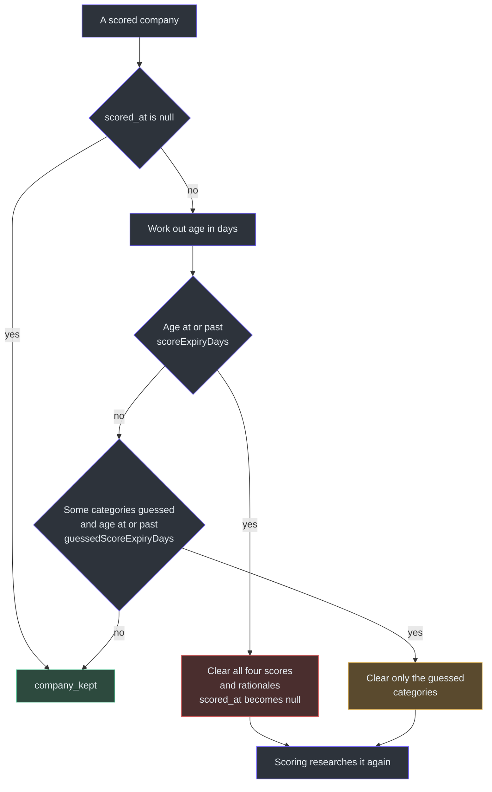
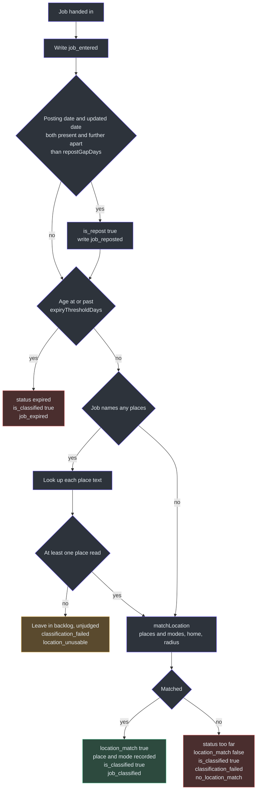
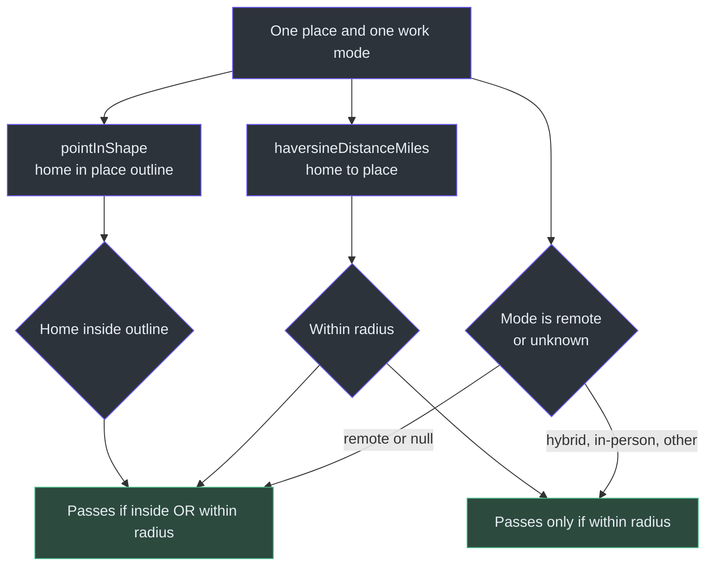
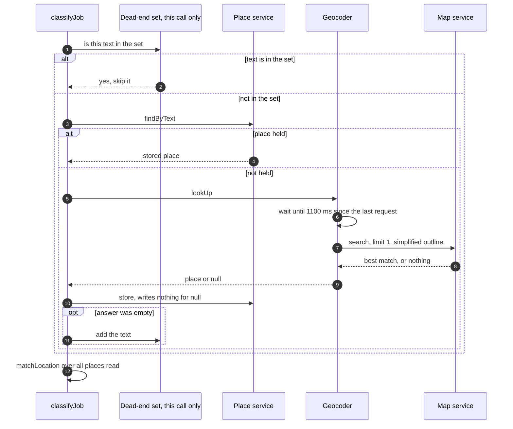
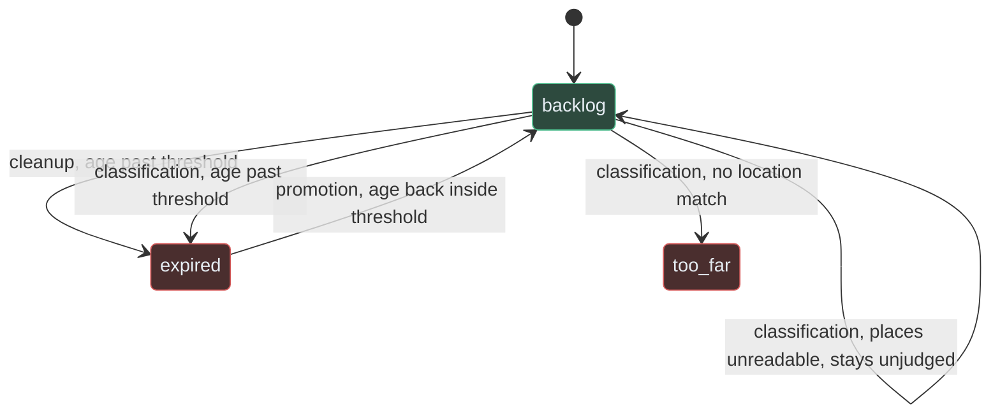

# Backlog Cleanup, Promotion and Classification

## Overview

The pipeline collects more jobs than anyone wants to read. Three steps judge jobs instead of fetching or reshaping them. They answer questions like "is this job too old", "was this role listed again" and "is this somewhere the user could work". The pipeline's rules give judging to these steps alone: classification judges the job, and it "never reshapes a value or goes looking for a missing one" ([part-ownership.md:40](https://github.com/mablahblah/job-assistant/blob/main/.claude/rules/part-ownership.md#L40)).

The three steps share one measure of age, so the clock cannot drift between them. They also share one reference moment: the instant the run started. A run that spends half an hour in a browser still judges every job against that one instant ([backlog-cleanup.ts:6-11](https://github.com/mablahblah/job-assistant/blob/main/lib/handlers/backlog-cleanup.ts#L6-L11), [classification.ts:12-13](https://github.com/mablahblah/job-assistant/blob/main/lib/handlers/classification.ts#L12-L13)).

The work-mode and location values used here were cleaned earlier. See [Normalization and Association](./normalization-and-association.md). The jobs come from [Parsing](./parsing.md).

### At a glance

| Component | Responsibility | Key file | Source |
|---|---|---|---|
| Backlog cleanup, jobs (`cleanBacklogJobs`) | Marks backlog jobs past the expiry threshold as `expired`. Runs first in a run | `lib/handlers/backlog-cleanup.ts` | [backlog-cleanup.ts:92-126](https://github.com/mablahblah/job-assistant/blob/main/lib/handlers/backlog-cleanup.ts#L92-L126) |
| Backlog cleanup, companies (`cleanBacklogCompanies`) | Empties company scores that have gone stale, so scoring researches them again | `lib/handlers/backlog-cleanup.ts` | [backlog-cleanup.ts:252-315](https://github.com/mablahblah/job-assistant/blob/main/lib/handlers/backlog-cleanup.ts#L252-L315) |
| Promotion (`promoteJobs`) | Returns an expired job to the backlog once its age is back inside the threshold | `lib/handlers/promotion.ts` | [promotion.ts:69-102](https://github.com/mablahblah/job-assistant/blob/main/lib/handlers/promotion.ts#L69-L102) |
| Classification (`classifyJobs`) | Marks reposts, expires jobs that are too old, and matches location against the user's | `lib/handlers/classification.ts` | [classification.ts:201-239](https://github.com/mablahblah/job-assistant/blob/main/lib/handlers/classification.ts#L201-L239) |
| Age measure (`jobAgeInDays`, `isPastThreshold`) | The one place a job's age is worked out | `lib/utils/job-age.ts` | [job-age.ts:61-63](https://github.com/mablahblah/job-assistant/blob/main/lib/utils/job-age.ts#L61-L63), [85-91](https://github.com/mablahblah/job-assistant/blob/main/lib/utils/job-age.ts#L85-L91) |
| Location match (`matchLocation`) | Decides if any place and work-mode pair is close enough to the user | `lib/utils/location-match.ts` | [location-match.ts:43-87](https://github.com/mablahblah/job-assistant/blob/main/lib/utils/location-match.ts#L43-L87) |
| Point in shape (`pointInShape`) | Tests whether the user's home point lies inside a place's outline | `lib/utils/point-in-shape.ts` | [point-in-shape.ts:37-53](https://github.com/mablahblah/job-assistant/blob/main/lib/utils/point-in-shape.ts#L37-L53) |
| Distance (`haversineDistanceMiles`) | Straight-line miles between two map points | `lib/utils/haversine.ts` | [haversine.ts:8-25](https://github.com/mablahblah/job-assistant/blob/main/lib/utils/haversine.ts#L8-L25) |
| Geocoder (`createGeocoder`) | Turns a place's text into coordinates and an outline, one request a second | `lib/tools/geocoder.ts` | [geocoder.ts:92-136](https://github.com/mablahblah/job-assistant/blob/main/lib/tools/geocoder.ts#L92-L136) |
| Place service (`createPlaceService`) | Owns the `Place` table, a cache of every place looked up | `lib/services/place-service.ts` | [place-service.ts:60-93](https://github.com/mablahblah/job-assistant/blob/main/lib/services/place-service.ts#L60-L93) |

## Where the steps sit in a run

Backlog cleanup opens the run. Promotion and classification close the job-handling part of it, after parsing.

```mermaid
graph LR
    subgraph Open["Start of run"]
        BC["Backlog cleanup<br>jobs and companies"]
    end
    subgraph Mid["Middle of run"]
        Col["Collection"] --> Res["Resolution"] --> Par["Parsing"] --> Nor["Normalization<br>and association"]
    end
    subgraph Judge["End of job handling"]
        Pro["Promotion"] --> Cla["Classification"]
    end
    BC --> Col
    Nor --> Pro
    Cla --> Sc["Scoring, by the agent"]

    style BC fill:#1e3a5f,stroke:#4a9eed,color:#e6edf3
    style Col fill:#2d333b,stroke:#6d5dfc,color:#e6edf3
    style Res fill:#2d333b,stroke:#6d5dfc,color:#e6edf3
    style Par fill:#2d333b,stroke:#6d5dfc,color:#e6edf3
    style Nor fill:#2d333b,stroke:#6d5dfc,color:#e6edf3
    style Pro fill:#1e3a5f,stroke:#4a9eed,color:#e6edf3
    style Cla fill:#1e3a5f,stroke:#4a9eed,color:#e6edf3
    style Sc fill:#2d333b,stroke:#6d5dfc,color:#e6edf3
    style Open fill:#161b22,stroke:#30363d,color:#e6edf3
    style Mid fill:#161b22,stroke:#30363d,color:#e6edf3
    style Judge fill:#161b22,stroke:#30363d,color:#e6edf3
```

<!-- Sources: lib/orchestrators/job-search.ts:218-272, lib/orchestrators/job-search.ts:582-637 -->

The exact order inside the orchestrator is: cleanup of jobs, then cleanup of companies, then two saves ([job-search.ts:220-272](https://github.com/mablahblah/job-assistant/blob/main/lib/orchestrators/job-search.ts#L220-L272)). Later come the home-location lookup, promotion and its save, then classification and its save ([job-search.ts:558-637](https://github.com/mablahblah/job-assistant/blob/main/lib/orchestrators/job-search.ts#L558-L637)). Scoring is a separate agent workflow, described in [Scoring](../agent-workflows/scoring.md). The wider run is described in [The Job Search Run](../architecture/job-search-run.md).

Every step reads its work from the database, and every step ends by saving. The expiry threshold is read once for the run, because cleanup, promotion and classification all judge age and a run that disagreed with itself about what counts as expired would contradict itself ([job-search.ts:188-194](https://github.com/mablahblah/job-assistant/blob/main/lib/orchestrators/job-search.ts#L188-L194)).

## How a job's age is measured

`jobAgeInDays` picks an anchor date in this order: the date the source last updated the posting, then the date it was posted, then the date this pipeline first collected it ([job-age.ts:85-87](https://github.com/mablahblah/job-assistant/blob/main/lib/utils/job-age.ts#L85-L87)). The reason is stated in the file. A source's last update date is closer to a posting's real age than its first date. The collected date is only a fallback because a source's own dates outrank our bookkeeping ([job-age.ts:73-77](https://github.com/mablahblah/job-assistant/blob/main/lib/utils/job-age.ts#L73-L77)).

The row's own `modified_at` and `created_at` are never read. Writing a status moves `modified_at`, so a rule reading it would make every job look freshly posted the moment its status was written ([job-age.ts:78-81](https://github.com/mablahblah/job-assistant/blob/main/lib/utils/job-age.ts#L78-L81)).

| Rule | Behavior | Source |
|---|---|---|
| Exact duration | Age is a fractional number of days, not a count of calendar days. `DAY_MS` is a fixed 86,400,000 ms | [job-age.ts:82-84](https://github.com/mablahblah/job-assistant/blob/main/lib/utils/job-age.ts#L82-L84), [durations.ts:11](https://github.com/mablahblah/job-assistant/blob/main/lib/utils/durations.ts#L11) |
| Future dates | A posting dated after the reference instant has age 0, never a negative age | [job-age.ts:88-90](https://github.com/mablahblah/job-assistant/blob/main/lib/utils/job-age.ts#L88-L90) |
| Threshold is inclusive | A job exactly `threshold` days old counts as past it | [job-age.ts:58-63](https://github.com/mablahblah/job-assistant/blob/main/lib/utils/job-age.ts#L58-L63) |
| Missing data | An undated job is read as collected this instant, which keeps it. Missing data alone never expires a job | [backlog-cleanup.ts:53-58](https://github.com/mablahblah/job-assistant/blob/main/lib/handlers/backlog-cleanup.ts#L53-L58), [classification.ts:129-133](https://github.com/mablahblah/job-assistant/blob/main/lib/handlers/classification.ts#L129-L133) |

## Step 1: Backlog cleanup

### Jobs

The step is handed every job with status `backlog`, regardless of how far along the pipeline it got ([job-service.ts:437-443](https://github.com/mablahblah/job-assistant/blob/main/lib/services/job-service.ts#L437-L443)). For each job, `cleanBacklogJob` asks one question: has its age crossed the expiry threshold. If yes, only the status changes, to `expired`. Nothing else about the job is touched ([backlog-cleanup.ts:73-80](https://github.com/mablahblah/job-assistant/blob/main/lib/handlers/backlog-cleanup.ts#L73-L80)). The step works on copies and never changes the job it was handed. It raises no warnings, because a job ageing out is the step working ([backlog-cleanup.ts:88-91](https://github.com/mablahblah/job-assistant/blob/main/lib/handlers/backlog-cleanup.ts#L88-L91)).

Trace events are `job_entered`, then either `job_kept` or `job_expired` with reason `past_expiration_threshold` ([backlog-cleanup.ts:39-46](https://github.com/mablahblah/job-assistant/blob/main/lib/handlers/backlog-cleanup.ts#L39-L46)). A job with no `id` or no `collector` is judged but leaves no trace row, since a row needs both as its key ([backlog-cleanup.ts:103-105](https://github.com/mablahblah/job-assistant/blob/main/lib/handlers/backlog-cleanup.ts#L103-L105)).

### Companies

A judgement about an employer goes stale the way a posting does. The company half of the sweep reads every company that has been scored (`scored_at` is not null, [company-service.ts:293-299](https://github.com/mablahblah/job-assistant/blob/main/lib/services/company-service.ts#L293-L299)). It uses two thresholds.

| Case | What is cleared | `scored_at` | Trace event | Source |
|---|---|---|---|---|
| Older than `scoreExpiryDays` | All four scores and their rationale sentences, and the list of guessed categories | Set to null | `company_scores_cleared` | [backlog-cleanup.ts:221-229](https://github.com/mablahblah/job-assistant/blob/main/lib/handlers/backlog-cleanup.ts#L221-L229), [287-294](https://github.com/mablahblah/job-assistant/blob/main/lib/handlers/backlog-cleanup.ts#L287-L294) |
| Older than `guessedScoreExpiryDays` and some categories were guessed | Only the guessed categories | Left as is, because the researched categories really are that old | `placeholder_company_scores_cleared` | [backlog-cleanup.ts:231-243](https://github.com/mablahblah/job-assistant/blob/main/lib/handlers/backlog-cleanup.ts#L231-L243), [295-302](https://github.com/mablahblah/job-assistant/blob/main/lib/handlers/backlog-cleanup.ts#L295-L302) |
| Never scored, or neither threshold passed | Nothing | Unchanged | `company_kept` | [backlog-cleanup.ts:214-217](https://github.com/mablahblah/job-assistant/blob/main/lib/handlers/backlog-cleanup.ts#L214-L217), [303-310](https://github.com/mablahblah/job-assistant/blob/main/lib/handlers/backlog-cleanup.ts#L303-L310) |

A "guessed" category is one the scoring agent filled in because nothing public could be found, so it expires sooner than a researched one ([backlog-cleanup.ts:128-131](https://github.com/mablahblah/job-assistant/blob/main/lib/handlers/backlog-cleanup.ts#L128-L131)). Full expiry is checked first on purpose, so a company old enough to lose everything does not walk away having lost only its guesses ([backlog-cleanup.ts:221-222](https://github.com/mablahblah/job-assistant/blob/main/lib/handlers/backlog-cleanup.ts#L221-L222)). A company's age cannot reuse the job measure because a company has one date and a job has three, but the arithmetic matches, including a floor of zero for future dates ([backlog-cleanup.ts:159-166](https://github.com/mablahblah/job-assistant/blob/main/lib/handlers/backlog-cleanup.ts#L159-L166)). The handler returns two counts, `scoresCleared` and `guessesCleared`, for the run summary ([backlog-cleanup.ts:146-153](https://github.com/mablahblah/job-assistant/blob/main/lib/handlers/backlog-cleanup.ts#L146-L153)). The orchestrator saves the cleaned companies before it saves the cleaned jobs ([job-search.ts:252-271](https://github.com/mablahblah/job-assistant/blob/main/lib/orchestrators/job-search.ts#L252-L271)).

<!-- Sources: lib/handlers/backlog-cleanup.ts:203-246 -->

## Step 2: Promotion

### Why promotion exists

An employer that lists a role again gives it a fresh posting date. That date pulls the job's age back inside the threshold. A job that expired earlier should then come back. Promotion does that ([promotion.ts:1-6](https://github.com/mablahblah/job-assistant/blob/main/lib/handlers/promotion.ts#L1-L6)).

Promotion trusts the job service to decide which jobs qualify. The lookup `findExpiredWithin` returns jobs whose status is `expired` and whose age is back inside the threshold ([job-service.ts:454-466](https://github.com/mablahblah/job-assistant/blob/main/lib/services/job-service.ts#L454-L466)). The handler then promotes everything it is handed and checks no age or status of its own ([promotion.ts:1-6](https://github.com/mablahblah/job-assistant/blob/main/lib/handlers/promotion.ts#L1-L6)).

It runs late for a reason. An expired job only gains a fresh date after collection has found the new listing and dedupe has merged it into the existing record. Run earlier, there would be nothing to find ([promotion.ts:8-11](https://github.com/mablahblah/job-assistant/blob/main/lib/handlers/promotion.ts#L8-L11)).

### What it changes

| Field | New value | Why | Source |
|---|---|---|---|
| `status` | `backlog` | The job is back in the running | [promotion.ts:57](https://github.com/mablahblah/job-assistant/blob/main/lib/handlers/promotion.ts#L57) |
| `is_classified` | `false` | Classification should reach its own conclusion about the relisted posting rather than inherit the one that expired it | [promotion.ts:13-14](https://github.com/mablahblah/job-assistant/blob/main/lib/handlers/promotion.ts#L13-L14), [58](https://github.com/mablahblah/job-assistant/blob/main/lib/handlers/promotion.ts#L58) |
| `alignment_score`, `alignment_rationale` | `null` | The posting now on offer is not the one that was scored. A job with no score is picked up by the next scoring run | [promotion.ts:50-52](https://github.com/mablahblah/job-assistant/blob/main/lib/handlers/promotion.ts#L50-L52), [59-60](https://github.com/mablahblah/job-assistant/blob/main/lib/handlers/promotion.ts#L59-L60) |
| Location match, matched place, matched mode, repost mark | Left alone | Classification overwrites them moments later, so clearing them first buys nothing | [promotion.ts:15-17](https://github.com/mablahblah/job-assistant/blob/main/lib/handlers/promotion.ts#L15-L17) |

Trace rows are `job_entered` and `job_promoted`, with no reason, because promotion has a single outcome ([promotion.ts:32-40](https://github.com/mablahblah/job-assistant/blob/main/lib/handlers/promotion.ts#L32-L40)). The orchestrator reads classification's work list after promotion's save, so promoted jobs are judged in the same run ([job-search.ts:606-610](https://github.com/mablahblah/job-assistant/blob/main/lib/orchestrators/job-search.ts#L606-L610)).

Inferred: `findExpiredWithin` filters on status `expired` and age only. It does not look at why a job expired. A job that parsing marked `expired` because its page was dead keeps a fresh posting date, so by this filter it also qualifies for promotion on the next run ([parsing.ts:119-124](https://github.com/mablahblah/job-assistant/blob/main/lib/handlers/parsing.ts#L119-L124), [job-service.ts:458-466](https://github.com/mablahblah/job-assistant/blob/main/lib/services/job-service.ts#L458-L466)). Whether that is intended is not written down in the files read for this page. Verify in the promotion tests (`lib/handlers/promotion.test.ts`).

## Step 3: Classification

### What it is handed

The step reads every job with status `backlog` that is resolved, parsed and not yet classified ([job-service.ts:488-494](https://github.com/mablahblah/job-assistant/blob/main/lib/services/job-service.ts#L488-L494)). It asks three questions about each. The order matters ([classification.ts:6-10](https://github.com/mablahblah/job-assistant/blob/main/lib/handlers/classification.ts#L6-L10)).

1. **Is it a repost?** Decided first. The repost mark is a fact about the posting, not a verdict, so it survives whatever the other checks decide. A job can be both a repost and too old.
2. **Is it too old?** Before the location check, because a job the user cannot apply to is not worth a paced, paid mapping request.
3. **Is it somewhere the user could work?** The only check that reaches outside the app.

### The decision flow for one job

<!-- Sources: lib/handlers/classification.ts:109-196 -->

### The three checks

| Check | Rule | Why | Source |
|---|---|---|---|
| Repost | Needs both `posting_date` and `posting_updated_date`. The gap between them, as an exact duration, must be greater than `repostGapDays` | Two dates far apart mean the role was listed again, not edited. One date says nothing either way. The gap is a duration so that two collectors disagreeing by hours about one posting are absorbed | [classification.ts:60-70](https://github.com/mablahblah/job-assistant/blob/main/lib/handlers/classification.ts#L60-L70), [schema.prisma:336-340](https://github.com/mablahblah/job-assistant/blob/main/prisma/schema.prisma#L336-L340) |
| Age | `isPastThreshold` on `jobAgeInDays`. If past, status becomes `expired` and `is_classified` is true | A relisted role has a fresh updated date, so it is not old. That is also why promotion can bring it back | [classification.ts:125-141](https://github.com/mablahblah/job-assistant/blob/main/lib/handlers/classification.ts#L125-L141) |
| Location | Look up every place text on the job, then `matchLocation`. A match records the place and mode. No match sets status `too far` | The user needs a job they can do from where they live | [classification.ts:143-186](https://github.com/mablahblah/job-assistant/blob/main/lib/handlers/classification.ts#L143-L186) |

The location texts come from `normalized_location_list`, and the modes from `normalized_mode_list` ([classification.ts:143](https://github.com/mablahblah/job-assistant/blob/main/lib/handlers/classification.ts#L143), [164](https://github.com/mablahblah/job-assistant/blob/main/lib/handlers/classification.ts#L164)). A job that names places but has none of them read is **left in the backlog, unjudged**. A place we could not read is not proof the job is far away ([classification.ts:152-157](https://github.com/mablahblah/job-assistant/blob/main/lib/handlers/classification.ts#L152-L157)). A lookup that throws is handled the same way, with the same reason, so every job has exactly one outcome row ([classification.ts:188-194](https://github.com/mablahblah/job-assistant/blob/main/lib/handlers/classification.ts#L188-L194)). A job that names no place at all is judged on its work mode alone, because a posting saying only "remote" names nowhere and is still work the user could do ([classification.ts:159-161](https://github.com/mablahblah/job-assistant/blob/main/lib/handlers/classification.ts#L159-L161)).

### Trace events

| Event | Reason | When | Source |
|---|---|---|---|
| `job_entered` | none | Every job on arrival | [classification.ts:117](https://github.com/mablahblah/job-assistant/blob/main/lib/handlers/classification.ts#L117) |
| `job_reposted` | none | The repost check fired. Written before the outcome so the outcome stays the last word | [classification.ts:122-123](https://github.com/mablahblah/job-assistant/blob/main/lib/handlers/classification.ts#L122-L123) |
| `job_expired` | `past_expiration_threshold` | Too old | [classification.ts:139](https://github.com/mablahblah/job-assistant/blob/main/lib/handlers/classification.ts#L139) |
| `job_classified` | none | Location matched | [classification.ts:170](https://github.com/mablahblah/job-assistant/blob/main/lib/handlers/classification.ts#L170) |
| `classification_failed` | `no_location_match` | Places read, none close enough | [classification.ts:183](https://github.com/mablahblah/job-assistant/blob/main/lib/handlers/classification.ts#L183) |
| `classification_failed` | `location_unusable` | Places named but none could be read, or a lookup threw | [classification.ts:155](https://github.com/mablahblah/job-assistant/blob/main/lib/handlers/classification.ts#L155), [193](https://github.com/mablahblah/job-assistant/blob/main/lib/handlers/classification.ts#L193) |

## Location matching: containment against distance

`matchLocation` pairs every place a job names with every work mode it offers. Any one pair passing is enough, so a posting offering several ways to work is judged on its best ([location-match.ts:1-5](https://github.com/mablahblah/job-assistant/blob/main/lib/utils/location-match.ts#L1-L5)). The two tests answer different questions.

| Work mode | Test used | Reason | Source |
|---|---|---|---|
| `remote` | Home point inside the place's outline, **or** place within the radius | Remote means working from home. Living inside the place is enough however large the place is, and a nearby anchor town still counts | [location-match.ts:6-11](https://github.com/mablahblah/job-assistant/blob/main/lib/utils/location-match.ts#L6-L11), [39-41](https://github.com/mablahblah/job-assistant/blob/main/lib/utils/location-match.ts#L39-L41) |
| `hybrid`, `in-person` | Place within the radius only | These mean showing up at an office. Living in a region the office also sits in is no help if the office is far away | [location-match.ts:7-9](https://github.com/mablahblah/job-assistant/blob/main/lib/utils/location-match.ts#L7-L9) |
| Unknown mode word | Treated as on-site, the stricter test | A stray word must not let a whole country through on containment alone | [location-match.ts:37-41](https://github.com/mablahblah/job-assistant/blob/main/lib/utils/location-match.ts#L37-L41) |
| No mode listed at all | Judged as one pair with mode `null`, which uses the containment test | An unknown mode is recorded as nothing, not invented as a word | [location-match.ts:49-51](https://github.com/mablahblah/job-assistant/blob/main/lib/utils/location-match.ts#L49-L51) |
| No place read, mode includes `remote` | Passes with no place named | A job saying only "remote" is work the user could do from home | [location-match.ts:53-58](https://github.com/mablahblah/job-assistant/blob/main/lib/utils/location-match.ts#L53-L58) |

Within the passing pairs, the strictly nearest place wins, so an exact tie keeps the place listed first. That decides only the name shown, never whether the job matched ([location-match.ts:76-80](https://github.com/mablahblah/job-assistant/blob/main/lib/utils/location-match.ts#L76-L80)). The home point is the coordinates of the user's home location setting. The radius is the radius setting ([job-search.ts:558-575](https://github.com/mablahblah/job-assistant/blob/main/lib/orchestrators/job-search.ts#L558-L575)).

**Why containment is done with geometry, not names.** The file records that a name match once let a job in a different town with the same name as the user's read as local, and that any place sharing a name with the user's own neighbourhood would match it too. An outline cannot make that mistake ([point-in-shape.ts:1-5](https://github.com/mablahblah/job-assistant/blob/main/lib/utils/point-in-shape.ts#L1-L5)). `pointInShape` runs ray casting over a `Polygon` or `MultiPolygon`. A point inside a hole does not count. Any other shape, or no outline, contains nothing, and the caller falls back on distance ([point-in-shape.ts:32-53](https://github.com/mablahblah/job-assistant/blob/main/lib/utils/point-in-shape.ts#L32-L53)). Distance is the haversine formula, which gives straight-line miles over the earth's surface, rounded to one decimal place ([haversine.ts:1-25](https://github.com/mablahblah/job-assistant/blob/main/lib/utils/haversine.ts#L1-L25)).

<!-- Sources: lib/utils/location-match.ts:37-87, lib/utils/point-in-shape.ts:37-53, lib/utils/haversine.ts:8-25 -->

## Geocoding and the place cache

### Why there is a cache

The geocoder allows one request a second. Postings repeat the same places over and over. Across the real database, the file records that 3,975 lookups resolve to only 789 distinct places, so each place is looked up once and reused from the `Place` table ([place-service.ts:1-5](https://github.com/mablahblah/job-assistant/blob/main/lib/services/place-service.ts#L1-L5)). Only the place service touches that table ([place-service.ts:1-2](https://github.com/mablahblah/job-assistant/blob/main/lib/services/place-service.ts#L1-L2)).

### The pace

| Rule | Behavior | Source |
|---|---|---|
| Spacing | `GEOCODE_PACING_MS = 1100`: one second plus a buffer for clock drift. The tool keeps its own timer, so no caller has to remember to wait | [geocoder.ts:4-5](https://github.com/mablahblah/job-assistant/blob/main/lib/tools/geocoder.ts#L4-L5), [15-16](https://github.com/mablahblah/job-assistant/blob/main/lib/tools/geocoder.ts#L15-L16), [109-111](https://github.com/mablahblah/job-assistant/blob/main/lib/tools/geocoder.ts#L109-L111) |
| Timer lives in the geocoder | Held per geocoder, not in module state, so a test can pace a run without a reset hook | [geocoder.ts:93-95](https://github.com/mablahblah/job-assistant/blob/main/lib/tools/geocoder.ts#L93-L95) |
| No retry | A refusal returns `null` and stores nothing. A run resolving hundreds of places cannot afford to back off. The place is tried again next run | [geocoder.ts:6-9](https://github.com/mablahblah/job-assistant/blob/main/lib/tools/geocoder.ts#L6-L9), [127-133](https://github.com/mablahblah/job-assistant/blob/main/lib/tools/geocoder.ts#L127-L133) |
| Timeout | The request goes through `fetchWithTimeout`, so a hung request cannot stall every job waiting behind it | [geocoder.ts:113-119](https://github.com/mablahblah/job-assistant/blob/main/lib/tools/geocoder.ts#L113-L119) |
| Key | The `GEOCODE_MAPS_API_KEY` environment variable is read at call time and throws if missing. A missing key used to make every job fail to classify silently | [geocoder.ts:102-107](https://github.com/mablahblah/job-assistant/blob/main/lib/tools/geocoder.ts#L102-L107) |
| Request shape | Only the best match is asked for (`limit=1`), with the place outline simplified (`polygon_threshold=0.01`) because an unsimplified country outline runs to megabytes | [geocoder.ts:74-86](https://github.com/mablahblah/job-assistant/blob/main/lib/tools/geocoder.ts#L74-L86) |
| Bad numbers | A missing or unreadable coordinate returns `null` rather than NaN or zero, which would read as a place off the coast of Africa | [geocoder.ts:34-42](https://github.com/mablahblah/job-assistant/blob/main/lib/tools/geocoder.ts#L34-L42) |

### The lookup order for one place text

`resolvePlace` goes through three levels before spending a request ([classification.ts:72-107](https://github.com/mablahblah/job-assistant/blob/main/lib/handlers/classification.ts#L72-L107)).

1. **This run's dead-end set.** A text that already came back empty this run is not asked again. It is checked first because nothing is stored for an empty answer, so a text in the set cannot be in the table either.
2. **The `Place` table.** A place already held is used as is.
3. **The geocoder.** The answer is stored, or nothing is stored if it was empty. An empty text joins the dead-end set.

The dead-end set lives inside one call of `classifyJobs`, not in the module. One run therefore cannot inherit another's dead ends and skip a map service that has since learned the place ([classification.ts:208-211](https://github.com/mablahblah/job-assistant/blob/main/lib/handlers/classification.ts#L208-L211)). The place service stores nothing for an empty answer, which leaves the text free to be tried again later, once a better text splitter or map might place it ([place-service.ts:73-78](https://github.com/mablahblah/job-assistant/blob/main/lib/services/place-service.ts#L73-L78)). It upserts on the lookup text ([place-service.ts:86-90](https://github.com/mablahblah/job-assistant/blob/main/lib/services/place-service.ts#L86-L90)).

<!-- Sources: lib/handlers/classification.ts:80-107, lib/tools/geocoder.ts:92-136, lib/services/place-service.ts:60-93 -->

### The home point

Once per run, before classification, the orchestrator turns the user's home location setting into coordinates using the same cache. It asks the place service first and the geocoder only if the text has never been seen. A location that cannot be placed on a map ends the run, because measuring against nothing would mark every job as not matching ([job-search.ts:553-575](https://github.com/mablahblah/job-assistant/blob/main/lib/orchestrators/job-search.ts#L553-L575)).

## How a job's status moves through these steps

<!-- Sources: lib/handlers/backlog-cleanup.ts:73-80, lib/handlers/promotion.ts:53-64, lib/handlers/classification.ts:138-186 -->

The state named `too_far` here is stored as the status string `too far`, with a space ([classification.ts:185](https://github.com/mablahblah/job-assistant/blob/main/lib/handlers/classification.ts#L185)). The diagram uses an underscore only because the diagram language does not allow a space in a state name. The part-ownership rule gives each status to one step: classification sets `too far`, or `expired` for an old posting, backlog cleanup sets `expired`, and promotion sets `backlog` ([part-ownership.md:46](https://github.com/mablahblah/job-assistant/blob/main/.claude/rules/part-ownership.md#L46)).

## Notes where code and docs differ

- The promotion handler's comment says it "runs late in the pipeline". In the orchestrator it runs after parsing's save and before classification, which is late for job handling but before scoring ([promotion.ts:8-11](https://github.com/mablahblah/job-assistant/blob/main/lib/handlers/promotion.ts#L8-L11), [job-search.ts:579-592](https://github.com/mablahblah/job-assistant/blob/main/lib/orchestrators/job-search.ts#L579-L592)).

## Related Pages

| Page | Relationship |
|---|---|
| [Parsing](./parsing.md) | Produces the parsed jobs classification reads, and can itself mark a dead posting `expired` |
| [Normalization and Association](./normalization-and-association.md) | Cleans the location and work-mode lists matched here |
| [Dedupe and Save](./dedupe-and-save.md) | The save step that follows each judging step |
| [Scoring](../agent-workflows/scoring.md) | Scores the jobs that survive classification, and re-researches companies cleanup emptied |
| [Data Model](../data/data-model.md) | Describes the `Place` table and the job status values |
| [Services](../data/services.md) | Describes the place service and the settings service |
| [Tracing and the Run Summary](../architecture/tracing-and-run-summary.md) | Explains the trace rows these steps write |
| [The Job Search Run](../architecture/job-search-run.md) | Shows the full run order |

## References

- [lib/handlers/backlog-cleanup.ts](https://github.com/mablahblah/job-assistant/blob/main/lib/handlers/backlog-cleanup.ts)
- [lib/handlers/promotion.ts](https://github.com/mablahblah/job-assistant/blob/main/lib/handlers/promotion.ts)
- [lib/handlers/classification.ts](https://github.com/mablahblah/job-assistant/blob/main/lib/handlers/classification.ts)
- [lib/utils/job-age.ts](https://github.com/mablahblah/job-assistant/blob/main/lib/utils/job-age.ts)
- [lib/utils/location-match.ts](https://github.com/mablahblah/job-assistant/blob/main/lib/utils/location-match.ts)
- [lib/utils/point-in-shape.ts](https://github.com/mablahblah/job-assistant/blob/main/lib/utils/point-in-shape.ts)
- [lib/utils/haversine.ts](https://github.com/mablahblah/job-assistant/blob/main/lib/utils/haversine.ts)
- [lib/tools/geocoder.ts](https://github.com/mablahblah/job-assistant/blob/main/lib/tools/geocoder.ts)
- [lib/services/place-service.ts](https://github.com/mablahblah/job-assistant/blob/main/lib/services/place-service.ts)
- [lib/orchestrators/job-search.ts](https://github.com/mablahblah/job-assistant/blob/main/lib/orchestrators/job-search.ts)
