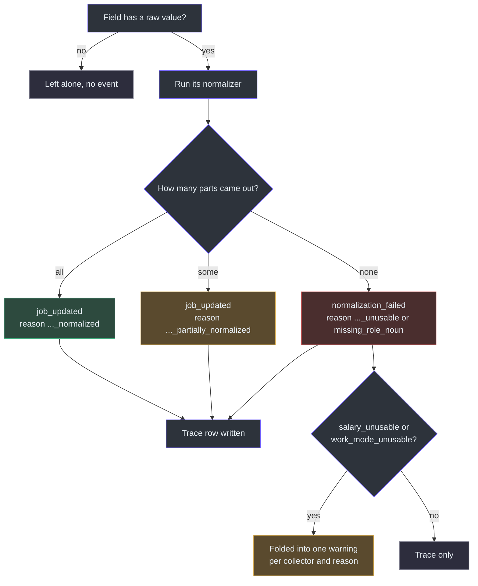
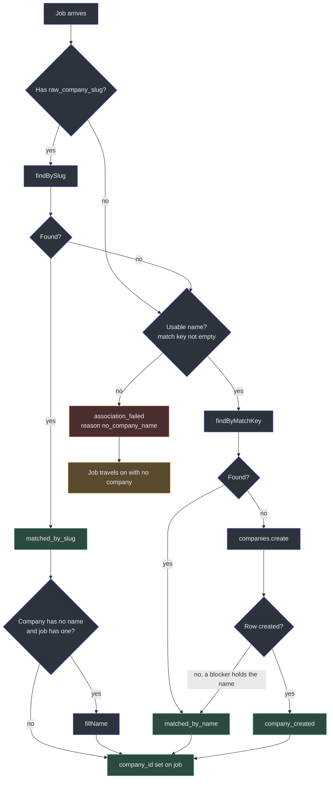
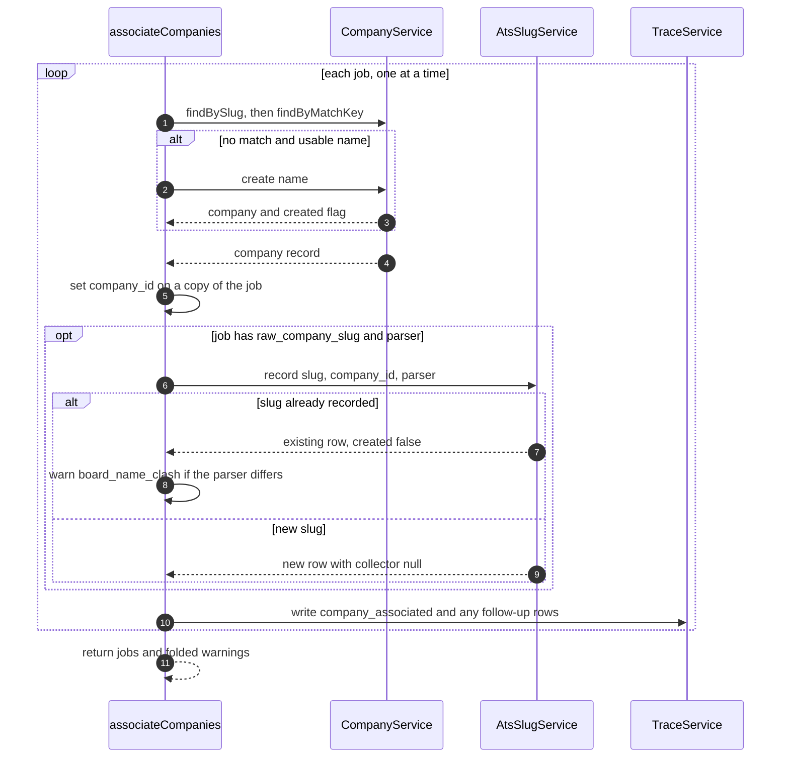

# Normalization and Association

## Overview

Collectors write whatever their source sent, in the source's own spelling. One source says "Sr. UX Designer (m/w/d)", another says "Senior UX Designer". One says "On-site", another "in office". Later steps cannot compare jobs that read differently. They also cannot tell whether two jobs belong to one employer when each source spells the employer differently.

Two handlers fix this, and they always run as a pair.

- **Normalization** reshapes data that is already there into the tidy fields the rest of the app reads. It never goes looking for a value that is missing ([lib/handlers/normalization.ts:1-12](https://github.com/mablahblah/job-assistant/blob/main/lib/handlers/normalization.ts#L1-L12)). That is the line between reshaping and parsing, written in the project rule ([.claude/rules/part-ownership.md:48-50](https://github.com/mablahblah/job-assistant/blob/main/.claude/rules/part-ownership.md#L48-L50)).
- **Association** decides which employer each job belongs to, and creates the employer row when none exists ([lib/handlers/association.ts:1-4](https://github.com/mablahblah/job-assistant/blob/main/lib/handlers/association.ts#L1-L4)).

They run in this order because dedupe matches on company, and a newly collected job has no company row yet ([lib/handlers/association.ts:3-4](https://github.com/mablahblah/job-assistant/blob/main/lib/handlers/association.ts#L3-L4)). Both run twice per search: once after collection and once after parsing. See [Job Search Run](../architecture/job-search-run.md) for the full order.

### At a glance

| Component | Responsibility | Key file | Source |
|---|---|---|---|
| `normalizeJobs` | Step wrapper. Calls `normalizeJob` per entry, writes trace rows, folds warnings | `lib/handlers/normalization.ts` | [lib/handlers/normalization.ts:220-260](https://github.com/mablahblah/job-assistant/blob/main/lib/handlers/normalization.ts#L220-L260) |
| `normalizeJob` | Routes each raw field to the util that owns it. Returns the tidied job and its events | `lib/handlers/normalization.ts` | [lib/handlers/normalization.ts:40-201](https://github.com/mablahblah/job-assistant/blob/main/lib/handlers/normalization.ts#L40-L201) |
| `normalizeTitle` | Rebuilds a raw title as `{level} {role} - {team}` | `lib/utils/title.ts` | [lib/utils/title.ts:275-340](https://github.com/mablahblah/job-assistant/blob/main/lib/utils/title.ts#L275-L340) |
| `normalizeSalary` | Turns a raw salary envelope into a low, a high and a period word | `lib/utils/salary.ts` | [lib/utils/salary.ts:55-86](https://github.com/mablahblah/job-assistant/blob/main/lib/utils/salary.ts#L55-L86) |
| `splitLocation` | Cuts a location string into single places and lifts out work modes | `lib/utils/split-location.ts` | [lib/utils/split-location.ts:53-77](https://github.com/mablahblah/job-assistant/blob/main/lib/utils/split-location.ts#L53-L77) |
| `normalizeModeList` | Maps each source's mode spelling onto three words and drops unknown words | `lib/utils/work-mode-list.ts` | [lib/utils/work-mode-list.ts:29-41](https://github.com/mablahblah/job-assistant/blob/main/lib/utils/work-mode-list.ts#L29-L41) |
| `normalizeCompanyName` | Cosmetic tidy of the employer name | `lib/utils/company-name.ts` | [lib/utils/company-name.ts:13-23](https://github.com/mablahblah/job-assistant/blob/main/lib/utils/company-name.ts#L13-L23) |
| `associateCompanies` | Attaches each job to a company, one at a time | `lib/handlers/association.ts` | [lib/handlers/association.ts:221-303](https://github.com/mablahblah/job-assistant/blob/main/lib/handlers/association.ts#L221-L303) |
| `companyMatchKey` | Builds the key that two spellings of one employer share | `lib/utils/company-match-key.ts` | [lib/utils/company-match-key.ts:44-70](https://github.com/mablahblah/job-assistant/blob/main/lib/utils/company-match-key.ts#L44-L70) |
| `AtsSlugService.record` | Writes down that a company posts on a hiring-system board | `lib/services/ats-slug-service.ts` | [lib/services/ats-slug-service.ts:66-94](https://github.com/mablahblah/job-assistant/blob/main/lib/services/ats-slug-service.ts#L66-L94) |

## Where the two steps sit

<!-- Sources: lib/orchestrators/job-search.ts:307-358, lib/orchestrators/job-search.ts:507-548 -->

The names on the boxes are the step names the orchestrator passes in. They are the labels written into trace rows ([lib/orchestrators/job-search.ts:312](https://github.com/mablahblah/job-assistant/blob/main/lib/orchestrators/job-search.ts#L312), [lib/orchestrators/job-search.ts:326](https://github.com/mablahblah/job-assistant/blob/main/lib/orchestrators/job-search.ts#L326), [lib/orchestrators/job-search.ts:512](https://github.com/mablahblah/job-assistant/blob/main/lib/orchestrators/job-search.ts#L512), [lib/orchestrators/job-search.ts:523](https://github.com/mablahblah/job-assistant/blob/main/lib/orchestrators/job-search.ts#L523)). One handler serves both positions, as the handler contract requires ([.claude/rules/handler-contract.md:19](https://github.com/mablahblah/job-assistant/blob/main/.claude/rules/handler-contract.md#L19)).

## Normalization

### Why it recomputes every time

Every present field is recomputed from its raw source on every call. The code does not check whether the target is already filled. Two results follow. A second pass over unchanged raw data ends on exactly the same job. And a pass after parsing can improve a figure the first pass got wrong or left out ([lib/handlers/normalization.ts:6-10](https://github.com/mablahblah/job-assistant/blob/main/lib/handlers/normalization.ts#L6-L10)).

The one exception is a raw field with nothing in it. It is left alone, because finding a missing value is parsing ([lib/handlers/normalization.ts:10-12](https://github.com/mablahblah/job-assistant/blob/main/lib/handlers/normalization.ts#L10-L12)). Each route has its own empty check, so an empty raw value never wipes a value an earlier pass wrote. Examples are an empty title ([lib/handlers/normalization.ts:49-52](https://github.com/mablahblah/job-assistant/blob/main/lib/handlers/normalization.ts#L49-L52)) and an empty salary envelope ([lib/handlers/normalization.ts:66-71](https://github.com/mablahblah/job-assistant/blob/main/lib/handlers/normalization.ts#L66-L71)).

### The five routes

| Raw field | Tidied field | Util | What it does | Source |
|---|---|---|---|---|
| `raw_title` | `title` | `normalizeTitle` | Finds the job noun, pulls out a seniority level, treats the rest as team | [lib/handlers/normalization.ts:52-64](https://github.com/mablahblah/job-assistant/blob/main/lib/handlers/normalization.ts#L52-L64) |
| `raw_salary` | `salary_low`, `salary_high`, `salary_period` | `normalizeSalary` | Whole currency units and a period word | [lib/handlers/normalization.ts:71-106](https://github.com/mablahblah/job-assistant/blob/main/lib/handlers/normalization.ts#L71-L106) |
| `raw_location_list` | `normalized_location_list` | `splitLocation` | Cuts at every delimiter, pools places, de-duplicates | [lib/handlers/normalization.ts:114-147](https://github.com/mablahblah/job-assistant/blob/main/lib/handlers/normalization.ts#L114-L147) |
| `raw_mode_list` plus modes found in locations | `normalized_mode_list` | `normalizeModeList` | Maps spellings to `remote`, `hybrid`, `in-person` | [lib/handlers/normalization.ts:149-185](https://github.com/mablahblah/job-assistant/blob/main/lib/handlers/normalization.ts#L149-L185) |
| `raw_company_name` | `raw_company_name` (overwritten) | `normalizeCompanyName` | Trims, collapses spaces, drops trailing punctuation | [lib/handlers/normalization.ts:188-198](https://github.com/mablahblah/job-assistant/blob/main/lib/handlers/normalization.ts#L188-L198) |

`normalizeJob` works on a shallow copy, so the job passed in is never changed ([lib/handlers/normalization.ts:44-46](https://github.com/mablahblah/job-assistant/blob/main/lib/handlers/normalization.ts#L44-L46)).

### Title: `{level} {role} - {team}`

The goal is that the same role published by two sources reads the same ([lib/utils/title.ts:1-8](https://github.com/mablahblah/job-assistant/blob/main/lib/utils/title.ts#L1-L8)). The vocabularies are passed in by the caller: head nouns, levels, suffixes and removal words. The util reads no settings and no database ([lib/utils/title.ts:12-17](https://github.com/mablahblah/job-assistant/blob/main/lib/utils/title.ts#L12-L17)). The orchestrator reads them from the settings service before the handlers run, so a missing vocabulary stops the whole run and does not read as one handler failing ([lib/orchestrators/job-search.ts:294-302](https://github.com/mablahblah/job-assistant/blob/main/lib/orchestrators/job-search.ts#L294-L302)).

The steps, in order:

1. **Tidy.** Dash and quote variants fold to plain forms. Nine punctuation characters are handled by a fixed list: the full stop is deleted, and the brackets, semicolon and colon become spaces ([lib/utils/title.ts:43-77](https://github.com/mablahblah/job-assistant/blob/main/lib/utils/title.ts#L43-L77)).
2. **Cut into segments** at a comma, a pipe, or a dash with a space on either side. A dash glued on both sides, as in "AI-Enabled", stays inside the word ([lib/utils/title.ts:60-63](https://github.com/mablahblah/job-assistant/blob/main/lib/utils/title.ts#L60-L63)).
3. **Drop junk by shape.** A token with digits and no letters is a requisition number. A token of single letters joined by slashes, like "m/w/d", is a gender marker. "UX/UI" survives because a part has more than one letter ([lib/utils/title.ts:84-106](https://github.com/mablahblah/job-assistant/blob/main/lib/utils/title.ts#L84-L106)). Roman numerals are never removed, which keeps "UX Designer II" apart from "UX Designer III" ([lib/utils/title.ts:99-101](https://github.com/mablahblah/job-assistant/blob/main/lib/utils/title.ts#L99-L101)).
4. **Pick the role segment.** It is the last segment holding a job noun. A head noun from the closed list beats a suffix match such as "-er". A segment of only level words is skipped unless it is the only one with a job noun ([lib/utils/title.ts:209-230](https://github.com/mablahblah/job-assistant/blob/main/lib/utils/title.ts#L209-L230)).
5. **Take the level.** The longest run of level words is matched first, so "mid level" is taken whole ([lib/utils/title.ts:156-176](https://github.com/mablahblah/job-assistant/blob/main/lib/utils/title.ts#L156-L176)). The level comes out of the role segment only if a job noun remains, so "Design Director" keeps "Director" ([lib/utils/title.ts:295-308](https://github.com/mablahblah/job-assistant/blob/main/lib/utils/title.ts#L295-L308)).
6. **Everything else is team.** Removal words come out here only. Team items sort alphabetically ([lib/utils/title.ts:324-333](https://github.com/mablahblah/job-assistant/blob/main/lib/utils/title.ts#L324-L333)).

If no job noun is found, the tidied string comes back with `matched: false` and the handler records `missing_role_noun`. It does not guess ([lib/utils/title.ts:286-289](https://github.com/mablahblah/job-assistant/blob/main/lib/utils/title.ts#L286-L289)).

### Salary: whole units and a period word

`normalizeSalary` takes the envelope a collector wrote. It divides figures sent in cents by 100 before rounding, so a fractional total ends on a whole unit ([lib/utils/salary.ts:58-67](https://github.com/mablahblah/job-assistant/blob/main/lib/utils/salary.ts#L58-L67)). A period or currency on its own is not a salary, so no numbers means an empty result ([lib/utils/salary.ts:69-71](https://github.com/mablahblah/job-assistant/blob/main/lib/utils/salary.ts#L69-L71)).

The period rules are strict on purpose:

- An absent period reads as `year`, because Adzuna and Greenhouse publish annual figures without saying so ([lib/utils/salary.ts:41-53](https://github.com/mablahblah/job-assistant/blob/main/lib/utils/salary.ts#L41-L53)).
- A leading count is dropped, so Ashby's "1 YEAR" matches JSearch's "YEAR".
- A word outside the five recognised ones gives `undefined`, never the nearest guess, so a wrong guess never reaches the database ([lib/utils/salary.ts:43-45](https://github.com/mablahblah/job-assistant/blob/main/lib/utils/salary.ts#L43-L45)).

`salary_currency` travels in the envelope but has no column, so it is not stored ([lib/utils/salary.ts:82-83](https://github.com/mablahblah/job-assistant/blob/main/lib/utils/salary.ts#L82-L83)).

The same file also holds `readSalaryFromText`, which reads a range out of a description ([lib/utils/salary.ts:219-229](https://github.com/mablahblah/job-assistant/blob/main/lib/utils/salary.ts#L219-L229)). That one is for parsers. Normalization does not call it, because finding a salary in prose is going looking. See [Parsing](./parsing.md).

### Location and work mode

`splitLocation` cuts at every delimiter and glues nothing back. The comment reports a measurement: across 2,208 real jobs, cutting everywhere gained 32 matches and lost none ([lib/utils/split-location.ts:4-9](https://github.com/mablahblah/job-assistant/blob/main/lib/utils/split-location.ts#L4-L9)). Pieces that name nothing on a map are kept, because ten of 796 such fragments were genuine local places ([lib/utils/split-location.ts:10-13](https://github.com/mablahblah/job-assistant/blob/main/lib/utils/split-location.ts#L10-L13)). A small hand-kept list strips filler such as "based in" and noise such as a bare "HQ" ([lib/utils/split-location.ts:32-39](https://github.com/mablahblah/job-assistant/blob/main/lib/utils/split-location.ts#L32-L39)).

A work mode named inside a location, such as "Austin (Hybrid)", is lifted out and passed down to the mode route ([lib/utils/split-location.ts:24-28](https://github.com/mablahblah/job-assistant/blob/main/lib/utils/split-location.ts#L24-L28), [lib/handlers/normalization.ts:108-111](https://github.com/mablahblah/job-assistant/blob/main/lib/handlers/normalization.ts#L108-L111)). So the job gets the mode even when the source published no mode words ([lib/handlers/normalization.ts:151-156](https://github.com/mablahblah/job-assistant/blob/main/lib/handlers/normalization.ts#L151-L156)).

`normalizeModeList` keeps only words it recognises and drops the rest. The older `work-mode.ts` fallback assumes every word is already recognised because a regex matched it first. Sources send any word they like, so this version must not guess ([lib/utils/work-mode-list.ts:1-6](https://github.com/mablahblah/job-assistant/blob/main/lib/utils/work-mode-list.ts#L1-L6)). Duplicates collapse into one entry ([lib/utils/work-mode-list.ts:35-37](https://github.com/mablahblah/job-assistant/blob/main/lib/utils/work-mode-list.ts#L35-L37)).

### Company name tidy

`normalizeCompanyName` trims, collapses spaces and drops a trailing run of non-letter, non-digit characters. Case and inner spacing are left as the source wrote them, because deciding that two spellings name one employer is a matching judgement that belongs to association ([lib/utils/company-name.ts:1-6](https://github.com/mablahblah/job-assistant/blob/main/lib/utils/company-name.ts#L1-L6)). Because the cleaned name overwrites `raw_company_name` and no copy is kept, it must give the same result when run on its own output ([lib/utils/company-name.ts:8-11](https://github.com/mablahblah/job-assistant/blob/main/lib/utils/company-name.ts#L8-L11)).

### Trace events and warnings

For every field that had a raw value, the handler records whether it came out whole, partial or not at all.

<!-- Sources: lib/handlers/normalization.ts:52-198, lib/handlers/normalization.ts:238-259, lib/utils/normalization-warnings.ts:17-60 -->

Details worth knowing:

- Salary counts only the three envelope keys that have a column. Counting currency would file every salary with a currency as partly done ([lib/handlers/normalization.ts:78-87](https://github.com/mablahblah/job-assistant/blob/main/lib/handlers/normalization.ts#L78-L87)).
- Nothing-normalized is checked first, so an envelope holding only a currency reads as unusable and not as complete on a count of zero out of zero ([lib/handlers/normalization.ts:96-105](https://github.com/mablahblah/job-assistant/blob/main/lib/handlers/normalization.ts#L96-L105)).
- Work mode counts recognised raw entries, not output length, so two spellings of one mode still count as both recognised ([lib/handlers/normalization.ts:164-171](https://github.com/mablahblah/job-assistant/blob/main/lib/handlers/normalization.ts#L164-L171)).
- Locations have a failure row and no success row ([lib/handlers/normalization.ts:135-137](https://github.com/mablahblah/job-assistant/blob/main/lib/handlers/normalization.ts#L135-L137)).
- Only two reasons ever warn the user: `salary_unusable` and `work_mode_unusable`. The rest go to the trace table only ([lib/utils/normalization-warnings.ts:15-18](https://github.com/mablahblah/job-assistant/blob/main/lib/utils/normalization-warnings.ts#L15-L18)). A search collects around 1,800 jobs, so one broken source would otherwise print a line per job ([lib/utils/normalization-warnings.ts:1-7](https://github.com/mablahblah/job-assistant/blob/main/lib/utils/normalization-warnings.ts#L1-L7)). Each warning shows a count and at most two examples ([lib/utils/normalization-warnings.ts:20-22](https://github.com/mablahblah/job-assistant/blob/main/lib/utils/normalization-warnings.ts#L20-L22)).
- A trace row and a warning both need the job's id and collector. A job with neither is still normalized but leaves no record ([lib/handlers/normalization.ts:232-236](https://github.com/mablahblah/job-assistant/blob/main/lib/handlers/normalization.ts#L232-L236)). Trace rows need `trace`, `runId` and `step` together, so the handler also runs outside a job search ([lib/handlers/normalization.ts:241-245](https://github.com/mablahblah/job-assistant/blob/main/lib/handlers/normalization.ts#L241-L245)).

## Association

### Why slug first, then name

A job from an ATS board knows which board it came from. That is a stronger identity than a spelled name, because it needs no matching on spelling ([lib/handlers/association.ts:95-96](https://github.com/mablahblah/job-assistant/blob/main/lib/handlers/association.ts#L95-L96)). Aggregator jobs have only a name. So the lookup order is:

1. **Board slug.** `findBySlug` asks whether any company owns a row in the ATS slug table with that slug ([lib/services/company-service.ts:209-215](https://github.com/mablahblah/job-assistant/blob/main/lib/services/company-service.ts#L209-L215)).
2. **Name match key.** `findByMatchKey` looks up the company by the unique `match_key` column ([lib/services/company-service.ts:217-220](https://github.com/mablahblah/job-assistant/blob/main/lib/services/company-service.ts#L217-L220)).
3. **Create.** If neither finds a company and the name is usable, a company is created ([lib/handlers/association.ts:107-122](https://github.com/mablahblah/job-assistant/blob/main/lib/handlers/association.ts#L107-L122)).

If the slug fails to find a company, the code falls through to the name, and does not create. The reason in the code: a board a parser found but the seed never polled must not split an employer the table already holds ([lib/handlers/association.ts:104-106](https://github.com/mablahblah/job-assistant/blob/main/lib/handlers/association.ts#L104-L106)).

<!-- Sources: lib/handlers/association.ts:85-185, lib/services/company-service.ts:209-220, lib/services/company-service.ts:301-331 -->

### The match key

Two spellings of one employer must reach one company row. `companyMatchKey` builds a key both spellings produce. It lower-cases each run of letters and digits, drops a trailing run of legal-entity words, and joins the rest ([lib/utils/company-match-key.ts:44-58](https://github.com/mablahblah/job-assistant/blob/main/lib/utils/company-match-key.ts#L44-L58)). The list includes `inc`, `llc`, `gmbh` and also `group`, `holdings` and `holding`, because "Ryan Specialty" and "Ryan Specialty Group" are one employer ([lib/utils/company-match-key.ts:3-6](https://github.com/mablahblah/job-assistant/blob/main/lib/utils/company-match-key.ts#L3-L6)).

| Design choice | Why | Source |
|---|---|---|
| Whole words come off the end, never substrings | A substring strip of "sa" or "co" would eat the ends of "Visa" and "Cisco" | [lib/utils/company-match-key.ts:51-53](https://github.com/mablahblah/job-assistant/blob/main/lib/utils/company-match-key.ts#L51-L53) |
| Each word is lower-cased on its own | A letter whose lowercase form carries a separate accent mark would drag the mark into the key | [lib/utils/company-match-key.ts:45-49](https://github.com/mablahblah/job-assistant/blob/main/lib/utils/company-match-key.ts#L45-L49) |
| A name of only legal words keys to its tidied name | Two such names stay apart | [lib/utils/company-match-key.ts:60-67](https://github.com/mablahblah/job-assistant/blob/main/lib/utils/company-match-key.ts#L60-L67) |
| A name with no letter or digit keys to empty and counts as no name | SQLite treats an empty string as an ordinary unique value, so a second such company would throw instead of failing to match | [lib/handlers/association.ts:36-45](https://github.com/mablahblah/job-assistant/blob/main/lib/handlers/association.ts#L36-L45) |
| The key is a unique column | The database refuses a duplicate employer whatever the code does | [lib/utils/company-match-key.ts:40-43](https://github.com/mablahblah/job-assistant/blob/main/lib/utils/company-match-key.ts#L40-L43) |

The service enforces the same rule on create. `create` throws on an empty name and computes the key itself ([lib/services/company-service.ts:301-310](https://github.com/mablahblah/job-assistant/blob/main/lib/services/company-service.ts#L301-L310)). If the database refuses with a unique-constraint error, the service finds the blocking company and returns it with `created` false ([lib/services/company-service.ts:318-325](https://github.com/mablahblah/job-assistant/blob/main/lib/services/company-service.ts#L318-L325)). The handler reads that as a match and not a creation, because counting `company_created` rows is how a run reports the companies it added ([lib/handlers/association.ts:113-120](https://github.com/mablahblah/job-assistant/blob/main/lib/handlers/association.ts#L113-L120)).

### Trace events by outcome

| Outcome | Event | Reason | Source |
|---|---|---|---|
| Found by slug | `company_associated` | `matched_by_slug` | [lib/handlers/association.ts:97-101](https://github.com/mablahblah/job-assistant/blob/main/lib/handlers/association.ts#L97-L101) |
| Found by name key | `company_associated` | `matched_by_name` | [lib/handlers/association.ts:107-110](https://github.com/mablahblah/job-assistant/blob/main/lib/handlers/association.ts#L107-L110) |
| New company made | `company_associated` | `company_created` | [lib/handlers/association.ts:116-120](https://github.com/mablahblah/job-assistant/blob/main/lib/handlers/association.ts#L116-L120) |
| Neither slug nor name worked | `association_failed` | `no_company_name` | [lib/handlers/association.ts:124-138](https://github.com/mablahblah/job-assistant/blob/main/lib/handlers/association.ts#L124-L138) |
| Nameless company took a name | `company_dbrow_updated` | `company_name_filled` | [lib/handlers/association.ts:155-162](https://github.com/mablahblah/job-assistant/blob/main/lib/handlers/association.ts#L155-L162) |
| Name already held by another company | `company_update_failed` | `company_name_clash` | [lib/handlers/association.ts:163-171](https://github.com/mablahblah/job-assistant/blob/main/lib/handlers/association.ts#L163-L171) |

The association row always comes first. A fill or clash row follows it and never replaces it ([lib/handlers/association.ts:140-142](https://github.com/mablahblah/job-assistant/blob/main/lib/handlers/association.ts#L140-L142)).

A company with no name takes one from the first job that supplies one. A name already held is never overwritten, so nothing logs a name change on every run ([lib/handlers/association.ts:152-154](https://github.com/mablahblah/job-assistant/blob/main/lib/handlers/association.ts#L152-L154)). On a clash, the job stays on the company it matched and the pair is reported as a warning. Merging two rows that name one employer is the user's call ([lib/handlers/association.ts:163-166](https://github.com/mablahblah/job-assistant/blob/main/lib/handlers/association.ts#L163-L166)).

### Recording board rows

After a job has a company, `recordBoardSlug` writes down that the company posts on a hiring-system board. The row holds the slug, the company and the parser name ([lib/handlers/association.ts:196-208](https://github.com/mablahblah/job-assistant/blob/main/lib/handlers/association.ts#L196-L208)). It only fires when the job has both a slug and a `parser`. The parser is what says the slug came off a posting that was actually read. A slug seen on a collected ATS job is not yet worth a row ([lib/handlers/association.ts:192-195](https://github.com/mablahblah/job-assistant/blob/main/lib/handlers/association.ts#L192-L195)).

Why here and not in the parsing handler: the parsing handler is handed no service, and matching runs again straight after a posting is read, by which point the job carries the real slug ([lib/handlers/association.ts:187-191](https://github.com/mablahblah/job-assistant/blob/main/lib/handlers/association.ts#L187-L191)).

<!-- Sources: lib/handlers/association.ts:221-303, lib/services/ats-slug-service.ts:66-94 -->

`AtsSlugService.record` creates a row with `collector: null`. Recording a slug says only that the board was seen on a posting. It never says that anything polls it. Promotion fills the collector in later ([lib/services/ats-slug-service.ts:73-82](https://github.com/mablahblah/job-assistant/blob/main/lib/services/ats-slug-service.ts#L73-L82)). A slug already held writes nothing. The common second call is a plain read ([lib/services/ats-slug-service.ts:67-70](https://github.com/mablahblah/job-assistant/blob/main/lib/services/ats-slug-service.ts#L67-L70)). If two writes race, the unique-constraint error is caught and the winning row is returned ([lib/services/ats-slug-service.ts:86-93](https://github.com/mablahblah/job-assistant/blob/main/lib/services/ats-slug-service.ts#L86-L93)). There is deliberately no way to remove a row ([lib/services/ats-slug-service.ts:5-8](https://github.com/mablahblah/job-assistant/blob/main/lib/services/ats-slug-service.ts#L5-L8)).

A row that already existed under a different parser means the board's name arrived from a second hiring system. The code warns, changes nothing, and leaves the recorded row as it was ([lib/handlers/association.ts:210-216](https://github.com/mablahblah/job-assistant/blob/main/lib/handlers/association.ts#L210-L216)). See [Services](../data/services.md) and [Data Model](../data/data-model.md) for the tables behind this.

### Failure handling

| Case | What happens | Source |
|---|---|---|
| Jobs run strictly one after another | Two jobs naming the same absent employer must end on one company. The second lookup has to follow the first create | [lib/handlers/association.ts:229-232](https://github.com/mablahblah/job-assistant/blob/main/lib/handlers/association.ts#L229-L232) |
| Company lookup throws | Only that job is lost. It keeps its place, and a `company_lookup_failed` warning is raised | [lib/handlers/association.ts:240-255](https://github.com/mablahblah/job-assistant/blob/main/lib/handlers/association.ts#L240-L255) |
| Board row write throws | The job already has its company. Only the board note is lost, and the next run writes it again | [lib/handlers/association.ts:259-273](https://github.com/mablahblah/job-assistant/blob/main/lib/handlers/association.ts#L259-L273) |
| Job has no id or collector | It is still associated, but leaves no trace row or warning | [lib/handlers/association.ts:276-278](https://github.com/mablahblah/job-assistant/blob/main/lib/handlers/association.ts#L276-L278) |
| Handler not given `atsSlugs` | The step still works and records no board | [lib/handlers/association.ts:22-25](https://github.com/mablahblah/job-assistant/blob/main/lib/handlers/association.ts#L22-L25), [lib/handlers/association.ts:201](https://github.com/mablahblah/job-assistant/blob/main/lib/handlers/association.ts#L201) |

The handler opens no database of its own and reaches the company table only through the service it is handed, so a fake serves its tests ([lib/handlers/association.ts:6-9](https://github.com/mablahblah/job-assistant/blob/main/lib/handlers/association.ts#L6-L9)). It recomputes on every pass and never skips a job that already has a company, so a later parsing pass can correct a company the first pass got wrong ([lib/handlers/association.ts:7-9](https://github.com/mablahblah/job-assistant/blob/main/lib/handlers/association.ts#L7-L9)).

## Related Pages

| Page | Relationship |
|---|---|
| [Collection](./collection.md) | Writes the raw fields and the company name or slug that these steps read |
| [Dedupe and Save](./dedupe-and-save.md) | Runs next and matches on the company identity set here |
| [Parsing](./parsing.md) | Fills missing raw fields, after which both steps run again |
| [Resolution](./resolution.md) | Runs between the two passes |
| [Judging Steps](./judging-steps.md) | Classification judges the normalized location and mode lists |
| [Services](../data/services.md) | The company and ATS slug services used by association |
| [Data Model](../data/data-model.md) | The `Company`, `AtsSlug` and `Job` tables |
| [Tracing and Run Summary](../architecture/tracing-and-run-summary.md) | Where the events and warnings listed above surface |
| [Job Search Run](../architecture/job-search-run.md) | The orchestrator that calls both handlers at two positions |

## References

- [lib/handlers/normalization.ts](https://github.com/mablahblah/job-assistant/blob/main/lib/handlers/normalization.ts)
- [lib/handlers/association.ts](https://github.com/mablahblah/job-assistant/blob/main/lib/handlers/association.ts)
- [lib/utils/title.ts](https://github.com/mablahblah/job-assistant/blob/main/lib/utils/title.ts)
- [lib/utils/company-match-key.ts](https://github.com/mablahblah/job-assistant/blob/main/lib/utils/company-match-key.ts)
- [.claude/rules/handler-contract.md](https://github.com/mablahblah/job-assistant/blob/main/.claude/rules/handler-contract.md)
