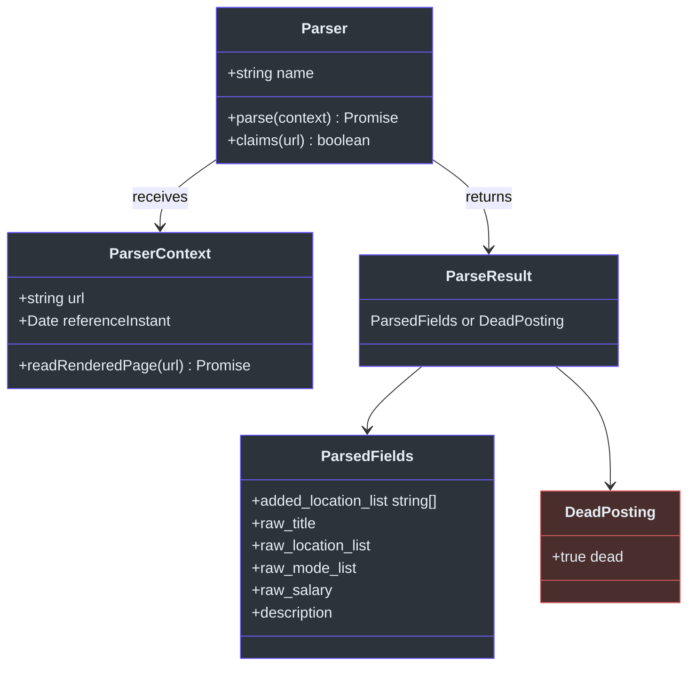
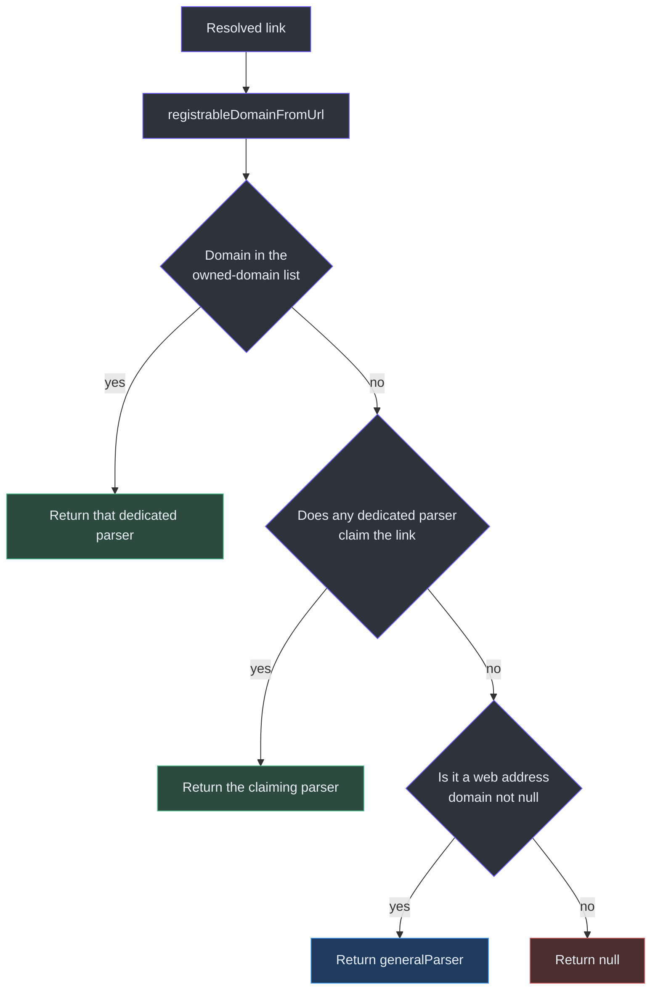
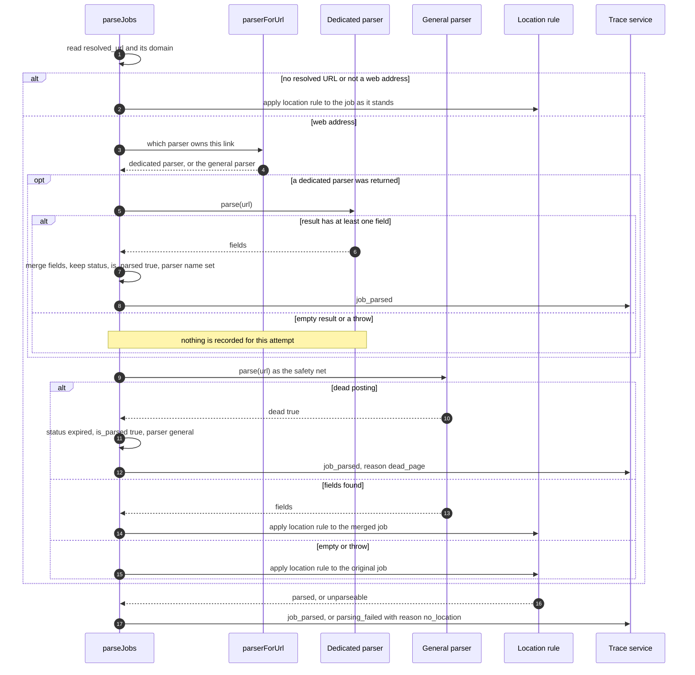
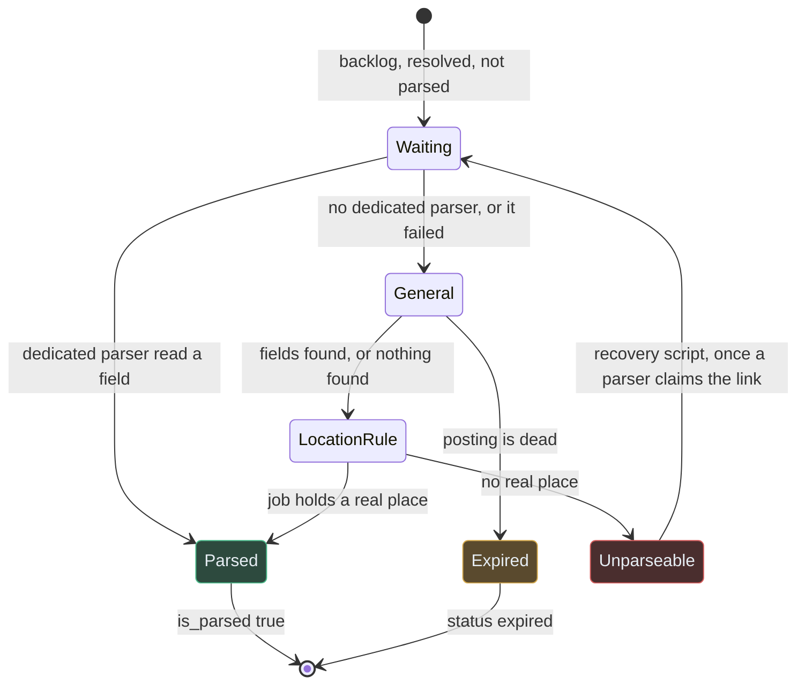

# Parsing

## Overview

After resolution, each job has the address of the best posting the pipeline could find. Parsing reads that posting and fills in fields the collector could not supply: posting dates, work mode, locations, pay, a description and sometimes the employer's name. Reading a job posting is "going to look", so it belongs to parsers and to nothing else in the pipeline ([part-ownership.md:50](https://github.com/mablahblah/job-assistant/blob/main/.claude/rules/part-ownership.md#L50)). A parser hands back only the fields it found, in their raw form. The normalization step cleans them later ([part-ownership.md:34](https://github.com/mablahblah/job-assistant/blob/main/.claude/rules/part-ownership.md#L34)).

There are two kinds of parser. A **dedicated parser** knows one hiring platform, such as Greenhouse, and usually calls its public data feed. The **general parser** knows no platform. It reads whatever a page publishes about itself. Together they mean every job with a web address gets read. Since the general parser was added, a job is no longer set aside just because no dedicated parser exists for its website. `unparseable` now means one narrow thing, described in [When a job becomes unparseable](#when-a-job-becomes-unparseable).

The step before this one is [Resolution](./resolution.md). The step after the judging steps that follow parsing is described in [Backlog Cleanup, Promotion and Classification](./judging-steps.md).

### At a glance

| Component | Responsibility | Key file | Source |
|---|---|---|---|
| Parser contract (`Parser`) | The shape every parser implements: a name, a `parse` function and an optional `claims` function | `lib/parsers/parser.ts` | [parser.ts:49-65](https://github.com/mablahblah/job-assistant/blob/main/lib/parsers/parser.ts#L49-L65) |
| Registry (`PARSERS_BY_DOMAIN`, `parserForUrl`) | Lists the 11 dedicated parsers by the domain each owns, and picks one for a link | `lib/parsers/registry.ts` | [registry.ts:37-79](https://github.com/mablahblah/job-assistant/blob/main/lib/parsers/registry.ts#L37-L79) |
| Parsing handler (`parseJobs`) | Runs one job at a time: dedicated parser first, general parser as safety net, then the location rule | `lib/handlers/parsing.ts` | [parsing.ts:154-177](https://github.com/mablahblah/job-assistant/blob/main/lib/handlers/parsing.ts#L154-L177) |
| General parser (`generalParser`) | Reads any page through its search-engine job data or its main text | `lib/parsers/general.ts` | [general.ts:45-81](https://github.com/mablahblah/job-assistant/blob/main/lib/parsers/general.ts#L45-L81) |
| Registrable domain (`registrableDomainFromUrl`) | Turns a link into the domain a company registered, using the public suffix list | `lib/utils/registrable-domain.ts` | [registrable-domain.ts:15-30](https://github.com/mablahblah/job-assistant/blob/main/lib/utils/registrable-domain.ts#L15-L30) |
| Description fallback (`withFieldsFromDescription`) | Fills a missing work mode or pay range from the description's prose | `lib/utils/description-fallback.ts` | [description-fallback.ts:12-39](https://github.com/mablahblah/job-assistant/blob/main/lib/utils/description-fallback.ts#L12-L39) |
| Shared field maps (for example `jobFieldsFromGreenhousePosting`) | Map one source's published fields to the app's raw fields, shared by that source's collector and parser | `lib/utils/greenhouse-fields.ts` | [greenhouse-fields.ts:30-68](https://github.com/mablahblah/job-assistant/blob/main/lib/utils/greenhouse-fields.ts#L30-L68) |
| Job posting data (`jobPostingFromHtml`) | Finds and reads a page's schema.org `JobPosting` block | `lib/utils/job-posting-data.ts` | [job-posting-data.ts:63-77](https://github.com/mablahblah/job-assistant/blob/main/lib/utils/job-posting-data.ts#L63-L77), [129-151](https://github.com/mablahblah/job-assistant/blob/main/lib/utils/job-posting-data.ts#L129-L151) |
| Recovery script | Moves `unparseable` jobs back to `backlog` once a parser claims their link | `scripts/recover-unparseable-jobs.ts` | [recover-unparseable-jobs.ts:51-71](https://github.com/mablahblah/job-assistant/blob/main/scripts/recover-unparseable-jobs.ts#L51-L71) |

## The Parser contract

<!-- Sources: lib/parsers/parser.ts:14-65 -->

The contract lives in one file so the handler knows only this shape and never a parser's inside parts ([parser.ts:1-5](https://github.com/mablahblah/job-assistant/blob/main/lib/parsers/parser.ts#L1-L5)).

| Part | Plain-words meaning | Source |
|---|---|---|
| `name` | The parser's one name, such as `greenhouse`. It becomes `parser:greenhouse` in the source priority list, which decides whether a parser's value or a collector's value survives when both supply the same field | [parser.ts:50-54](https://github.com/mablahblah/job-assistant/blob/main/lib/parsers/parser.ts#L50-L54) |
| `parse(context)` | Reads the job at the link and returns what it found. A parser that cannot read its source throws | [parser.ts:55-58](https://github.com/mablahblah/job-assistant/blob/main/lib/parsers/parser.ts#L55-L58) |
| `claims(url)` | Optional. Answers "is this link mine even though my domain does not appear in it". The registry asks only when no domain matched | [parser.ts:59-64](https://github.com/mablahblah/job-assistant/blob/main/lib/parsers/parser.ts#L59-L64) |
| `ParserContext` | The link plus two optional helpers: `readRenderedPage` (read a page in a browser the caller already opened) and `referenceInstant` (the moment the run started, for working out ages) | [parser.ts:14-18](https://github.com/mablahblah/job-assistant/blob/main/lib/parsers/parser.ts#L14-L18) |
| `DeadPosting` | `{ dead: true }`. The page itself shows the job is gone. Different from throwing (could not read) and from returning `{}` (read nothing) | [parser.ts:20-25](https://github.com/mablahblah/job-assistant/blob/main/lib/parsers/parser.ts#L20-L25) |
| Empty result | A result with no fields is treated as a failed read. One field or more is a success, because a thin posting is not an unread one | [parser.ts:34-39](https://github.com/mablahblah/job-assistant/blob/main/lib/parsers/parser.ts#L34-L39) |
| `added_location_list` | Places read from loose page text. They are added to the job's own locations, never used to replace them | [parser.ts:27-32](https://github.com/mablahblah/job-assistant/blob/main/lib/parsers/parser.ts#L27-L32) |

Only the general parser is typed to return a dead posting. Dedicated parsers are typed `Parser`, which defaults to plain fields, so they "can never find a page dead" ([parser.ts:41-49](https://github.com/mablahblah/job-assistant/blob/main/lib/parsers/parser.ts#L41-L49)).

## The registry: picking a parser for a link

The registry is keyed by **owned domain**, which is the name a company registered, not the full host. Greenhouse serves boards from `boards.greenhouse.io`, `job-boards.greenhouse.io` and `job-boards.eu.greenhouse.io`. Keying by owned domain makes all three one entry, and it caught the `.eu` host that a hand-written list had missed. It also lets a platform like Workday, which gives every employer its own subdomain, count as one platform instead of many unrelated sites ([registry.ts:5-14](https://github.com/mablahblah/job-assistant/blob/main/lib/parsers/registry.ts#L5-L14)). The domain is worked out with the public suffix list, because "the last two labels" would misread `adzuna.co.uk` as `co.uk` ([registrable-domain.ts:10-14](https://github.com/mablahblah/job-assistant/blob/main/lib/utils/registrable-domain.ts#L10-L14)). Only `http` and `https` addresses count ([registrable-domain.ts:25-27](https://github.com/mablahblah/job-assistant/blob/main/lib/utils/registrable-domain.ts#L25-L27)).

`parserForUrl` makes three attempts, in this order ([registry.ts:51-79](https://github.com/mablahblah/job-assistant/blob/main/lib/parsers/registry.ts#L51-L79)).

<!-- Sources: lib/parsers/registry.ts:56-79 -->

**Why the order matters.** The registry measured on 2026-09-20 that all 309 postings already on a Greenhouse address also carry a Greenhouse job number. If claims were checked first, a Lever, Ashby or Dribbble link that happened to carry that number would be pulled away from the parser that owns its domain ([registry.ts:16-21](https://github.com/mablahblah/job-assistant/blob/main/lib/parsers/registry.ts#L16-L21)). Domain ownership therefore wins, and claims only rescue links on unowned domains.

The only parser that makes a claim today is Greenhouse. It claims any link carrying a `gh_jid` query value, because some employers host Greenhouse postings on their own careers page ([greenhouse.ts:127-133](https://github.com/mablahblah/job-assistant/blob/main/lib/parsers/greenhouse.ts#L127-L133)). `parserForUrl` returns `null` only for a string that is not a web address. It never returns `null` for a valid web address ([registry.ts:72-78](https://github.com/mablahblah/job-assistant/blob/main/lib/parsers/registry.ts#L72-L78)).

## All 12 parsers

Eleven dedicated parsers sit in the registry. The twelfth is the general parser, which sits outside the domain list and is the fallback ([registry.ts:37-49](https://github.com/mablahblah/job-assistant/blob/main/lib/parsers/registry.ts#L37-L49), [general.ts:45](https://github.com/mablahblah/job-assistant/blob/main/lib/parsers/general.ts#L45)). None opens a browser itself except through the helper handed to the general parser.

| Parser | Owned domain | How it reads the posting | Employer name | Source |
|---|---|---|---|---|
| `greenhouse` | `greenhouse.io`, plus links carrying `gh_jid` | Public JSON feed at `boards-api.greenhouse.io`, with `pay_transparency=true` so pay is not withheld. Board and job id come from the link, or from the job number via a board-name lookup when the link names no board | Read from the posting itself | [greenhouse.ts:15-16](https://github.com/mablahblah/job-assistant/blob/main/lib/parsers/greenhouse.ts#L15-L16), [101-122](https://github.com/mablahblah/job-assistant/blob/main/lib/parsers/greenhouse.ts#L101-L122), [124-162](https://github.com/mablahblah/job-assistant/blob/main/lib/parsers/greenhouse.ts#L124-L162) |
| `lever` | `lever.co` | Public JSON feed at `api.lever.co/v0/postings/{board}/{id}` | One extra request for the board page, name read from its title, because the feed never carries it | [lever.ts:14-17](https://github.com/mablahblah/job-assistant/blob/main/lib/parsers/lever.ts#L14-L17), [37-70](https://github.com/mablahblah/job-assistant/blob/main/lib/parsers/lever.ts#L37-L70) |
| `ashby` | `ashbyhq.com` | Fetches the whole board's JSON at `api.ashbyhq.com`, then finds the posting by a link match key because Ashby postings have no stable id | One extra request for the board page title | [ashby.ts:14-17](https://github.com/mablahblah/job-assistant/blob/main/lib/parsers/ashby.ts#L14-L17), [41-94](https://github.com/mablahblah/job-assistant/blob/main/lib/parsers/ashby.ts#L41-L94) |
| `dribbble` | `dribbble.com` | Plain fetch of the server-rendered page. Reads an inline `Dribbble.JobListing.initialize` block with targeted patterns, plus the page's `JobPosting` data. Translates Dribbble's own work-mode words | From the inline block or the `JobPosting` data | [dribbble.ts:106-145](https://github.com/mablahblah/job-assistant/blob/main/lib/parsers/dribbble.ts#L106-L145), [147-157](https://github.com/mablahblah/job-assistant/blob/main/lib/parsers/dribbble.ts#L147-L157) |
| `workday` | `myworkdayjobs.com` | JSON data address for each posting, built from the link's board and job path | Deliberately left out. Workday sends a legal entity name and using it would split one employer into two companies | [workday.ts:1-6](https://github.com/mablahblah/job-assistant/blob/main/lib/parsers/workday.ts#L1-L6), [25-50](https://github.com/mablahblah/job-assistant/blob/main/lib/parsers/workday.ts#L25-L50) |
| `ultipro` | `ultipro.com` | Plain fetch of the posting page, which embeds the whole job in a `CandidateOpportunityDetail(...)` script call. The job's identity lives in the link's query string | From the posting | [ultipro.ts:1-5](https://github.com/mablahblah/job-assistant/blob/main/lib/parsers/ultipro.ts#L1-L5), [16-44](https://github.com/mablahblah/job-assistant/blob/main/lib/parsers/ultipro.ts#L16-L44) |
| `gem` | `gem.com` | Public JSON feed at `api.gem.com/job_board/v0/{board}/job_posts/{id}` | None. The aggregator's name stands | [gem.ts:12-13](https://github.com/mablahblah/job-assistant/blob/main/lib/parsers/gem.ts#L12-L13), [34-59](https://github.com/mablahblah/job-assistant/blob/main/lib/parsers/gem.ts#L34-L59) |
| `smartrecruiters` | `smartrecruiters.com` | Public JSON feed. Only the number before the first dash in the link's id is sent, because the full slug returns Bad Request | Published by the feed | [smartrecruiters.ts:1-7](https://github.com/mablahblah/job-assistant/blob/main/lib/parsers/smartrecruiters.ts#L1-L7), [39-48](https://github.com/mablahblah/job-assistant/blob/main/lib/parsers/smartrecruiters.ts#L39-L48), [50-75](https://github.com/mablahblah/job-assistant/blob/main/lib/parsers/smartrecruiters.ts#L50-L75) |
| `bamboohr` | `bamboohr.com` | Asks the board's `careers/{id}/detail` address for JSON. Also reads a free-text pay field with no currency sign needed | None. The aggregator's name stands | [bamboohr.ts:17-18](https://github.com/mablahblah/job-assistant/blob/main/lib/parsers/bamboohr.ts#L17-L18), [47-80](https://github.com/mablahblah/job-assistant/blob/main/lib/parsers/bamboohr.ts#L47-L80) |
| `rippling` | `rippling.com` | Public JSON feed at `api.rippling.com/platform/api/ats/v1/board/{board}/jobs/{id}` | Published on the job itself | [rippling.ts:12-13](https://github.com/mablahblah/job-assistant/blob/main/lib/parsers/rippling.ts#L12-L13), [37-62](https://github.com/mablahblah/job-assistant/blob/main/lib/parsers/rippling.ts#L37-L62) |
| `workable` | `workable.com` | Handles two sites. Company site `apply.workable.com/{board}/j/{code}` and the search site `jobs.workable.com/view/{id}/{slug}`, each with its own JSON feed | Company site: one extra request to the board's widget. Search site: the job names the employer but not its board, so it guesses three board names and keeps the first whose widget lists at least one job | [workable.ts:28-35](https://github.com/mablahblah/job-assistant/blob/main/lib/parsers/workable.ts#L28-L35), [126-154](https://github.com/mablahblah/job-assistant/blob/main/lib/parsers/workable.ts#L126-L154), [209-224](https://github.com/mablahblah/job-assistant/blob/main/lib/parsers/workable.ts#L209-L224) |
| `general` (fallback) | None | Plain fetch. Reads the page's `JobPosting` data first, then the page's main text. Opens a browser only if both find nothing and a browser helper was supplied | Not read. Title, employer and pay stay with the collector | [general.ts:1-17](https://github.com/mablahblah/job-assistant/blob/main/lib/parsers/general.ts#L1-L17), [45-81](https://github.com/mablahblah/job-assistant/blob/main/lib/parsers/general.ts#L45-L81) |

Every dedicated parser follows the same plan. It cuts a board name and a posting id out of the link, calls the platform's data address, throws if the answer is not ok, maps the answer to raw fields, and then runs `withFieldsFromDescription`. A link it cannot read throws a "could not read" error ("a parse error, not an empty read", for example [lever.ts:42-45](https://github.com/mablahblah/job-assistant/blob/main/lib/parsers/lever.ts#L42-L45)). Each uses a browser-like user-agent header (`BROWSER_USER_AGENT`, [page-fetcher.ts:10](https://github.com/mablahblah/job-assistant/blob/main/lib/tools/page-fetcher.ts#L10)).

### Shared field maps

A source's field mapping lives in `lib/utils/{source}-fields.ts`, not inside the collector or parser. Both the collector and the parser call it, so the two cannot drift apart. For example, `jobFieldsFromGreenhousePosting` writes cents exactly as Greenhouse sends them, and records `salary_unit: "cents"` instead of converting. It does the mapping only. Building the link and setting the phase flags belongs to the caller, so one cannot overwrite the other's work ([greenhouse-fields.ts:1-6](https://github.com/mablahblah/job-assistant/blob/main/lib/utils/greenhouse-fields.ts#L1-L6), [36-48](https://github.com/mablahblah/job-assistant/blob/main/lib/utils/greenhouse-fields.ts#L36-L48)). Greenhouse publishes no work mode, so `raw_mode_list` is empty and the description fallback fills it ([greenhouse-fields.ts:61-64](https://github.com/mablahblah/job-assistant/blob/main/lib/utils/greenhouse-fields.ts#L61-L64)).

### The description fallback

`withFieldsFromDescription` is the one shared step that reads work mode and pay out of description prose. A field the employer actually published always wins. The prose is read only when the published field is empty, because prose may describe a signing bonus or a different pay tier ([description-fallback.ts:6-9](https://github.com/mablahblah/job-assistant/blob/main/lib/utils/description-fallback.ts#L6-L9), [20-27](https://github.com/mablahblah/job-assistant/blob/main/lib/utils/description-fallback.ts#L20-L27)).

### How the general parser reads a page

| Step | What happens | Source |
|---|---|---|
| 1. Fetch | `fetchPageAnswer` returns status, final address and HTML | [general.ts:48](https://github.com/mablahblah/job-assistant/blob/main/lib/parsers/general.ts#L48), [page-fetcher.ts:27-34](https://github.com/mablahblah/job-assistant/blob/main/lib/tools/page-fetcher.ts#L27-L34) |
| 2. Dead by status | 404 or 410 returns `{ dead: true }` | [general.ts:52](https://github.com/mablahblah/job-assistant/blob/main/lib/parsers/general.ts#L52) |
| 3. Dead by address | An address carrying an error flag returns `{ dead: true }` | [general.ts:56](https://github.com/mablahblah/job-assistant/blob/main/lib/parsers/general.ts#L56) |
| 4. Refusal | Any other non-2xx (403, 429, 5xx) throws. A refusal is not proof the job is gone | [general.ts:58-62](https://github.com/mablahblah/job-assistant/blob/main/lib/parsers/general.ts#L58-L62) |
| 5. Plain read | Try `JobPosting` data, then main text. Return the fields if either works | [general.ts:25-43](https://github.com/mablahblah/job-assistant/blob/main/lib/parsers/general.ts#L25-L43), [66-67](https://github.com/mablahblah/job-assistant/blob/main/lib/parsers/general.ts#L66-L67) |
| 6. No browser helper | Return `{}` (nothing read). Some sites draw everything with scripts, so there is not enough evidence to call the page dead | [general.ts:69-72](https://github.com/mablahblah/job-assistant/blob/main/lib/parsers/general.ts#L69-L72) |
| 7. Browser read | Fetch the rendered page and read it the same way | [general.ts:74-76](https://github.com/mablahblah/job-assistant/blob/main/lib/parsers/general.ts#L74-L76) |
| 8. Still nothing | Return `{ dead: true }`. The page loaded in a browser and shows no job | [general.ts:78-79](https://github.com/mablahblah/job-assistant/blob/main/lib/parsers/general.ts#L78-L79) |

The general parser reads five things only: posted date, updated date, work mode, location and description. It never calls a posting dead from the job data's end date, because sites leave that as a placeholder ([general.ts:6-17](https://github.com/mablahblah/job-assistant/blob/main/lib/parsers/general.ts#L6-L17), [job-posting-data.ts:127-151](https://github.com/mablahblah/job-assistant/blob/main/lib/utils/job-posting-data.ts#L127-L151)). Locations read from loose page text come back as `added_location_list`, so they add to the job's places rather than replace them ([general.ts:35-42](https://github.com/mablahblah/job-assistant/blob/main/lib/parsers/general.ts#L35-L42)). The page-text reader uses Readability and treats fewer than 500 characters of article text as "not a real posting" ([page-text.ts:13-15](https://github.com/mablahblah/job-assistant/blob/main/lib/utils/page-text.ts#L13-L15)).

## The handler: one job at a time

`parseJobs` reads the list from the database (jobs that are `backlog`, resolved and not yet parsed, [job-service.ts:427-433](https://github.com/mablahblah/job-assistant/blob/main/lib/services/job-service.ts#L427-L433)). It runs sequentially. Each job is guarded on its own, so one failure never costs the jobs after it ([parsing.ts:157-158](https://github.com/mablahblah/job-assistant/blob/main/lib/handlers/parsing.ts#L157-L158)). A browser for the general parser is opened lazily, only when a parser first asks for a rendered page, and closed at the end of the step ([job-search.ts:466-501](https://github.com/mablahblah/job-assistant/blob/main/lib/orchestrators/job-search.ts#L466-L501)).

<!-- Sources: lib/handlers/parsing.ts:80-152, lib/handlers/parsing.ts:154-177 -->

### What trust each path gets

| Path | Status change | Location rule applied | Parser name written | Source |
|---|---|---|---|---|
| Dedicated parser read at least one field | None. Status is copied back as it was | No. The source that owns the domain already knows what kind of posting it is | The dedicated parser's name | [parsing.ts:94-106](https://github.com/mablahblah/job-assistant/blob/main/lib/handlers/parsing.ts#L94-L106) |
| General parser found the posting dead | `expired` | No | `general` | [parsing.ts:119-124](https://github.com/mablahblah/job-assistant/blob/main/lib/handlers/parsing.ts#L119-L124) |
| General parser found fields | None | Yes | `general` | [parsing.ts:126-144](https://github.com/mablahblah/job-assistant/blob/main/lib/handlers/parsing.ts#L126-L144) |
| General parser found nothing, or was refused | None. A refused read never expires a job | Yes, on the job as it stood | None | [parsing.ts:145-151](https://github.com/mablahblah/job-assistant/blob/main/lib/handlers/parsing.ts#L145-L151) |
| No resolved URL, or not a web address | None | Yes | None | [parsing.ts:85-89](https://github.com/mablahblah/job-assistant/blob/main/lib/handlers/parsing.ts#L85-L89) |

Both failure paths of a dedicated parser are silent. An empty answer or a throw falls through to the general parser, and no trace row is written for the dedicated attempt ([parsing.ts:107-111](https://github.com/mablahblah/job-assistant/blob/main/lib/handlers/parsing.ts#L107-L111)). Each job leaves parsing with exactly one trace row, however many parsers were asked ([schema.prisma:420-426](https://github.com/mablahblah/job-assistant/blob/main/prisma/schema.prisma#L420-L426)). If the registry returns the general parser itself, the dedicated attempt is skipped and the general parser runs once ([parsing.ts:91-95](https://github.com/mablahblah/job-assistant/blob/main/lib/handlers/parsing.ts#L91-L95)).

## When a job becomes unparseable

`docs/architecture.md` still says a job no parser covers is set aside as `unparseable` ([architecture.md:212](https://github.com/mablahblah/job-assistant/blob/main/docs/architecture.md#L212)). The code no longer works that way. The only place the parsing handler sets `unparseable` is `applyLocationRule`, and it does so for one reason ([parsing.ts:58-71](https://github.com/mablahblah/job-assistant/blob/main/lib/handlers/parsing.ts#L58-L71)).

A job becomes `unparseable` when all of these are true:

1. The step ended on the location rule. That means the job had no resolved web link, or the general parser read nothing, or the general parser read fields that added no place.
2. None of the job's `raw_location_list` strings yields a real place. `splitLocation` already strips work-mode words such as "Remote", so a list holding only "Remote" has no place ([parsing.ts:50-56](https://github.com/mablahblah/job-assistant/blob/main/lib/handlers/parsing.ts#L50-L56)).

The trace row is `parsing_failed` with reason `no_location`. It carries the owned domain and the resolved link, so failures can be counted by platform and chased back ([parsing.ts:64-70](https://github.com/mablahblah/job-assistant/blob/main/lib/handlers/parsing.ts#L64-L70)). A search of `lib/` and `scripts/` outside tests finds one place that writes the status `unparseable`: [parsing.ts:65](https://github.com/mablahblah/job-assistant/blob/main/lib/handlers/parsing.ts#L65). Inferred: a manual status change can also choose it, since it is a listed status ([job-status.ts:30](https://github.com/mablahblah/job-assistant/blob/main/lib/utils/job-status.ts#L30)).

<!-- Sources: lib/handlers/parsing.ts:58-152, scripts/recover-unparseable-jobs.ts:51-71 -->

### Recovery

Nothing in a job search reads jobs at status `unparseable` again, because the step that feeds parsing reads only `backlog` jobs ([recover-unparseable-jobs.ts:3-7](https://github.com/mablahblah/job-assistant/blob/main/scripts/recover-unparseable-jobs.ts#L3-L7)). `scripts/recover-unparseable-jobs.ts` is a one-time command run by hand. It reads every `unparseable` job, asks `parserForUrl` whether anything claims the link, and moves the ones that are claimed back to `backlog` through the same status-change code a manual change uses ([recover-unparseable-jobs.ts:61-86](https://github.com/mablahblah/job-assistant/blob/main/scripts/recover-unparseable-jobs.ts#L61-L86)). It is not a handler and no orchestrator names it ([recover-unparseable-jobs.ts:13-15](https://github.com/mablahblah/job-assistant/blob/main/scripts/recover-unparseable-jobs.ts#L13-L15)).

Inferred: because `parserForUrl` now returns the general parser for any web address, this script's test (`parserForUrl(link) === null`) skips only jobs with no usable web link. It would move every other `unparseable` job back to `backlog`, including ones the general parser already failed on. Those would be tried again and, if they still hold no place, become `unparseable` again.

## Adding a parser

A parser joins the pipeline by being listed in `lib/parsers/registry.ts` and nowhere else ([sources.md:16-17](https://github.com/mablahblah/job-assistant/blob/main/.claude/rules/sources.md#L16-L17)). Its file is `lib/parsers/{subject}.ts`, its value is `{subject}Parser`, and its `name` matches its file name ([sources.md:12-15](https://github.com/mablahblah/job-assistant/blob/main/.claude/rules/sources.md#L12-L15)). Adding or renaming a registry entry also requires `npm run db:seed`. The seed appends the new `parser:{name}` to the bottom of the source priority list, and a source missing from that list loses every field two sources contest ([source-registry.md:1-3](https://github.com/mablahblah/job-assistant/blob/main/.claude/rules/source-registry.md#L1-L3)).

## Related Pages

| Page | Relationship |
|---|---|
| [Resolution](./resolution.md) | Produces the resolved link that parsing reads |
| [Collection](./collection.md) | Collectors share their field maps with parsers |
| [Normalization and Association](./normalization-and-association.md) | Cleans the raw fields that parsers return |
| [Dedupe and Save](./dedupe-and-save.md) | Runs after parsing and uses the source priority list |
| [Backlog Cleanup, Promotion and Classification](./judging-steps.md) | Judges parsed jobs by age and location |
| [Data Model](../data/data-model.md) | Describes the `parser`, `is_parsed` and status columns |
| [Project Rules](../quality/project-rules.md) | Holds the naming and registry rules for parsers |

## References

- [lib/parsers/parser.ts](https://github.com/mablahblah/job-assistant/blob/main/lib/parsers/parser.ts)
- [lib/parsers/registry.ts](https://github.com/mablahblah/job-assistant/blob/main/lib/parsers/registry.ts)
- [lib/parsers/general.ts](https://github.com/mablahblah/job-assistant/blob/main/lib/parsers/general.ts)
- [lib/parsers/greenhouse.ts](https://github.com/mablahblah/job-assistant/blob/main/lib/parsers/greenhouse.ts)
- [lib/handlers/parsing.ts](https://github.com/mablahblah/job-assistant/blob/main/lib/handlers/parsing.ts)
- [lib/utils/registrable-domain.ts](https://github.com/mablahblah/job-assistant/blob/main/lib/utils/registrable-domain.ts)
- [lib/utils/greenhouse-fields.ts](https://github.com/mablahblah/job-assistant/blob/main/lib/utils/greenhouse-fields.ts)
- [lib/utils/job-posting-data.ts](https://github.com/mablahblah/job-assistant/blob/main/lib/utils/job-posting-data.ts)
- [scripts/recover-unparseable-jobs.ts](https://github.com/mablahblah/job-assistant/blob/main/scripts/recover-unparseable-jobs.ts)
