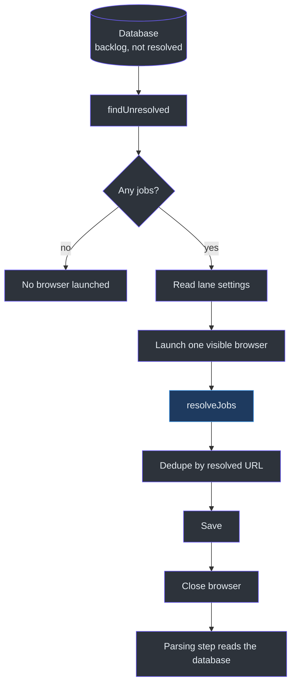
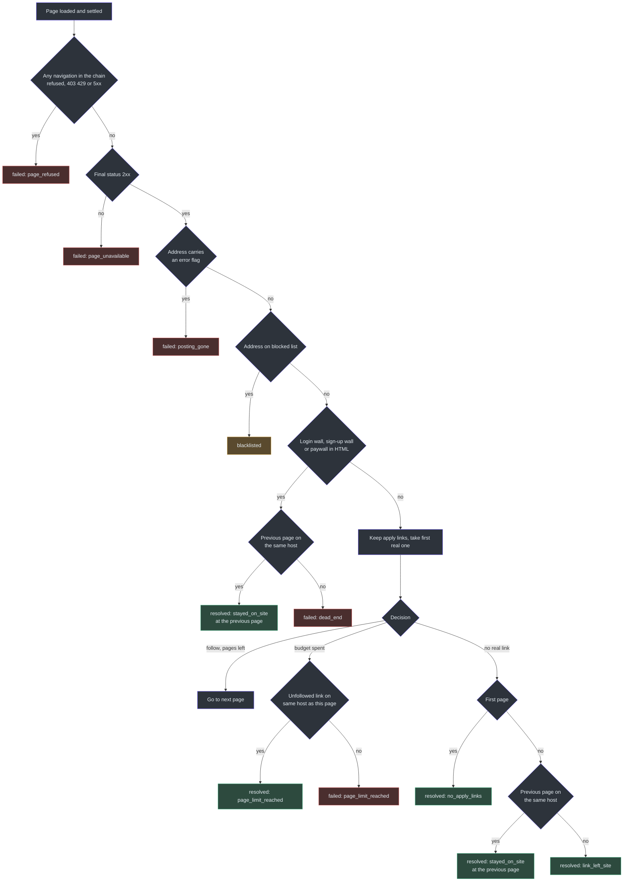
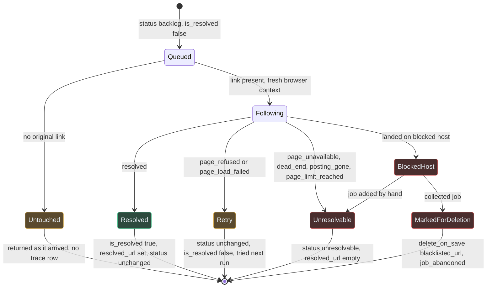
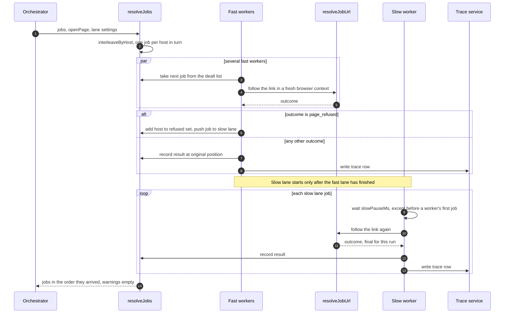
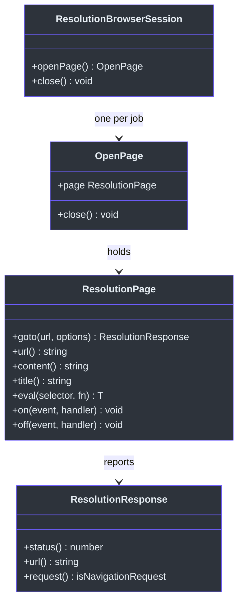

# Resolution

## Overview

A job from an aggregator (a site that lists other companies' jobs) arrives with a link to the aggregator's copy of the posting. That copy is often thin, stale or hidden behind a login. Resolution exists to follow that link, and any "apply" links after it, until it reaches the employer's own posting. The address it reaches is stored as the job's resolved URL. Later steps trust that address: dedupe treats two jobs with the same resolved URL as one job, and parsing reads the posting at that address.

Resolution is the one step that opens a real, visible browser. It is slow and some sites push back if they are asked too fast. Most of the code on this page is there to keep the step polite and to make sure a bad afternoon at one site does not throw away good jobs.

This page covers the step's plan and its rules. For the steps before it, see [Dedupe and Save](./dedupe-and-save.md) and [Collection](./collection.md). For the step after it, see [Parsing](./parsing.md).

### At a glance

| Component | Responsibility | Key file | Source |
|---|---|---|---|
| Resolution handler (`resolveJobs`) | Runs resolution over a whole list, in two lanes, and records what happened to each job | `lib/handlers/resolution.ts` | [resolution.ts:129-280](https://github.com/mablahblah/job-assistant/blob/main/lib/handlers/resolution.ts#L129-L280) |
| Resolver (`resolveJobUrl`) | Follows one link through at most four pages and says what it found | `lib/resolvers/resolve-job-url.ts` | [resolve-job-url.ts:91-221](https://github.com/mablahblah/job-assistant/blob/main/lib/resolvers/resolve-job-url.ts#L91-L221) |
| Page-settling wait (`waitForPageToLoad`) | Gives a page time to finish drawing before it is judged | `lib/resolvers/wait-for-page-to-load.ts` | [wait-for-page-to-load.ts:46-71](https://github.com/mablahblah/job-assistant/blob/main/lib/resolvers/wait-for-page-to-load.ts#L46-L71) |
| Next-step decision (`decideNextAction`) | Chooses: stop here, follow a link, or stop because the page budget is spent | `lib/utils/decide-next-action.ts` | [decide-next-action.ts:30-47](https://github.com/mablahblah/job-assistant/blob/main/lib/utils/decide-next-action.ts#L30-L47) |
| Apply-link filter (`filterApplyLinks`) | Keeps only links whose words read like "apply" or "view original posting" | `lib/utils/apply-links.ts` | [apply-links.ts:11-19](https://github.com/mablahblah/job-assistant/blob/main/lib/utils/apply-links.ts#L11-L19) |
| Blocked-host list (`isBlacklistedUrl`) | Says whether an address sits on a site we never want to land on | `lib/utils/blacklist.ts` | [blacklist.ts:5-47](https://github.com/mablahblah/job-assistant/blob/main/lib/utils/blacklist.ts#L5-L47) |
| Dead-end scan (`detectDeadEndSignals`) | Spots a login wall, sign-up wall or paywall in a page's HTML | `lib/utils/dead-end-signals.ts` | [dead-end-signals.ts:9-38](https://github.com/mablahblah/job-assistant/blob/main/lib/utils/dead-end-signals.ts#L9-L38) |
| Error-flag check (`urlAnnouncesError`) | Spots a page whose address says "error" even though the server answered 200 | `lib/utils/url-error-flag.ts` | [url-error-flag.ts:15-34](https://github.com/mablahblah/job-assistant/blob/main/lib/utils/url-error-flag.ts#L15-L34) |
| Host round-robin (`interleaveByHost`) | Reorders the queue so no single site gets all its visits in a row | `lib/utils/interleave-by-host.ts` | [interleave-by-host.ts:32-65](https://github.com/mablahblah/job-assistant/blob/main/lib/utils/interleave-by-host.ts#L32-L65) |
| Resolution browser (`createResolutionBrowser`) | Launches one visible Chromium per run and gives each job its own clean context | `lib/tools/resolution-browser.ts` | [resolution-browser.ts:58-80](https://github.com/mablahblah/job-assistant/blob/main/lib/tools/resolution-browser.ts#L58-L80) |
| Page contract (`ResolutionPage`) | The small slice of a browser page that resolution is allowed to use | `lib/tools/resolution-page.ts` | [resolution-page.ts:35-59](https://github.com/mablahblah/job-assistant/blob/main/lib/tools/resolution-page.ts#L35-L59) |

## Where resolution sits in a run

The step does not receive a job list from the step before it. It asks the database for every job whose status is `backlog` and whose `is_resolved` flag is false, whenever that job was collected ([job-service.ts:416-422](https://github.com/mablahblah/job-assistant/blob/main/lib/services/job-service.ts#L416-L422)). That is why a job that was left for the next run turns up again without any extra bookkeeping.

If that list is empty, no browser is launched. The three lane settings are read before the browser opens, so a missing setting stops the run without leaving a browser on screen ([job-search.ts:369-387](https://github.com/mablahblah/job-assistant/blob/main/lib/orchestrators/job-search.ts#L369-L387)). After resolution, the same dedupe and save used after collection run again, under their own step names ([job-search.ts:408-433](https://github.com/mablahblah/job-assistant/blob/main/lib/orchestrators/job-search.ts#L408-L433)). The browser is always closed in a `finally` block ([job-search.ts:451-456](https://github.com/mablahblah/job-assistant/blob/main/lib/orchestrators/job-search.ts#L451-L456)). See [The Job Search Run](../architecture/job-search-run.md) for the full order.

<!-- Sources: lib/orchestrators/job-search.ts:369-456, lib/services/job-service.ts:416-422 -->

## Following one link: the resolver

`resolveJobUrl` is handed a browser page and a starting address. It opens nothing itself, which is the rule for every resolver ([.claude/rules/resolvers.md:3](https://github.com/mablahblah/job-assistant/blob/main/.claude/rules/resolvers.md#L3)). It loops at most four times (`DEFAULT_MAX_PAGES = 4`, [resolve-job-url.ts:15](https://github.com/mablahblah/job-assistant/blob/main/lib/resolvers/resolve-job-url.ts#L15)). The limit is a constant on purpose, not a setting ([schema.prisma:322-326](https://github.com/mablahblah/job-assistant/blob/main/prisma/schema.prisma#L322-L326)).

On each page the resolver runs the same checks in a fixed order. The order matters, because each check catches something the next one would miss.

| Order | Check | What it catches | Result if it fires | Source |
|---|---|---|---|---|
| 1 | Load the page, listening to every response | A page that will not load at all | `failed`, reason `page_load_failed` | [resolve-job-url.ts:114-131](https://github.com/mablahblah/job-assistant/blob/main/lib/resolvers/resolve-job-url.ts#L114-L131) |
| 2 | Was any navigation in the chain refused | A source that refused us and then redirected away from its own refusal | `failed`, reason `page_refused` | [resolve-job-url.ts:85-89](https://github.com/mablahblah/job-assistant/blob/main/lib/resolvers/resolve-job-url.ts#L85-L89), [137-139](https://github.com/mablahblah/job-assistant/blob/main/lib/resolvers/resolve-job-url.ts#L137-L139) |
| 3 | Status of the final page | 403, 429 and 5xx are a refusal. Any other non-2xx is a page that is simply gone | `page_refused` or `page_unavailable` | [resolve-job-url.ts:47-59](https://github.com/mablahblah/job-assistant/blob/main/lib/resolvers/resolve-job-url.ts#L47-L59), [141-146](https://github.com/mablahblah/job-assistant/blob/main/lib/resolvers/resolve-job-url.ts#L141-L146) |
| 4 | Does the address carry an error flag | A dead posting redirected to the employer's whole listing, answering 200 | `failed`, reason `posting_gone` | [resolve-job-url.ts:153-155](https://github.com/mablahblah/job-assistant/blob/main/lib/resolvers/resolve-job-url.ts#L153-L155) |
| 5 | Is the final address on the blocked list | Paywalled aggregators and spam sites | Outcome `blacklisted` | [resolve-job-url.ts:158-160](https://github.com/mablahblah/job-assistant/blob/main/lib/resolvers/resolve-job-url.ts#L158-L160) |
| 6 | Dead-end scan of the HTML | Login wall, sign-up wall, paywall | Step back one page if it stayed on the same host, else `failed`, reason `dead_end` | [resolve-job-url.ts:162-175](https://github.com/mablahblah/job-assistant/blob/main/lib/resolvers/resolve-job-url.ts#L162-L175) |
| 7 | Read the page's links, keep apply links, decide | Whether to follow a link, stop, or run out of pages | See the next flowchart | [resolve-job-url.ts:177-216](https://github.com/mablahblah/job-assistant/blob/main/lib/resolvers/resolve-job-url.ts#L177-L216) |

### Why the order is what it is

- **Status is read from the whole chain, not only the last page.** On 2026-09-12 an aggregator redirected a job link to an address that answered 403 and then bounced to a page that answered 200. A whole run of that source recorded no refusal at all ([resolve-job-url.ts:76-84](https://github.com/mablahblah/job-assistant/blob/main/lib/resolvers/resolve-job-url.ts#L76-L84)). Only navigations count. One page load fires about 69 responses, mostly images and tracking pixels, and a refused pixel says nothing about the source.
- **The error flag is read before anything looks at the page.** A board once redirected a dead job to the employer's whole 95-job listing, and that listing was saved as the posting. The address was the only evidence ([resolve-job-url.ts:148-152](https://github.com/mablahblah/job-assistant/blob/main/lib/resolvers/resolve-job-url.ts#L148-L152)). The check reads a query parameter literally named `error`, so it names no website ([url-error-flag.ts:12-14](https://github.com/mablahblah/job-assistant/blob/main/lib/utils/url-error-flag.ts#L12-L14)). A value of `false`, `0` or empty counts as "no" ([url-error-flag.ts:33](https://github.com/mablahblah/job-assistant/blob/main/lib/utils/url-error-flag.ts#L33)).
- **The blocked list is judged on where the page settled**, not where the link aimed ([resolve-job-url.ts:157](https://github.com/mablahblah/job-assistant/blob/main/lib/resolvers/resolve-job-url.ts#L157)).

<!-- Sources: lib/resolvers/resolve-job-url.ts:104-216, lib/utils/decide-next-action.ts:30-47 -->

### Deciding whether to follow a link

`decideNextAction` is a small function with no browser in it, so it can be tested alone. It looks at the apply links already collected and one yes-or-no flag, "are there pages left" ([decide-next-action.ts:30-47](https://github.com/mablahblah/job-assistant/blob/main/lib/utils/decide-next-action.ts#L30-L47)).

- A **modal trigger** is a link with no real destination: an empty address, a bare `#`, or `javascript:` code. It is skipped, because following it would not go anywhere ([decide-next-action.ts:17-19](https://github.com/mablahblah/job-assistant/blob/main/lib/utils/decide-next-action.ts#L17-L19)).
- If no real link is left, the page in hand is the answer (`no_apply_links`).
- If a real link exists but no pages are left, the function returns the link it did not follow. The resolver then compares that link to the current page's host: same host means it was the application form and the posting is already in hand, different host means the real posting was never reached ([resolve-job-url.ts:196-203](https://github.com/mablahblah/job-assistant/blob/main/lib/resolvers/resolve-job-url.ts#L196-L203)).

The function never compares hosts itself. The host test runs after the browser lands, because a link can redirect somewhere other than its written address ([decide-next-action.ts:26-29](https://github.com/mablahblah/job-assistant/blob/main/lib/utils/decide-next-action.ts#L26-L29)). That test is `isSameDomain`, which compares exact host names. `boards.greenhouse.io` is not the same host as `greenhouse.io` ([url-domain.ts:12-18](https://github.com/mablahblah/job-assistant/blob/main/lib/utils/url-domain.ts#L12-L18)).

The apply-link filter matches whole phrases such as "apply now", "view original", "see job" and "visit posting", ignoring case. A bare word like "Share Job" does not match ([apply-links.ts:7-19](https://github.com/mablahblah/job-assistant/blob/main/lib/utils/apply-links.ts#L7-L19)).

### Waiting for a page to finish

Many job pages draw themselves with scripts after the first load. `waitForPageToLoad` polls every 150 ms for up to 15 seconds until the page has at least five links and a non-empty title ([wait-for-page-to-load.ts:9-11](https://github.com/mablahblah/job-assistant/blob/main/lib/resolvers/wait-for-page-to-load.ts#L9-L11), [46-71](https://github.com/mablahblah/job-assistant/blob/main/lib/resolvers/wait-for-page-to-load.ts#L46-L71)). It never throws. If time runs out, the page is judged as it stands. If reading the page throws because the page moved on mid-read, that counts as "not finished yet" ([wait-for-page-to-load.ts:31-44](https://github.com/mablahblah/job-assistant/blob/main/lib/resolvers/wait-for-page-to-load.ts#L31-L44)).

## The seven resolution outcomes for one job

The resolver returns `resolved`, `failed` or `blacklisted`. The handler turns each into a change on the job. Only two failure reasons are treated as "the moment, not the job".

<!-- Sources: lib/handlers/resolution.ts:46-127, lib/resolvers/resolve-job-url.ts:18-38 -->

| Outcome | What the handler writes | Trace event and reason | Why | Source |
|---|---|---|---|---|
| `resolved` | `resolved_url` set, `is_resolved` true. Status is not touched | `job_resolved`, reason is one of `no_apply_links`, `link_left_site`, `stayed_on_site`, `page_limit_reached` | Resolution places a job. It does not move it | [resolution.ts:70-78](https://github.com/mablahblah/job-assistant/blob/main/lib/handlers/resolution.ts#L70-L78) |
| `failed` with `page_refused` or `page_load_failed` | Job left exactly where it was: `is_resolved` false, no resolved URL, status unchanged | `resolution_failed` | These describe the moment. The source may answer next time. Parking the job would lose it for good, because the lookup only reads `backlog` jobs | [resolution.ts:50-67](https://github.com/mablahblah/job-assistant/blob/main/lib/handlers/resolution.ts#L50-L67), [81-82](https://github.com/mablahblah/job-assistant/blob/main/lib/handlers/resolution.ts#L81-L82) |
| `failed` with any other reason | Status `unresolvable`, `resolved_url` null | `resolution_failed` | The answer would be the same on every run. The job waits for the user to repair it | [resolution.ts:46-48](https://github.com/mablahblah/job-assistant/blob/main/lib/handlers/resolution.ts#L46-L48) |
| `blacklisted`, job added by hand (`collector` is `user`) | Status `unresolvable` | `resolution_failed`, reason `blacklisted_url` | No collector will ever find a hand-entered job again, so deleting it would destroy it | [resolution.ts:85-89](https://github.com/mablahblah/job-assistant/blob/main/lib/handlers/resolution.ts#L85-L89) |
| `blacklisted`, collected job | `delete_on_save` set to `blacklisted_url` | `job_abandoned`, reason `blacklisted_url` | Save removes the row. The job came from a site we never want | [resolution.ts:91-95](https://github.com/mablahblah/job-assistant/blob/main/lib/handlers/resolution.ts#L91-L95) |
| Browser threw while opening, running or closing | Entry returned untouched | `resolution_failed`, reason `page_load_failed` | The browser failed, not the posting | [resolution.ts:119-126](https://github.com/mablahblah/job-assistant/blob/main/lib/handlers/resolution.ts#L119-L126) |
| No `original_url` at all | Entry returned untouched | No trace row | There is nowhere to start from. Nothing is made up | [resolution.ts:103-105](https://github.com/mablahblah/job-assistant/blob/main/lib/handlers/resolution.ts#L103-L105) |

A "hand-entered job" is one whose `collector` field is `user`. A job that was marked for deletion is not deleted by resolution. It is deleted by the save step that follows. Dedupe reads a shared resolved URL as proof that two jobs are one, so a failed job must never keep a resolved URL. That is why every failure branch writes `resolved_url: null` ([resolution.ts:43-47](https://github.com/mablahblah/job-assistant/blob/main/lib/handlers/resolution.ts#L43-L47)).

The trace vocabulary for these ten reasons is written down in the `Trace` model comment in the schema ([schema.prisma:508-531](https://github.com/mablahblah/job-assistant/blob/main/prisma/schema.prisma#L508-L531)). Trace rows are described in [Tracing and the Run Summary](../architecture/tracing-and-run-summary.md).

## Two lanes: fast and slow

### Why two lanes exist

Aggregators throttle by counting visits. Measured against one aggregator on 2026-09-12, roughly 25 visits per five minutes passed and about 30 were refused ([interleave-by-host.ts:3-7](https://github.com/mablahblah/job-assistant/blob/main/lib/utils/interleave-by-host.ts#L3-L7)). The database hands back the queue grouped by collector, so all of one site's jobs sit together. That is the worst order for a rate limit.

The handler does three things about it.

1. **It deals the queue round-robin by host.** `interleaveByHost` takes one job from each host in turn, so one site's visits are spread over the whole run ([interleave-by-host.ts:32-65](https://github.com/mablahblah/job-assistant/blob/main/lib/utils/interleave-by-host.ts#L32-L65)). It groups by exact host, not by owned domain, because two subdomains of one company can be different systems with their own limits ([interleave-by-host.ts:12-15](https://github.com/mablahblah/job-assistant/blob/main/lib/utils/interleave-by-host.ts#L12-L15)). Jobs with no readable link share one pooled group, so none is dropped ([interleave-by-host.ts:21-29](https://github.com/mablahblah/job-assistant/blob/main/lib/utils/interleave-by-host.ts#L21-L29)).
2. **It runs a fast lane of several workers.** The width is the `resolution_fast_concurrency` setting ([schema.prisma:327](https://github.com/mablahblah/job-assistant/blob/main/prisma/schema.prisma#L327)).
3. **It sends refused hosts to a slow lane.** The first `page_refused` from a host adds that host to a set. The job that proved it, and every later job of that host, goes to the slow lane ([resolution.ts:216-235](https://github.com/mablahblah/job-assistant/blob/main/lib/handlers/resolution.ts#L216-L235)). The set starts empty on every call, and no host is named in code ([resolution.ts:196-199](https://github.com/mablahblah/job-assistant/blob/main/lib/handlers/resolution.ts#L196-L199)).

Only a refusal demotes a host. A 404 is about one posting, and sending a whole site to the slow lane over one dead posting would cost the rest of its jobs for nothing ([resolution.ts:227-230](https://github.com/mablahblah/job-assistant/blob/main/lib/handlers/resolution.ts#L227-L230)).

A job moved to the slow lane keeps no result and no trace row from the fast attempt. The slow attempt is the one that counts, and it is final: another refusal there is simply the job's answer for the run ([resolution.ts:200-205](https://github.com/mablahblah/job-assistant/blob/main/lib/handlers/resolution.ts#L200-L205), [265-268](https://github.com/mablahblah/job-assistant/blob/main/lib/handlers/resolution.ts#L265-L268)).

<!-- Sources: lib/handlers/resolution.ts:129-280, lib/utils/interleave-by-host.ts:32-65 -->

### Lane settings

| Setting | Meaning | Default in code | Source |
|---|---|---|---|
| `resolution_fast_concurrency` | How many jobs the fast lane works at once. A headed browser holds the machine while it runs | None. A missing value throws | [schema.prisma:322-327](https://github.com/mablahblah/job-assistant/blob/main/prisma/schema.prisma#L322-L327), [settings-service.ts:176-184](https://github.com/mablahblah/job-assistant/blob/main/lib/services/settings-service.ts#L176-L184) |
| `resolution_slow_concurrency` | How many jobs the slow lane works at once. Normally one | 1 if the caller passes none | [schema.prisma:328-330](https://github.com/mablahblah/job-assistant/blob/main/prisma/schema.prisma#L328-L330), [resolution.ts:136](https://github.com/mablahblah/job-assistant/blob/main/lib/handlers/resolution.ts#L136) |
| `resolution_slow_pause_seconds` | Pause between a slow worker's jobs. Stored in seconds, handed on as milliseconds | 12 seconds if the caller passes none | [schema.prisma:331-335](https://github.com/mablahblah/job-assistant/blob/main/prisma/schema.prisma#L331-L335), [resolution.ts:137](https://github.com/mablahblah/job-assistant/blob/main/lib/handlers/resolution.ts#L137), [job-search.ts:397](https://github.com/mablahblah/job-assistant/blob/main/lib/orchestrators/job-search.ts#L397) |

The settings service throws on a missing value rather than returning zero. A lane with zero jobs at a time would look the same as a lane that found nothing ([settings-service.ts:176-178](https://github.com/mablahblah/job-assistant/blob/main/lib/services/settings-service.ts#L176-L178)).

The slow lane pauses before every job except each worker's first. That first job comes after the whole fast lane has run, which is already cooling-off time ([resolution.ts:247-258](https://github.com/mablahblah/job-assistant/blob/main/lib/handlers/resolution.ts#L247-L258)). The two lanes reduce the cost of a block. They do not prevent one, because the fast lane has no pacing of its own (documented in [architecture.md:19](https://github.com/mablahblah/job-assistant/blob/main/docs/architecture.md#L19)).

## The browser and the page contract

| Design choice | What the code does | Why | Source |
|---|---|---|---|
| Headed, never headless | `HEADED_LAUNCH_OPTIONS = { headless: false }`, not configurable | Measured against one aggregator's redirector: 26 of 26 headless requests refused, none of 6 headed ones. Changing the user-agent did not help | [resolution-browser.ts:17-23](https://github.com/mablahblah/job-assistant/blob/main/lib/tools/resolution-browser.ts#L17-L23) |
| One browser per run | `launch()` is called once in `createResolutionBrowser` | Only one Chromium process opens, however many jobs there are | [resolution-browser.ts:61-63](https://github.com/mablahblah/job-assistant/blob/main/lib/tools/resolution-browser.ts#L61-L63) |
| One context per job | `openPage()` makes a new context and page, and `close()` closes that context only | One site's cookies and consent clicks never reach the next job | [resolution-browser.ts:66-77](https://github.com/mablahblah/job-assistant/blob/main/lib/tools/resolution-browser.ts#L66-L77), [resolution.ts:114-118](https://github.com/mablahblah/job-assistant/blob/main/lib/handlers/resolution.ts#L114-L118) |
| Launcher passed in | `createResolutionBrowser(launch = defaultLaunch)` | A test can hand over a stand-in, so no test needs a real Chromium | [resolution-browser.ts:43-60](https://github.com/mablahblah/job-assistant/blob/main/lib/tools/resolution-browser.ts#L43-L60) |
| Narrow page interface | `ResolutionPage` names only the methods resolution calls: `goto`, `url`, `content`, `title`, `$$eval`, `on`, `off` | A real Playwright page fits with no adapter, and a scripted fake fits just as well | [resolution-page.ts:1-5](https://github.com/mablahblah/job-assistant/blob/main/lib/tools/resolution-page.ts#L1-L5), [35-59](https://github.com/mablahblah/job-assistant/blob/main/lib/tools/resolution-page.ts#L35-L59) |
| Handler gets a page factory, not a browser | `ResolveJobsOptions.openPage` | The handler launches nothing of its own | [resolution.ts:6-8](https://github.com/mablahblah/job-assistant/blob/main/lib/handlers/resolution.ts#L6-L8), [15-28](https://github.com/mablahblah/job-assistant/blob/main/lib/handlers/resolution.ts#L15-L28) |

This pattern follows the project rule for tools: a tool that keeps something open is set up by a `create` function ([.claude/rules/tools.md:5-8](https://github.com/mablahblah/job-assistant/blob/main/.claude/rules/tools.md#L5-L8)).

<!-- Sources: lib/tools/resolution-page.ts:7-84, lib/tools/resolution-browser.ts:28-80 -->

## The blocked-host list

`BLACKLISTED_DOMAINS` holds 14 hosts in three groups: paywalled aggregators, spam destinations that redirects often land on, and spam sources that republish low-quality postings ([blacklist.ts:5-23](https://github.com/mablahblah/job-assistant/blob/main/lib/utils/blacklist.ts#L5-L23)). A host matches if it equals a listed domain or is a subdomain of one, so `www.jobleads.com` matches `jobleads.com` but `notjobleads.com` does not ([blacklist.ts:41-46](https://github.com/mablahblah/job-assistant/blob/main/lib/utils/blacklist.ts#L41-L46)). A string that is not a link is never on the list, and the function never throws ([blacklist.ts:29-39](https://github.com/mablahblah/job-assistant/blob/main/lib/utils/blacklist.ts#L29-L39)).

This is the project rule "knowledge about a job site is data, never code" in action. The rule code reads the list. It does not contain a site name ([CLAUDE.md, Working Agreements](https://github.com/mablahblah/job-assistant/blob/main/CLAUDE.md)).

## Dead-end signals

`detectDeadEndSignals` flags only strong signals, because a page wrongly called a dead end throws away a real posting ([dead-end-signals.ts:6-8](https://github.com/mablahblah/job-assistant/blob/main/lib/utils/dead-end-signals.ts#L6-L8)).

| Signal | Reason returned | Source |
|---|---|---|
| A password input box | `login_wall` | [dead-end-signals.ts:11-13](https://github.com/mablahblah/job-assistant/blob/main/lib/utils/dead-end-signals.ts#L11-L13) |
| "create an account to view/apply/continue/access/see" or "sign up to ..." | `signup_wall` | [dead-end-signals.ts:18-23](https://github.com/mablahblah/job-assistant/blob/main/lib/utils/dead-end-signals.ts#L18-L23) |
| "subscribe to view/access/see/unlock", "start your free trial", "upgrade to view ..." | `paywall` | [dead-end-signals.ts:27-35](https://github.com/mablahblah/job-assistant/blob/main/lib/utils/dead-end-signals.ts#L27-L35) |

The reason is read by the scan but the resolver reports every one as the single failure reason `dead_end` ([resolve-job-url.ts:174](https://github.com/mablahblah/job-assistant/blob/main/lib/resolvers/resolve-job-url.ts#L174)).

## Notes where code and docs differ

- `docs/architecture.md` calls the resolver a "Util" in its table ([architecture.md:202](https://github.com/mablahblah/job-assistant/blob/main/docs/architecture.md#L202)). It lives in `lib/resolvers/`, which is its own folder kind ([naming.md:7-19](https://github.com/mablahblah/job-assistant/blob/main/.claude/rules/naming.md#L7-L19)).
- `docs/architecture.md` says resolution reports "resolved, failed or blocked". The code's three outcome names are `resolved`, `failed` and `blacklisted` ([resolve-job-url.ts:18-38](https://github.com/mablahblah/job-assistant/blob/main/lib/resolvers/resolve-job-url.ts#L18-L38)).
- Inferred: a job with no `original_url` is returned untouched with no trace row, so it keeps `is_resolved` false and the lookup will return it again on every run ([resolution.ts:105](https://github.com/mablahblah/job-assistant/blob/main/lib/handlers/resolution.ts#L105), [job-service.ts:416-422](https://github.com/mablahblah/job-assistant/blob/main/lib/services/job-service.ts#L416-L422)).

## Related Pages

| Page | Relationship |
|---|---|
| [Collection](./collection.md) | Produces the jobs resolution reads. Some collectors mark their own jobs as already resolved |
| [Dedupe and Save](./dedupe-and-save.md) | Runs straight after resolution and uses the resolved URL as proof of identity |
| [Parsing](./parsing.md) | Reads the posting at the resolved URL |
| [The Job Search Run](../architecture/job-search-run.md) | Shows where resolution sits in the whole run |
| [Tracing and the Run Summary](../architecture/tracing-and-run-summary.md) | Explains the trace rows resolution writes |
| [Project Rules](../quality/project-rules.md) | Holds the rules for resolvers, tools and handlers |
| [Testing](../quality/testing.md) | Explains the scripted fakes used instead of Playwright |

## References

- [lib/handlers/resolution.ts](https://github.com/mablahblah/job-assistant/blob/main/lib/handlers/resolution.ts)
- [lib/resolvers/resolve-job-url.ts](https://github.com/mablahblah/job-assistant/blob/main/lib/resolvers/resolve-job-url.ts)
- [lib/resolvers/wait-for-page-to-load.ts](https://github.com/mablahblah/job-assistant/blob/main/lib/resolvers/wait-for-page-to-load.ts)
- [lib/utils/decide-next-action.ts](https://github.com/mablahblah/job-assistant/blob/main/lib/utils/decide-next-action.ts)
- [lib/utils/blacklist.ts](https://github.com/mablahblah/job-assistant/blob/main/lib/utils/blacklist.ts)
- [lib/utils/interleave-by-host.ts](https://github.com/mablahblah/job-assistant/blob/main/lib/utils/interleave-by-host.ts)
- [lib/tools/resolution-browser.ts](https://github.com/mablahblah/job-assistant/blob/main/lib/tools/resolution-browser.ts)
- [lib/tools/resolution-page.ts](https://github.com/mablahblah/job-assistant/blob/main/lib/tools/resolution-page.ts)
- [.claude/rules/resolvers.md](https://github.com/mablahblah/job-assistant/blob/main/.claude/rules/resolvers.md)
- [docs/architecture.md](https://github.com/mablahblah/job-assistant/blob/main/docs/architecture.md)
