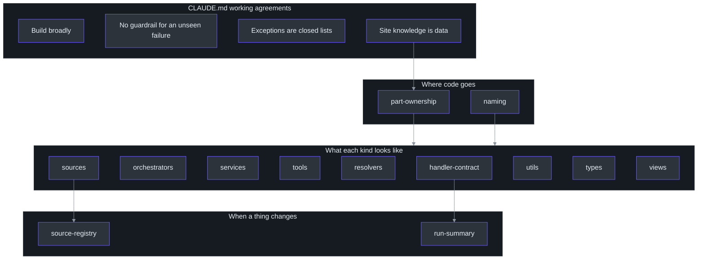
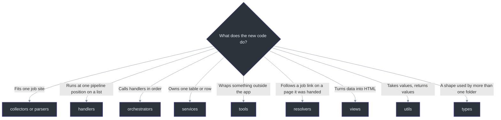
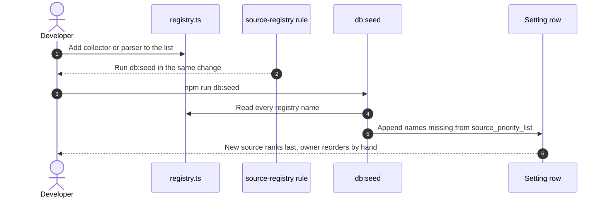

# Project Rules

## Overview

This project keeps its design rules in writing, in two places. The first is `.claude/rules/`, thirteen short files that Claude Code loads when it edits matching files. The second is the "Working Agreements" section of `CLAUDE.md`, which holds four rules that apply everywhere. The rules exist because the code is written largely with an AI agent. An agent that cannot ask questions needs the answer to "where does this go, and what is it called?" written down.

Each rule file names the paths it applies to in a `paths:` line at the top. Claude Code loads the rule only when it touches a file that matches ([.claude/rules/handler-contract.md:1-3](https://github.com/mablahblah/job-assistant/blob/main/.claude/rules/handler-contract.md#L1-L3)). Only one rule has automatic enforcement in a test. The rest depend on the agent and on review.

## At a glance

| Layer | What it is | Applies to | Source |
| --- | --- | --- | --- |
| Rule files | 13 files, each answering one question | Paths named in each file | [.claude/rules/part-ownership.md:1-3](https://github.com/mablahblah/job-assistant/blob/main/.claude/rules/part-ownership.md#L1-L3) |
| Working agreements | 4 rules about how to build | All work | [CLAUDE.md:107-115](https://github.com/mablahblah/job-assistant/blob/main/CLAUDE.md#L107-L115) |
| Linting | ESLint with the TypeScript plugin | Every `.ts` file outside `docs/` and `generated/` | [.eslintrc.json:1-8](https://github.com/mablahblah/job-assistant/blob/main/.eslintrc.json#L1-L8) |
| Type check | Strict TypeScript, no output files | Every `.ts` file outside `docs/` and `generated/` | [tsconfig.json:6-20](https://github.com/mablahblah/job-assistant/blob/main/tsconfig.json#L6-L20) |
| Automatic check | A test that stops utils importing from handlers | `lib/utils/` | [lib/utils/import-direction.test.ts:16](https://github.com/mablahblah/job-assistant/blob/main/lib/utils/import-direction.test.ts#L16) |

## How the rules fit together

<!-- Sources: CLAUDE.md:105-113, .claude/rules/part-ownership.md:1-54, .claude/rules/naming.md:1-51, .claude/rules/sources.md:1-23, .claude/rules/source-registry.md:1-9, .claude/rules/handler-contract.md:1-41, .claude/rules/run-summary.md:1-90 -->

The grouping is the page author's reading, not a structure the repository declares (inferred).

## Where does new code go?

<!-- Sources: .claude/rules/naming.md:7-25, .claude/rules/part-ownership.md:7-11, .claude/rules/tools.md:7, .claude/rules/resolvers.md:7 -->

The `lib/db/` folder holds the database connection and the schema check, and only that folder builds a connection ([.claude/rules/naming.md:25](https://github.com/mablahblah/job-assistant/blob/main/.claude/rules/naming.md#L25)).

## The four working agreements

| Agreement | In plain words | Why it exists | Source |
| --- | --- | --- | --- |
| **Build broadly, not for the case in front of you** | A rule that exists only to make one seen example come out right is a defect. Fold it into a general step that already exists | One-off fixes pile up into code nobody can reason about | [CLAUDE.md:109](https://github.com/mablahblah/job-assistant/blob/main/CLAUDE.md#L109) |
| **No guardrail for a failure nobody has seen** | A measured occurrence justifies building against a failure. Until then the risk is written down, not coded around | Guards for imagined failures add code that never runs and hides real design | [CLAUDE.md:111](https://github.com/mablahblah/job-assistant/blob/main/CLAUDE.md#L111) |
| **An exception is a closed list, never a judgement** | Where a rule allows an exception, it names the exact files or cases | An exception left to judgement gets taken every time | [CLAUDE.md:113](https://github.com/mablahblah/job-assistant/blob/main/CLAUDE.md#L113) |
| **Knowledge about a job site is data, never code** | A rule may read a list of websites. It may not contain one. Site-specific judgement lives in collectors and parsers only | New sites should mean a new entry, not a new branch in shared code | [CLAUDE.md:115](https://github.com/mablahblah/job-assistant/blob/main/CLAUDE.md#L115) |

You can see all four in the code. The parser registry is keyed by the website each parser owns, and the lookup falls through to a general parser for any unowned link, so no shared code names a site ([lib/parsers/registry.ts:51-79](https://github.com/mablahblah/job-assistant/blob/main/lib/parsers/registry.ts#L51-L79)). The one exception rule in `sources.md` is a closed list of one: `general.ts` is the only parser that owns no website ([.claude/rules/sources.md:23](https://github.com/mablahblah/job-assistant/blob/main/.claude/rules/sources.md#L23)). The recovery command asks the registry whether a parser claims a link and holds no knowledge of sites itself ([scripts/recover-unparseable-jobs.ts:62-70](https://github.com/mablahblah/job-assistant/blob/main/scripts/recover-unparseable-jobs.ts#L62-L70)).

## The thirteen rule files

| Rule | Applies to | Answers | Source |
| --- | --- | --- | --- |
| `part-ownership` | `lib/**/*.ts` | Where new behavior goes, and what each kind of part may never do | [.claude/rules/part-ownership.md:1-50](https://github.com/mablahblah/job-assistant/blob/main/.claude/rules/part-ownership.md#L1-L50) |
| `naming` | `lib/**` and `scripts/**` | What any file, test, or value is called, and which folder it sits in | [.claude/rules/naming.md:1-51](https://github.com/mablahblah/job-assistant/blob/main/.claude/rules/naming.md#L1-L51) |
| `handler-contract` | `lib/handlers/**` | What code that runs at one pipeline position must look like | [.claude/rules/handler-contract.md:1-41](https://github.com/mablahblah/job-assistant/blob/main/.claude/rules/handler-contract.md#L1-L41) |
| `orchestrators` | `lib/orchestrators/**` | What a runner of the pipeline is called | [.claude/rules/orchestrators.md:1-13](https://github.com/mablahblah/job-assistant/blob/main/.claude/rules/orchestrators.md#L1-L13) |
| `tools` | `lib/tools/**` | What a wrapper around something outside the app looks like | [.claude/rules/tools.md:1-13](https://github.com/mablahblah/job-assistant/blob/main/.claude/rules/tools.md#L1-L13) |
| `services` | `lib/services/**` | What code that owns one table looks like | [.claude/rules/services.md:1-13](https://github.com/mablahblah/job-assistant/blob/main/.claude/rules/services.md#L1-L13) |
| `sources` | `lib/collectors/**`, `lib/parsers/**` | What a collector or parser is called and how it joins the pipeline | [.claude/rules/sources.md:1-23](https://github.com/mablahblah/job-assistant/blob/main/.claude/rules/sources.md#L1-L23) |
| `resolvers` | `lib/resolvers/**` | What code that follows job links looks like | [.claude/rules/resolvers.md:1-10](https://github.com/mablahblah/job-assistant/blob/main/.claude/rules/resolvers.md#L1-L10) |
| `types` | `lib/types/**` | What a shared shape file holds | [.claude/rules/types.md:1-9](https://github.com/mablahblah/job-assistant/blob/main/.claude/rules/types.md#L1-L9) |
| `utils` | `lib/utils/**` | What a plain function is called and where it lives | [.claude/rules/utils.md:1-12](https://github.com/mablahblah/job-assistant/blob/main/.claude/rules/utils.md#L1-L12) |
| `views` | `lib/views/**` | What code that builds a screen looks like | [.claude/rules/views.md:1-11](https://github.com/mablahblah/job-assistant/blob/main/.claude/rules/views.md#L1-L11) |
| `source-registry` | `lib/**/registry.ts` | What must happen when a collector or parser is added or renamed | [.claude/rules/source-registry.md:1-9](https://github.com/mablahblah/job-assistant/blob/main/.claude/rules/source-registry.md#L1-L9) |
| `run-summary` | `lib/utils/run-summary*.ts` | What a command prints when it finishes | [.claude/rules/run-summary.md:1-90](https://github.com/mablahblah/job-assistant/blob/main/.claude/rules/run-summary.md#L1-L90) |

The `paths:` values come from the first lines of each file. Their wording matches the table in [CLAUDE.md:79-93](https://github.com/mablahblah/job-assistant/blob/main/CLAUDE.md#L79-L93).

## Rule by rule

### part-ownership

This rule decides which part of the pipeline may do what. It starts from one fact: collectors and parsers are the only code written for a particular site, and no part branches on which collector produced a job ([.claude/rules/part-ownership.md:7-11](https://github.com/mablahblah/job-assistant/blob/main/.claude/rules/part-ownership.md#L7-L11)).

Seven jobs have exactly one implementation: removing duplicates, saving and updating, following a link, tidying names, matching a location, clearing the backlog, and recording what happened. A second copy is "a defect, not a variation" ([.claude/rules/part-ownership.md:13-17](https://github.com/mablahblah/job-assistant/blob/main/.claude/rules/part-ownership.md#L13-L17)). No part may assume it runs inside a job search, so the same save code serves a search, a hand status change, and scoring ([.claude/rules/part-ownership.md:19-23](https://github.com/mablahblah/job-assistant/blob/main/.claude/rules/part-ownership.md#L19-L23)). Each stretch ends at the database and the next one asks the database for its work ([.claude/rules/part-ownership.md:25-27](https://github.com/mablahblah/job-assistant/blob/main/.claude/rules/part-ownership.md#L25-L27)).

| Part | Owns | Never does | Source |
| --- | --- | --- | --- |
| Collector | Gathers raw jobs into `raw_` fields exactly as they arrived | Interpret anything | [.claude/rules/part-ownership.md:33](https://github.com/mablahblah/job-assistant/blob/main/.claude/rules/part-ownership.md#L33) |
| Normalizer | Reshapes raw data already present | Go looking for missing data | [.claude/rules/part-ownership.md:34](https://github.com/mablahblah/job-assistant/blob/main/.claude/rules/part-ownership.md#L34) |
| Resolver | Follows a link to the employer's own posting | Read anything off the page it lands on | [.claude/rules/part-ownership.md:35](https://github.com/mablahblah/job-assistant/blob/main/.claude/rules/part-ownership.md#L35) |
| Parser | The final attempt at filling `raw_` fields | Format what it extracts | [.claude/rules/part-ownership.md:36](https://github.com/mablahblah/job-assistant/blob/main/.claude/rules/part-ownership.md#L36) |
| Company association | Decides the employer; creates one if none | Invent a name from a slug, or a slug from a name | [.claude/rules/part-ownership.md:37](https://github.com/mablahblah/job-assistant/blob/main/.claude/rules/part-ownership.md#L37) |
| Dedupe | Reduces the job list using identity tests | Merge when no test has the fields it needs | [.claude/rules/part-ownership.md:38](https://github.com/mablahblah/job-assistant/blob/main/.claude/rules/part-ownership.md#L38) |
| Save | Creates, updates, deletes rows; owns the merge rule | Decide which employer a job belongs to | [.claude/rules/part-ownership.md:39](https://github.com/mablahblah/job-assistant/blob/main/.claude/rules/part-ownership.md#L39) |
| Classification | Judgements such as location match and expiry | Reshape a value or look for a missing one | [.claude/rules/part-ownership.md:40](https://github.com/mablahblah/job-assistant/blob/main/.claude/rules/part-ownership.md#L40) |
| Scoring | Alignment, employer scores, promoting an employer | Reach the database except through the services that own each table | [.claude/rules/part-ownership.md:41](https://github.com/mablahblah/job-assistant/blob/main/.claude/rules/part-ownership.md#L41) |
| Backlog cleanup | Expires old backlog jobs, and empties stale employer scores | Delete a job or an employer | [.claude/rules/part-ownership.md:42](https://github.com/mablahblah/job-assistant/blob/main/.claude/rules/part-ownership.md#L42) |

The rule gives a test that separates reshaping from going looking: reshaping changes a value that is there, and going looking produces one that is not ([.claude/rules/part-ownership.md:48-50](https://github.com/mablahblah/job-assistant/blob/main/.claude/rules/part-ownership.md#L48-L50)). It also says which step may set which status ([.claude/rules/part-ownership.md:44-46](https://github.com/mablahblah/job-assistant/blob/main/.claude/rules/part-ownership.md#L44-L46)), shown in [Quick Reference](../../getting-started/quick-reference.md#job-statuses).

### naming

Files are kebab-case, one folder per kind of thing. Tests sit beside the code and are named by what they test ([.claude/rules/naming.md:27-38](https://github.com/mablahblah/job-assistant/blob/main/.claude/rules/naming.md#L27-L38)).

| Test file name | Meaning | Source |
| --- | --- | --- |
| `{name}.test.ts` | Tests one file | [.claude/rules/naming.md:31](https://github.com/mablahblah/job-assistant/blob/main/.claude/rules/naming.md#L31) |
| `{name}-events.test.ts` | A handler's trace-row tests | [.claude/rules/naming.md:32](https://github.com/mablahblah/job-assistant/blob/main/.claude/rules/naming.md#L32) |
| `{scenario}.flow.test.ts` | Runs a whole search or command from start to finish | [.claude/rules/naming.md:33](https://github.com/mablahblah/job-assistant/blob/main/.claude/rules/naming.md#L33) |
| `{name}.fake.test.ts` | Tests a stand-in | [.claude/rules/naming.md:34](https://github.com/mablahblah/job-assistant/blob/main/.claude/rules/naming.md#L34) |

Value names follow one pattern ([.claude/rules/naming.md:46-51](https://github.com/mablahblah/job-assistant/blob/main/.claude/rules/naming.md#L46-L51)): a fixed written-out value is `SCREAMING_SNAKE` (`ACTIVE_STATUSES`), an object carrying functions is `camelCase` (`adzunaCollector`), a type is `PascalCase` (`JobListEntry`), and everything else is `camelCase`. The code follows this: `ACTIVE_STATUSES` and `VALID_STATUSES` are in `lib/utils/job-status.ts` ([lib/utils/job-status.ts:8](https://github.com/mablahblah/job-assistant/blob/main/lib/utils/job-status.ts#L8)). A shape used by more than one folder goes in `lib/types/`; a shape one folder uses stays there ([.claude/rules/naming.md:40-44](https://github.com/mablahblah/job-assistant/blob/main/.claude/rules/naming.md#L40-L44)).

### handler-contract

A handler takes a list, acts on every entry, and returns that list under the name of what is in it (`jobs` or `companies`, never both) ([.claude/rules/handler-contract.md:9-11](https://github.com/mablahblah/job-assistant/blob/main/.claude/rules/handler-contract.md#L9-L11)). The orchestrator makes this concrete: its `HandlerResult` type forbids a result that carries both, so the entry count cannot pick one arbitrarily ([lib/orchestrators/job-search.ts:58-67](https://github.com/mablahblah/job-assistant/blob/main/lib/orchestrators/job-search.ts#L58-L67)).

The rule separates two kinds of record ([.claude/rules/handler-contract.md:31-35](https://github.com/mablahblah/job-assistant/blob/main/.claude/rules/handler-contract.md#L31-L35)):

| Record | Purpose | Who sees it |
| --- | --- | --- |
| **Trace row** | Analytics. Written as the handler runs. Changes nothing | Nobody is told |
| **Warning** | Validation. Something is wrong the user needs to know | Returned up to the agent, which presents it |

An event can produce both. A salary that could not be read writes a trace row and returns a warning ([.claude/rules/handler-contract.md:35](https://github.com/mablahblah/job-assistant/blob/main/.claude/rules/handler-contract.md#L35)). A handler reads no database beyond the trace service ([.claude/rules/handler-contract.md:17](https://github.com/mablahblah/job-assistant/blob/main/.claude/rules/handler-contract.md#L17)), and it is handed the step name because one handler runs at more than one position ([.claude/rules/handler-contract.md:37](https://github.com/mablahblah/job-assistant/blob/main/.claude/rules/handler-contract.md#L37)). The orchestrator shows this: `dedupeJobs` runs at three positions with a different `step` each time ([lib/orchestrators/job-search.ts:334-343](https://github.com/mablahblah/job-assistant/blob/main/lib/orchestrators/job-search.ts#L334-L343), [lib/orchestrators/job-search.ts:408-417](https://github.com/mablahblah/job-assistant/blob/main/lib/orchestrators/job-search.ts#L408-L417), [lib/orchestrators/job-search.ts:528-538](https://github.com/mablahblah/job-assistant/blob/main/lib/orchestrators/job-search.ts#L528-L538)).

### orchestrators, services, tools, resolvers, views, types, utils

These seven rules are short. They set a name pattern and one sentence about what the part may touch.

| Rule | Pattern | Boundary it sets | Source |
| --- | --- | --- | --- |
| `orchestrators` | `lib/orchestrators/{subject}.ts`, function `run{Subject}` | Calls handlers in order and hands each what it needs as arguments | [.claude/rules/orchestrators.md:7-13](https://github.com/mablahblah/job-assistant/blob/main/.claude/rules/orchestrators.md#L7-L13) |
| `services` | `{subject}-service.ts`, `create{Subject}Service(db)`, `{Subject}Record` | Owns exactly one table or row, reaches the database only through its client | [.claude/rules/services.md:7-13](https://github.com/mablahblah/job-assistant/blob/main/.claude/rules/services.md#L7-L13) |
| `tools` | `{subject}.ts`, builder starts with `create`, stand-in `fake{Subject}()` | Wraps one outside thing, owns no table, takes no job list | [.claude/rules/tools.md:7-13](https://github.com/mablahblah/job-assistant/blob/main/.claude/rules/tools.md#L7-L13) |
| `resolvers` | `resolve-job-url.ts`, `resolveJobUrl` | Drives a page it was handed and never opens one | [.claude/rules/resolvers.md:7-10](https://github.com/mablahblah/job-assistant/blob/main/.claude/rules/resolvers.md#L7-L10) |
| `views` | `{subject}.ts`, `{subject}View` | Takes values, returns HTML, reaches no database | [.claude/rules/views.md:7-11](https://github.com/mablahblah/job-assistant/blob/main/.claude/rules/views.md#L7-L11) |
| `types` | `{subject}.ts` | Declares a shape; holds no logic and calls nothing | [.claude/rules/types.md:7-9](https://github.com/mablahblah/job-assistant/blob/main/.claude/rules/types.md#L7-L9) |
| `utils` | `{subject}.ts`, named for a noun it returns or a yes-or-no question | Takes values, returns values, reaches no database | [.claude/rules/utils.md:7-12](https://github.com/mablahblah/job-assistant/blob/main/.claude/rules/utils.md#L7-L12) |

The utils boundary is the only one with a test. `lib/utils/import-direction.test.ts` reads every non-test util file and fails if one imports from `handlers` or `orchestrators`, including type-only imports ([lib/utils/import-direction.test.ts:16](https://github.com/mablahblah/job-assistant/blob/main/lib/utils/import-direction.test.ts#L16), [lib/utils/import-direction.test.ts:27-35](https://github.com/mablahblah/job-assistant/blob/main/lib/utils/import-direction.test.ts#L27-L35)). The test explains why: a folder meant to depend on nothing must not depend on the pipeline ([lib/utils/import-direction.test.ts:1-4](https://github.com/mablahblah/job-assistant/blob/main/lib/utils/import-direction.test.ts#L1-L4)). The rule that states this direction is a line in the `utils` rule ([.claude/rules/utils.md:12](https://github.com/mablahblah/job-assistant/blob/main/.claude/rules/utils.md#L12)).

### sources and source-registry

Collector and parser file names must match their `name` field, and a source joins the pipeline only by being listed in its registry ([.claude/rules/sources.md:11-14](https://github.com/mablahblah/job-assistant/blob/main/.claude/rules/sources.md#L11-L14), [.claude/rules/sources.md:20-23](https://github.com/mablahblah/job-assistant/blob/main/.claude/rules/sources.md#L20-L23)). The paired rule explains the cost of forgetting the next step: a registry change must run `npm run db:seed` in the same change, because a source missing from the priority list loses every contested field ([.claude/rules/source-registry.md:7-9](https://github.com/mablahblah/job-assistant/blob/main/.claude/rules/source-registry.md#L7-L9)). The seed does the appending ([scripts/db-seed.ts:204-218](https://github.com/mablahblah/job-assistant/blob/main/scripts/db-seed.ts#L204-L218)). See [Parsing](../pipeline/parsing.md) and [Collection](../pipeline/collection.md).

<!-- Sources: .claude/rules/source-registry.md:7-9, scripts/db-seed.ts:88-95, scripts/db-seed.ts:189-219, lib/collectors/registry.ts:19-34 -->

### run-summary

Every step prints, even with no work, because "a missing block reads as a step that never ran" ([.claude/rules/run-summary.md:9](https://github.com/mablahblah/job-assistant/blob/main/.claude/rules/run-summary.md#L9)). The heading carries how many jobs entered, and each job leaves by exactly one line, so the lines sum to the heading ([.claude/rules/run-summary.md:15-23](https://github.com/mablahblah/job-assistant/blob/main/.claude/rules/run-summary.md#L15-L23)). A reason clause uses the value written to `Trace.reason`, so the summary and a database query use one name ([.claude/rules/run-summary.md:32-34](https://github.com/mablahblah/job-assistant/blob/main/.claude/rules/run-summary.md#L32-L34)). A note is something true about the jobs that is not a path out of the step, and never counts toward the heading ([.claude/rules/run-summary.md:43-45](https://github.com/mablahblah/job-assistant/blob/main/.claude/rules/run-summary.md#L43-L45)). Every count is read back from trace rows, never from what a handler returned ([.claude/rules/run-summary.md:88-90](https://github.com/mablahblah/job-assistant/blob/main/.claude/rules/run-summary.md#L88-L90)). The command does exactly that ([scripts/job-search.ts:117-130](https://github.com/mablahblah/job-assistant/blob/main/scripts/job-search.ts#L117-L130)). A stopped step is marked in its heading ([lib/utils/run-summary.ts:119](https://github.com/mablahblah/job-assistant/blob/main/lib/utils/run-summary.ts#L119)). See [Tracing and Run Summary](../architecture/tracing-and-run-summary.md).

## Lint, types, and hooks

| Tool | Setting | Why it matters | Source |
| --- | --- | --- | --- |
| ESLint | `eslint:recommended` plus the TypeScript recommended set | Baseline correctness checks | [.eslintrc.json:4](https://github.com/mablahblah/job-assistant/blob/main/.eslintrc.json#L4) |
| Unused variables | A warning, not an error; names starting with `_` are exempt for arguments | Lets a function keep a parameter it does not use | [.eslintrc.json:6](https://github.com/mablahblah/job-assistant/blob/main/.eslintrc.json#L6) |
| Lint scope | Ignores `node_modules`, `generated`, and `docs` | `docs/` holds research spikes, not app code | [.eslintignore:1-4](https://github.com/mablahblah/job-assistant/blob/main/.eslintignore#L1-L4) |
| TypeScript | `strict: true`, `noEmit: true`, module `esnext` | Type errors fail `npm run lint` since it runs the type check second | [tsconfig.json:6-7](https://github.com/mablahblah/job-assistant/blob/main/tsconfig.json#L6-L7), [package.json:19-20](https://github.com/mablahblah/job-assistant/blob/main/package.json#L19-L20) |
| Type scope | Includes `**/*.ts`; excludes `node_modules`, `generated`, `docs` | Same boundary as lint | [tsconfig.json:19-20](https://github.com/mablahblah/job-assistant/blob/main/tsconfig.json#L19-L20) |
| Vitest | Time zone fixed to UTC; `docs/` excluded | Tests that read dates cannot depend on the machine | [vitest.config.ts:14-18](https://github.com/mablahblah/job-assistant/blob/main/vitest.config.ts#L14-L18) |
| Claude Code hooks | After every edit, write, or shell command: `code-review-graph update --skip-flows`; at session start: `code-review-graph status` | Keeps the code graph that agents query in step with the files | [.claude/settings.json:3-27](https://github.com/mablahblah/job-assistant/blob/main/.claude/settings.json#L3-L27) |

The lint rules are not strict about the architecture. ESLint here checks style and correctness only, and the architectural rules live in the written rule files plus the one import test (inferred from reading `.eslintrc.json`, which has no custom rule).

## Known gaps

| Finding | Detail | Source |
| --- | --- | --- |
| Most rules are not machine-checked | Only the utils import direction has a test; the rest rely on the agent reading the rule and on review (inferred from a search of test files that read rule files) | [lib/utils/import-direction.test.ts:1-15](https://github.com/mablahblah/job-assistant/blob/main/lib/utils/import-direction.test.ts#L1-L15) |
| Terminology says a service is never a store, repository, or DAO | The rule files agree with this naming | [CLAUDE.md:95-105](https://github.com/mablahblah/job-assistant/blob/main/CLAUDE.md#L95-L105), [.claude/rules/services.md:7-13](https://github.com/mablahblah/job-assistant/blob/main/.claude/rules/services.md#L7-L13) |

## Related Pages

| Page | Relationship |
| --- | --- |
| [Testing](./testing.md) | How the suite and the flow tests prove these rules |
| [System Design](../architecture/system-design.md) | The architecture the rules protect |
| [Services](../data/services.md) | Services built under the services rule |
| [Parsing](../pipeline/parsing.md) | The parser contract and registry |
| [Collection](../pipeline/collection.md) | The collector contract and registry |
| [Tracing and Run Summary](../architecture/tracing-and-run-summary.md) | The trace and summary rules in practice |
| [Contributor Guide](../../onboarding/contributor-guide.md) | Where to start when adding code |
| [Quick Reference](../../getting-started/quick-reference.md) | Folder and status tables |

## References

- [CLAUDE.md](https://github.com/mablahblah/job-assistant/blob/main/CLAUDE.md)
- [.claude/rules/part-ownership.md](https://github.com/mablahblah/job-assistant/blob/main/.claude/rules/part-ownership.md)
- [.claude/rules/naming.md](https://github.com/mablahblah/job-assistant/blob/main/.claude/rules/naming.md)
- [.claude/rules/handler-contract.md](https://github.com/mablahblah/job-assistant/blob/main/.claude/rules/handler-contract.md)
- [.claude/rules/run-summary.md](https://github.com/mablahblah/job-assistant/blob/main/.claude/rules/run-summary.md)
- [.eslintrc.json](https://github.com/mablahblah/job-assistant/blob/main/.eslintrc.json)
- [tsconfig.json](https://github.com/mablahblah/job-assistant/blob/main/tsconfig.json)
