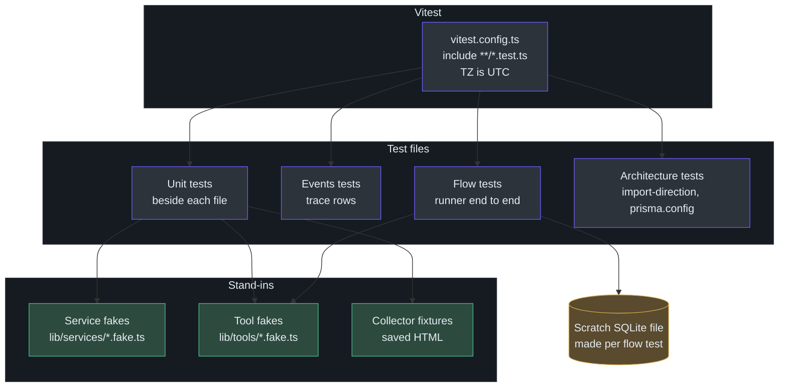
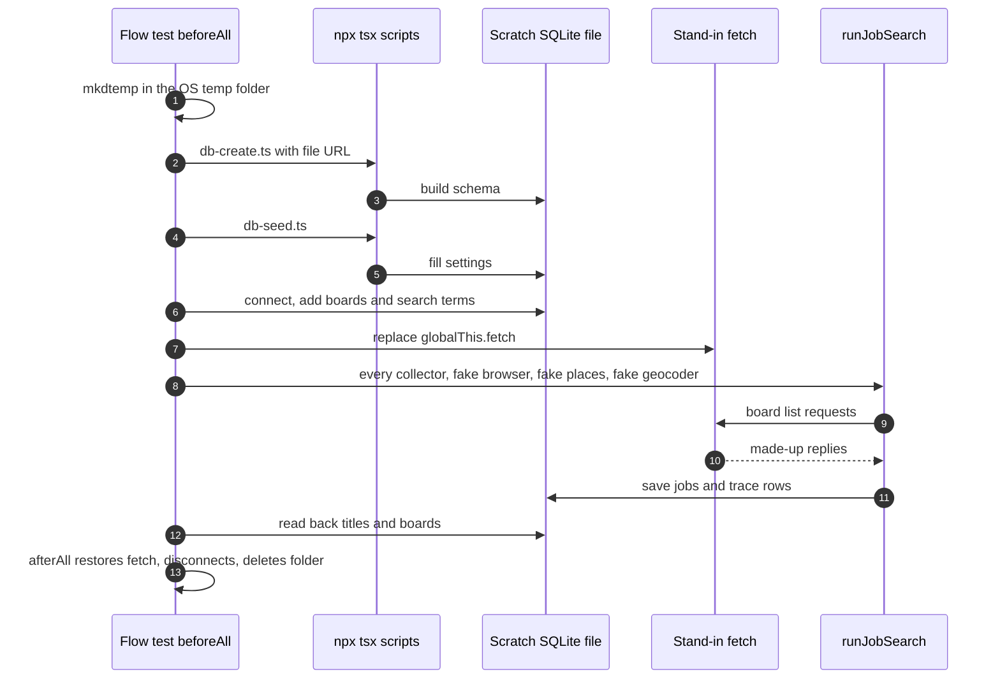
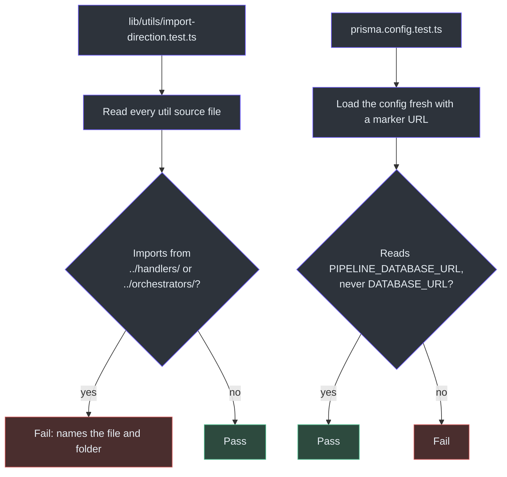

# Testing

## Overview

This app talks to job sites, a browser, a map service, a paid search service and a database. A test suite that touched any of them would be slow, would cost money, and would break when a website changed. So the suite is built on one idea: **every outside thing has a stand-in**, and the real services run against a throwaway database.

There are 235 test files tracked in git, of which 33 are flow tests, and 13 shared stand-ins (counted with `git ls-files`). The kinds of file and their names are fixed by the naming rule ([.claude/rules/naming.md:25-33](https://github.com/mablahblah/job-assistant/blob/main/.claude/rules/naming.md#L25-L33)).

### At a glance

| Kind of file | Name | What it proves | Example | Source |
| --- | --- | --- | --- | --- |
| Unit test | `{name}.test.ts`, beside the file it tests | One file does what it says | `lib/handlers/association.test.ts` | [naming.md:27](https://github.com/mablahblah/job-assistant/blob/main/.claude/rules/naming.md#L27) |
| Trace-row test | `{name}-events.test.ts` | A handler records what happened to each job | `lib/handlers/backlog-cleanup-events.test.ts` | [naming.md:28](https://github.com/mablahblah/job-assistant/blob/main/.claude/rules/naming.md#L28) |
| Flow test | `{scenario}.flow.test.ts`, beside the runner it drives | A whole job search or command works from start to finish | `lib/orchestrators/hiring-systems-paging.flow.test.ts` | [naming.md:29](https://github.com/mablahblah/job-assistant/blob/main/.claude/rules/naming.md#L29) |
| Stand-in | `{name}.fake.ts` | Replaces a service or tool used by more than one test file | `lib/services/job-service.fake.ts` | [naming.md:31-33](https://github.com/mablahblah/job-assistant/blob/main/.claude/rules/naming.md#L31-L33) |
| Stand-in test | `{name}.fake.test.ts` | The stand-in itself behaves like the real thing | `lib/tools/geocoder.fake.test.ts` | [naming.md:30](https://github.com/mablahblah/job-assistant/blob/main/.claude/rules/naming.md#L30) |

## Setup

<!-- Sources: vitest.config.ts:4-19, lib/orchestrators/hiring-systems-paging.flow.test.ts:336-386, lib/utils/import-direction.test.ts:13-49, prisma.config.test.ts:35-103 -->

`npm run test` runs `vitest run` ([package.json:21](https://github.com/mablahblah/job-assistant/blob/main/package.json#L21)). The config sets four things.

| Setting | Value | Why | Source |
| --- | --- | --- | --- |
| `include` | `**/*.test.ts` | Unit, events, flow and stand-in tests all end in `.test.ts` | [vitest.config.ts:12](https://github.com/mablahblah/job-assistant/blob/main/vitest.config.ts#L12) |
| `exclude` | `node_modules` and `docs/` | `docs/` holds research spikes, not app code | [vitest.config.ts:13-14](https://github.com/mablahblah/job-assistant/blob/main/vitest.config.ts#L13-L14) |
| `env.TZ` | `UTC` | Week logic uses local time and fixtures use UTC dates, so the zone is fixed | [vitest.config.ts:17-18](https://github.com/mablahblah/job-assistant/blob/main/vitest.config.ts#L17-L18) |
| `resolve.alias` | `@` points at the repo root | Mirrors the `paths` setting in `tsconfig` so `@/` imports resolve | [vitest.config.ts:5-9](https://github.com/mablahblah/job-assistant/blob/main/vitest.config.ts#L5-L9) |

`npm run lint` runs ESLint and then the type check, `tsc --noEmit` ([package.json:19-20](https://github.com/mablahblah/job-assistant/blob/main/package.json#L19-L20)).

## Stand-ins

A stand-in (the code also calls it a fake) implements the same interface as the real thing and answers from a table the test fills in. The rule is: a stand-in used by more than one test file lives in `{name}.fake.ts`. One used by only a single test file may stay inside that file ([naming.md:31-33](https://github.com/mablahblah/job-assistant/blob/main/.claude/rules/naming.md#L31-L33)). The builder is named `fake{Subject}...`, for example `fakeJobService` ([services.md:10](https://github.com/mablahblah/job-assistant/blob/main/.claude/rules/services.md#L10), [tools.md:13](https://github.com/mablahblah/job-assistant/blob/main/.claude/rules/tools.md#L13)).

| Stand-in | Replaces | What it does | Source |
| --- | --- | --- | --- |
| `fakeJobService` | The job service and its database | Remembers what happened between calls. It mirrors the real create, update and delete rules against an array, so a job created by one call is found by the next | [job-service.fake.ts:1-5](https://github.com/mablahblah/job-assistant/blob/main/lib/services/job-service.fake.ts#L1-L5), [job-service.fake.ts:65-72](https://github.com/mablahblah/job-assistant/blob/main/lib/services/job-service.fake.ts#L65-L72) |
| `fakeResolutionBrowser` | The browser that follows job links | Answers `goto` from a table of pages, follows redirect chains up to 10 hops, can simulate a page that hangs | [resolution-browser.fake.ts:15-16](https://github.com/mablahblah/job-assistant/blob/main/lib/tools/resolution-browser.fake.ts#L15-L16), [resolution-browser.fake.ts:29-70](https://github.com/mablahblah/job-assistant/blob/main/lib/tools/resolution-browser.fake.ts#L29-L70) |
| `fakeCompanySearch` | The paid employer search | Answers from a query-to-result table and records every query asked, so a test can prove the service was not asked twice | [company-search.fake.ts:1-6](https://github.com/mablahblah/job-assistant/blob/main/lib/tools/company-search.fake.ts#L1-L6) |
| `fakePageFetcher` | Every job website | One local web server holding a page for each host and path. It swaps in for global `fetch`, records every visit, and can launch a real headless browser pointed at the local server | [page-fetcher.fake.ts:1-9](https://github.com/mablahblah/job-assistant/blob/main/lib/tools/page-fetcher.fake.ts#L1-L9), [page-fetcher.fake.ts:33-51](https://github.com/mablahblah/job-assistant/blob/main/lib/tools/page-fetcher.fake.ts#L33-L51) |
| `fakeWebServer` | The dashboard server | Answers `/` with a fixed page and `start` with true, with no port or database | [web-server.fake.ts:1-3](https://github.com/mablahblah/job-assistant/blob/main/lib/tools/web-server.fake.ts#L1-L3), [web-server.fake.ts:14-26](https://github.com/mablahblah/job-assistant/blob/main/lib/tools/web-server.fake.ts#L14-L26) |
| `fakeRenderedPageFetcher` | The rendered-page fetcher | Returns HTML from a table of pages | [rendered-page-fetcher.fake.ts:6](https://github.com/mablahblah/job-assistant/blob/main/lib/tools/rendered-page-fetcher.fake.ts#L6) |
| `fakeSettingsService` | The settings service | Takes overrides for the values a test cares about | [settings-service.fake.ts:13](https://github.com/mablahblah/job-assistant/blob/main/lib/services/settings-service.fake.ts#L13) |

The full list of tracked stand-ins is in `lib/services/` (ats-slug, company, job, place, settings, work-log) and `lib/tools/` (company-search, geocoder, page-fetcher, rendered-page-fetcher, resolution-browser, resolution-page, web-server). There is no stand-in for the trace service, because flow tests use the real one against the scratch database.

Stand-ins have tests of their own (`*.fake.test.ts`), so a stand-in cannot quietly drift away from the interface it copies. The company search fake carries a sentinel, `NEVER_ANSWERS`, because the real tool has a 60 second limit and testing that needs a search that never answers ([company-search.fake.ts:11-14](https://github.com/mablahblah/job-assistant/blob/main/lib/tools/company-search.fake.ts#L11-L14)). The real tool is built to take its outside call as an argument for exactly this reason ([lib/tools/company-search.ts:19-25](https://github.com/mablahblah/job-assistant/blob/main/lib/tools/company-search.ts#L19-L25)). See [Status Changes and the Work Log](../agent-workflows/status-change-and-work-log.md).

The fake browser parses pages with `linkedom`, the library that turns an HTML string into a queryable document in plain Node. That is why page-reading code can run in a test with no browser ([resolution-browser.fake.ts:4](https://github.com/mablahblah/job-assistant/blob/main/lib/tools/resolution-browser.fake.ts#L4), [resolution-browser.fake.ts:94-109](https://github.com/mablahblah/job-assistant/blob/main/lib/tools/resolution-browser.fake.ts#L94-L109)).

### Fixtures: replaying a saved page

Browser-based collectors save the HTML of their results container after a real run. An offline test then replays that saved file. If a site quietly changes its markup, the replay fails ([lib/collectors/fixture.ts:1-5](https://github.com/mablahblah/job-assistant/blob/main/lib/collectors/fixture.ts#L1-L5)). Two fixtures are tracked: `dribbble.html` and `uiuxjobsboard.html`. They are read by the `-cards.test.ts` files for each collector ([lib/collectors/dribbble-cards.test.ts:1-5](https://github.com/mablahblah/job-assistant/blob/main/lib/collectors/dribbble-cards.test.ts#L1-L5)).

The baseline is protected from bad writes:

| Guard | Why | Source |
| --- | --- | --- |
| A run whose own self-check failed never overwrites the fixture | It would write the run's own breakage into the baseline the test exists to compare against | [fixture.ts:54-56](https://github.com/mablahblah/job-assistant/blob/main/lib/collectors/fixture.ts#L54-L56) |
| Empty HTML is refused | A blank container is what a broken selector produces | [fixture.ts:58-62](https://github.com/mablahblah/job-assistant/blob/main/lib/collectors/fixture.ts#L58-L62) |
| `writeFixture` never throws | Every refusal comes back as a warning, so a collection that worked is never reported as a collector that failed | [fixture.ts:47-49](https://github.com/mablahblah/job-assistant/blob/main/lib/collectors/fixture.ts#L47-L49) |
| The best container wins, not the last | Cleanliness beats size. Equal card counts keep the incumbent. Keeping the last once left a fixture with one card, which proves little | [fixture.ts:89-111](https://github.com/mablahblah/job-assistant/blob/main/lib/collectors/fixture.ts#L89-L111) |
| The directory is read per call from `COLLECTOR_FIXTURE_DIR` | A test can point it at a scratch folder for one test | [fixture.ts:27-31](https://github.com/mablahblah/job-assistant/blob/main/lib/collectors/fixture.ts#L27-L31) |

See [Collection](../pipeline/collection.md) for the collectors themselves.

## Flow tests

A unit test proves one file. A flow test proves that the files work together. It runs a whole job search or command, with real services, against a real but throwaway database. The only thing standing in is the outside world.

The example the page uses is `hiring-systems-paging.flow.test.ts`. Its header states the scenario in plain words: five hiring systems each have a full board and a quiet board, one system has more jobs than a single reply returns, and a Dover board must never be sent a request ([hiring-systems-paging.flow.test.ts:1-28](https://github.com/mablahblah/job-assistant/blob/main/lib/orchestrators/hiring-systems-paging.flow.test.ts#L1-L28)). The `Covers:` line lists what it proves ([hiring-systems-paging.flow.test.ts:26-28](https://github.com/mablahblah/job-assistant/blob/main/lib/orchestrators/hiring-systems-paging.flow.test.ts#L26-L28)).

<!-- Sources: lib/orchestrators/hiring-systems-paging.flow.test.ts:293-311, 336-392 -->

| Technique | How the test does it | Source |
| --- | --- | --- |
| Scratch database | Creates a temp folder and a file URL for `pipeline.db` inside it | [hiring-systems-paging.flow.test.ts:337-338](https://github.com/mablahblah/job-assistant/blob/main/lib/orchestrators/hiring-systems-paging.flow.test.ts#L337-L338) |
| Real schema and seed | Spawns the real `db-create.ts` and `db-seed.ts` scripts with `PIPELINE_DATABASE_URL` pointing at the scratch file | [hiring-systems-paging.flow.test.ts:293-300](https://github.com/mablahblah/job-assistant/blob/main/lib/orchestrators/hiring-systems-paging.flow.test.ts#L293-L300) |
| Safe by design | `db:create` refuses to rebuild the database named in `.env`, so these tests cannot damage the real one | [CLAUDE.md, Commands](https://github.com/mablahblah/job-assistant/blob/main/CLAUDE.md) |
| Connection | `connect` sets the environment variable only for the moment the client is built, then restores it | [hiring-systems-paging.flow.test.ts:302-311](https://github.com/mablahblah/job-assistant/blob/main/lib/orchestrators/hiring-systems-paging.flow.test.ts#L302-L311) |
| Sites replaced | `globalThis.fetch` is swapped for a stand-in that answers each system's board address in the shape measured live, and restored in `afterAll` | [hiring-systems-paging.flow.test.ts:20-24](https://github.com/mablahblah/job-assistant/blob/main/lib/orchestrators/hiring-systems-paging.flow.test.ts#L20-L24), [hiring-systems-paging.flow.test.ts:361](https://github.com/mablahblah/job-assistant/blob/main/lib/orchestrators/hiring-systems-paging.flow.test.ts#L361), [hiring-systems-paging.flow.test.ts:388-392](https://github.com/mablahblah/job-assistant/blob/main/lib/orchestrators/hiring-systems-paging.flow.test.ts#L388-L392) |
| Browser and maps replaced | A browser that stays put, a fake place service that always answers, and a fake geocoder | [hiring-systems-paging.flow.test.ts:264-291](https://github.com/mablahblah/job-assistant/blob/main/lib/orchestrators/hiring-systems-paging.flow.test.ts#L264-L291), [hiring-systems-paging.flow.test.ts:313-325](https://github.com/mablahblah/job-assistant/blob/main/lib/orchestrators/hiring-systems-paging.flow.test.ts#L313-L325) |
| Registry used for real | Passes `COLLECTORS` so no collector is left out of the "does any reach Dover" question | [hiring-systems-paging.flow.test.ts:363-370](https://github.com/mablahblah/job-assistant/blob/main/lib/orchestrators/hiring-systems-paging.flow.test.ts#L363-L370) |
| Time limit | A 120 second setup ceiling, because two scripts are spawned and a job search runs after them | [hiring-systems-paging.flow.test.ts:55-57](https://github.com/mablahblah/job-assistant/blob/main/lib/orchestrators/hiring-systems-paging.flow.test.ts#L55-L57) |
| Assertions | Matching titles collected, non-matching not collected, an empty board still on its polling list, the last page read, no request to Dover | [hiring-systems-paging.flow.test.ts:394-419](https://github.com/mablahblah/job-assistant/blob/main/lib/orchestrators/hiring-systems-paging.flow.test.ts#L394-L419) |

Why a real database instead of `fakeJobService` here? A flow test exists to catch a fault that only appears when real pieces meet. If the services were also fakes, a mistake in how a handler uses a real service could never show up. Unit tests use fakes for speed. Flow tests use real services for truth.

Flow tests are named for the scenario they prove and sit beside the runner they drive. There are 28 in `lib/orchestrators/` and 5 in `scripts/`, which cover commands such as `find-jobs` ([scripts/find-jobs-by-link.flow.test.ts](https://github.com/mablahblah/job-assistant/blob/main/scripts/find-jobs-by-link.flow.test.ts)). The add-external-jobs runner alone has eight ([lib/orchestrators/add-external-jobs-failed-save.flow.test.ts](https://github.com/mablahblah/job-assistant/blob/main/lib/orchestrators/add-external-jobs-failed-save.flow.test.ts)). See [External Jobs and Resumes](../agent-workflows/external-jobs-and-resumes.md).

## How no test touches a real site or browser

| Outside thing | What a test uses instead | Does anything real run? |
| --- | --- | --- |
| Job websites over `fetch` | Swapped `globalThis.fetch`, or `fakePageFetcher` | A local web server on this machine only |
| Link-following browser | `fakeResolutionBrowser` or a hand-written browser that stays put | No browser |
| Rendered-page browser | `fakeRenderedPageFetcher`, or an injected launcher | No browser |
| Parsing browser in a page-reading flow test | `fakePageFetcher.launchBrowser()` | A real headless browser, but it is launched to find every host name on this machine, so it only reaches the local server |
| Paid employer search | `fakeCompanySearch`, or an injected actor runner | No |
| Map and geocoding service | `fakeGeocoder`, `fakePlaceService` | No |
| The real database | A scratch SQLite file in the OS temp folder | A real file, deleted afterward |

Sources for the table: [page-fetcher.fake.ts:1-9](https://github.com/mablahblah/job-assistant/blob/main/lib/tools/page-fetcher.fake.ts#L1-L9), [page-fetcher.fake.ts:33-51](https://github.com/mablahblah/job-assistant/blob/main/lib/tools/page-fetcher.fake.ts#L33-L51), [resolution-browser.fake.ts:130-140](https://github.com/mablahblah/job-assistant/blob/main/lib/tools/resolution-browser.fake.ts#L130-L140), [rendered-page-fetcher.ts:67-70](https://github.com/mablahblah/job-assistant/blob/main/lib/tools/rendered-page-fetcher.ts#L67-L70), [company-search.ts:25](https://github.com/mablahblah/job-assistant/blob/main/lib/tools/company-search.ts#L25).

The reason a launcher or runner is passed in as an argument, rather than called inside the tool, is the testing seam. The rendered page tool says so: a caller can supply its own launcher, the same reason the resolution browser takes one ([rendered-page-fetcher.ts:67-70](https://github.com/mablahblah/job-assistant/blob/main/lib/tools/rendered-page-fetcher.ts#L67-L70)). The web server tool splits `respondTo` from `start` so a made-up request proves the page with no port opened ([lib/tools/web-server.ts:5-6](https://github.com/mablahblah/job-assistant/blob/main/lib/tools/web-server.ts#L5-L6)). And `serve.ts` guards its `main` so importing it for a test binds no port ([scripts/serve.ts:82-88](https://github.com/mablahblah/job-assistant/blob/main/scripts/serve.ts#L82-L88)). See [The Read-Only Dashboard](../dashboard/dashboard.md).

## Tests that guard the rules

Some tests check the shape of the code, not its behavior.

<!-- Sources: lib/utils/import-direction.test.ts:19-49, prisma.config.test.ts:35-103 -->

| Test | What it guards | Why | Source |
| --- | --- | --- | --- |
| `import-direction.test.ts` | No util imports from `handlers` or `orchestrators`, value or type-only | A plain function sits at the bottom of the app and must depend on nothing above it. A failure tells the reader to move the shared shape into `lib/types/` | [import-direction.test.ts:1-8](https://github.com/mablahblah/job-assistant/blob/main/lib/utils/import-direction.test.ts#L1-L8), [import-direction.test.ts:15-34](https://github.com/mablahblah/job-assistant/blob/main/lib/utils/import-direction.test.ts#L15-L34) |
| `prisma.config.test.ts`, AC1 | The Prisma config points at the current schema and migrations, and reads `PIPELINE_DATABASE_URL`, not `DATABASE_URL` | Stops a command pointing at the wrong database | [prisma.config.test.ts:35-60](https://github.com/mablahblah/job-assistant/blob/main/prisma.config.test.ts#L35-L60) |
| `prisma.config.test.ts`, AC2 | The database URL has no fallback. Unset means a clear error | A missing setting must fail loudly | [prisma.config.test.ts:62-89](https://github.com/mablahblah/job-assistant/blob/main/prisma.config.test.ts#L62-L89) |
| `prisma.config.test.ts`, AC3 | `pipeline.db` is git-ignored and untracked | Keeps the real database out of the repository | [prisma.config.test.ts:91-103](https://github.com/mablahblah/job-assistant/blob/main/prisma.config.test.ts#L91-L103) |

The import-direction test applies the rule that a plain function never names a file in `handlers/` or `orchestrators/` ([.claude/rules/part-ownership.md](https://github.com/mablahblah/job-assistant/blob/main/.claude/rules/part-ownership.md)). It is the rule turned into something that fails the build. The `prisma.config` test names its checks "AC1" to "AC3", short for acceptance criteria, which is the wording the project's feature specs use (inferred from the test names). See [Project Rules](project-rules.md).

Config tests that import `prisma.config.ts` get a 10 second ceiling because the first import is slow. It was measured at 318 ms alone, and slower when other workers compete for the processor ([prisma.config.test.ts:10-13](https://github.com/mablahblah/job-assistant/blob/main/prisma.config.test.ts#L10-L13)). They restore the environment and the module cache after each test, so one test cannot leak into the next ([prisma.config.test.ts:15-25](https://github.com/mablahblah/job-assistant/blob/main/prisma.config.test.ts#L15-L25)).

## Related Pages

| Page | Relationship |
| --- | --- |
| [Project Rules](project-rules.md) | The naming and part rules these tests enforce |
| [Services](../data/services.md) | The real services flow tests run against a scratch database |
| [Database Commands](../data/database-commands.md) | `db:create` and `db:seed`, which flow tests call |
| [Collection](../pipeline/collection.md) | The collectors that fixtures protect |
| [The Job Search Run](../architecture/job-search-run.md) | The runner most flow tests drive |
| [Contributor Guide](../../onboarding/contributor-guide.md) | How to run the suite as a new contributor |
| [Quick Reference](../../getting-started/quick-reference.md) | The test and lint commands |

## References

- [vitest.config.ts](https://github.com/mablahblah/job-assistant/blob/main/vitest.config.ts)
- [prisma.config.test.ts](https://github.com/mablahblah/job-assistant/blob/main/prisma.config.test.ts)
- [lib/services/job-service.fake.ts](https://github.com/mablahblah/job-assistant/blob/main/lib/services/job-service.fake.ts)
- [lib/tools/resolution-browser.fake.ts](https://github.com/mablahblah/job-assistant/blob/main/lib/tools/resolution-browser.fake.ts)
- [lib/tools/page-fetcher.fake.ts](https://github.com/mablahblah/job-assistant/blob/main/lib/tools/page-fetcher.fake.ts)
- [lib/orchestrators/hiring-systems-paging.flow.test.ts](https://github.com/mablahblah/job-assistant/blob/main/lib/orchestrators/hiring-systems-paging.flow.test.ts)
- [lib/collectors/fixture.ts](https://github.com/mablahblah/job-assistant/blob/main/lib/collectors/fixture.ts)
- [lib/utils/import-direction.test.ts](https://github.com/mablahblah/job-assistant/blob/main/lib/utils/import-direction.test.ts)
- [.claude/rules/naming.md](https://github.com/mablahblah/job-assistant/blob/main/.claude/rules/naming.md)
