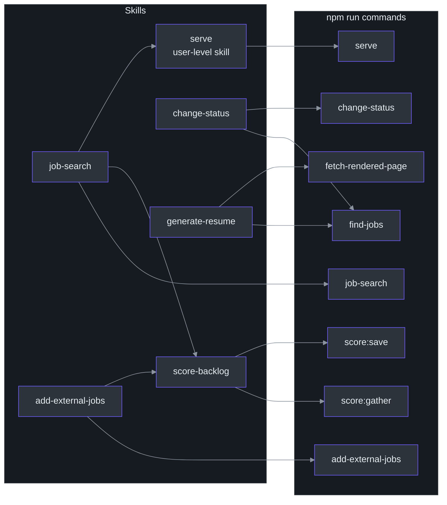
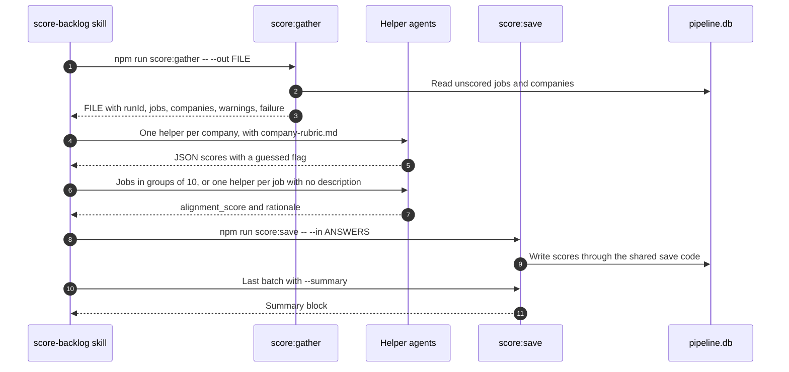
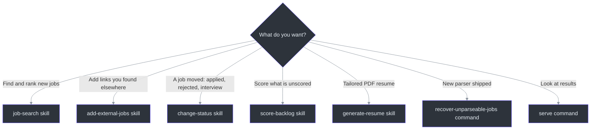

# Commands and Skills

## Overview

The project has two layers. A **command** is a small TypeScript script run with `npm run`. It does one deterministic thing and prints text. A **skill** is a written procedure that Claude Code follows. A skill exists where a human or an agent has to decide something, because a command cannot pause to think. The skill runs commands, reads their output, and reports it to the user. Together they let one request such as "run the job search" cover collecting, scoring, and showing results.

## At a glance

| Layer | Count | Where it lives | Source |
| --- | --- | --- | --- |
| npm scripts in `package.json` | 17 (16 commands plus `postinstall`) | `package.json` and `scripts/` | [package.json:5-23](https://github.com/mablahblah/job-assistant/blob/main/package.json#L5-L23) |
| Project skills for the app | 6 | `.claude/skills/{name}/SKILL.md` | [.claude/skills/job-search/SKILL.md:1-4](https://github.com/mablahblah/job-assistant/blob/main/.claude/skills/job-search/SKILL.md#L1-L4) |
| Helper notes for the code-graph tool | 4 | `.claude/skills/*.md` (loose files) | [.claude/skills/debug-issue.md:1-4](https://github.com/mablahblah/job-assistant/blob/main/.claude/skills/debug-issue.md#L1-L4) |

## Which skill calls which command

<!-- Sources: .claude/skills/job-search/SKILL.md:13-53, .claude/skills/score-backlog/SKILL.md:22-120, .claude/skills/change-status/SKILL.md:41-70, .claude/skills/add-external-jobs/SKILL.md:47-70, .claude/skills/generate-resume/SKILL.md:38-72 -->

The `serve` skill is not in this repository. It is a user-level skill that the `job-search` skill invokes ([.claude/skills/job-search/SKILL.md:53](https://github.com/mablahblah/job-assistant/blob/main/.claude/skills/job-search/SKILL.md#L53)). Its command, `npm run serve`, is in `package.json` ([package.json:6](https://github.com/mablahblah/job-assistant/blob/main/package.json#L6)).

## Commands

### Day-to-day commands

| Command | What it does and why it exists | Flags | Source |
| --- | --- | --- | --- |
| `npm run job-search` | Runs the whole pipeline. Prints `Run: {id}` first, then errors, warnings, and a summary read back from trace rows. Exits non-zero if the run stopped early | `--limit N` for tests only | [scripts/job-search.ts:40-140](https://github.com/mablahblah/job-assistant/blob/main/scripts/job-search.ts#L40-L140) |
| `npm run score:gather` | Writes every unscored job and company to a file for an agent to judge. Exists because scoring needs judgment, not a fixed rule | `--out FILE`, `--run-id ID` | [scripts/score-gather.ts:1-4](https://github.com/mablahblah/job-assistant/blob/main/scripts/score-gather.ts#L1-L4), [scripts/score-gather.ts:27-41](https://github.com/mablahblah/job-assistant/blob/main/scripts/score-gather.ts#L27-L41) |
| `npm run score:save` | Writes the agent's scores back. Runs once per batch so a run that stops halfway keeps the research it paid for | `--in FILE`, `--summary` | [scripts/score-save.ts:1-5](https://github.com/mablahblah/job-assistant/blob/main/scripts/score-save.ts#L1-L5), [scripts/score-save.ts:45-48](https://github.com/mablahblah/job-assistant/blob/main/scripts/score-save.ts#L45-L48) |
| `npm run find-jobs` | Finds a job by its link, otherwise by part of the employer's name. Only reads. Prints one JSON object | `--url`, `--company`, `--statuses` | [scripts/find-jobs.ts:1-9](https://github.com/mablahblah/job-assistant/blob/main/scripts/find-jobs.ts#L1-L9), [scripts/find-jobs.ts:86-95](https://github.com/mablahblah/job-assistant/blob/main/scripts/find-jobs.ts#L86-L95) |
| `npm run change-status` | Sets job statuses by hand. Files a work log entry where Texas counts the status as an activity. Refuses a whole submission if one entry is bad | `--in FILE` | [scripts/change-status.ts:1-12](https://github.com/mablahblah/job-assistant/blob/main/scripts/change-status.ts#L1-L12), [scripts/change-status.ts:36-40](https://github.com/mablahblah/job-assistant/blob/main/scripts/change-status.ts#L36-L40) |
| `npm run add-external-jobs` | Takes links the user found elsewhere and runs only those through the pipeline's steps | `--in FILE` | [scripts/add-external-jobs.ts:1-3](https://github.com/mablahblah/job-assistant/blob/main/scripts/add-external-jobs.ts#L1-L3), [scripts/add-external-jobs.ts:26](https://github.com/mablahblah/job-assistant/blob/main/scripts/add-external-jobs.ts#L26) |
| `npm run fetch-rendered-page` | Prints a page's finished HTML after its scripts have run. Many postings build their text in the browser, so a plain fetch gets an empty shell | `--url URL` | [scripts/fetch-rendered-page.ts:1-4](https://github.com/mablahblah/job-assistant/blob/main/scripts/fetch-rendered-page.ts#L1-L4), [scripts/fetch-rendered-page.ts:19](https://github.com/mablahblah/job-assistant/blob/main/scripts/fetch-rendered-page.ts#L19) |
| `npm run serve` | Starts the read-only dashboard, default port 3001 | `PORT` environment variable | [scripts/serve.ts:20](https://github.com/mablahblah/job-assistant/blob/main/scripts/serve.ts#L20), [scripts/serve.ts:55-58](https://github.com/mablahblah/job-assistant/blob/main/scripts/serve.ts#L55-L58) |

### One-off and maintenance commands

| Command | What it does and why it exists | Source |
| --- | --- | --- |
| `npm run recover-unparseable-jobs` | Moves every `unparseable` job whose link a parser now claims back to `backlog`. Run by hand after shipping a new parser. Takes no flags. No skill calls it. It runs through the same status-change code a hand change uses | [scripts/recover-unparseable-jobs.ts:1-17](https://github.com/mablahblah/job-assistant/blob/main/scripts/recover-unparseable-jobs.ts#L1-L17), [scripts/recover-unparseable-jobs.ts:61-78](https://github.com/mablahblah/job-assistant/blob/main/scripts/recover-unparseable-jobs.ts#L61-L78) |
| `npm run db:create {file}` | Rebuilds a named database from the schema. Deletes the target first. Refuses the real database | [scripts/db-create.ts:1-7](https://github.com/mablahblah/job-assistant/blob/main/scripts/db-create.ts#L1-L7) |
| `npm run db:migrate` | Backs up the database, then applies schema changes | [scripts/db-migrate.ts:68-72](https://github.com/mablahblah/job-assistant/blob/main/scripts/db-migrate.ts#L68-L72) |
| `npm run db:seed` | Fills absent settings and the source priority list, overwriting nothing | [scripts/db-seed.ts:1-5](https://github.com/mablahblah/job-assistant/blob/main/scripts/db-seed.ts#L1-L5) |
| `npm run lint` | ESLint, then the type check | [package.json:19-20](https://github.com/mablahblah/job-assistant/blob/main/package.json#L19-L20) |
| `npm run typecheck` | The TypeScript check alone, with no output files | [package.json:20](https://github.com/mablahblah/job-assistant/blob/main/package.json#L20) |
| `npm run test`, `npm run test:watch` | Vitest, once or watching | [package.json:21-22](https://github.com/mablahblah/job-assistant/blob/main/package.json#L21-L22) |
| `postinstall` | Runs automatically after `npm install`; generates the Prisma client | [package.json:7](https://github.com/mablahblah/job-assistant/blob/main/package.json#L7) |

`scripts/db-migrate-data.ts` is not an npm command. It is the one-time move of data from the old database, which reads `DATABASE_URL` from the environment ([scripts/db-migrate-data.ts:277](https://github.com/mablahblah/job-assistant/blob/main/scripts/db-migrate-data.ts#L277)).

### Shared start-up check

Every command that reads or writes data runs the same first step: compare the database to the code, and stop with a three-line message on a mismatch ([scripts/job-search.ts:49-52](https://github.com/mablahblah/job-assistant/blob/main/scripts/job-search.ts#L49-L52), [scripts/change-status.ts:115-118](https://github.com/mablahblah/job-assistant/blob/main/scripts/change-status.ts#L115-L118)). The dashboard does the check inside its server because a dashboard must refuse to listen, not just exit ([scripts/serve.ts:6-8](https://github.com/mablahblah/job-assistant/blob/main/scripts/serve.ts#L6-L8)).

## Skills

### Summary

| Skill | When it runs | What it does | Source |
| --- | --- | --- | --- |
| `job-search` | Only when the user invokes it (`disable-model-invocation`) | Runs the pipeline, reports every error and warning, pastes the summary, scores, then starts the dashboard | [.claude/skills/job-search/SKILL.md:1-4](https://github.com/mablahblah/job-assistant/blob/main/.claude/skills/job-search/SKILL.md#L1-L4) |
| `score-backlog` | After a job search, or when the user asks to score | Gathers, researches each company, scores jobs, saves | [.claude/skills/score-backlog/SKILL.md:1-4](https://github.com/mablahblah/job-assistant/blob/main/.claude/skills/score-backlog/SKILL.md#L1-L4) |
| `change-status` | Only on user request | Finds each job, then writes its new status | [.claude/skills/change-status/SKILL.md:1-9](https://github.com/mablahblah/job-assistant/blob/main/.claude/skills/change-status/SKILL.md#L1-L9) |
| `add-external-jobs` | Only on user request | Reads pasted links, runs only those jobs through the steps, scores, and reports where each landed | [.claude/skills/add-external-jobs/SKILL.md:1-9](https://github.com/mablahblah/job-assistant/blob/main/.claude/skills/add-external-jobs/SKILL.md#L1-L9) |
| `generate-resume` | Only on user request | Looks up a job, reads its live posting, picks resume items from an inventory, renders a PDF | [.claude/skills/generate-resume/SKILL.md:1-10](https://github.com/mablahblah/job-assistant/blob/main/.claude/skills/generate-resume/SKILL.md#L1-L10) |

### job-search

Five phases: run the pipeline, read the output, report, score, show results ([.claude/skills/job-search/SKILL.md:11-55](https://github.com/mablahblah/job-assistant/blob/main/.claude/skills/job-search/SKILL.md#L11-L55)). It forbids describing the command's internals and forbids running any part of the pipeline separately ([.claude/skills/job-search/SKILL.md:19](https://github.com/mablahblah/job-assistant/blob/main/.claude/skills/job-search/SKILL.md#L19)). The reason for pasting the summary verbatim is stated in the skill: the user never sees the command's output, so the paste is the only copy ([.claude/skills/job-search/SKILL.md:42](https://github.com/mablahblah/job-assistant/blob/main/.claude/skills/job-search/SKILL.md#L42)). A test reads the skill file and checks that it names the `Run: ` line and passes the identifier on ([scripts/run-identifier-skills.test.ts:19-25](https://github.com/mablahblah/job-assistant/blob/main/scripts/run-identifier-skills.test.ts#L19-L25)).

### score-backlog

<!-- Sources: .claude/skills/score-backlog/SKILL.md:17-126, scripts/score-gather.ts:27-41, scripts/score-save.ts:45-48 -->

Key rules from the skill: one helper per company because scoring a company means live web research ([.claude/skills/score-backlog/SKILL.md:42](https://github.com/mablahblah/job-assistant/blob/main/.claude/skills/score-backlog/SKILL.md#L42)). Jobs with the posting's words go to helpers ten at a time. Jobs without them get one helper each, because that helper must open the posting first ([.claude/skills/score-backlog/SKILL.md:69-70](https://github.com/mablahblah/job-assistant/blob/main/.claude/skills/score-backlog/SKILL.md#L69-L70)). It reads a private profile and two rubrics ([.claude/skills/score-backlog/SKILL.md:65](https://github.com/mablahblah/job-assistant/blob/main/.claude/skills/score-backlog/SKILL.md#L65)). When no public information exists for a category, the rubric awards a 3 and the helper sets `guessed` to true ([.claude/skills/score-backlog/SKILL.md:57](https://github.com/mablahblah/job-assistant/blob/main/.claude/skills/score-backlog/SKILL.md#L57)). See [Scoring](../deep-dive/agent-workflows/scoring.md).

### change-status

The skill maps each requested status to the list of statuses worth searching. For example, `app. sent` only searches `backlog`, while `rejected` searches the five active statuses ([.claude/skills/change-status/SKILL.md:33-39](https://github.com/mablahblah/job-assistant/blob/main/.claude/skills/change-status/SKILL.md#L33-L39)). It never passes a role to the lookup, because the user writes shorthand that no stored title contains ([.claude/skills/change-status/SKILL.md:18](https://github.com/mablahblah/job-assistant/blob/main/.claude/skills/change-status/SKILL.md#L18)). If a job has no employer on file, the command holds it back and the skill asks the user for the name ([.claude/skills/change-status/SKILL.md:72-82](https://github.com/mablahblah/job-assistant/blob/main/.claude/skills/change-status/SKILL.md#L72-L82)). See [Status Change and Work Log](../deep-dive/agent-workflows/status-change-and-work-log.md).

### add-external-jobs

The skill reads each pasted posting for a title, employer, and description. It sets aside any link that shows a sign-in wall or a bot check and asks the user for the title and employer ([.claude/skills/add-external-jobs/SKILL.md:26-31](https://github.com/mablahblah/job-assistant/blob/main/.claude/skills/add-external-jobs/SKILL.md#L26-L31)). It writes a submission file, runs `npm run add-external-jobs -- --in FILE`, then invokes `score-backlog` and reports where each job landed ([.claude/skills/add-external-jobs/SKILL.md:36-49](https://github.com/mablahblah/job-assistant/blob/main/.claude/skills/add-external-jobs/SKILL.md#L36-L49)). It forbids running `npm run job-search` beside it ([.claude/skills/add-external-jobs/SKILL.md:17](https://github.com/mablahblah/job-assistant/blob/main/.claude/skills/add-external-jobs/SKILL.md#L17)). See [External Jobs and Resumes](../deep-dive/agent-workflows/external-jobs-and-resumes.md).

### generate-resume

It restricts itself to a short list of allowed tools ([.claude/skills/generate-resume/SKILL.md:11-19](https://github.com/mablahblah/job-assistant/blob/main/.claude/skills/generate-resume/SKILL.md#L11-L19)). Its rule is "pick-only": no resume text is written or edited, only which inventory items are shown ([.claude/skills/generate-resume/SKILL.md:26](https://github.com/mablahblah/job-assistant/blob/main/.claude/skills/generate-resume/SKILL.md#L26)). It uses `find-jobs` to pick the job and `fetch-rendered-page` to read the live posting ([.claude/skills/generate-resume/SKILL.md:38-72](https://github.com/mablahblah/job-assistant/blob/main/.claude/skills/generate-resume/SKILL.md#L38-L72)).

## Execution policy pattern

Four of the skills open with an "Execution Policy" list of things never to do. It is how the owner keeps an agent from improvising. Examples: do not change a status without running the lookup first ([.claude/skills/change-status/SKILL.md:15](https://github.com/mablahblah/job-assistant/blob/main/.claude/skills/change-status/SKILL.md#L15)), do not score after a stopped run ([.claude/skills/add-external-jobs/SKILL.md:19](https://github.com/mablahblah/job-assistant/blob/main/.claude/skills/add-external-jobs/SKILL.md#L19)), and ask the user before deviating from any step.

## Choosing what to run

<!-- Sources: .claude/skills/job-search/SKILL.md:1-4, .claude/skills/add-external-jobs/SKILL.md:1-9, .claude/skills/change-status/SKILL.md:1-9, .claude/skills/score-backlog/SKILL.md:1-4, .claude/skills/generate-resume/SKILL.md:1-10, scripts/recover-unparseable-jobs.ts:1-17, scripts/serve.ts:1-5 -->

## Other files in the skills folder

The four loose `.md` files in `.claude/skills/` (`debug-issue`, `explore-codebase`, `refactor-safely`, `review-changes`) are guides for the code-graph tool, not part of the job search ([.claude/skills/debug-issue.md:1-8](https://github.com/mablahblah/job-assistant/blob/main/.claude/skills/debug-issue.md#L1-L8)).

## Related Pages

| Page | Relationship |
| --- | --- |
| [Overview](./overview.md) | Why the skills and commands are split this way |
| [Environment Setup](./setup.md) | Prepare the database before running anything |
| [Quick Reference](./quick-reference.md) | Commands and statuses on one page |
| [Job Search Run](../deep-dive/architecture/job-search-run.md) | What `npm run job-search` does inside |
| [Scoring](../deep-dive/agent-workflows/scoring.md) | The gather, judge, and save cycle |
| [Status Change and Work Log](../deep-dive/agent-workflows/status-change-and-work-log.md) | The hand status change and its legal record |
| [External Jobs and Resumes](../deep-dive/agent-workflows/external-jobs-and-resumes.md) | The add-links and resume skills |

## References

- [package.json](https://github.com/mablahblah/job-assistant/blob/main/package.json)
- [.claude/skills/job-search/SKILL.md](https://github.com/mablahblah/job-assistant/blob/main/.claude/skills/job-search/SKILL.md)
- [.claude/skills/score-backlog/SKILL.md](https://github.com/mablahblah/job-assistant/blob/main/.claude/skills/score-backlog/SKILL.md)
- [.claude/skills/change-status/SKILL.md](https://github.com/mablahblah/job-assistant/blob/main/.claude/skills/change-status/SKILL.md)
- [scripts/job-search.ts](https://github.com/mablahblah/job-assistant/blob/main/scripts/job-search.ts)
