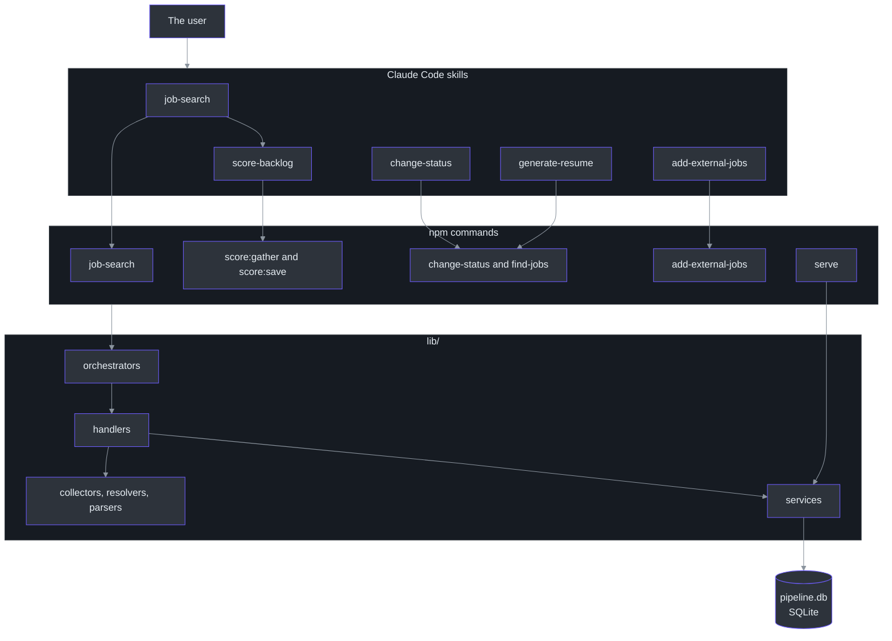
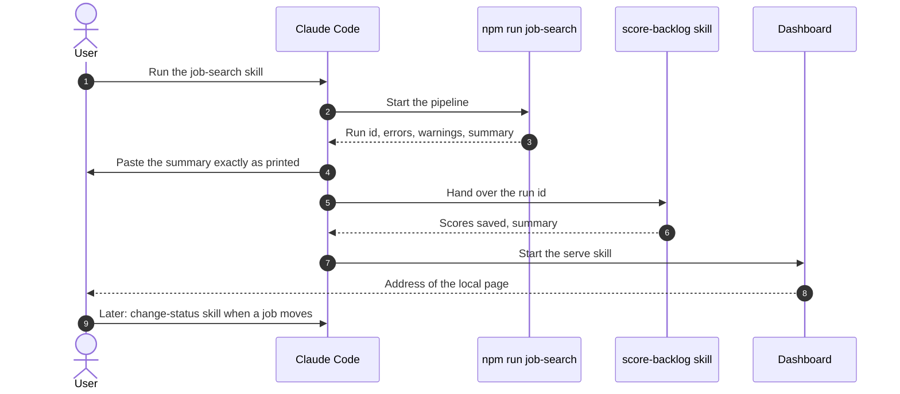

# Overview

## Why this project exists

Checking many job boards by hand is slow and repetitive. The Job Search Assistant is a personal command-line tool that does the repetitive part. It collects job postings from many sources, removes duplicates, judges which ones are close enough to apply to, and asks an AI agent to rank them. It also keeps the record that the Texas unemployment program requires. The user then looks at the results on a small local web page.

The tool is driven by Claude Code "skills". A skill is a written procedure that Claude follows. Each skill runs one or more `npm run` commands and then explains the output to the user. The earlier description in `docs/APP.md` still speaks of "scrapers" and a "status pipeline". That file is dated. This page describes the system as the code builds it today ([docs/APP.md:5](https://github.com/mablahblah/job-assistant/blob/main/docs/APP.md#L5)). The project's own description is in [CLAUDE.md:3](https://github.com/mablahblah/job-assistant/blob/main/CLAUDE.md#L3).

## The four jobs

| Job | What it means in plain words | Where it happens | Source |
| --- | --- | --- | --- |
| **Find** | Pull job lists from 14 sources, follow each link to the employer's own posting, and read it | `npm run job-search` | [lib/collectors/registry.ts:19-34](https://github.com/mablahblah/job-assistant/blob/main/lib/collectors/registry.ts#L19-L34) |
| **Rank** | An agent scores each job against the user's profile and each employer against a company rubric | The `score-backlog` skill with `score:gather` and `score:save` | [.claude/skills/score-backlog/SKILL.md:22-26](https://github.com/mablahblah/job-assistant/blob/main/.claude/skills/score-backlog/SKILL.md#L22-L26) |
| **Track** | Each job has one of twelve statuses, changed by hand when the user applies, is rejected, and so on | The `change-status` skill and `npm run change-status` | [lib/utils/job-status.ts:24-37](https://github.com/mablahblah/job-assistant/blob/main/lib/utils/job-status.ts#L24-L37) |
| **File the work log** | Some status changes write a Texas Workforce Commission job-search entry that cannot be rebuilt later | `npm run change-status` | [scripts/change-status.ts:1-12](https://github.com/mablahblah/job-assistant/blob/main/scripts/change-status.ts#L1-L12) |

A fifth, smaller job is **view**: a read-only local dashboard shows the backlog, active jobs, ruled-out jobs, and the work log ([scripts/serve.ts:1-5](https://github.com/mablahblah/job-assistant/blob/main/scripts/serve.ts#L1-L5)). See [Dashboard](../deep-dive/dashboard/dashboard.md).

## At a glance

| Component | Responsibility | Key file | Source |
| --- | --- | --- | --- |
| **Skills** | Procedures Claude follows; they run commands and report results | `.claude/skills/*/SKILL.md` | [.claude/skills/job-search/SKILL.md:11-19](https://github.com/mablahblah/job-assistant/blob/main/.claude/skills/job-search/SKILL.md#L11-L19) |
| **Commands** | One `npm run` entry per action, each a small script in `scripts/` | `package.json` | [package.json:5-23](https://github.com/mablahblah/job-assistant/blob/main/package.json#L5-L23) |
| **Orchestrator** | Calls every pipeline step in order and records where a run stopped | `lib/orchestrators/job-search.ts` | [lib/orchestrators/job-search.ts:151-188](https://github.com/mablahblah/job-assistant/blob/main/lib/orchestrators/job-search.ts#L151-L188) |
| **Collectors** | Pull a raw job list from one source each (14 of them) | `lib/collectors/registry.ts` | [lib/collectors/registry.ts:19-34](https://github.com/mablahblah/job-assistant/blob/main/lib/collectors/registry.ts#L19-L34) |
| **Parsers** | Read one source's posting (11 dedicated parsers plus a general fallback) | `lib/parsers/registry.ts` | [lib/parsers/registry.ts:37-49](https://github.com/mablahblah/job-assistant/blob/main/lib/parsers/registry.ts#L37-L49) |
| **Services** | Own one database table or row each | `lib/services/` | [.claude/rules/services.md:7](https://github.com/mablahblah/job-assistant/blob/main/.claude/rules/services.md#L7) |
| **Database** | SQLite through Prisma and the libsql adapter | `lib/db/pipeline-db.ts` | [lib/db/pipeline-db.ts:14-18](https://github.com/mablahblah/job-assistant/blob/main/lib/db/pipeline-db.ts#L14-L18) |
| **Dashboard** | Server-rendered HTML, vanilla CSS and JavaScript | `scripts/serve.ts` | [scripts/serve.ts:61-88](https://github.com/mablahblah/job-assistant/blob/main/scripts/serve.ts#L61-L88) |

The technology list is in [CLAUDE.md:5-14](https://github.com/mablahblah/job-assistant/blob/main/CLAUDE.md#L5-L14): TypeScript run directly by `tsx` with no build step, SQLite through Prisma, Playwright for browsers, `linkedom` for reading HTML offline, and Vitest for tests.

## How the parts connect

<!-- Sources: .claude/skills/job-search/SKILL.md:13-53, .claude/skills/score-backlog/SKILL.md:22-120, .claude/skills/change-status/SKILL.md:41-70, .claude/skills/add-external-jobs/SKILL.md:47-49, scripts/serve.ts:61-88, package.json:5-23, CLAUDE.md:43-75 -->

The folder layout inside `lib/` follows one rule: every file sits in a folder named for the kind of thing it is ([.claude/rules/naming.md:7-25](https://github.com/mablahblah/job-assistant/blob/main/.claude/rules/naming.md#L7-L25)). See [System Design](../deep-dive/architecture/system-design.md).

## Why the design looks the way it does

The design rests on one idea: **every step ends in a database write**. The orchestrator says so in its header comment: each of the three stretches "ends in a database write, so a run's work outlives the run whether or not the next step gets to it" ([lib/orchestrators/job-search.ts:1-16](https://github.com/mablahblah/job-assistant/blob/main/lib/orchestrators/job-search.ts#L1-L16)). The next step does not receive a list from the one before. It asks the database for the jobs that carry the right marker. This gives three benefits.

| Benefit | Why it matters | Source |
| --- | --- | --- |
| A run that crashes keeps its finished work | A long run that dies at step 9 does not lose steps 1 to 8 | [lib/orchestrators/job-search.ts:653-658](https://github.com/mablahblah/job-assistant/blob/main/lib/orchestrators/job-search.ts#L653-L658) |
| The same step can serve many callers | Saving is called by a job search, a hand status change, and scoring | [.claude/rules/part-ownership.md:19-23](https://github.com/mablahblah/job-assistant/blob/main/.claude/rules/part-ownership.md#L19-L23) |
| Knowledge of a job site stays in two places | Only collectors and parsers are written to fit a site | [.claude/rules/part-ownership.md:7-11](https://github.com/mablahblah/job-assistant/blob/main/.claude/rules/part-ownership.md#L7-L11) |

Scoring is the one step that is not inside the command. Scoring needs an agent to think, and a single command cannot pause while an agent thinks. So the `job-search` skill runs the pipeline command first and then hands the work to the `score-backlog` skill ([.claude/skills/job-search/SKILL.md:60](https://github.com/mablahblah/job-assistant/blob/main/.claude/skills/job-search/SKILL.md#L60)).

## What one job search does

<!-- Sources: lib/orchestrators/job-search.ts:222-262, lib/orchestrators/job-search.ts:276-362, lib/orchestrators/job-search.ts:390-434, lib/orchestrators/job-search.ts:480-551, lib/orchestrators/job-search.ts:586-637 -->

The order matters. Cleanup opens the run so the backlog collection adds to has already been swept ([lib/orchestrators/job-search.ts:218-220](https://github.com/mablahblah/job-assistant/blob/main/lib/orchestrators/job-search.ts#L218-L220)). Normalization runs before company association, because association matches on the cleaned company name ([lib/orchestrators/job-search.ts:504-506](https://github.com/mablahblah/job-assistant/blob/main/lib/orchestrators/job-search.ts#L504-L506)). Promotion and classification close the run, because an expired job only earns a fresh date after collection finds its new listing ([lib/orchestrators/job-search.ts:579-581](https://github.com/mablahblah/job-assistant/blob/main/lib/orchestrators/job-search.ts#L579-L581)). The full walk-through is in [Job Search Run](../deep-dive/architecture/job-search-run.md).

## A typical session

<!-- Sources: .claude/skills/job-search/SKILL.md:11-55, .claude/skills/score-backlog/SKILL.md:17-126, scripts/job-search.ts:73-76 -->

The command prints `Run: {run-id}` first so scoring can file its own records under the same run ([scripts/job-search.ts:73-76](https://github.com/mablahblah/job-assistant/blob/main/scripts/job-search.ts#L73-L76)). The skill also tells the user that a visible browser window opens partway through and holds the screen ([.claude/skills/job-search/SKILL.md:21](https://github.com/mablahblah/job-assistant/blob/main/.claude/skills/job-search/SKILL.md#L21)). The code confirms this: resolution launches with `headless: false` because headless requests were refused in a measured test ([lib/tools/resolution-browser.ts:19-23](https://github.com/mablahblah/job-assistant/blob/main/lib/tools/resolution-browser.ts#L19-L23)).

## Where the code differs from the older docs

| Claim in older docs | What the code shows | Source |
| --- | --- | --- |
| Seven collectors, four parsers (`docs/architecture.md`) | 14 collectors, 11 dedicated parsers, plus the general parser | [lib/collectors/registry.ts:19-34](https://github.com/mablahblah/job-assistant/blob/main/lib/collectors/registry.ts#L19-L34), [lib/parsers/registry.ts:37-49](https://github.com/mablahblah/job-assistant/blob/main/lib/parsers/registry.ts#L37-L49) |
| `CLAUDE.md` command list | Omits `add-external-jobs` and `recover-unparseable-jobs`, which both exist | [package.json:12-16](https://github.com/mablahblah/job-assistant/blob/main/package.json#L12-L16) |
| `docs/APP.md` describes scrapers and a `__greenhouse__` search term | The pipeline has collectors and a settings table | [docs/APP.md:49-50](https://github.com/mablahblah/job-assistant/blob/main/docs/APP.md#L49-L50) |

## Related Pages

| Page | Relationship |
| --- | --- |
| [Environment Setup](./setup.md) | How to install and prepare the database before the first run |
| [Commands and Skills](./commands-and-skills.md) | Every command and skill in detail |
| [Quick Reference](./quick-reference.md) | One-page tables of statuses, settings, and variables |
| [System Design](../deep-dive/architecture/system-design.md) | The architecture behind the overview |
| [Job Search Run](../deep-dive/architecture/job-search-run.md) | The run, step by step |
| [Product Manager Guide](../onboarding/product-manager-guide.md) | Product-level view of the same system |

## References

- [CLAUDE.md](https://github.com/mablahblah/job-assistant/blob/main/CLAUDE.md)
- [docs/architecture.md](https://github.com/mablahblah/job-assistant/blob/main/docs/architecture.md) (a map of why; verify every what against the code)
- [lib/orchestrators/job-search.ts](https://github.com/mablahblah/job-assistant/blob/main/lib/orchestrators/job-search.ts)
- [scripts/job-search.ts](https://github.com/mablahblah/job-assistant/blob/main/scripts/job-search.ts)
- [package.json](https://github.com/mablahblah/job-assistant/blob/main/package.json)
