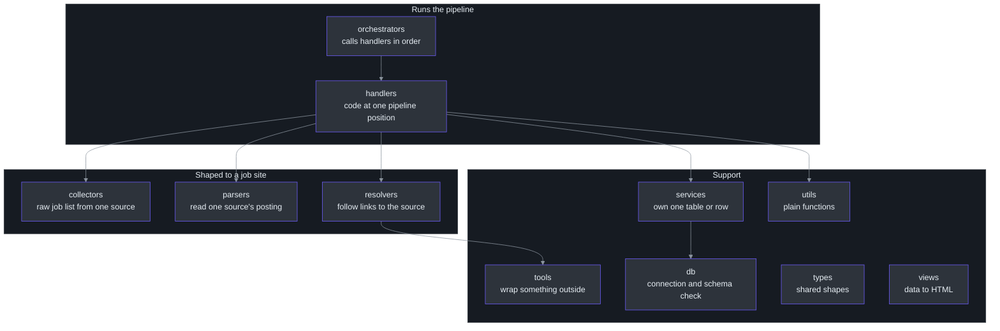
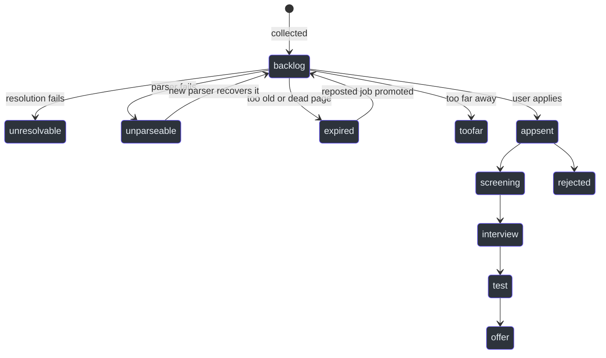
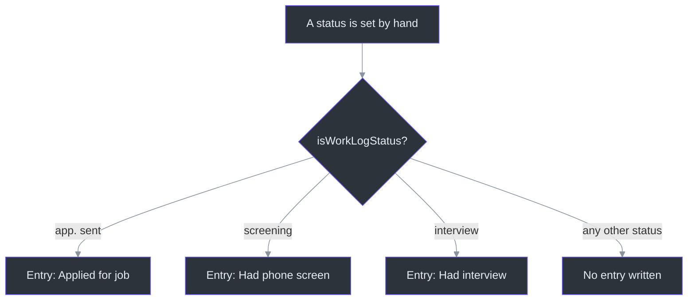

# Quick Reference

## Overview

This page gathers the facts you look up most often. Each table was checked against the code. The reasons behind each fact are on the linked deep-dive pages.

| Table | What it answers | Source |
| --- | --- | --- |
| [Commands](#commands) | What do I run? | [package.json:5-23](https://github.com/mablahblah/job-assistant/blob/main/package.json#L5-L23) |
| [Folders in lib](#folders-in-lib) | Where does new code go? | [.claude/rules/naming.md:7-25](https://github.com/mablahblah/job-assistant/blob/main/.claude/rules/naming.md#L7-L25) |
| [Job statuses](#job-statuses) | What can a job be, and which lists are they in? | [lib/utils/job-status.ts:24-37](https://github.com/mablahblah/job-assistant/blob/main/lib/utils/job-status.ts#L24-L37) |
| [Trace steps](#trace-steps) | Which pipeline positions write records? | [prisma/schema.prisma:362-368](https://github.com/mablahblah/job-assistant/blob/main/prisma/schema.prisma#L362-L368) |
| [Settings](#settings) | What can I tune without editing code? | [prisma/schema.prisma:275-355](https://github.com/mablahblah/job-assistant/blob/main/prisma/schema.prisma#L275-L355) |
| [Environment variables](#environment-variables) | What goes in `.env`? | [.env.example:1-28](https://github.com/mablahblah/job-assistant/blob/main/.env.example#L1-L28) |

## Commands

| Command | Use it to | Source |
| --- | --- | --- |
| `npm run job-search` | Run the whole pipeline | [package.json:11](https://github.com/mablahblah/job-assistant/blob/main/package.json#L11) |
| `npm run score:gather -- --out FILE` | Write out what needs a score | [package.json:17](https://github.com/mablahblah/job-assistant/blob/main/package.json#L17) |
| `npm run score:save -- --in FILE` | Save scores an agent worked out | [package.json:18](https://github.com/mablahblah/job-assistant/blob/main/package.json#L18) |
| `npm run find-jobs -- --url U --company X` | Look up a job by link, else by employer | [package.json:13](https://github.com/mablahblah/job-assistant/blob/main/package.json#L13) |
| `npm run change-status -- --in FILE` | Set statuses by hand | [package.json:15](https://github.com/mablahblah/job-assistant/blob/main/package.json#L15) |
| `npm run add-external-jobs -- --in FILE` | Add jobs from pasted links | [package.json:12](https://github.com/mablahblah/job-assistant/blob/main/package.json#L12) |
| `npm run fetch-rendered-page -- --url URL` | Print a page's HTML after scripts run | [package.json:14](https://github.com/mablahblah/job-assistant/blob/main/package.json#L14) |
| `npm run recover-unparseable-jobs` | Move jobs a new parser can now read back to backlog | [package.json:16](https://github.com/mablahblah/job-assistant/blob/main/package.json#L16) |
| `npm run serve` | Start the dashboard (port 3001 unless `PORT` is set) | [package.json:6](https://github.com/mablahblah/job-assistant/blob/main/package.json#L6) |
| `npm run db:create FILE` | Rebuild a named database (refuses the real one) | [package.json:8](https://github.com/mablahblah/job-assistant/blob/main/package.json#L8) |
| `npm run db:migrate` | Change the schema, after a dated backup | [package.json:9](https://github.com/mablahblah/job-assistant/blob/main/package.json#L9) |
| `npm run db:seed` | Fill absent settings and the priority list | [package.json:10](https://github.com/mablahblah/job-assistant/blob/main/package.json#L10) |
| `npm run lint` | ESLint, then the type check | [package.json:19](https://github.com/mablahblah/job-assistant/blob/main/package.json#L19) |
| `npm run test` | Run Vitest once | [package.json:21](https://github.com/mablahblah/job-assistant/blob/main/package.json#L21) |

Details and the skill for each command are in [Commands and Skills](./commands-and-skills.md).

## Folders in lib

<!-- Sources: .claude/rules/naming.md:7-25, .claude/rules/part-ownership.md:7-11, lib/orchestrators/job-search.ts:17-45, .claude/rules/resolvers.md:7, .claude/rules/handler-contract.md:17 -->

The arrows show the usual direction of calls, not every import (inferred from the imports in the orchestrator and the rules). `lib/` holds no file of its own ([.claude/rules/naming.md:5](https://github.com/mablahblah/job-assistant/blob/main/.claude/rules/naming.md#L5)).

| Folder | Holds | File name shape | Source |
| --- | --- | --- | --- |
| `lib/collectors/` | Pull a raw job list from one source (14 listed) | `{source}.ts`, value `{source}Collector` | [.claude/rules/sources.md:7-14](https://github.com/mablahblah/job-assistant/blob/main/.claude/rules/sources.md#L7-L14) |
| `lib/db/` | Database connection, its environment, schema check | `pipeline-db.ts` | [lib/db/pipeline-db.ts:14-18](https://github.com/mablahblah/job-assistant/blob/main/lib/db/pipeline-db.ts#L14-L18) |
| `lib/handlers/` | Code that runs at one pipeline position | `{verb-noun}.ts`, function `normalizeJobs` | [.claude/rules/handler-contract.md:23-26](https://github.com/mablahblah/job-assistant/blob/main/.claude/rules/handler-contract.md#L23-L26) |
| `lib/orchestrators/` | The runner that calls handlers in order | `job-search.ts`, function `runJobSearch` | [.claude/rules/orchestrators.md:11](https://github.com/mablahblah/job-assistant/blob/main/.claude/rules/orchestrators.md#L11) |
| `lib/parsers/` | Read one source's posting (11 dedicated plus a general one) | `{source}.ts`, value `{source}Parser` | [.claude/rules/sources.md:16-23](https://github.com/mablahblah/job-assistant/blob/main/.claude/rules/sources.md#L16-L23) |
| `lib/resolvers/` | Follow a job link toward its source posting | `resolve-job-url.ts` | [.claude/rules/resolvers.md:7-10](https://github.com/mablahblah/job-assistant/blob/main/.claude/rules/resolvers.md#L7-L10) |
| `lib/services/` | Own one table or one row | `{subject}-service.ts`, builder `create{Subject}Service(db)` | [.claude/rules/services.md:7-13](https://github.com/mablahblah/job-assistant/blob/main/.claude/rules/services.md#L7-L13) |
| `lib/tools/` | Wrappers around something outside the app | `{subject}.ts`, stand-in `{subject}.fake.ts` | [.claude/rules/tools.md:7-13](https://github.com/mablahblah/job-assistant/blob/main/.claude/rules/tools.md#L7-L13) |
| `lib/types/` | Shapes shared across folders, no logic | `{subject}.ts` | [.claude/rules/types.md:7-9](https://github.com/mablahblah/job-assistant/blob/main/.claude/rules/types.md#L7-L9) |
| `lib/utils/` | Plain functions, values in and values out | `{subject}.ts` | [.claude/rules/utils.md:9](https://github.com/mablahblah/job-assistant/blob/main/.claude/rules/utils.md#L9) |
| `lib/views/` | Data to HTML | `{subject}.ts`, function `{subject}View` | [.claude/rules/views.md:7-11](https://github.com/mablahblah/job-assistant/blob/main/.claude/rules/views.md#L7-L11) |

## Job statuses

There are twelve. They are declared once so a typo cannot create a state no query reads ([lib/utils/job-status.ts:22-23](https://github.com/mablahblah/job-assistant/blob/main/lib/utils/job-status.ts#L22-L23)). The table shows which named lists each status belongs to.

| Status | Active | Work log | Ruled out | Rechecked on re-add | Who normally sets it |
| --- | --- | --- | --- | --- | --- |
| `backlog` | | | | | Promotion, or letting an added job through |
| `expired` | | | yes | yes | Backlog cleanup, classification, or the parser for a dead page |
| `too far` | | | yes | yes | Classification |
| `won't apply` | | | yes | | The user |
| `unresolvable` | | | yes | yes | Resolution |
| `unparseable` | | | yes | yes | The parser |
| `rejected` | | | yes | | The user |
| `app. sent` | yes | yes | | | The user |
| `screening` | yes | yes | | | The user |
| `interview` | yes | yes | | | The user |
| `test` | yes | | | | The user |
| `offer` | yes | | | | The user |

<!-- Sources: lib/utils/job-status.ts:8-14, lib/utils/job-status.ts:24-37, lib/utils/job-status.ts:49-53, lib/utils/job-status.ts:67-74, lib/utils/job-status.ts:84-89, .claude/rules/part-ownership.md:44-46 -->

| List | Meaning and why it is separate | Source |
| --- | --- | --- |
| `ACTIVE_STATUSES` | Applied and not rejected. The row is frozen except for its status, and save refuses to delete it | [lib/utils/job-status.ts:1-14](https://github.com/mablahblah/job-assistant/blob/main/lib/utils/job-status.ts#L1-L14) |
| `WORK_LOG_STATUSES` | Texas counts activities, not job states, so `test` and `offer` are active without being activities. Kept in one file so the two lists cannot drift | [lib/utils/job-status.ts:44-53](https://github.com/mablahblah/job-assistant/blob/main/lib/utils/job-status.ts#L44-L53) |
| `RULED_OUT_STATUSES` | Read by the dashboard to show disqualified jobs | [lib/utils/job-status.ts:61-74](https://github.com/mablahblah/job-assistant/blob/main/lib/utils/job-status.ts#L61-L74) |
| `RECHECKED_STATUSES` | Verdicts the pipeline reached itself. Adding the link again reruns those checks | [lib/utils/job-status.ts:81-89](https://github.com/mablahblah/job-assistant/blob/main/lib/utils/job-status.ts#L81-L89) |

The three work log statuses map to the commission's own wording: "Applied for job", "Had phone screen", "Had interview" ([lib/utils/work-log-activity.ts:10](https://github.com/mablahblah/job-assistant/blob/main/lib/utils/work-log-activity.ts#L10), [lib/utils/work-log-activity.ts:17-21](https://github.com/mablahblah/job-assistant/blob/main/lib/utils/work-log-activity.ts#L17-L21)). The rule for who sets a status: a step sets only the status that names its own outcome ([.claude/rules/part-ownership.md:44-46](https://github.com/mablahblah/job-assistant/blob/main/.claude/rules/part-ownership.md#L44-L46)).

### How a job moves

The state diagram shows the usual moves, drawn from the "who sets a status" rule and the skills. It is not a full list of every allowed transition.

<!-- Sources: .claude/rules/part-ownership.md:44-46, .claude/skills/change-status/SKILL.md:33-39, scripts/recover-unparseable-jobs.ts:1-17, lib/orchestrators/job-search.ts:579-604 -->

`toofar` and `appsent` are diagram names for `too far` and `app. sent`. The change-status skill lets `screening`, `interview`, `test`, `offer` and `rejected` be set from any of the five active statuses ([.claude/skills/change-status/SKILL.md:36-37](https://github.com/mablahblah/job-assistant/blob/main/.claude/skills/change-status/SKILL.md#L36-L37)), so the order drawn above is the usual path, not a rule.

### Does a status write a work log entry?

<!-- Sources: lib/utils/job-status.ts:49-59, lib/utils/work-log-activity.ts:17-30 -->

`activityFromStatus` is the function that returns the wording, and it returns nothing for any status outside the three ([lib/utils/work-log-activity.ts:27-30](https://github.com/mablahblah/job-assistant/blob/main/lib/utils/work-log-activity.ts#L27-L30)). See [Status Change and Work Log](../deep-dive/agent-workflows/status-change-and-work-log.md).

## Trace steps

A trace row records what happened to one job or company at one pipeline position. Rows feed the run summary and change nothing ([.claude/rules/handler-contract.md:31](https://github.com/mablahblah/job-assistant/blob/main/.claude/rules/handler-contract.md#L31)). A handler's step name must be one of the values in the `Trace` model comment ([.claude/rules/handler-contract.md:41](https://github.com/mablahblah/job-assistant/blob/main/.claude/rules/handler-contract.md#L41)).

| Order | Step | Written by | Source |
| --- | --- | --- | --- |
| 1 | `backlog_cleanup` | Old job and company sweep | [lib/orchestrators/job-search.ts:222-248](https://github.com/mablahblah/job-assistant/blob/main/lib/orchestrators/job-search.ts#L222-L248) |
| 2 | `post_backlog_cleanup_save` | Save after cleanup | [lib/orchestrators/job-search.ts:262-271](https://github.com/mablahblah/job-assistant/blob/main/lib/orchestrators/job-search.ts#L262-L271) |
| 3 | `collection` | Collectors | [lib/orchestrators/job-search.ts:276-287](https://github.com/mablahblah/job-assistant/blob/main/lib/orchestrators/job-search.ts#L276-L287) |
| 4 to 7 | `post_collection_normalization`, `_association`, `_dedupe`, `_save` | Tidy, attach a company, remove duplicates, write | [lib/orchestrators/job-search.ts:307-360](https://github.com/mablahblah/job-assistant/blob/main/lib/orchestrators/job-search.ts#L307-L360) |
| 8 | `resolution` | Follow links in a visible browser | [lib/orchestrators/job-search.ts:390-403](https://github.com/mablahblah/job-assistant/blob/main/lib/orchestrators/job-search.ts#L390-L403) |
| 9 to 10 | `post_resolution_dedupe`, `post_resolution_save` | Dedupe and write | [lib/orchestrators/job-search.ts:408-433](https://github.com/mablahblah/job-assistant/blob/main/lib/orchestrators/job-search.ts#L408-L433) |
| 11 | `parsing` | Read each posting | [lib/orchestrators/job-search.ts:480-489](https://github.com/mablahblah/job-assistant/blob/main/lib/orchestrators/job-search.ts#L480-L489) |
| 12 to 15 | `post_parsing_normalization`, `_association`, `_dedupe`, `_save` | Tidy, attach, dedupe, write | [lib/orchestrators/job-search.ts:507-550](https://github.com/mablahblah/job-assistant/blob/main/lib/orchestrators/job-search.ts#L507-L550) |
| 16 to 17 | `promotion`, `post_promotion_save` | Reposted jobs return to backlog | [lib/orchestrators/job-search.ts:586-603](https://github.com/mablahblah/job-assistant/blob/main/lib/orchestrators/job-search.ts#L586-L603) |
| 18 to 19 | `classification`, `post_classification_save` | Close enough? Expired? | [lib/orchestrators/job-search.ts:612-635](https://github.com/mablahblah/job-assistant/blob/main/lib/orchestrators/job-search.ts#L612-L635) |
| 20 | `scoring` | Scoring commands, not the pipeline | [lib/orchestrators/scoring.ts:162](https://github.com/mablahblah/job-assistant/blob/main/lib/orchestrators/scoring.ts#L162) |
| 21 | `company_promotion` | Scoring commands, promote a scored employer | [lib/orchestrators/scoring.ts:435](https://github.com/mablahblah/job-assistant/blob/main/lib/orchestrators/scoring.ts#L435) |
| extra | `post_parsing_let_through`, `post_classification_let_through` | Only when adding jobs by hand | [lib/orchestrators/add-external-jobs.ts:218-244](https://github.com/mablahblah/job-assistant/blob/main/lib/orchestrators/add-external-jobs.ts#L218-L244) |

The list is written out in the schema comment ([prisma/schema.prisma:362-368](https://github.com/mablahblah/job-assistant/blob/main/prisma/schema.prisma#L362-L368)). The `Trace` table keeps rows free of any link to a job, so a trace outlives the job it describes ([prisma/schema.prisma:623-625](https://github.com/mablahblah/job-assistant/blob/main/prisma/schema.prisma#L623-L625)). One schema comment says "Only a job search writes traces", but scoring also writes them under the same run id ([prisma/schema.prisma:360-361](https://github.com/mablahblah/job-assistant/blob/main/prisma/schema.prisma#L360-L361), [prisma/schema.prisma:377-380](https://github.com/mablahblah/job-assistant/blob/main/prisma/schema.prisma#L377-L380)). See [Tracing and Run Summary](../deep-dive/architecture/tracing-and-run-summary.md).

## Settings

There is one row in the `Setting` table, with `id` 1 ([prisma/schema.prisma:275-276](https://github.com/mablahblah/job-assistant/blob/main/prisma/schema.prisma#L275-L276)). `db:seed` fills any empty column and never overwrites ([scripts/db-seed.ts:129-131](https://github.com/mablahblah/job-assistant/blob/main/scripts/db-seed.ts#L129-L131)). A getter on the settings service throws when its column is empty, which stops the run ([lib/services/settings-service.ts:39-41](https://github.com/mablahblah/job-assistant/blob/main/lib/services/settings-service.ts#L39-L41)).

| Setting | Type | Seed default | What it controls | Source |
| --- | --- | --- | --- | --- |
| `search_terms` | list of text | Product Design, UX, Founding Design | Terms every collector searches | [prisma/schema.prisma:278](https://github.com/mablahblah/job-assistant/blob/main/prisma/schema.prisma#L278), [scripts/db-seed.ts:12](https://github.com/mablahblah/job-assistant/blob/main/scripts/db-seed.ts#L12) |
| `location` | text | `78701` | Home location every job is measured against | [prisma/schema.prisma:280](https://github.com/mablahblah/job-assistant/blob/main/prisma/schema.prisma#L280), [scripts/db-seed.ts:13](https://github.com/mablahblah/job-assistant/blob/main/scripts/db-seed.ts#L13) |
| `radius` | whole number | 30 | Search radius in miles | [prisma/schema.prisma:282](https://github.com/mablahblah/job-assistant/blob/main/prisma/schema.prisma#L282), [scripts/db-seed.ts:14](https://github.com/mablahblah/job-assistant/blob/main/scripts/db-seed.ts#L14) |
| `expiry_threshold` | whole number | 8 | Days old before a posting counts as expired | [prisma/schema.prisma:285](https://github.com/mablahblah/job-assistant/blob/main/prisma/schema.prisma#L285), [scripts/db-seed.ts:15](https://github.com/mablahblah/job-assistant/blob/main/scripts/db-seed.ts#L15) |
| `title_head_nouns` | list | designer, engineer, manager, and others | Words that name a job; tells the title rule which part is the role | [prisma/schema.prisma:289](https://github.com/mablahblah/job-assistant/blob/main/prisma/schema.prisma#L289), [scripts/db-seed.ts:18-23](https://github.com/mablahblah/job-assistant/blob/main/scripts/db-seed.ts#L18-L23) |
| `title_levels` | list of objects | Intern through Chief | Each stored seniority spelling and the spellings that match it | [prisma/schema.prisma:293](https://github.com/mablahblah/job-assistant/blob/main/prisma/schema.prisma#L293), [scripts/db-seed.ts:30-44](https://github.com/mablahblah/job-assistant/blob/main/scripts/db-seed.ts#L30-L44) |
| `title_suffixes` | list | `-er`, `-or`, `-ist`, and others | Word endings that name a person doing a job, used when no head noun matched | [prisma/schema.prisma:297](https://github.com/mablahblah/job-assistant/blob/main/prisma/schema.prisma#L297), [scripts/db-seed.ts:47](https://github.com/mablahblah/job-assistant/blob/main/scripts/db-seed.ts#L47) |
| `title_removal_words` | list | w2, c2h, evergreen | Words removed from a title's team part only | [prisma/schema.prisma:300](https://github.com/mablahblah/job-assistant/blob/main/prisma/schema.prisma#L300), [scripts/db-seed.ts:51](https://github.com/mablahblah/job-assistant/blob/main/scripts/db-seed.ts#L51) |
| `source_priority_list` | ordered list | `collector:user` first, then parsers, collectors, general parser | Which source wins a contested field; the owner reorders it | [prisma/schema.prisma:309](https://github.com/mablahblah/job-assistant/blob/main/prisma/schema.prisma#L309), [scripts/db-seed.ts:88-95](https://github.com/mablahblah/job-assistant/blob/main/scripts/db-seed.ts#L88-L95) |
| `identifying_query_values` | list | `opportunityid` | Link query values kept when matching links; all others are dropped | [prisma/schema.prisma:315](https://github.com/mablahblah/job-assistant/blob/main/prisma/schema.prisma#L315), [scripts/db-seed.ts:68](https://github.com/mablahblah/job-assistant/blob/main/scripts/db-seed.ts#L68) |
| `resolution_fast_concurrency` | whole number | 3 | Jobs the fast lane resolves at once | [prisma/schema.prisma:327](https://github.com/mablahblah/job-assistant/blob/main/prisma/schema.prisma#L327), [scripts/db-seed.ts:52](https://github.com/mablahblah/job-assistant/blob/main/scripts/db-seed.ts#L52) |
| `resolution_slow_concurrency` | whole number | 1 | Jobs the slow lane resolves at once (hosts that already refused us) | [prisma/schema.prisma:330](https://github.com/mablahblah/job-assistant/blob/main/prisma/schema.prisma#L330), [scripts/db-seed.ts:53](https://github.com/mablahblah/job-assistant/blob/main/scripts/db-seed.ts#L53) |
| `resolution_slow_pause_seconds` | whole number | 12 | Wait between slow-lane jobs | [prisma/schema.prisma:335](https://github.com/mablahblah/job-assistant/blob/main/prisma/schema.prisma#L335), [scripts/db-seed.ts:54](https://github.com/mablahblah/job-assistant/blob/main/scripts/db-seed.ts#L54) |
| `repost_gap_days` | whole number | 3 | How far apart two dates must be before a job counts as reposted | [prisma/schema.prisma:340](https://github.com/mablahblah/job-assistant/blob/main/prisma/schema.prisma#L340), [scripts/db-seed.ts:55](https://github.com/mablahblah/job-assistant/blob/main/scripts/db-seed.ts#L55) |
| `promotion_threshold` | decimal | 3.5 | Average of a company's four scores must exceed this before its board joins a polling list | [prisma/schema.prisma:345](https://github.com/mablahblah/job-assistant/blob/main/prisma/schema.prisma#L345), [scripts/db-seed.ts:60](https://github.com/mablahblah/job-assistant/blob/main/scripts/db-seed.ts#L60) |
| `score_expiry_days` | whole number | 90 | Days a company's scores stand before cleanup empties them | [prisma/schema.prisma:349](https://github.com/mablahblah/job-assistant/blob/main/prisma/schema.prisma#L349), [scripts/db-seed.ts:62](https://github.com/mablahblah/job-assistant/blob/main/scripts/db-seed.ts#L62) |
| `guessed_score_expiry_days` | whole number | 30 | Days a guessed category stands | [prisma/schema.prisma:352](https://github.com/mablahblah/job-assistant/blob/main/prisma/schema.prisma#L352), [scripts/db-seed.ts:64](https://github.com/mablahblah/job-assistant/blob/main/scripts/db-seed.ts#L64) |

The seed also lists the setting names inside its patch type ([scripts/db-seed.ts:101-118](https://github.com/mablahblah/job-assistant/blob/main/scripts/db-seed.ts#L101-L118)), which must stay in step with the defaults object. See [Data Model](../deep-dive/data/data-model.md) for the other tables.

## Environment variables

| Variable | Needed for | Required | Source |
| --- | --- | --- | --- |
| `PIPELINE_DATABASE_URL` | The database file | Yes; there is no fallback | [lib/db/pipeline-env.ts:7-17](https://github.com/mablahblah/job-assistant/blob/main/lib/db/pipeline-env.ts#L7-L17) |
| `ADZUNA_APP_ID`, `ADZUNA_API_KEY` | Adzuna collector | To use that collector | [lib/collectors/adzuna.ts:123-124](https://github.com/mablahblah/job-assistant/blob/main/lib/collectors/adzuna.ts#L123-L124) |
| `RAPIDAPI_KEY` | JSearch collector | To use that collector | [lib/collectors/jsearch.ts:116](https://github.com/mablahblah/job-assistant/blob/main/lib/collectors/jsearch.ts#L116) |
| `GEOCODE_MAPS_API_KEY` | Location lookup | Yes, for classification | [lib/tools/geocoder.ts:104](https://github.com/mablahblah/job-assistant/blob/main/lib/tools/geocoder.ts#L104) |
| `APIFY_API_TOKEN` | Employer contact details for the work log | When a status change writes an entry | [lib/tools/company-search.ts:74](https://github.com/mablahblah/job-assistant/blob/main/lib/tools/company-search.ts#L74) |
| `DATABASE_URL` | Old database, one-time data move only | No | [scripts/db-migrate-data.ts:277](https://github.com/mablahblah/job-assistant/blob/main/scripts/db-migrate-data.ts#L277) |
| `PORT` | Dashboard port, default 3001 | No | [scripts/serve.ts:55-58](https://github.com/mablahblah/job-assistant/blob/main/scripts/serve.ts#L55-L58) |
| `COLLECTOR_FIXTURE_DIR` | Folder of saved pages for the fixture collector | No | [lib/collectors/fixture.ts:30](https://github.com/mablahblah/job-assistant/blob/main/lib/collectors/fixture.ts#L30) |

Setup steps are in [Environment Setup](./setup.md).

## Related Pages

| Page | Relationship |
| --- | --- |
| [Overview](./overview.md) | What the project is |
| [Environment Setup](./setup.md) | How to get the variables and settings in place |
| [Commands and Skills](./commands-and-skills.md) | Each command and skill explained |
| [Data Model](../deep-dive/data/data-model.md) | The tables behind the settings and statuses |
| [Tracing and Run Summary](../deep-dive/architecture/tracing-and-run-summary.md) | Trace steps in depth |
| [Project Rules](../deep-dive/quality/project-rules.md) | The rules behind the folder names |

## References

- [lib/utils/job-status.ts](https://github.com/mablahblah/job-assistant/blob/main/lib/utils/job-status.ts)
- [prisma/schema.prisma](https://github.com/mablahblah/job-assistant/blob/main/prisma/schema.prisma)
- [scripts/db-seed.ts](https://github.com/mablahblah/job-assistant/blob/main/scripts/db-seed.ts)
- [.env.example](https://github.com/mablahblah/job-assistant/blob/main/.env.example)
- [package.json](https://github.com/mablahblah/job-assistant/blob/main/package.json)
