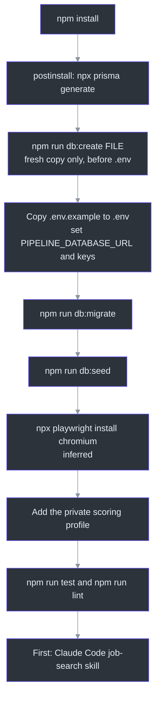
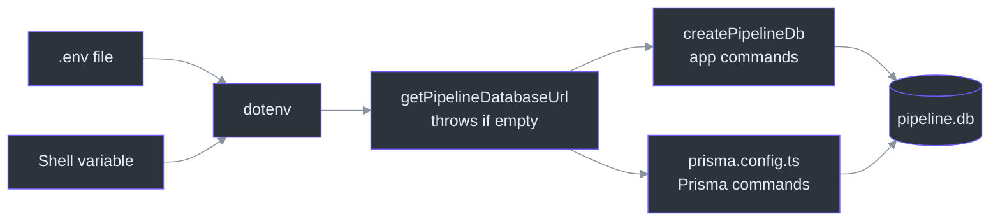
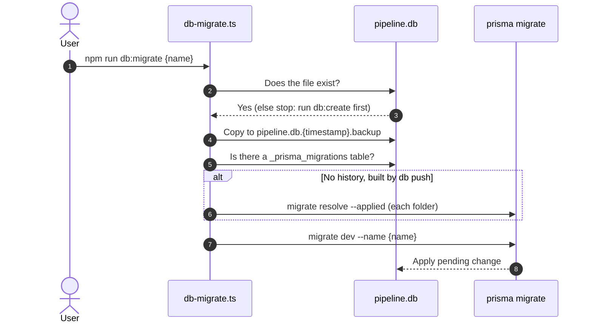

# Environment Setup

## Overview

Setup has four jobs: install the packages, build the database, tell the app where its database is and give it any API keys, and fill the database with default settings. The order matters, because each step needs the one before it. This page also explains why each step exists, so a failure message makes sense when it appears.

Everything below was read from the code. Steps that the repository does not state are marked "inferred".

## At a glance

| Step | Command or file | What it does | Source |
| --- | --- | --- | --- |
| 1. Install | `npm install` | Installs packages, then `postinstall` generates the Prisma database client | [package.json:7](https://github.com/mablahblah/job-assistant/blob/main/package.json#L7) |
| 2. Create database | `npm run db:create {file}` | Deletes the named file, then builds it from the schema | [scripts/db-create.ts:71-75](https://github.com/mablahblah/job-assistant/blob/main/scripts/db-create.ts#L71-L75) |
| 3. Environment | copy `.env.example` to `.env` | Names the database file and holds API keys | [.env.example:1](https://github.com/mablahblah/job-assistant/blob/main/.env.example#L1) |
| 4. Migrate | `npm run db:migrate` | Backs up the database, then applies any pending schema change | [scripts/db-migrate.ts:68-72](https://github.com/mablahblah/job-assistant/blob/main/scripts/db-migrate.ts#L68-L72) |
| 5. Seed | `npm run db:seed` | Fills absent settings and the source priority list | [scripts/db-seed.ts:222-230](https://github.com/mablahblah/job-assistant/blob/main/scripts/db-seed.ts#L222-L230) |
| 6. Browsers | `npx playwright install chromium` (inferred) | Gets the browser that resolution and parsing drive | [lib/tools/resolution-browser.ts:52](https://github.com/mablahblah/job-assistant/blob/main/lib/tools/resolution-browser.ts#L52) |
| 7. Profile | copy the example profile (inferred) | Gives the scoring agent the candidate to score against | [.claude/skills/score-backlog/SKILL.md:65](https://github.com/mablahblah/job-assistant/blob/main/.claude/skills/score-backlog/SKILL.md#L65) |
| 8. Check | `npm run test` and `npm run lint` | Runs the test suite, linter, and type check | [package.json:19-21](https://github.com/mablahblah/job-assistant/blob/main/package.json#L19-L21) |

## The setup order

<!-- Sources: package.json:7, .env.example:5, scripts/db-create.ts:33-77, scripts/db-migrate.ts:60-99, scripts/db-seed.ts:222-230, .claude/skills/score-backlog/SKILL.md:65 -->

## Step 1. Install

The project runs TypeScript directly through `tsx` with no build step ([CLAUDE.md:7](https://github.com/mablahblah/job-assistant/blob/main/CLAUDE.md#L7)). No Node version is pinned: there is no `.nvmrc` file and `package.json` has no `engines` field. The type package is `@types/node` version 20 ([package.json:38](https://github.com/mablahblah/job-assistant/blob/main/package.json#L38)), so Node 20 or newer is the safe choice (inferred).

`npm install` runs `postinstall`, which runs `npx prisma generate` ([package.json:7](https://github.com/mablahblah/job-assistant/blob/main/package.json#L7)). This builds the typed database client into the `generated/pipeline` folder ([prisma/schema.prisma:3-6](https://github.com/mablahblah/job-assistant/blob/main/prisma/schema.prisma#L3-L6)). That folder is not tracked, and the app imports it from `lib/db/pipeline-db.ts` ([lib/db/pipeline-db.ts:7](https://github.com/mablahblah/job-assistant/blob/main/lib/db/pipeline-db.ts#L7)). Without it, nothing that touches the database will start.

After you edit `prisma/schema.prisma`, run `npx prisma generate` by hand. Neither database command regenerates the client ([CLAUDE.md:43](https://github.com/mablahblah/job-assistant/blob/main/CLAUDE.md#L43)). That includes `db:migrate` when it applies a real schema change ([scripts/db-migrate.ts:85-88](https://github.com/mablahblah/job-assistant/blob/main/scripts/db-migrate.ts#L85-L88)). This was tested with Prisma 7.10 on a throwaway database.

## Step 2. Create the database

`db:create` builds a database from the schema with `prisma db push`. Before that, it removes the target file and the SQLite side files `-journal`, `-wal` and `-shm`, so the build starts from nothing ([scripts/db-create.ts:58-66](https://github.com/mablahblah/job-assistant/blob/main/scripts/db-create.ts#L58-L66)).

Because it deletes, it has two safety rules:

| Rule | Why | Source |
| --- | --- | --- |
| It takes no default target. You must pass a path | A mistyped bare command cannot land on a database anyone cares about | [scripts/db-create.ts:33-36](https://github.com/mablahblah/job-assistant/blob/main/scripts/db-create.ts#L33-L36) |
| It refuses the database named by `PIPELINE_DATABASE_URL` in the repo's own `.env` | A wipe of the real file must not be possible | [scripts/db-create.ts:42-56](https://github.com/mablahblah/job-assistant/blob/main/scripts/db-create.ts#L42-L56) |
| It reads `.env` directly, not `process.env` | A shell that exports a different value cannot make a wipe look safe | [scripts/db-create.ts:4-7](https://github.com/mablahblah/job-assistant/blob/main/scripts/db-create.ts#L4-L7) |
| It asks the filesystem whether two paths are one file | Case-folding disks and shortcuts defeat plain text comparison | [lib/utils/same-file.ts:1-9](https://github.com/mablahblah/job-assistant/blob/main/lib/utils/same-file.ts#L1-L9) |

### A catch on a fresh clone

On a first setup, `.env` names `file:./pipeline.db`, and `db:create` refuses that very file. When neither path exists yet, `isSameFile` falls back to comparing the paths as lowercase text, so a not-yet-created `pipeline.db` still counts as the protected file ([lib/utils/same-file.ts:56-59](https://github.com/mablahblah/job-assistant/blob/main/lib/utils/same-file.ts#L56-L59)). The script also skips the check when `.env` is missing or holds no `PIPELINE_DATABASE_URL` ([scripts/db-create.ts:40-46](https://github.com/mablahblah/job-assistant/blob/main/scripts/db-create.ts#L40-L46)).

On a fresh copy of the project only, with no `pipeline.db` yet, create the database before you create `.env`: run `npm run db:create ./pipeline.db`. With no `.env`, the command has no real database to protect, so it accepts the target ([scripts/db-create.ts:40-46](https://github.com/mablahblah/job-assistant/blob/main/scripts/db-create.ts#L40-L46)). Never run this once `pipeline.db` exists: the command deletes the file it is given ([scripts/db-create.ts:58-66](https://github.com/mablahblah/job-assistant/blob/main/scripts/db-create.ts#L58-L66)). This order was read from the code, not run.

## Step 3. Environment file

`.env` is ignored by git, and only `.env.example` is committed ([.gitignore:4-7](https://github.com/mablahblah/job-assistant/blob/main/.gitignore#L4-L7)). Copy the template and fill it in.

### What each key powers

| Variable | What it powers | Where the code reads it | If missing |
| --- | --- | --- | --- |
| `PIPELINE_DATABASE_URL` | The one database the app uses, for example `file:./pipeline.db` | [lib/db/pipeline-env.ts:7-17](https://github.com/mablahblah/job-assistant/blob/main/lib/db/pipeline-env.ts#L7-L17) | Throws and stops the command |
| `ADZUNA_APP_ID`, `ADZUNA_API_KEY` | The Adzuna collector | [lib/collectors/adzuna.ts:123-124](https://github.com/mablahblah/job-assistant/blob/main/lib/collectors/adzuna.ts#L123-L124) | That collector returns an error line and no jobs |
| `RAPIDAPI_KEY` | The JSearch collector | [lib/collectors/jsearch.ts:116](https://github.com/mablahblah/job-assistant/blob/main/lib/collectors/jsearch.ts#L116) | That collector returns an error line and no jobs |
| `GEOCODE_MAPS_API_KEY` | Turns a job's location into coordinates so it can be measured against the home location | [lib/tools/geocoder.ts:104](https://github.com/mablahblah/job-assistant/blob/main/lib/tools/geocoder.ts#L104) | Throws "no place can be looked up" |
| `APIFY_API_TOKEN` | Finds an employer's address, phone and website for the work log | [lib/tools/company-search.ts:74](https://github.com/mablahblah/job-assistant/blob/main/lib/tools/company-search.ts#L74) | Raises a missing-credential error at search time |
| `DATABASE_URL` | The old database, read only by the one-time data move | [scripts/db-migrate-data.ts:277](https://github.com/mablahblah/job-assistant/blob/main/scripts/db-migrate-data.ts#L277) | Not needed for normal use |
| `PORT` (optional, not in the template) | Dashboard port, default 3001 | [scripts/serve.ts:56](https://github.com/mablahblah/job-assistant/blob/main/scripts/serve.ts#L56) | Falls back to 3001 |
| `COLLECTOR_FIXTURE_DIR` (optional, not in the template) | Folder of saved pages for the offline fixture collector | [lib/collectors/fixture.ts:30](https://github.com/mablahblah/job-assistant/blob/main/lib/collectors/fixture.ts#L30) | Uses `lib/collectors/fixtures` |

### Why the database variable has no fallback

`getPipelineDatabaseUrl()` is the function that reads `PIPELINE_DATABASE_URL`. It throws when the value is missing and does not fall back to the old `DATABASE_URL`. The comment gives the reason: a Prisma command run without it should fail loudly instead of quietly reaching the old database ([prisma.config.ts:14-16](https://github.com/mablahblah/job-assistant/blob/main/prisma.config.ts#L14-L16)). The lookup runs when the function is called, not at load time, so a test can delete the variable and prove the failure ([lib/db/pipeline-env.ts:1-6](https://github.com/mablahblah/job-assistant/blob/main/lib/db/pipeline-env.ts#L1-L6)).

`createPipelineDb()` loads `.env` itself, because it is "the one door to the database". A caller that already set the variable wins, since dotenv never overwrites an existing value ([lib/db/pipeline-db.ts:1-6](https://github.com/mablahblah/job-assistant/blob/main/lib/db/pipeline-db.ts#L1-L6)). Only `lib/db/` builds a database connection ([.claude/rules/naming.md:25](https://github.com/mablahblah/job-assistant/blob/main/.claude/rules/naming.md#L25)).

<!-- Sources: lib/db/pipeline-env.ts:7-17, lib/db/pipeline-db.ts:6-18, prisma.config.ts:3-17 -->

## Step 4. Migrate

`db:migrate` is the only way to change the schema ([CLAUDE.md:41](https://github.com/mablahblah/job-assistant/blob/main/CLAUDE.md#L41)). Its order of work shows why it is safe:

<!-- Sources: scripts/db-migrate.ts:20-99 -->

| Behavior | Why | Source |
| --- | --- | --- |
| Stops if no database file exists | There is nothing to migrate; it tells you to run `db:create` | [scripts/db-migrate.ts:62-65](https://github.com/mablahblah/job-assistant/blob/main/scripts/db-migrate.ts#L62-L65) |
| Writes a dated `.backup` copy first | A botched migration must never leave you without the old data | [scripts/db-migrate.ts:68-72](https://github.com/mablahblah/job-assistant/blob/main/scripts/db-migrate.ts#L68-L72) |
| Marks every existing migration as applied if the file has no migration table | `db:create` uses `db push`, which lays down the schema but no history | [scripts/db-migrate.ts:40-57](https://github.com/mablahblah/job-assistant/blob/main/scripts/db-migrate.ts#L40-L57) |
| Passes an optional name to `prisma migrate dev` | Names a new migration | [scripts/db-migrate.ts:79-83](https://github.com/mablahblah/job-assistant/blob/main/scripts/db-migrate.ts#L79-L83) |

Backups end in `.backup` after the database name, and git ignores them ([.gitignore:12-15](https://github.com/mablahblah/job-assistant/blob/main/.gitignore#L12-L15)). Before any command reads or writes data, it checks that the database matches the code. If it does not, it prints the three drift lines and tells you to run `npm run db:migrate` ([lib/db/schema-drift.ts:15-27](https://github.com/mablahblah/job-assistant/blob/main/lib/db/schema-drift.ts#L15-L27)). The check exists because the trace service swallows write failures, so a run on a mismatched database would otherwise work for minutes and leave no record ([scripts/job-search.ts:44-52](https://github.com/mablahblah/job-assistant/blob/main/scripts/job-search.ts#L44-L52)). See [Database Commands](../deep-dive/data/database-commands.md).

## Step 5. Seed the settings

`db:seed` fills the single `Setting` row. It fills what is empty and overwrites nothing, so it is safe after every schema change ([scripts/db-seed.ts:1-5](https://github.com/mablahblah/job-assistant/blob/main/scripts/db-seed.ts#L1-L5)).

| What it seeds | Behavior | Source |
| --- | --- | --- |
| Defaults for search terms, home location, radius, expiry, title vocabularies, resolution pacing, thresholds | Creates the row if absent; otherwise fills only the columns that are `null` | [scripts/db-seed.ts:120-184](https://github.com/mablahblah/job-assistant/blob/main/scripts/db-seed.ts#L120-L184) |
| The source priority list | Appends any collector or parser name that is missing, to the bottom; never reorders | [scripts/db-seed.ts:189-219](https://github.com/mablahblah/job-assistant/blob/main/scripts/db-seed.ts#L189-L219) |

The seed starts the list with `collector:user`, then every dedicated parser, then every collector, then the general parser ([scripts/db-seed.ts:88-95](https://github.com/mablahblah/job-assistant/blob/main/scripts/db-seed.ts#L88-L95)). The order is only a starting point, because the owner reorders the list by hand. A source missing from the list ranks below all listed sources, so it loses every contested field. That is why the rule says to run `db:seed` whenever a registry changes ([.claude/rules/source-registry.md:7-9](https://github.com/mablahblah/job-assistant/blob/main/.claude/rules/source-registry.md#L7-L9)).

The default home location is the postal code `78701`, with a radius of 30 miles ([scripts/db-seed.ts:13-14](https://github.com/mablahblah/job-assistant/blob/main/scripts/db-seed.ts#L13-L14)). Every setting is explained in [Quick Reference](./quick-reference.md#settings). A missing setting makes the settings service throw, which stops the run instead of guessing ([lib/services/settings-service.ts:39-41](https://github.com/mablahblah/job-assistant/blob/main/lib/services/settings-service.ts#L39-L41)).

## Step 6. Browsers (inferred)

Two browser tools use Playwright's Chromium. Resolution opens a visible browser ([lib/tools/resolution-browser.ts:23](https://github.com/mablahblah/job-assistant/blob/main/lib/tools/resolution-browser.ts#L23)). Page rendering for parsing and for `fetch-rendered-page` uses a hidden one ([lib/tools/rendered-page-fetcher.ts:77](https://github.com/mablahblah/job-assistant/blob/main/lib/tools/rendered-page-fetcher.ts#L77)). `postinstall` only generates the database client, so nothing in the repository downloads the browser. Running `npx playwright install chromium` is the standard Playwright step (inferred).

## Step 7. The scoring profile (inferred)

The `score-backlog` skill reads a private profile file, `.alignment-info.md`, in its own folder ([.claude/skills/score-backlog/SKILL.md:65](https://github.com/mablahblah/job-assistant/blob/main/.claude/skills/score-backlog/SKILL.md#L65)). Git ignores it ([.gitignore:21-22](https://github.com/mablahblah/job-assistant/blob/main/.gitignore#L21-L22)). A made-up public example sits beside it as `.alignment-info.example.md`. Copy the example to `.alignment-info.md` and replace its content with your own profile. This wiki does not describe any real profile.

## Step 8. Check the install

| Command | What it checks | Source |
| --- | --- | --- |
| `npm run test` | The whole Vitest suite, with the time zone fixed to UTC | [vitest.config.ts:11-18](https://github.com/mablahblah/job-assistant/blob/main/vitest.config.ts#L11-L18) |
| `npm run lint` | ESLint, then the TypeScript type check | [package.json:19-20](https://github.com/mablahblah/job-assistant/blob/main/package.json#L19-L20) |

The test run excludes `docs/` ([vitest.config.ts:14](https://github.com/mablahblah/job-assistant/blob/main/vitest.config.ts#L14)), and lint ignores `docs`, `node_modules` and `generated` ([.eslintignore:1-4](https://github.com/mablahblah/job-assistant/blob/main/.eslintignore#L1-L4)). One comment in the test config says "No tests yet", which is out of date: many test files exist ([vitest.config.ts:15](https://github.com/mablahblah/job-assistant/blob/main/vitest.config.ts#L15)). See [Testing](../deep-dive/quality/testing.md).

## Related Pages

| Page | Relationship |
| --- | --- |
| [Overview](./overview.md) | What the tool is for |
| [Commands and Skills](./commands-and-skills.md) | What to run once setup is done |
| [Quick Reference](./quick-reference.md) | Settings and environment variables in one table |
| [Database Commands](../deep-dive/data/database-commands.md) | The create, migrate, and seed scripts in depth |
| [Data Model](../deep-dive/data/data-model.md) | The tables the schema builds |
| [Contributor Guide](../onboarding/contributor-guide.md) | Day-to-day working rules |

## References

- [package.json](https://github.com/mablahblah/job-assistant/blob/main/package.json)
- [.env.example](https://github.com/mablahblah/job-assistant/blob/main/.env.example)
- [scripts/db-create.ts](https://github.com/mablahblah/job-assistant/blob/main/scripts/db-create.ts)
- [scripts/db-migrate.ts](https://github.com/mablahblah/job-assistant/blob/main/scripts/db-migrate.ts)
- [scripts/db-seed.ts](https://github.com/mablahblah/job-assistant/blob/main/scripts/db-seed.ts)
- [prisma.config.ts](https://github.com/mablahblah/job-assistant/blob/main/prisma.config.ts)
