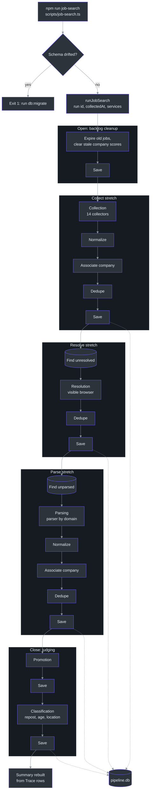

# Job Search Assistant Wiki

The Job Search Assistant is a personal command-line tool, driven by Claude Code skills, that finds job postings, ranks them, tracks applications, and files the Texas unemployment work log. It is one pipeline written in TypeScript and run through `tsx`, with a single SQLite database behind Prisma ([CLAUDE.md:1-14](https://github.com/mablahblah/job-assistant/blob/main/CLAUDE.md#L1-L14)). The only code shaped to a particular job site is its collectors and parsers. Every other step acts on a job's data alone ([.claude/rules/part-ownership.md:7-11](https://github.com/mablahblah/job-assistant/blob/main/.claude/rules/part-ownership.md#L7-L11)).

This page is the entry point for developers. The repository's `README.md` gives a short overview; start here or at [Overview](./getting-started/overview.md) for depth.

## Quick Start

Full detail, including the order and the reasons behind each step, is in [Environment Setup](./getting-started/setup.md).

```bash
# 1. Install packages; postinstall runs `npx prisma generate`
npm install

# 2. Create .env from the template, then set PIPELINE_DATABASE_URL and any API keys
cp .env.example .env

# 3. Build, migrate and seed the database
npm run db:create ./pipeline.db   # refuses the database .env names; see the setup page
npm run db:migrate                # writes a dated backup first
npm run db:seed                   # fills absent settings, overwrites nothing

# 4. Get the browser resolution and parsing drive (inferred, standard Playwright step)
npx playwright install chromium

# 5. Check the install
npm run test                      # Vitest
npm run lint                      # ESLint, then the type check

# 6. Use it
npm run job-search                # run the whole pipeline; prints its run id first
npm run serve                     # read-only dashboard, default port 3001
```

| Command | Script | Source |
| --- | --- | --- |
| `npm run job-search` | `scripts/job-search.ts` | [package.json:11](https://github.com/mablahblah/job-assistant/blob/main/package.json#L11) |
| `npm run score:gather` / `score:save` | `scripts/score-gather.ts`, `scripts/score-save.ts` | [package.json:17-18](https://github.com/mablahblah/job-assistant/blob/main/package.json#L17-L18) |
| `npm run find-jobs` / `change-status` | `scripts/find-jobs.ts`, `scripts/change-status.ts` | [package.json:13-15](https://github.com/mablahblah/job-assistant/blob/main/package.json#L13-L15) |
| `npm run serve` | `scripts/serve.ts` | [package.json:6](https://github.com/mablahblah/job-assistant/blob/main/package.json#L6) |
| `npm run db:create` / `db:migrate` / `db:seed` | `scripts/db-*.ts` | [package.json:8-10](https://github.com/mablahblah/job-assistant/blob/main/package.json#L8-L10) |
| `npm run lint` / `test` | ESLint and `tsc`, Vitest | [package.json:19-21](https://github.com/mablahblah/job-assistant/blob/main/package.json#L19-L21) |

Every command and the skill that calls it is listed in [Commands and Skills](./getting-started/commands-and-skills.md).

## Architecture Overview

A job search is one call to `runJobSearch`. It runs three stretches, collect, resolve and parse, and each one ends in a database write. A later stretch does not take a list from the one before it. It asks the database for the jobs that still need its work ([lib/orchestrators/job-search.ts:1-16](https://github.com/mablahblah/job-assistant/blob/main/lib/orchestrators/job-search.ts#L1-L16)). Backlog cleanup opens the run, and promotion and classification close it. Scoring is not part of this run. The `job-search` skill runs it afterwards through two separate commands, with an agent doing the judging in between.



<!-- Sources: scripts/job-search.ts:40-140, lib/orchestrators/job-search.ts:151-667, lib/collectors/registry.ts:19-34 -->

The full walk through every handler, and what a run that stops partway keeps, is in [The Job Search Run](./deep-dive/architecture/job-search-run.md). Why the code is split the way it is lives in [System Design](./deep-dive/architecture/system-design.md).

## Documentation Map

| Section | Page | What it covers |
| --- | --- | --- |
| Onboarding | [Contributor Guide](./onboarding/contributor-guide.md) | Tools, then the pipeline and its data, then how to get productive |
| Onboarding | [Staff Engineer Guide](./onboarding/staff-engineer-guide.md) | The core idea, decisions and alternatives, failure modes, known debt |
| Onboarding | [Executive Guide](./onboarding/executive-guide.md) | Capabilities, risks, cost of outside services, recommendations |
| Onboarding | [Product Manager Guide](./onboarding/product-manager-guide.md) | User journeys, feature map, limits, stored data, without jargon |
| Getting Started | [Overview](./getting-started/overview.md) | What the tool is and the four jobs it does |
| Getting Started | [Environment Setup](./getting-started/setup.md) | Install, `.env`, database creation, migration and seeding |
| Getting Started | [Commands and Skills](./getting-started/commands-and-skills.md) | Every npm command and project skill, and which calls which |
| Getting Started | [Quick Reference](./getting-started/quick-reference.md) | Commands, folders, statuses, trace steps, settings, environment |
| Architecture | [System Design](./deep-dive/architecture/system-design.md) | Part kinds, what each owns and never does, the handler contract |
| Architecture | [The Job Search Run](./deep-dive/architecture/job-search-run.md) | Every handler in order, failure handling |
| Architecture | [Tracing and the Run Summary](./deep-dive/architecture/tracing-and-run-summary.md) | The Trace table and how the summary is rebuilt from it |
| Data Layer | [Data Model](./deep-dive/data/data-model.md) | Every table, phase-gate flags, the `raw_` prefix |
| Data Layer | [Services](./deep-dive/data/services.md) | One service per table, fakes, the active-job freeze |
| Data Layer | [Database Commands and Safety](./deep-dive/data/database-commands.md) | Create, migrate, seed, and the schema check |
| Pipeline Steps | [Collection](./deep-dive/pipeline/collection.md) | The 14 collectors and the usability check |
| Pipeline Steps | [Normalization and Association](./deep-dive/pipeline/normalization-and-association.md) | Tidying fields and attaching jobs to employers |
| Pipeline Steps | [Dedupe and Save](./deep-dive/pipeline/dedupe-and-save.md) | Job identity, the merge rule, the save guardrail |
| Pipeline Steps | [Resolution](./deep-dive/pipeline/resolution.md) | Following aggregator links to the employer's posting |
| Pipeline Steps | [Parsing](./deep-dive/pipeline/parsing.md) | Dedicated parsers, the general parser, unparseable jobs |
| Pipeline Steps | [Backlog Cleanup, Promotion and Classification](./deep-dive/pipeline/judging-steps.md) | Expiry, reposts, location matching |
| Agent Workflows | [Scoring](./deep-dive/agent-workflows/scoring.md) | Two commands with an agent between, rubrics, company promotion |
| Agent Workflows | [Status Changes and the Work Log](./deep-dive/agent-workflows/status-change-and-work-log.md) | Finding a job, setting its status, filing the work log |
| Agent Workflows | [External Jobs and Resumes](./deep-dive/agent-workflows/external-jobs-and-resumes.md) | Hand-added jobs, let-through, the resume skill |
| Dashboard | [The Read-Only Dashboard](./deep-dive/dashboard/dashboard.md) | `npm run serve`, the job lists, the score total |
| Quality | [Testing](./deep-dive/quality/testing.md) | Vitest, stand-ins, flow tests |
| Quality | [Project Rules](./deep-dive/quality/project-rules.md) | Every rule file and the working agreements |

## Key Files

| File | Role | Source |
| --- | --- | --- |
| `scripts/job-search.ts` | Builds the services, checks the schema, mints the run id, prints the summary | [scripts/job-search.ts:40-140](https://github.com/mablahblah/job-assistant/blob/main/scripts/job-search.ts#L40-L140) |
| `lib/orchestrators/job-search.ts` | `runJobSearch`: calls every handler in pipeline order | [lib/orchestrators/job-search.ts:151](https://github.com/mablahblah/job-assistant/blob/main/lib/orchestrators/job-search.ts#L151) |
| `lib/orchestrators/scoring.ts` | `runScoringGather` and `runScoringSave`, the two halves of scoring | [lib/orchestrators/scoring.ts:47](https://github.com/mablahblah/job-assistant/blob/main/lib/orchestrators/scoring.ts#L47) |
| `lib/collectors/registry.ts` | The list of collectors a job search runs | [lib/collectors/registry.ts:19-34](https://github.com/mablahblah/job-assistant/blob/main/lib/collectors/registry.ts#L19-L34) |
| `lib/parsers/registry.ts` | Parsers keyed by the domain each owns, and the lookup by URL | [lib/parsers/registry.ts:37-79](https://github.com/mablahblah/job-assistant/blob/main/lib/parsers/registry.ts#L37-L79) |
| `lib/handlers/save.ts` | `saveJobs` and `saveCompanies`, the one saving path every caller shares | [lib/handlers/save.ts:147](https://github.com/mablahblah/job-assistant/blob/main/lib/handlers/save.ts#L147) |
| `lib/services/job-service.ts` | Owns the Job table, including the phase-gate lookups | [lib/services/job-service.ts:282](https://github.com/mablahblah/job-assistant/blob/main/lib/services/job-service.ts#L282) |
| `lib/db/pipeline-db.ts` | The one place a database connection is built | [lib/db/pipeline-db.ts:14-18](https://github.com/mablahblah/job-assistant/blob/main/lib/db/pipeline-db.ts#L14-L18) |
| `prisma/schema.prisma` | Every table, starting with Job | [prisma/schema.prisma:14](https://github.com/mablahblah/job-assistant/blob/main/prisma/schema.prisma#L14) |
| `scripts/serve.ts` | Starts the read-only dashboard | [scripts/serve.ts:1-88](https://github.com/mablahblah/job-assistant/blob/main/scripts/serve.ts#L1-L88) |
| `CLAUDE.md` | Project instructions, folder map and working agreements | [CLAUDE.md:45-65](https://github.com/mablahblah/job-assistant/blob/main/CLAUDE.md#L45-L65) |
| `.claude/rules/` | The rules that govern where code goes and what it is called | [.claude/rules/part-ownership.md:5](https://github.com/mablahblah/job-assistant/blob/main/.claude/rules/part-ownership.md#L5) |

## Tech Stack

| Layer | Choice | Source |
| --- | --- | --- |
| Runtime | TypeScript run directly through `tsx`, no build step, on Node.js | [package.json:42](https://github.com/mablahblah/job-assistant/blob/main/package.json#L42) |
| Database | SQLite through Prisma ORM with the libsql adapter | [package.json:25-28](https://github.com/mablahblah/job-assistant/blob/main/package.json#L25-L28) |
| Browser automation | Playwright, for resolution and for rendering pages to parse | [package.json:32](https://github.com/mablahblah/job-assistant/blob/main/package.json#L32) |
| HTML reading | linkedom, so page-reading code runs and is tested without a browser | [package.json:31](https://github.com/mablahblah/job-assistant/blob/main/package.json#L31) |
| Dashboard | Server-rendered HTML with vanilla CSS and JavaScript | [CLAUDE.md:11](https://github.com/mablahblah/job-assistant/blob/main/CLAUDE.md#L11) |
| Testing | Vitest, time zone fixed to UTC | [vitest.config.ts:11-18](https://github.com/mablahblah/job-assistant/blob/main/vitest.config.ts#L11-L18) |
| Linting | ESLint with `@typescript-eslint`, then `tsc --noEmit` | [package.json:19-20](https://github.com/mablahblah/job-assistant/blob/main/package.json#L19-L20) |
| Workflows | Claude Code skills that call the npm commands | [CLAUDE.md:14](https://github.com/mablahblah/job-assistant/blob/main/CLAUDE.md#L14) |
