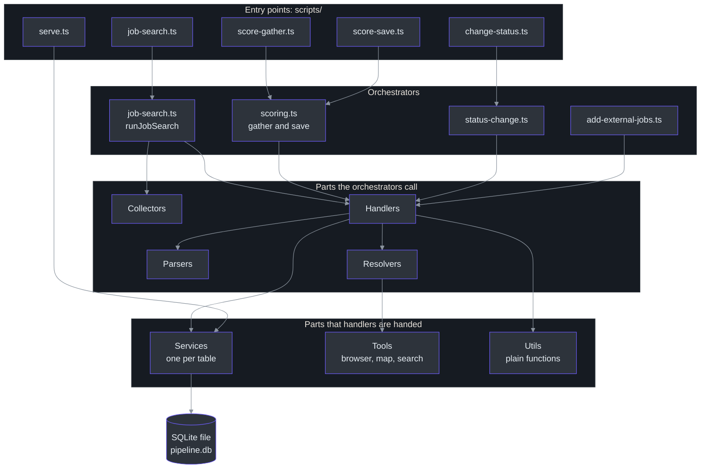
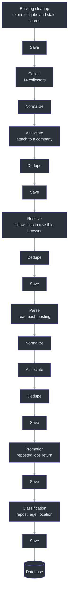
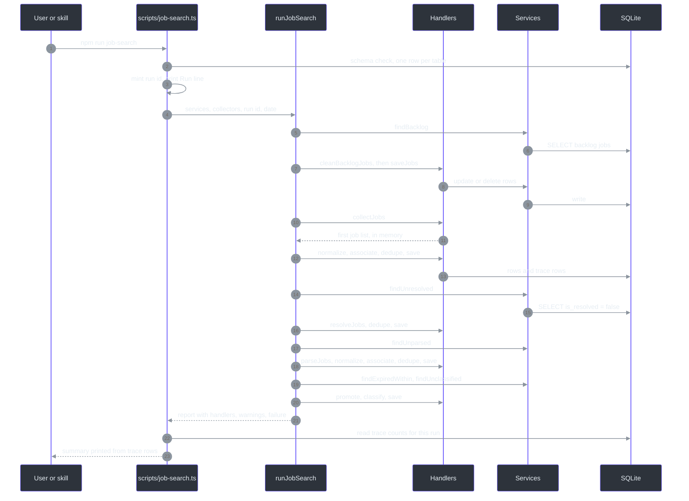
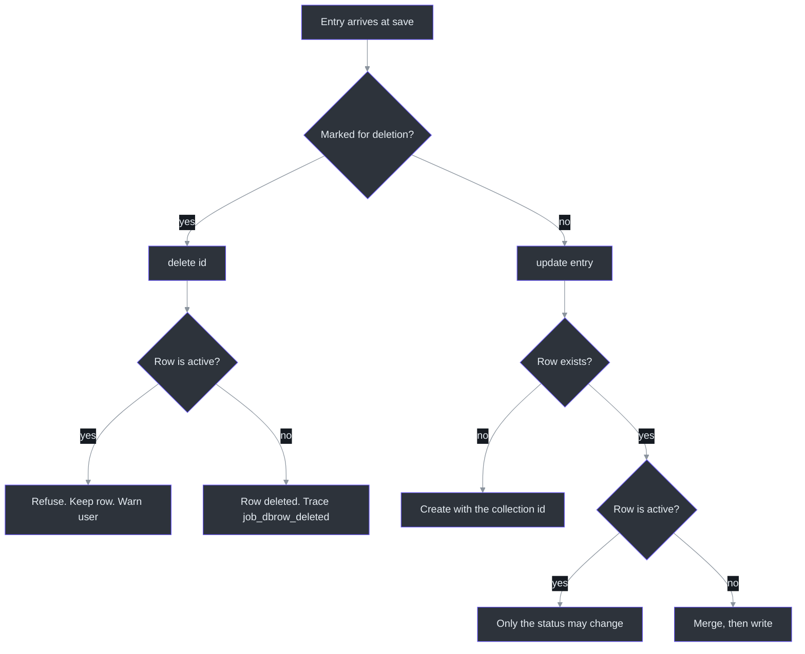
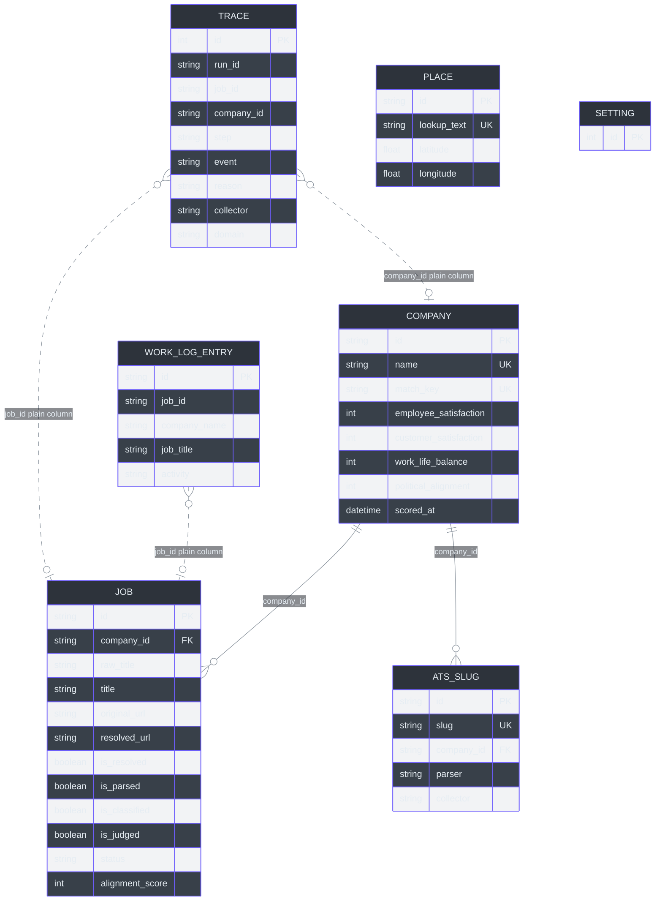
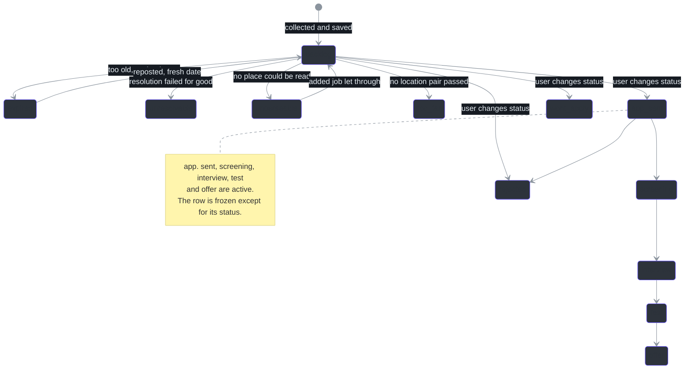
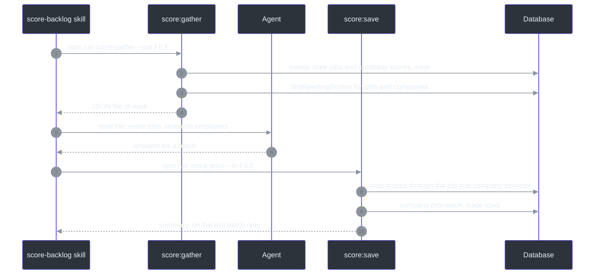
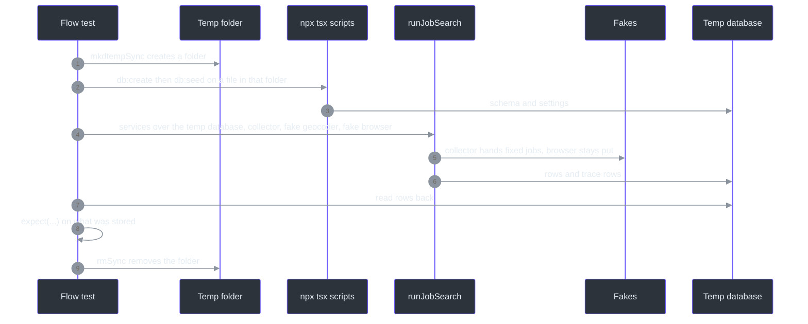
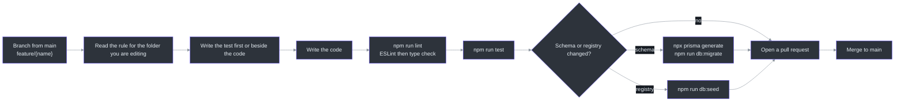

# Contributor Guide

This guide takes you from "I can read Python or JavaScript" to "I can add a collector or a parser and prove it works." It is written in three parts. Each part builds on the one before it.

| Part | What it covers | Read it if |
|---|---|---|
| Part I: Foundations | TypeScript run through `tsx`, Prisma on SQLite, Vitest, Playwright, linkedom | You have not used these tools before |
| Part II: This codebase | The pipeline, the kinds of part, the data model, the trace table | You want to know why the code is shaped the way it is |
| Part III: Getting productive | Setup, tests, fakes, flow tests, the rules, adding a collector or parser | You are about to write code |
| Appendices | Glossary, key file table, quick reference card, common errors | You need to look something up |

Every claim in this guide points at a line of code. Where the guide infers something instead of reading it, the text says "inferred".

A note on trust. The project has a long document, [docs/architecture.md](https://github.com/mablahblah/job-assistant/blob/main/docs/architecture.md), that describes the system as built. It is detailed, but parts of it are out of date. For example, it says seven collectors exist, and the code lists fourteen at [lib/collectors/registry.ts:19-34](https://github.com/mablahblah/job-assistant/blob/main/lib/collectors/registry.ts#L19-L34). When the document and the code disagree, believe the code.

## What this project is, in four sentences

This is a personal command-line tool that searches job boards, ranks what it finds, tracks applications, and files a weekly unemployment work log. It is driven by Claude Code "skills", which are written instructions that call the project's npm commands. One command, `npm run job-search`, runs a fixed pipeline of steps that collect, clean, de-duplicate, follow, read and judge job postings. A second pair of commands lets an AI agent score the jobs, because a single command cannot pause while an agent thinks.

The one fact to hold in your head while you read the rest of this guide is this: **every step of the pipeline reads its own work out of the database and ends by writing back to the database.** No step hands a list to the next step in memory. That is why a run that crashes halfway keeps everything the finished steps saved. The guide returns to this idea many times.

---

# Part I: Foundations

This part is for someone who knows Python or JavaScript but has not met this exact stack. The stack is:

| Tool | Role in this project | Closest thing you may know | Source |
|---|---|---|---|
| TypeScript | The language | JavaScript with types, or Python with type hints that are checked | [tsconfig.json:1-19](https://github.com/mablahblah/job-assistant/blob/main/tsconfig.json#L1-L19) |
| `tsx` | Runs `.ts` files directly, with no build step | `ts-node`, or running `python script.py` | [package.json:6-20](https://github.com/mablahblah/job-assistant/blob/main/package.json#L6-L20) |
| Node.js | The runtime | The same runtime as JavaScript on a server | [package.json:37-45](https://github.com/mablahblah/job-assistant/blob/main/package.json#L37-L45) |
| Prisma | Talks to the database and generates typed query code | SQLAlchemy, Django ORM, Sequelize | [prisma/schema.prisma:3-10](https://github.com/mablahblah/job-assistant/blob/main/prisma/schema.prisma#L3-L10) |
| SQLite through libsql | The database, one file on disk | SQLite in Python's `sqlite3` | [lib/db/pipeline-db.ts:14-18](https://github.com/mablahblah/job-assistant/blob/main/lib/db/pipeline-db.ts#L14-L18) |
| Vitest | The test runner | pytest or Jest | [vitest.config.ts:1-20](https://github.com/mablahblah/job-assistant/blob/main/vitest.config.ts#L1-L20) |
| Playwright | Drives a real Chromium browser | Selenium, Puppeteer | [lib/tools/resolution-browser.ts:10-23](https://github.com/mablahblah/job-assistant/blob/main/lib/tools/resolution-browser.ts#L10-L23) |
| linkedom | Reads an HTML string as a queryable document, with no browser | BeautifulSoup, or `jsdom` | [lib/collectors/uiuxjobsboard-cards.ts:6-8](https://github.com/mablahblah/job-assistant/blob/main/lib/collectors/uiuxjobsboard-cards.ts#L6-L8) |

## 1. TypeScript for Python and JavaScript engineers

### 1.1 Why TypeScript here

TypeScript is JavaScript plus a type checker. The types exist only while you write code and while `npm run typecheck` runs. They are erased before the code runs. So a type is a promise the checker verifies, not a check that happens at runtime.

This project uses strict mode, which turns on the full set of checks. See [tsconfig.json:3-8](https://github.com/mablahblah/job-assistant/blob/main/tsconfig.json#L3-L8). In strict mode a value that might be missing must be handled. This is the same discipline as `Optional[str]` in Python type hints, except the checker refuses to pass until you handle it.

### 1.2 Running code with no build step

There is no compile step and no `dist/` folder. The `tsx` tool reads a `.ts` file, strips the types, and runs the result. Every script in the project is run this way.

```bash
npx tsx scripts/job-search.ts
```

The npm scripts wrap that call. For example `npm run job-search` runs the line above. See [package.json:5-23](https://github.com/mablahblah/job-assistant/blob/main/package.json#L5-L23) for the full list.

| What you want | Python | JavaScript | This project |
|---|---|---|---|
| Run a script | `python script.py` | `node script.js` | `npx tsx scripts/x.ts`, usually through `npm run` |
| Check types | `mypy .` | not applicable | `npm run typecheck`, which runs `tsc --noEmit` |
| Run all tests | `pytest` | `npx jest` | `npm run test`, which runs `vitest run` |
| Lint | `ruff` or `flake8` | `eslint` | `npm run lint`, which runs ESLint and then the type check |
| Install | `pip install -r ...` | `npm install` | `npm install`, which also runs `prisma generate` through `postinstall` |

Two settings in `tsconfig.json` explain the "no build" claim. `noEmit` means the compiler writes no files, and `isolatedModules` means each file can be understood on its own, which is what `tsx` needs. See [tsconfig.json:6-12](https://github.com/mablahblah/job-assistant/blob/main/tsconfig.json#L6-L12).

The `lint` script runs two things in order. It runs ESLint, then the type check. See [package.json:19-20](https://github.com/mablahblah/job-assistant/blob/main/package.json#L19-L20). The ESLint rules are small: the recommended sets plus a warning for unused variables, with a leading underscore allowed to mean "unused on purpose". See [.eslintrc.json:1-8](https://github.com/mablahblah/job-assistant/blob/main/.eslintrc.json#L1-L8).

### 1.3 Values and types side by side

| Idea | Python | JavaScript | TypeScript in this project |
|---|---|---|---|
| String, number, boolean | `str`, `int`, `bool` | `string`, `number`, `boolean` | `string`, `number`, `boolean` |
| Might be missing | `Optional[str]` | `string or undefined` | `string or null or undefined`, written `string \| null \| undefined` |
| A list of strings | `list[str]` | `string[]` | `string[]` or `readonly string[]` |
| A dictionary | `dict[str, int]` | `Record<string, number>` | `Record<string, number>` |
| A fixed set of strings | `Literal["a", "b"]` | not available | a union such as `"remote" or "hybrid"` |
| A record shape | `TypedDict` or a dataclass | an object literal | `interface` or `type` |
| A function that returns later | `async def` returning a coroutine | `async function` returning a `Promise` | `async function` returning a `Promise<T>` |
| Unknown shape | `Any` | any value | `unknown`, which forces you to check before use |

Here is a real example of a union of fixed strings. The job service names the three pipeline steps that read a "gate" flag. See [lib/services/job-service.ts:214-215](https://github.com/mablahblah/job-assistant/blob/main/lib/services/job-service.ts#L214-L215).

```typescript
export type BacklogStep = "resolution" | "parsing" | "classification";
```

If you pass any other string where a `BacklogStep` is expected, the type check fails. In Python you would write `Literal["resolution", "parsing", "classification"]`.

### 1.4 Interfaces and the "shape" of an object

An `interface` describes the fields and methods an object has. Nothing in the code implements it with a class. An object that has the right fields simply satisfies it. This is called structural typing. It is like Python's `Protocol`.

The best example is the `Collector` contract. It is two members long. See [lib/collectors/collector.ts:28-33](https://github.com/mablahblah/job-assistant/blob/main/lib/collectors/collector.ts#L28-L33).

```typescript
export interface Collector {
  name: string;
  collect(context: CollectorContext): Promise<CollectorResult>;
}
```

Any object with a `name` and a `collect` function is a collector. There is no base class and no `extends`. That is why the project describes collectors as sharing "helpers rather than a base class".

### 1.5 Immutability and spreading

Almost every function in the pipeline returns a new copy of a job rather than changing the one it was given. The tool for this is the spread operator `...`. It copies every field, and later fields win.

```typescript
return { ...job, is_resolved: false, resolved_url: null, status: "unresolvable" };
```

That line is real. See [lib/handlers/resolution.ts:46-48](https://github.com/mablahblah/job-assistant/blob/main/lib/handlers/resolution.ts#L46-L48). In Python the same idea is `{**job, "is_resolved": False, ...}`. You will see this pattern everywhere, so read it as "the same job, with these fields changed".

### 1.6 Async code

`async` and `await` work like Python's. A function marked `async` returns a `Promise`, and `await` waits for it. Two differences matter.

| Topic | Python asyncio | JavaScript and this project |
|---|---|---|
| Starting an event loop | You call `asyncio.run(main())` | The runtime already has one. The scripts end with `main().catch(...)`. See [scripts/job-search.ts:142-145](https://github.com/mablahblah/job-assistant/blob/main/scripts/job-search.ts#L142-L145) |
| A forgotten `await` | Gives you a coroutine object and a warning | Gives you a `Promise` object and no error. The work still starts, but you do not wait for it |
| Running things in parallel | `asyncio.gather` | `Promise.all` |

The second difference matters because this project is careful about order. Two entries pointing at one row "have to settle in the order they arrived", so the save step writes one entry at a time. See [docs/architecture.md:179](https://github.com/mablahblah/job-assistant/blob/main/docs/architecture.md#L179).

### 1.7 Modules and imports

Files use ES module syntax: `import { x } from "./y"` and `export const x`. A path that starts with `./` or `../` is relative. A bare name such as `"playwright"` is an installed package. There is also an alias `@/` that points at the repo root. It is set in two places so that the type checker and Vitest agree. See [tsconfig.json:13-15](https://github.com/mablahblah/job-assistant/blob/main/tsconfig.json#L13-L15) and [vitest.config.ts:5-9](https://github.com/mablahblah/job-assistant/blob/main/vitest.config.ts#L5-L9).

Notice that the code imports from `"../services/job-service"` with no `.ts` extension. The tool resolves it for you.

### 1.8 Comments are part of the design

Most files in this repository start with a comment block that explains why the file exists. Many functions have a comment that says what the function refuses to do. This is deliberate. For example, the header of the save handler states the central design idea in its first six lines. See [lib/handlers/save.ts:1-9](https://github.com/mablahblah/job-assistant/blob/main/lib/handlers/save.ts#L1-L9). Read those blocks first. They are the fastest way to learn the intent.

### 1.9 Three TypeScript tricks you will see

| Trick | What it looks like | What it means | Source |
|---|---|---|---|
| `as const` | `["app. sent", "screening"] as const` | The list is read-only, and its items become exact string types | [lib/utils/job-status.ts:8-14](https://github.com/mablahblah/job-assistant/blob/main/lib/utils/job-status.ts#L8-L14) |
| `satisfies` | `{ ... } satisfies Prisma.JobOmit` | Check the object against a type without widening it | [lib/services/job-service.ts:165-171](https://github.com/mablahblah/job-assistant/blob/main/lib/services/job-service.ts#L165-L171) |
| `never` field | `companies?: never` | A way to say "this field must not appear", so a result cannot carry two list names | [lib/orchestrators/job-search.ts:61-63](https://github.com/mablahblah/job-assistant/blob/main/lib/orchestrators/job-search.ts#L61-L63) |

### 1.10 Naming conventions you must follow

Names are not a matter of taste here. A rule file fixes them. See [.claude/rules/naming.md:46-51](https://github.com/mablahblah/job-assistant/blob/main/.claude/rules/naming.md#L46-L51).

| Kind of name | Style | Example |
|---|---|---|
| A fixed value written out in the file | SCREAMING_SNAKE | `ACTIVE_STATUSES` |
| An object carrying functions | camelCase | `adzunaCollector` |
| A type or interface | PascalCase | `JobListEntry` |
| Everything else | camelCase | `repoRoot` |
| A file | kebab-case | `company-match-key.ts` |
| A database column | `like_this`, the same in the database and in code | `is_resolved` |

The column rule comes from a recorded decision. Prisma could give each column a second name for the code, and the project refused that, because "two names for one thing is a thing that can disagree with itself". See [docs/DECISIONS.md:16](https://github.com/mablahblah/job-assistant/blob/main/docs/DECISIONS.md#L16).

## 2. Prisma with SQLite through the libsql adapter

### 2.1 What Prisma does

Prisma is an ORM, a layer that turns database rows into typed objects. You describe your tables once in a schema file. Prisma then generates a client whose methods are typed to match.

| Step | Python (SQLAlchemy) | JavaScript (Sequelize) | This project |
|---|---|---|---|
| Describe tables | A model class | A model definition | `model Job { ... }` in [prisma/schema.prisma:14-142](https://github.com/mablahblah/job-assistant/blob/main/prisma/schema.prisma#L14-L142) |
| Create the client | `Session(engine)` | `new Sequelize(...)` | `createPipelineDb()` in [lib/db/pipeline-db.ts:14-18](https://github.com/mablahblah/job-assistant/blob/main/lib/db/pipeline-db.ts#L14-L18) |
| Query | `session.query(Job).filter(...)` | `Job.findAll({ where })` | `db.job.findMany({ where })` |
| Change the schema | Alembic | a migration file | `npm run db:migrate` |

### 2.2 The generated client

The schema file has a `generator` block that says where the generated code goes. See [prisma/schema.prisma:3-6](https://github.com/mablahblah/job-assistant/blob/main/prisma/schema.prisma#L3-L6). The output folder is `generated/pipeline`, and it is not tracked by git. That is why the setup includes `prisma generate`.

**After you edit `prisma/schema.prisma`, run `npx prisma generate`.** Neither database command does it for you. If you forget, the client keeps describing the old schema and the type check fails in confusing ways. A fresh clone is covered because `postinstall` runs the generator. See [package.json:7](https://github.com/mablahblah/job-assistant/blob/main/package.json#L7).

### 2.3 Why the libsql adapter

SQLite is a database in one file. The libsql adapter lets Prisma talk to it through the `@libsql/client` driver. The connection is made in one place and nowhere else.

```typescript
export function createPipelineDb(): PrismaClient {
  return new PrismaClient({
    adapter: new PrismaLibSql({ url: getPipelineDatabaseUrl() }),
  });
}
```

That is the whole of [lib/db/pipeline-db.ts:14-18](https://github.com/mablahblah/job-assistant/blob/main/lib/db/pipeline-db.ts#L14-L18). It is a factory function and not a shared object, because the URL is read each time it is called. A caller that changes `PIPELINE_DATABASE_URL` gets a client that follows. See the comment at [lib/db/pipeline-db.ts:11-13](https://github.com/mablahblah/job-assistant/blob/main/lib/db/pipeline-db.ts#L11-L13).

The URL comes from `getPipelineDatabaseUrl()`, which throws if the variable is not set. See [lib/db/pipeline-env.ts:7-17](https://github.com/mablahblah/job-assistant/blob/main/lib/db/pipeline-env.ts#L7-L17). There is no fallback to any other database. This is deliberate. The error text says so.

Only `lib/db/` may build a connection. The naming rule states it. See [.claude/rules/naming.md:25](https://github.com/mablahblah/job-assistant/blob/main/.claude/rules/naming.md#L25).

### 2.4 Reading the schema

A model is a table. A line inside it is a column. A `?` after the type means the column can be empty.

```prisma
model Job {
  id         String   @id @default(cuid())
  company_id String?
  status     String   @default("backlog")
  is_resolved Boolean @default(false)
  ...
}
```

This is a trimmed copy of the real model at [prisma/schema.prisma:14-142](https://github.com/mablahblah/job-assistant/blob/main/prisma/schema.prisma#L14-L142). A few points worth knowing now:

| Schema feature | Meaning | Where to see it |
|---|---|---|
| `@id @default(cuid())` | The primary key is a generated text id | [prisma/schema.prisma:15](https://github.com/mablahblah/job-assistant/blob/main/prisma/schema.prisma#L15) |
| `String?` | The column may be null | [prisma/schema.prisma:18](https://github.com/mablahblah/job-assistant/blob/main/prisma/schema.prisma#L18) |
| `Json?` | A column holding structured JSON, typed loosely by Prisma | [prisma/schema.prisma:66](https://github.com/mablahblah/job-assistant/blob/main/prisma/schema.prisma#L66) |
| `@@index([...])` | A database index for faster lookups | [prisma/schema.prisma:135-141](https://github.com/mablahblah/job-assistant/blob/main/prisma/schema.prisma#L135-L141) |
| `@unique` | The database refuses a duplicate | [prisma/schema.prisma:151-156](https://github.com/mablahblah/job-assistant/blob/main/prisma/schema.prisma#L151-L156) |
| `@updatedAt` | Prisma sets the time on every write | [prisma/schema.prisma:49](https://github.com/mablahblah/job-assistant/blob/main/prisma/schema.prisma#L49) |

Every comment in the schema is meaningful. Several of them explain a decision. For example, the comment above `alignment_score` says that empty is what tells the system a job still needs scoring, which is why the column has no default. See [prisma/schema.prisma:119-124](https://github.com/mablahblah/job-assistant/blob/main/prisma/schema.prisma#L119-L124).

### 2.5 Common queries

You rarely write queries outside `lib/services/`. When you read a service, these are the patterns you will meet.

| Operation | Prisma call | Meaning |
|---|---|---|
| Find many | `db.job.findMany({ where: { status: "backlog" } })` | Like `SELECT ... WHERE` |
| Find one by key | `db.job.findUnique({ where: { id } })` | Returns the row or `null` |
| Create | `db.job.create({ data })` | Like `INSERT` |
| Update | `db.job.update({ where: { id }, data })` | Like `UPDATE` |
| Delete | `db.job.delete({ where: { id } })` | Like `DELETE` |
| Leave columns out | `omit: { is_resolved: true }` | Do not read those columns |
| Search inside text | `{ name: { contains: part } }` | Becomes SQL `LIKE`, which is case-insensitive for plain letters in SQLite |

The `contains` note comes from a comment in the job service. See [lib/services/job-service.ts:496-499](https://github.com/mablahblah/job-assistant/blob/main/lib/services/job-service.ts#L496-L499). It also notes that Prisma's SQLite support rejects an "insensitive" mode, so the code does not ask for one.

### 2.6 Json columns and the one allowed cast

SQLite has no array type, so lists such as `raw_location_list` are stored as JSON. Prisma types a JSON column as a very loose type called `JsonValue`. The project bridges the gap with one cast, in one function, with a comment saying so. See [lib/services/job-service.ts:234-239](https://github.com/mablahblah/job-assistant/blob/main/lib/services/job-service.ts#L234-L239).

A cast tells the checker "trust me". The rule here is: do not add more of them. If you need to read a JSON column, check its shape at runtime, the way the settings service does with `isStringArray`. See [lib/services/settings-service.ts:53-58](https://github.com/mablahblah/job-assistant/blob/main/lib/services/settings-service.ts#L53-L58).

### 2.7 Errors from the database

When a create collides with an existing id, Prisma raises an error whose code is `P2002`. The job service recognises it and falls back to an update. See [lib/services/job-service.ts:227-232](https://github.com/mablahblah/job-assistant/blob/main/lib/services/job-service.ts#L227-L232) and [lib/services/job-service.ts:308-318](https://github.com/mablahblah/job-assistant/blob/main/lib/services/job-service.ts#L308-L318). The comment explains that, with the libsql adapter, the error arrives without a field name. That detail matters if you ever copy this pattern.

### 2.8 Changing the schema safely

There is exactly one way to change the schema: `npm run db:migrate`. It writes a dated backup first, then runs Prisma's migration workflow, so every stored row survives. See [CLAUDE.md](https://github.com/mablahblah/job-assistant/blob/main/CLAUDE.md) and the migration files under [prisma/migrations/migration_lock.toml:1-3](https://github.com/mablahblah/job-assistant/blob/main/prisma/migrations/migration_lock.toml#L1-L3).

A different command, `npm run db:create FILE`, deletes its target and rebuilds it from the schema. It exists for making throwaway test databases. It takes no default, and it refuses the database named in `.env`. It reads `.env` directly, not the shell's environment, so a stray shell variable cannot make a wipe of the real file look safe. See [scripts/db-create.ts:33-56](https://github.com/mablahblah/job-assistant/blob/main/scripts/db-create.ts#L33-L56) and the build step at [scripts/db-create.ts:71-75](https://github.com/mablahblah/job-assistant/blob/main/scripts/db-create.ts#L71-L75).

This is a recorded decision: "A command that destroys data is stopped by the path it was given, never by what it finds inside." See [docs/DECISIONS.md:24](https://github.com/mablahblah/job-assistant/blob/main/docs/DECISIONS.md#L24).

Before any command touches data, a schema check runs. It reads one row from each of the seven tables. A table that cannot be read is named in the error. See [lib/db/schema-check.ts:25-47](https://github.com/mablahblah/job-assistant/blob/main/lib/db/schema-check.ts#L25-L47) and [lib/db/schema-drift.ts:15-25](https://github.com/mablahblah/job-assistant/blob/main/lib/db/schema-drift.ts#L15-L25). The reason is a real incident. A column was added to the schema and never applied to the live database. Every trace write failed, the trace service swallowed each failure, and a whole run's history was lost without a word. See the header at [lib/db/schema-check.ts:1-11](https://github.com/mablahblah/job-assistant/blob/main/lib/db/schema-check.ts#L1-L11).

## 3. Vitest

### 3.1 The basics

Vitest is a test runner with a Jest-like interface. If you know pytest, the mapping is simple.

| Idea | pytest | Jest or Vitest | Source in this project |
|---|---|---|---|
| A test | `def test_x():` | `test("x", () => { ... })` | [lib/utils/import-direction.test.ts:36-48](https://github.com/mablahblah/job-assistant/blob/main/lib/utils/import-direction.test.ts#L36-L48) |
| A group | a class or a module | `describe("group", () => { ... })` | [lib/utils/import-direction.test.ts:36](https://github.com/mablahblah/job-assistant/blob/main/lib/utils/import-direction.test.ts#L36) |
| An assertion | `assert a == b` | `expect(a).toEqual(b)` | [lib/utils/import-direction.test.ts:47](https://github.com/mablahblah/job-assistant/blob/main/lib/utils/import-direction.test.ts#L47) |
| Setup before all tests | a fixture | `beforeAll(async () => { ... })` | [lib/orchestrators/ultipro-dedupe.flow.test.ts:188](https://github.com/mablahblah/job-assistant/blob/main/lib/orchestrators/ultipro-dedupe.flow.test.ts#L188) |
| Teardown | a fixture finaliser | `afterAll` | [lib/orchestrators/ultipro-dedupe.flow.test.ts:27](https://github.com/mablahblah/job-assistant/blob/main/lib/orchestrators/ultipro-dedupe.flow.test.ts#L27) |
| Where tests live | `tests/` folder | next to the code | beside the file they test |

### 3.2 The config

The whole config is 21 lines. See [vitest.config.ts:1-20](https://github.com/mablahblah/job-assistant/blob/main/vitest.config.ts#L1-L20). Three lines deserve attention.

| Line | What it does | Why |
|---|---|---|
| `include: ["**/*.test.ts"]` | Every file ending `.test.ts` is a test | Flow tests end in `.flow.test.ts`, so they are included too |
| `exclude: [... "docs/**"]` | Skip the `docs/` folder | `docs/` holds research spikes, not app code |
| `env: { TZ: "UTC" }` | Run every test in UTC time | Some code groups dates by local day. Without a fixed zone a test would pass on one machine and fail on another |

### 3.3 Commands

```bash
npm run test                          # run everything once
npm run test:watch                    # re-run on change
npx vitest run lib/utils/job-merge    # only files whose path matches
npx vitest run -t "stay separate"     # only tests whose name matches
```

These forms are standard Vitest. The first two are the project's scripts at [package.json:21-22](https://github.com/mablahblah/job-assistant/blob/main/package.json#L21-L22).

### 3.4 Tests are specifications

A test name states a behaviour in plain words. The flow test header lists what it "Covers", for example "Links differing in an identifying value stay separate". See [lib/orchestrators/ultipro-dedupe.flow.test.ts:1-22](https://github.com/mablahblah/job-assistant/blob/main/lib/orchestrators/ultipro-dedupe.flow.test.ts#L1-L22). Read a test file the way you would read a requirements list.

## 4. Playwright

### 4.1 What it does here

Playwright controls a real Chromium browser from code. The project uses it in three tools and nowhere else in production code.

| Tool | What it opens | Visible or not | Source |
|---|---|---|---|
| Resolution browser | One browser for the whole run, with a fresh context per job | Visible (headed) | [lib/tools/resolution-browser.ts:10-23](https://github.com/mablahblah/job-assistant/blob/main/lib/tools/resolution-browser.ts#L10-L23) |
| Rendered page fetcher | A browser that prints a page after its scripts ran | Invisible (headless) | [lib/tools/rendered-page-fetcher.ts:73-77](https://github.com/mablahblah/job-assistant/blob/main/lib/tools/rendered-page-fetcher.ts#L73-L77) |
| Page fetcher fake | A local stand-in website for tests | Not applicable | [lib/tools/page-fetcher.fake.ts:12-12](https://github.com/mablahblah/job-assistant/blob/main/lib/tools/page-fetcher.fake.ts#L12-L12) |

The resolution browser is visible on purpose. The comment says that, when measured, a redirecting website refused 26 of 26 headless requests and none of 6 headed ones. See [lib/tools/resolution-browser.ts:19-23](https://github.com/mablahblah/job-assistant/blob/main/lib/tools/resolution-browser.ts#L19-L23). A visible window takes over the screen while the run works, so the `job-search` skill tells the user before it starts.

### 4.2 The narrow slice trick

The resolution code does not import Playwright's `Page` type. It defines its own tiny interface that lists only the methods it calls. See the header at [lib/tools/resolution-page.ts:1-5](https://github.com/mablahblah/job-assistant/blob/main/lib/tools/resolution-page.ts#L1-L5).

```typescript
export interface ResolutionResponse {
  status(): number;
  url(): string;
  request(): { isNavigationRequest(): boolean };
}
```

Because the interface asks for less than the real thing, a real Playwright page satisfies it with no adapter, and a hand-built fake does too. This is the main reason the browser steps can be tested without a browser. It is worth copying whenever you wrap an outside library.

### 4.3 What a context is

A browser context is like a private window with its own cookies. The resolution browser hands each job a fresh one, so one site's cookies and consent clicks never reach the next job. See [docs/architecture.md:198](https://github.com/mablahblah/job-assistant/blob/main/docs/architecture.md#L198).

## 5. linkedom

linkedom turns an HTML string into a document you can query with `querySelectorAll`, in plain Node, with no browser. Because it needs no browser, the code that reads a page can be tested offline against a saved copy.

```typescript
import { parseHTML } from "linkedom";
const { document } = parseHTML(html);
```

That is how the card reader for one job site starts. See [lib/collectors/uiuxjobsboard-cards.ts:75-75](https://github.com/mablahblah/job-assistant/blob/main/lib/collectors/uiuxjobsboard-cards.ts#L75-L75). The file also derives a type for the document from what `parseHTML` returns, because the project's type setting has no built-in browser types. See [lib/collectors/uiuxjobsboard-cards.ts:18-20](https://github.com/mablahblah/job-assistant/blob/main/lib/collectors/uiuxjobsboard-cards.ts#L18-L20).

| Task | Python | JavaScript in a browser | This project |
|---|---|---|---|
| Parse an HTML string | `BeautifulSoup(html)` | `new DOMParser()` | `parseHTML(html)` from linkedom |
| Select elements | `soup.select("a")` | `document.querySelectorAll("a")` | `document.querySelectorAll("a")` |

Other libraries you may meet, each used in one place:

| Package | Used for | Source |
|---|---|---|
| `tldts` | Reading the "owned domain" of an address using the public suffix list | [lib/utils/registrable-domain.ts:1-1](https://github.com/mablahblah/job-assistant/blob/main/lib/utils/registrable-domain.ts#L1-L1) |
| `stemmer` | Reducing words to a stem when matching search terms | [lib/utils/search-term-analyzer.ts:5-5](https://github.com/mablahblah/job-assistant/blob/main/lib/utils/search-term-analyzer.ts#L5-L5) |
| `@mozilla/readability` | Pulling the main text out of a web page | [lib/utils/page-text.ts:7-7](https://github.com/mablahblah/job-assistant/blob/main/lib/utils/page-text.ts#L7-L7) |
| `apify-client` | The paid search service that finds an employer's contact details | [lib/tools/company-search.ts:8-8](https://github.com/mablahblah/job-assistant/blob/main/lib/tools/company-search.ts#L8-L8) |
| `dotenv` | Reading `.env` | [lib/db/pipeline-db.ts:6-6](https://github.com/mablahblah/job-assistant/blob/main/lib/db/pipeline-db.ts#L6-L6) |

## 6. Part I checklist

Before you go on, you should be able to answer these without looking.

| Question | Short answer |
|---|---|
| How do I run a script? | `npx tsx path/to/script.ts`, usually through `npm run` |
| Where do types get checked? | In `npm run typecheck`, never at runtime |
| What do I run after I edit the schema? | `npx prisma generate`, and `npm run db:migrate` for the live database |
| Where do I create a database connection? | Only in `lib/db/` |
| How do I test code that opens a browser? | Hand it a fake that satisfies a narrow interface |
| Why does the test config set `TZ`? | Dates are grouped by local day, so tests pin the zone |

---

# Part II: This Codebase

This part explains what the code does and, more important, why it is arranged the way it is. If you understand this part, you can predict where a new piece of behaviour belongs before you open an editor.

## 7. What the project does

The user wants jobs they can actually apply for, ranked by fit, with a record of what they applied to. The project does four things.

| Job to do | How it is done | Command | Source |
|---|---|---|---|
| Find jobs | Fourteen collectors pull postings from job boards and company hiring pages | `npm run job-search` | [lib/collectors/registry.ts:19-34](https://github.com/mablahblah/job-assistant/blob/main/lib/collectors/registry.ts#L19-L34) |
| Rank jobs | An AI agent scores each job and each employer against written rubrics | `npm run score:gather` then `npm run score:save` | [lib/orchestrators/scoring.ts:1-8](https://github.com/mablahblah/job-assistant/blob/main/lib/orchestrators/scoring.ts#L1-L8) |
| Track applications | The user changes a job's status by hand | `npm run change-status` | [lib/orchestrators/status-change.ts:1-17](https://github.com/mablahblah/job-assistant/blob/main/lib/orchestrators/status-change.ts#L1-L17) |
| File the work log | Three statuses write a Texas Workforce Commission entry | `npm run change-status` | [lib/utils/job-status.ts:44-53](https://github.com/mablahblah/job-assistant/blob/main/lib/utils/job-status.ts#L44-L53) |

A dashboard, started with `npm run serve`, shows the results. It only reads. It never writes. See [docs/architecture.md:65](https://github.com/mablahblah/job-assistant/blob/main/docs/architecture.md#L65).

## 8. Project structure

### 8.1 The tree

Every file in `lib/` sits in a folder named for the kind of thing it is. The top of `lib/` holds no file of its own. See [.claude/rules/naming.md:9-25](https://github.com/mablahblah/job-assistant/blob/main/.claude/rules/naming.md#L9-L25).

```text
job-assistant/
├── scripts/                 Command entry points: job-search.ts, score-gather.ts, change-status.ts, serve.ts ...
├── lib/
│   ├── collectors/          One file per source. Pulls a raw job list. Also registry.ts
│   ├── parsers/             One file per source. Reads one posting. Also registry.ts and general.ts
│   ├── resolvers/           Follows a job link toward the employer's own posting
│   ├── handlers/            Code that runs at one pipeline position (normalize, dedupe, save ...)
│   ├── orchestrators/       Runners that call handlers in order. Also the flow tests
│   ├── services/            One file per table, built from the database connection
│   ├── tools/               Wrappers around things outside the app (browser, map service, web server)
│   ├── utils/               Plain functions: values in, values out
│   ├── views/               Code that turns data into HTML
│   ├── types/               Shapes shared across folders, no logic
│   └── db/                  The database connection, its environment, and the schema check
├── prisma/                  schema.prisma and migrations
├── public/                  The dashboard's stylesheet and script
├── docs/                    architecture.md (partly stale), DECISIONS.md, APP.md, changelogs
└── .claude/
    ├── rules/               The rules that govern where new code goes and what it is called
    └── skills/              The Claude Code skills that call the npm commands
```

The folder map is also a table in [CLAUDE.md](https://github.com/mablahblah/job-assistant/blob/main/CLAUDE.md). Where a file sits answers what kind of file it is. That is the point of the layout.

### 8.2 The architecture at a glance



<!-- Sources: scripts/job-search.ts:1-145, lib/orchestrators/job-search.ts:151-188, lib/orchestrators/scoring.ts:47-68, lib/orchestrators/status-change.ts:43-63, lib/orchestrators/add-external-jobs.ts:1-6, .claude/rules/naming.md:9-25 -->

Two things to notice. First, only services reach the database. Second, the dashboard (`serve.ts`) reaches the data through the same services as everything else.

## 9. The pipeline

### 9.1 The idea: each step ends at the database

A job search is a series of steps. Each step:

1. asks the database for the jobs that are waiting for it,
2. does its work on those jobs,
3. writes the results back.

The next step does not receive the first step's list. It asks the database for its own list. The orchestrator's header says this in plain words: "the database is the only handoff between steps". See [lib/orchestrators/job-search.ts:1-16](https://github.com/mablahblah/job-assistant/blob/main/lib/orchestrators/job-search.ts#L1-L16).

Why is it built this way? There are three reasons, and each one has a real incident or a measured fact behind it.

| Reason | What it buys | Evidence |
|---|---|---|
| A crash keeps finished work | If step four throws, steps one to three already saved their rows | [lib/orchestrators/job-search.ts:13-16](https://github.com/mablahblah/job-assistant/blob/main/lib/orchestrators/job-search.ts#L13-L16) |
| A job collected last week is still handled | The resolve step reads every waiting job, not only this run's | [lib/services/job-service.ts:73-77](https://github.com/mablahblah/job-assistant/blob/main/lib/services/job-service.ts#L73-L77) |
| An agent can sit in the middle | Scoring can be two commands with a person or agent between them, because nothing is held in memory | [lib/orchestrators/scoring.ts:1-8](https://github.com/mablahblah/job-assistant/blob/main/lib/orchestrators/scoring.ts#L1-L8) |

### 9.2 The steps in order



<!-- Sources: lib/orchestrators/job-search.ts:218-272, lib/orchestrators/job-search.ts:276-362, lib/orchestrators/job-search.ts:369-457, lib/orchestrators/job-search.ts:464-551, lib/orchestrators/job-search.ts:586-637, docs/architecture.md:112-130 -->

The same order is written as text in the "Run Shape" section of the architecture document. See [docs/architecture.md:108-130](https://github.com/mablahblah/job-assistant/blob/main/docs/architecture.md#L108-L130).

### 9.3 What each step reads and writes

This table is the heart of the design. Look at the "Reads" column. After collection, no step takes its input from the step before it.

| Step | Reads | Gate it needs | Writes | Source |
|---|---|---|---|---|
| Backlog cleanup | Every backlog job: `findBacklog()` | none | Sets `expired` on old jobs | [lib/services/job-service.ts:437-443](https://github.com/mablahblah/job-assistant/blob/main/lib/services/job-service.ts#L437-L443) |
| Collection | Settings and the polled boards | none | A new in-memory list, saved by the next save | [lib/handlers/collection.ts:54-60](https://github.com/mablahblah/job-assistant/blob/main/lib/handlers/collection.ts#L54-L60) |
| Resolution | `findUnresolved()` | `is_resolved` is false | `resolved_url`, `is_resolved`, sometimes a status | [lib/services/job-service.ts:416-422](https://github.com/mablahblah/job-assistant/blob/main/lib/services/job-service.ts#L416-L422) |
| Parsing | `findUnparsed()` | `is_resolved` true, `is_parsed` false | Parsed fields, `is_parsed`, sometimes a status | [lib/services/job-service.ts:427-433](https://github.com/mablahblah/job-assistant/blob/main/lib/services/job-service.ts#L427-L433) |
| Promotion | `findExpiredWithin()` | status is `expired` | Status back to `backlog`, score emptied | [lib/services/job-service.ts:458-466](https://github.com/mablahblah/job-assistant/blob/main/lib/services/job-service.ts#L458-L466) |
| Classification | `findUnclassified()` | resolved, parsed, `is_classified` false | Location answer, `is_classified`, sometimes a status | [lib/services/job-service.ts:488-494](https://github.com/mablahblah/job-assistant/blob/main/lib/services/job-service.ts#L488-L494) |
| Scoring gather | `findNeedingScores()` | resolved, parsed, classified, no score | A file for the agent | [lib/services/job-service.ts:469-486](https://github.com/mablahblah/job-assistant/blob/main/lib/services/job-service.ts#L469-L486) |

Every one of these reads leaves the gate columns off the rows it returns. The reason is in the comment. A job carried on to a save "should hold no stale copy of a flag another phase owns". See [lib/services/job-service.ts:162-171](https://github.com/mablahblah/job-assistant/blob/main/lib/services/job-service.ts#L162-L171).

### 9.4 Phase gates

A phase gate is a true-or-false column on the job. A step sets its own gate once it has handled a job. The next step's query asks for jobs whose earlier gates are true and its own gate is false.

| Gate column | Set by | Meaning when true | Source |
|---|---|---|---|
| `is_resolved` | Resolution, or a collector that already knows the employer's page | The job's link now points at the source posting | [lib/handlers/resolution.ts:69-77](https://github.com/mablahblah/job-assistant/blob/main/lib/handlers/resolution.ts#L69-L77) |
| `is_parsed` | Parsing | The posting has been read | [lib/handlers/parsing.ts:60-65](https://github.com/mablahblah/job-assistant/blob/main/lib/handlers/parsing.ts#L60-L65) |
| `is_classified` | Classification | The job has been judged on age and location | [lib/handlers/classification.ts:136-141](https://github.com/mablahblah/job-assistant/blob/main/lib/handlers/classification.ts#L136-L141) |
| `is_judged` | Scoring | Scoring has judged the job | [prisma/schema.prisma:54-57](https://github.com/mablahblah/job-assistant/blob/main/prisma/schema.prisma#L54-L57) |

Fourteen collectors set these gates differently. Collectors that host their own postings (Greenhouse, Lever, Ashby, Dribbble, and others) set `is_resolved: true` at the start, because the link they found is already the real posting. The aggregators (Adzuna, JSearch) set it to false. Compare [lib/collectors/gem.ts:25-35](https://github.com/mablahblah/job-assistant/blob/main/lib/collectors/gem.ts#L25-L35) with [lib/collectors/adzuna.ts:72-74](https://github.com/mablahblah/job-assistant/blob/main/lib/collectors/adzuna.ts#L72-L74).

A gate that is false for a failed job is how the system retries. A job whose resolution was refused for the moment keeps its status, and `is_resolved` stays false, so the next run queues it again. See [lib/handlers/resolution.ts:58-67](https://github.com/mablahblah/job-assistant/blob/main/lib/handlers/resolution.ts#L58-L67).

### 9.5 The orchestrator in practice

The orchestrator is a long function, but it follows one pattern. Learn the pattern and you can read all of it.

```typescript
const failures = createFailureTracker();
const at = failures.at;

const saved = await handler("post_collection_save", () =>
  saveJobs(report.jobs, { jobService, priorityList, ... , step: "post_collection_save" })
);
```

The pieces:

| Piece | What it does | Source |
|---|---|---|
| `at(name, fn)` | Runs `fn`. If it throws, it records the first failure with the given name, then re-throws | [lib/utils/run-failure.ts:23-33](https://github.com/mablahblah/job-assistant/blob/main/lib/utils/run-failure.ts#L23-L33) |
| `handler(step, fn)` | Wraps `at`, and adds a line to the list of finished handlers | [lib/orchestrators/job-search.ts:179-186](https://github.com/mablahblah/job-assistant/blob/main/lib/orchestrators/job-search.ts#L179-L186) |
| One big `try` and one empty `catch` | Turns a throw into a report instead of crashing the command | [lib/orchestrators/job-search.ts:653-658](https://github.com/mablahblah/job-assistant/blob/main/lib/orchestrators/job-search.ts#L653-L658) |
| `report.failure` | Says where the run stopped and why | [lib/orchestrators/job-search.ts:665-666](https://github.com/mablahblah/job-assistant/blob/main/lib/orchestrators/job-search.ts#L665-L666) |

The tracker keeps only the first failure. Cleanup code can throw second, for example a browser that will not close, and that must not bury the real cause. See [lib/utils/run-failure.ts:1-6](https://github.com/mablahblah/job-assistant/blob/main/lib/utils/run-failure.ts#L1-L6).

Every setting is read once at the top of the run and handed to handlers as an argument. A missing setting stops the run. See [lib/orchestrators/job-search.ts:188-216](https://github.com/mablahblah/job-assistant/blob/main/lib/orchestrators/job-search.ts#L188-L216). The settings service throws on a missing value, so "nothing configured" never looks like "nothing to search for". See [lib/services/settings-service.ts:1-4](https://github.com/mablahblah/job-assistant/blob/main/lib/services/settings-service.ts#L1-L4).

### 9.6 One run, in sequence



<!-- Sources: scripts/job-search.ts:40-130, lib/orchestrators/job-search.ts:151-667, lib/services/job-service.ts:416-494, lib/services/trace-service.ts:148-194 -->

Notice step 22: the summary is read back from the database, not taken from what the orchestrator returned. The comment at [scripts/job-search.ts:117-122](https://github.com/mablahblah/job-assistant/blob/main/scripts/job-search.ts#L117-L122) gives the reason. The returned report holds list lengths only, and the per-collector and per-reason numbers exist only as trace rows.

## 10. The kinds of part

### 10.1 Why kinds matter

The project has a short list of kinds of part. Each kind owns one thing and refuses to do anything else. If you know the kind, you know where the new code goes. This is the most important rule file in the repository. See [.claude/rules/part-ownership.md:1-50](https://github.com/mablahblah/job-assistant/blob/main/.claude/rules/part-ownership.md#L1-L50).

### 10.2 What each kind owns

| Kind | Folder | Owns | Never does | Source |
|---|---|---|---|---|
| Collector | `lib/collectors/` | Gathers raw jobs and every field its source gives for free. Writes into `raw_` fields exactly as received | Interpret anything | [.claude/rules/part-ownership.md:33](https://github.com/mablahblah/job-assistant/blob/main/.claude/rules/part-ownership.md#L33) |
| Normalizer | `lib/handlers/normalization.ts` | Reshapes raw data that is already there | Go looking for missing data | [.claude/rules/part-ownership.md:34](https://github.com/mablahblah/job-assistant/blob/main/.claude/rules/part-ownership.md#L34) |
| Resolver | `lib/resolvers/` | Follows a job link to the employer's posting | Read anything off the page it lands on | [.claude/rules/part-ownership.md:35](https://github.com/mablahblah/job-assistant/blob/main/.claude/rules/part-ownership.md#L35) |
| Parser | `lib/parsers/` | Makes the final attempt at filling `raw_` fields | Format what it extracts | [.claude/rules/part-ownership.md:36](https://github.com/mablahblah/job-assistant/blob/main/.claude/rules/part-ownership.md#L36) |
| Company association | `lib/handlers/association.ts` | Decides which employer a job belongs to | Invent a name from a slug, or a slug from a name | [.claude/rules/part-ownership.md:37](https://github.com/mablahblah/job-assistant/blob/main/.claude/rules/part-ownership.md#L37) |
| Dedupe | `lib/handlers/dedupe.ts` | Reduces the list to one entry per real posting | Merge two jobs when no test has the fields it needs | [.claude/rules/part-ownership.md:38](https://github.com/mablahblah/job-assistant/blob/main/.claude/rules/part-ownership.md#L38) |
| Save | `lib/handlers/save.ts` | Creates, updates, deletes rows. Owns the merge rule | Decide which employer a job belongs to | [.claude/rules/part-ownership.md:39](https://github.com/mablahblah/job-assistant/blob/main/.claude/rules/part-ownership.md#L39) |
| Classification | `lib/handlers/classification.ts` | Judges the job: location match, expiry | Reshape a value or look for a missing one | [.claude/rules/part-ownership.md:40](https://github.com/mablahblah/job-assistant/blob/main/.claude/rules/part-ownership.md#L40) |
| Scoring | `lib/orchestrators/scoring.ts` | Alignment, employer scores, promoting an employer | Reach the database except through the services that own each table | [.claude/rules/part-ownership.md:41](https://github.com/mablahblah/job-assistant/blob/main/.claude/rules/part-ownership.md#L41) |
| Backlog cleanup | `lib/handlers/backlog-cleanup.ts` | Expires old backlog jobs, and empties stale employer scores | Delete a job or an employer | [.claude/rules/part-ownership.md:42](https://github.com/mablahblah/job-assistant/blob/main/.claude/rules/part-ownership.md#L42) |

### 10.3 The test that separates reshaping from going looking

"Reshaping changes a value that is already there. Going looking produces one that is not." If a field is empty and something has to go and find it, that is a parser's job wherever it happens. See [.claude/rules/part-ownership.md:48-50](https://github.com/mablahblah/job-assistant/blob/main/.claude/rules/part-ownership.md#L48-L50).

This matters for design. A collector must not read a salary out of a description, because that is interpretation. The parser does it. Normalization then formats what the parser found. Three parts, three jobs.

### 10.4 Seven things exist exactly once

Removing duplicates, saving and updating, following a job's link to its source, tidying names, matching a location against the user's own, clearing out the backlog, and recording what happened. Each has one implementation. A second one is a defect, not a variation. See [.claude/rules/part-ownership.md:15-17](https://github.com/mablahblah/job-assistant/blob/main/.claude/rules/part-ownership.md#L15-L17).

### 10.5 No part branches on the collector

"No part branches on which collector produced a job." See [.claude/rules/part-ownership.md:11](https://github.com/mablahblah/job-assistant/blob/main/.claude/rules/part-ownership.md#L11). Only collectors and parsers know about a particular job site. Everything else acts on a job's data alone.

This leads to the project's working agreement: "Knowledge about a job site is data, never code. A rule may read a list of websites. A rule may not contain one." See the Working Agreements in [CLAUDE.md](https://github.com/mablahblah/job-assistant/blob/main/CLAUDE.md). The blocked-host list is the example: it is data the resolver reads. See [docs/architecture.md:205](https://github.com/mablahblah/job-assistant/blob/main/docs/architecture.md#L205).

### 10.6 The direction of dependency

A plain function in `lib/utils/` never imports from `lib/handlers/` or `lib/orchestrators/`, even for a type. A test enforces it by reading every util file and looking for those import paths. See [lib/utils/import-direction.test.ts:14-48](https://github.com/mablahblah/job-assistant/blob/main/lib/utils/import-direction.test.ts#L14-L48) and the rule at [.claude/rules/utils.md:12](https://github.com/mablahblah/job-assistant/blob/main/.claude/rules/utils.md#L12).

### 10.7 Who sets a status

A step sets only the status that names its own outcome. See [.claude/rules/part-ownership.md:44-46](https://github.com/mablahblah/job-assistant/blob/main/.claude/rules/part-ownership.md#L44-L46).

| Step | Status it may set |
|---|---|
| Resolution | `unresolvable` |
| Parsing | `unparseable`, or `expired` for a dead page |
| Classification | `too far`, or `expired` for an old posting |
| Backlog cleanup | `expired` |
| Promotion and letting an added job through | `backlog` |
| A status change by hand | whatever the user chose |

### 10.8 The contracts, one by one

The five kinds you will touch most each have a rule file. This table says where to find them.

| Kind | Rule | Naming | Source |
|---|---|---|---|
| Handler | `handler-contract.md` | `lib/handlers/{subject}.ts`, function `verbPlural`, `{Function}Options`, `{Function}Result` | [.claude/rules/handler-contract.md:21-27](https://github.com/mablahblah/job-assistant/blob/main/.claude/rules/handler-contract.md#L21-L27) |
| Service | `services.md` | `{subject}-service.ts`, `create{Subject}Service(db)`, fake `fake{Subject}Service()` | [.claude/rules/services.md:7-13](https://github.com/mablahblah/job-assistant/blob/main/.claude/rules/services.md#L7-L13) |
| Tool | `tools.md` | `lib/tools/{subject}.ts`, builder starting with `create` if it keeps something open | [.claude/rules/tools.md:7-13](https://github.com/mablahblah/job-assistant/blob/main/.claude/rules/tools.md#L7-L13) |
| Collector and parser | `sources.md` | `{subject}Collector`, `{subject}Parser`, `name` matches the filename | [.claude/rules/sources.md:7-23](https://github.com/mablahblah/job-assistant/blob/main/.claude/rules/sources.md#L7-L23) |
| Orchestrator | `orchestrators.md` | `run{Subject}`, `{Function}Options`, `{Function}Result` | [.claude/rules/orchestrators.md:7-13](https://github.com/mablahblah/job-assistant/blob/main/.claude/rules/orchestrators.md#L7-L13) |
| Util | `utils.md` | a noun for what it returns, or `is{X}` for a yes or no | [.claude/rules/utils.md:7-12](https://github.com/mablahblah/job-assistant/blob/main/.claude/rules/utils.md#L7-L12) |
| View | `views.md` | `{subject}View`, returns HTML | [.claude/rules/views.md:7-11](https://github.com/mablahblah/job-assistant/blob/main/.claude/rules/views.md#L7-L11) |
| Resolver | `resolvers.md` | `resolveJobUrl`, drives a page it was handed | [.claude/rules/resolvers.md:7-10](https://github.com/mablahblah/job-assistant/blob/main/.claude/rules/resolvers.md#L7-L10) |
| Type | `types.md` | `lib/types/{subject}.ts`, no logic | [.claude/rules/types.md:7-9](https://github.com/mablahblah/job-assistant/blob/main/.claude/rules/types.md#L7-L9) |

## 11. Handlers in depth

### 11.1 The contract

A handler takes a list, acts on every entry, and returns that list. Collection is the single exception: it takes no list, because it builds the first one. See [.claude/rules/handler-contract.md:7-13](https://github.com/mablahblah/job-assistant/blob/main/.claude/rules/handler-contract.md#L7-L13).

Four properties are worth memorising.

| Property | What it means | Why |
|---|---|---|
| The list comes back under its own name | `jobs` for jobs, `companies` for companies, never both | A result carrying both would leave the orchestrator's count choosing arbitrarily. See [lib/orchestrators/job-search.ts:58-67](https://github.com/mablahblah/job-assistant/blob/main/lib/orchestrators/job-search.ts#L58-L67) |
| A handler reads no database beyond the trace service | Everything else arrives as an argument | A fake can stand in for every service in a test |
| One handler serves every position | `dedupeJobs` runs three times in one search | The behaviour exists once. The caller says which position by passing a step name |
| Per-entry work is a separate function | `normalizeJob` is not a handler. `normalizeJobs` is | See [lib/handlers/normalization.ts:40-40](https://github.com/mablahblah/job-assistant/blob/main/lib/handlers/normalization.ts#L40-L40) and [lib/handlers/normalization.ts:220-220](https://github.com/mablahblah/job-assistant/blob/main/lib/handlers/normalization.ts#L220-L220) |

### 11.2 Trace rows versus warnings

These are two different things, and a handler can produce both from one event.

| Thing | Purpose | Who sees it | Example |
|---|---|---|---|
| Trace row | Analytics. Records that something happened. Changes nothing | Nobody is told. It is counted later | A job abandoned because its link was not a link |
| Warning | Validation. Something is wrong that the user must know | The handler returns it, the caller passes it up, the agent shows it | A salary that could not be read |

A salary that cannot be read writes a trace row and returns a warning. See [.claude/rules/handler-contract.md:29-39](https://github.com/mablahblah/job-assistant/blob/main/.claude/rules/handler-contract.md#L29-L39).

A handler handed no run id and no step name writes no trace and still does its work. That is why the same function can run outside a job search. See [lib/handlers/let-through.ts:86-98](https://github.com/mablahblah/job-assistant/blob/main/lib/handlers/let-through.ts#L86-L98).

### 11.3 A walk through one handler: parsing

Parsing is a good example because it has a fallback. Read [lib/handlers/parsing.ts:80-152](https://github.com/mablahblah/job-assistant/blob/main/lib/handlers/parsing.ts#L80-L152) with this table beside it.

| Order | What happens | Result for the job |
|---|---|---|
| 1 | No web link at all | Only the location rule decides |
| 2 | Ask the registry for the parser that owns the link's domain | A dedicated parser, or the general parser |
| 3 | A dedicated parser reads at least one field | `is_parsed: true`, `parser` set, status untouched |
| 4 | The dedicated parser throws or reads nothing | Fall through to the general parser, without writing anything |
| 5 | The general parser says the page is dead | Status `expired`, reason `dead_page` |
| 6 | The general parser reads fields | Merge them, then apply the location rule |
| 7 | Nothing worked | Apply the location rule alone |
| 8 | The location rule finds no place | Status `unparseable`, reason `no_location` |

The last row exists because of a recorded decision. A job is judged dead only by its own page. "Better a job be accidentally in the backlog but dead than the other way around." See [docs/DECISIONS.md:32](https://github.com/mablahblah/job-assistant/blob/main/docs/DECISIONS.md#L32).

### 11.4 Who calls the handlers

Not only the job search calls them. The same handlers run under three other callers.

| Caller | What it runs | How it picks its jobs | Source |
|---|---|---|---|
| Job search | Every handler in order | Reads every waiting job | [lib/orchestrators/job-search.ts:151-188](https://github.com/mablahblah/job-assistant/blob/main/lib/orchestrators/job-search.ts#L151-L188) |
| Add external jobs | The resolve, parse and classify handlers on only the jobs the user pasted | `findBacklogByIds(ids, step)` narrows the question to those ids | [lib/orchestrators/add-external-jobs.ts:161-161](https://github.com/mablahblah/job-assistant/blob/main/lib/orchestrators/add-external-jobs.ts#L161-L161) |
| Scoring | Backlog cleanup, save, company promotion | Its own reads | [lib/orchestrators/scoring.ts:88-151](https://github.com/mablahblah/job-assistant/blob/main/lib/orchestrators/scoring.ts#L88-L151) |
| Status change | Status handler, then employer search | The submission file | [lib/orchestrators/status-change.ts:57-86](https://github.com/mablahblah/job-assistant/blob/main/lib/orchestrators/status-change.ts#L57-L86) |

"No part assumes it is inside a job search." Nothing may depend on a run identifier, on being partway through a list, or on another part having run first. See [.claude/rules/part-ownership.md:19-21](https://github.com/mablahblah/job-assistant/blob/main/.claude/rules/part-ownership.md#L19-L21).

## 12. Dedupe, merge and the priority list

### 12.1 Why dedupe exists

Fourteen sources will find the same job. Dedupe turns that into one row per real posting. It runs twice per pass: the list against itself, then each survivor against rows already in the table. See [lib/handlers/dedupe.ts:77-135](https://github.com/mablahblah/job-assistant/blob/main/lib/handlers/dedupe.ts#L77-L135). Two runs over the same jobs leave one row each rather than two, as the document measured. See [docs/architecture.md:61](https://github.com/mablahblah/job-assistant/blob/main/docs/architecture.md#L61).

### 12.2 What counts as the same job

There are three tests, tried in order. The first that fires wins. See [lib/utils/job-identity.ts:1-12](https://github.com/mablahblah/job-assistant/blob/main/lib/utils/job-identity.ts#L1-L12).

| Order | Clause | Meaning | Strength |
|---|---|---|---|
| 1 | `original_url` | The links the collectors found share a match key | Proof |
| 2 | `resolved_url` | The links of the source postings share a match key | Proof |
| 3 | `company_and_title` | Same company, same normalized title, dates inside 30 days | A guess. Tried last |

The third clause has a veto. Two posting ids on one board are two openings, so two resolved links that share a host but key differently block the guess. See [lib/utils/job-identity.ts:62-76](https://github.com/mablahblah/job-assistant/blob/main/lib/utils/job-identity.ts#L62-L76).

A match key is the link squashed down: scheme, lowercase host, path with no trailing slash, and no query string except the query values named in a setting. See [lib/utils/url-match-key.ts:1-10](https://github.com/mablahblah/job-assistant/blob/main/lib/utils/url-match-key.ts#L1-L10) and the recorded decision at [docs/DECISIONS.md:30](https://github.com/mablahblah/job-assistant/blob/main/docs/DECISIONS.md#L30). The reason is measured. One source carries a job's only identity in a query value while most carry throwaway tracking values.

### 12.3 Hard match and repost match

Two matched jobs are a "hard match" if their pooled dates sit less than 24 hours apart, and a "repost match" if more. This label decides only the trace reason. Classification re-decides repost-ness from the saved dates. See [docs/architecture.md:183](https://github.com/mablahblah/job-assistant/blob/main/docs/architecture.md#L183).

### 12.4 Field-by-field merge

When two copies of a job meet, each field is settled separately. See [lib/utils/job-merge.ts:200-260](https://github.com/mablahblah/job-assistant/blob/main/lib/utils/job-merge.ts#L200-L260).

| Group of fields | Rule | Source |
|---|---|---|
| Contested fields (title, links, locations, salary, description) | The source priority list picks the winner. A filled field beats an empty one | [lib/utils/job-merge.ts:7-23](https://github.com/mablahblah/job-assistant/blob/main/lib/utils/job-merge.ts#L7-L23) |
| Written-through fields (gates, status, score, location answers) | The later copy lands. An explicit `null` is a real value | [lib/utils/job-merge.ts:38-60](https://github.com/mablahblah/job-assistant/blob/main/lib/utils/job-merge.ts#L38-L60) |
| `collector` and `parser` | Written from the winning side | [lib/utils/job-merge.ts:54-54](https://github.com/mablahblah/job-assistant/blob/main/lib/utils/job-merge.ts#L54-L54) |
| `id` and `collected_at` | Written once, never overwritten | [lib/utils/job-merge.ts:57-57](https://github.com/mablahblah/job-assistant/blob/main/lib/utils/job-merge.ts#L57-L57) |
| Posting dates | Pooled: the earliest posting date and the latest update | [lib/utils/job-dates.ts:22-22](https://github.com/mablahblah/job-assistant/blob/main/lib/utils/job-dates.ts#L22-L22) |

A test fails until every `Job` column is placed in one of these groups. So you cannot add a column and forget how it merges. See [docs/architecture.md:187](https://github.com/mablahblah/job-assistant/blob/main/docs/architecture.md#L187).

### 12.5 The source priority list

When two sources disagree, the list decides. It is one flat ordered list of entries such as `collector:greenhouse` and `parser:greenhouse`. They are separate entries. The user's own hand-entered jobs sit at the top as `collector:user`. See [scripts/db-seed.ts:80-89](https://github.com/mablahblah/job-assistant/blob/main/scripts/db-seed.ts#L80-L89).

How a side is ranked, from the code:

```typescript
export function sideRank(list, side) {
  if (side.parser != null) {
    const parserRank = findEntryRank(list, "parser", side.parser);
    if (parserRank !== null) return parserRank;
  }
  if (side.collector != null) return findEntryRank(list, "collector", side.collector);
  return null;
}
```

This is a shortened copy of [lib/utils/source-priority.ts:61-74](https://github.com/mablahblah/job-assistant/blob/main/lib/utils/source-priority.ts#L61-L74). Read it carefully. If the parser has an entry, the parser's rank is used. Only when it has none does the collector's rank apply. The architecture document says "the better of" the two, which is not what the code does. Trust the code.

A side missing from the list ranks nowhere, and returns `null` rather than a last-place number. Two missing sides leave the stored value in place, and two tied sides let the later copy win. See [docs/architecture.md:189](https://github.com/mablahblah/job-assistant/blob/main/docs/architecture.md#L189).

The recorded decision behind this is worth quoting. "No rule in the code overrides it. A rule sitting above the list would make reordering the list appear to do nothing." See [docs/DECISIONS.md:22](https://github.com/mablahblah/job-assistant/blob/main/docs/DECISIONS.md#L22).

The list is why adding a collector or parser comes with a database step: `npm run db:seed` appends the new name to the bottom of the list. See [.claude/rules/source-registry.md:7-9](https://github.com/mablahblah/job-assistant/blob/main/.claude/rules/source-registry.md#L7-L9).

### 12.6 Save and the active-job freeze

Save is the only part that guards the user's own work. A job whose status says the user has applied is "active". An active row is frozen except for its status, and a delete against one is refused. See [lib/services/job-service.ts:328-336](https://github.com/mablahblah/job-assistant/blob/main/lib/services/job-service.ts#L328-L336) and [lib/services/job-service.ts:376-380](https://github.com/mablahblah/job-assistant/blob/main/lib/services/job-service.ts#L376-L380).



<!-- Sources: lib/handlers/save.ts:71-145, lib/services/job-service.ts:285-352, lib/services/job-service.ts:372-384 -->

The five active statuses are written once, in one file, and nothing else declares them. See [lib/utils/job-status.ts:8-14](https://github.com/mablahblah/job-assistant/blob/main/lib/utils/job-status.ts#L8-L14).

## 13. The data model

### 13.1 The tables

There are seven tables. See [prisma/schema.prisma:14-673](https://github.com/mablahblah/job-assistant/blob/main/prisma/schema.prisma#L14-L673) for the full schema.

| Model | Holds | Written by | Source |
|---|---|---|---|
| `Job` | One posting. Everything a source published lives in `raw_` columns | The job service, through save | [prisma/schema.prisma:14-142](https://github.com/mablahblah/job-assistant/blob/main/prisma/schema.prisma#L14-L142) |
| `Company` | An employer, its four scores, and contact details | Company service | [prisma/schema.prisma:147-210](https://github.com/mablahblah/job-assistant/blob/main/prisma/schema.prisma#L147-L210) |
| `AtsSlug` | One hiring-board row: slug, company, parser, and the collector that polls it | ATS slug service | [prisma/schema.prisma:219-241](https://github.com/mablahblah/job-assistant/blob/main/prisma/schema.prisma#L219-L241) |
| `Place` | One looked-up location with coordinates and an outline | Place service | [prisma/schema.prisma:251-270](https://github.com/mablahblah/job-assistant/blob/main/prisma/schema.prisma#L251-L270) |
| `Setting` | One row of configuration | The seed script. Settings service only reads | [prisma/schema.prisma:275-355](https://github.com/mablahblah/job-assistant/blob/main/prisma/schema.prisma#L275-L355) |
| `Trace` | One row per event in a job's path | Trace service | [prisma/schema.prisma:618-650](https://github.com/mablahblah/job-assistant/blob/main/prisma/schema.prisma#L618-L650) |
| `WorkLogEntry` | One recorded unemployment activity | Work log service | [prisma/schema.prisma:657-673](https://github.com/mablahblah/job-assistant/blob/main/prisma/schema.prisma#L657-L673) |

### 13.2 How they relate



<!-- Sources: prisma/schema.prisma:14-142, prisma/schema.prisma:147-210, prisma/schema.prisma:219-241, prisma/schema.prisma:254-273, prisma/schema.prisma:275-355, prisma/schema.prisma:618-650, prisma/schema.prisma:657-673 -->

Only two real foreign keys exist: a job points at its company, and a board row points at its company. Everything shown with a dotted line is a plain text column with no database relation. That is deliberate. The reason differs by table.

| Table | Why there is no relation | Source |
|---|---|---|
| `Trace` | A trace must outlive the job or company it describes | [prisma/schema.prisma:624-631](https://github.com/mablahblah/job-assistant/blob/main/prisma/schema.prisma#L624-L631) |
| `WorkLogEntry` | It is a legal filing that cannot be made again once its week has passed. It must not depend on a row the app may delete. It copies the employer name and job title onto itself | [prisma/schema.prisma:652-668](https://github.com/mablahblah/job-assistant/blob/main/prisma/schema.prisma#L652-L668) |
| `Place` | A place is found again by its text, which is its whole identity | [prisma/schema.prisma:254-256](https://github.com/mablahblah/job-assistant/blob/main/prisma/schema.prisma#L254-L256) |

The work log decision is also recorded in the permanent log. See [docs/DECISIONS.md:20](https://github.com/mablahblah/job-assistant/blob/main/docs/DECISIONS.md#L20).

### 13.3 The `raw_` prefix

Every field a source publishes is stored under a `raw_` name exactly as it arrived. The cleaned version sits beside it. For example `raw_title` holds the published title and `title` holds the reshaped one. See [prisma/schema.prisma:25-30](https://github.com/mablahblah/job-assistant/blob/main/prisma/schema.prisma#L25-L30).

Why keep both? Because normalization can be improved and re-run, but only if the original is still there. The one exception is `raw_company_name`, which normalization rewrites in place. Its "from" value in the trace is then the only surviving record of how the source spelled it. See [prisma/schema.prisma:542-546](https://github.com/mablahblah/job-assistant/blob/main/prisma/schema.prisma#L542-L546).

### 13.4 The life of a job's status

A job has one of twelve statuses. The first seven are non-active. The last five mean the user has applied and has not been rejected. See [prisma/schema.prisma:58-63](https://github.com/mablahblah/job-assistant/blob/main/prisma/schema.prisma#L58-L63) and [lib/utils/job-status.ts:24-37](https://github.com/mablahblah/job-assistant/blob/main/lib/utils/job-status.ts#L24-L37).



<!-- Sources: lib/utils/job-status.ts:8-37, lib/handlers/resolution.ts:46-48, lib/handlers/parsing.ts:60-69, lib/handlers/classification.ts:136-141, lib/handlers/promotion.ts:53-62, lib/handlers/let-through.ts:34-47, .claude/rules/part-ownership.md:44-46 -->

The names `too_far`, `app_sent` and `wont_apply` in the diagram stand for the real statuses `too far`, `app. sent` and `won't apply`. The diagram tool cannot draw spaces or dots in a state name. The lines after `app_sent` show the order the names suggest. The code does not force that order (inferred: a status change takes any valid status, because the only check is that the status is one of the twelve. See [docs/architecture.md:45](https://github.com/mablahblah/job-assistant/blob/main/docs/architecture.md#L45)).

### 13.5 The job entry shape

In memory, a job is a `JobListEntry`. It is the `Job` row with every field optional, plus one extra flag, `delete_on_save`. The five JSON columns are given proper list and object types. See [lib/types/job-list-entry.ts:83-97](https://github.com/mablahblah/job-assistant/blob/main/lib/types/job-list-entry.ts#L83-L97).

The extra flag is how dedupe tells save which entries to delete. It is never a column. The job service strips it before writing. See [lib/services/job-service.ts:266-275](https://github.com/mablahblah/job-assistant/blob/main/lib/services/job-service.ts#L266-L275).

### 13.6 Companies and boards

An employer is a `Company`. Its `name` is optional, because a company met only as a board slug has no name, and "nothing invents one". See [prisma/schema.prisma:149-151](https://github.com/mablahblah/job-assistant/blob/main/prisma/schema.prisma#L149-L151). Its `match_key` is the name squashed so two spellings of one employer share it. Both are unique, so the database refuses a duplicate employer whatever the matching code does.

A board row separates two facts that an older design tied together. One fact is that "this company posts on a hiring system". The other is that "we poll its board every run". The `slug` and `parser` columns carry the first. The `collector` column carries the second, and filling it in is what starts the polling. See [prisma/schema.prisma:212-218](https://github.com/mablahblah/job-assistant/blob/main/prisma/schema.prisma#L212-L218).

Company promotion is how a board gets a collector. A company whose four scores average above a threshold has its unpolled boards filled in. See [lib/handlers/company-promotion.ts:31-42](https://github.com/mablahblah/job-assistant/blob/main/lib/handlers/company-promotion.ts#L31-L42). The test is on the average, not on each category, because the rubric awards a 3 where nothing public was found, so a per-category test would block a strong employer on one unknown. See [prisma/schema.prisma:341-345](https://github.com/mablahblah/job-assistant/blob/main/prisma/schema.prisma#L341-L345).

### 13.7 Settings are data

The single `Setting` row holds search terms, location, radius, thresholds, the four title vocabularies, the source priority list, and the lane settings. See [prisma/schema.prisma:275-355](https://github.com/mablahblah/job-assistant/blob/main/prisma/schema.prisma#L275-L355). The title vocabularies live here as data so a future screen can edit them without a code change. See [docs/architecture.md:268](https://github.com/mablahblah/job-assistant/blob/main/docs/architecture.md#L268).

## 14. The trace table

### 14.1 Why a trace and not a run table

There is no table with one row per run. A run is identified by the id written on every event it produced. A table holding one row per run "earns nothing". See [docs/architecture.md:298](https://github.com/mablahblah/job-assistant/blob/main/docs/architecture.md#L298). The related recorded decision is that no count is ever stored: "a stored total is a second version of the truth". See [docs/DECISIONS.md:18](https://github.com/mablahblah/job-assistant/blob/main/docs/DECISIONS.md#L18).

So every number in the run summary is computed from trace rows when it is asked for. The question "how many jobs did each collector produce" is an SQL group by on `collector`. The question "where did the pipeline drop this job" is the job's most recent row.

### 14.2 What a row holds

| Column | Meaning | Source |
|---|---|---|
| `run_id` | The job search the event belongs to | [prisma/schema.prisma:622-623](https://github.com/mablahblah/job-assistant/blob/main/prisma/schema.prisma#L622-L623) |
| `job_id` or `company_id` | What the event describes. Never both | [prisma/schema.prisma:624-631](https://github.com/mablahblah/job-assistant/blob/main/prisma/schema.prisma#L624-L631) |
| `step` | Where in the pipeline | [prisma/schema.prisma:632-633](https://github.com/mablahblah/job-assistant/blob/main/prisma/schema.prisma#L632-L633) |
| `event` | What happened. Job events carry the `job_` prefix | [prisma/schema.prisma:390-392](https://github.com/mablahblah/job-assistant/blob/main/prisma/schema.prisma#L390-L392) |
| `reason` | Why a dead end happened | [prisma/schema.prisma:636-637](https://github.com/mablahblah/job-assistant/blob/main/prisma/schema.prisma#L636-L637) |
| `collector` | The source that produced the job. Empty on a company event | [prisma/schema.prisma:638-640](https://github.com/mablahblah/job-assistant/blob/main/prisma/schema.prisma#L638-L640) |
| `domain` | The owned domain of a failing source. A column of its own so it can be grouped | [prisma/schema.prisma:641-646](https://github.com/mablahblah/job-assistant/blob/main/prisma/schema.prisma#L641-L646) |
| `detail` | JSON for what is only ever read one row at a time. Nothing counted goes here | [prisma/schema.prisma:647-648](https://github.com/mablahblah/job-assistant/blob/main/prisma/schema.prisma#L647-L648) |

The type system enforces "never both". A job event type says `company_id?: never`, and a company event says `job_id?: never`. A row carrying both fails to compile. See [lib/services/trace-service.ts:55-74](https://github.com/mablahblah/job-assistant/blob/main/lib/services/trace-service.ts#L55-L74).

### 14.3 A trace write never throws

The trace service catches every failed write, counts it, and carries on. The reason is in the comment. The write runs inside a collector's `try`, where a throw would read as a collector failure and cost every remaining job from that source. "Losing a trace row is better than losing the rest of the run." See [lib/services/trace-service.ts:119-139](https://github.com/mablahblah/job-assistant/blob/main/lib/services/trace-service.ts#L119-L139).

The cost is that a bad schema would otherwise hide forever. That is why the schema check runs first. The two decisions fit together.

### 14.4 The vocabulary

The steps, events and reasons are listed in a long comment above the `Trace` model, in pipeline order. See [prisma/schema.prisma:357-617](https://github.com/mablahblah/job-assistant/blob/main/prisma/schema.prisma#L357-L617). A step name passed to a handler must be one of the values in that comment. See [.claude/rules/handler-contract.md:41](https://github.com/mablahblah/job-assistant/blob/main/.claude/rules/handler-contract.md#L41).

Three conventions keep queries honest.

| Convention | Example | Source |
|---|---|---|
| A reason string is never shared by two different populations | Association's dead end is `no_company_name`, not collection's `no_company_identity` | [docs/architecture.md:273](https://github.com/mablahblah/job-assistant/blob/main/docs/architecture.md#L273) |
| Where one population splits by place, steps may share a reason, and `event` says which side | `location_unusable` appears under normalization and classification | [prisma/schema.prisma:566-571](https://github.com/mablahblah/job-assistant/blob/main/prisma/schema.prisma#L566-L571) |
| A reused event is told apart by `step` | `job_abandoned` appears in collection, save, dedupe and resolution | [prisma/schema.prisma:402-406](https://github.com/mablahblah/job-assistant/blob/main/prisma/schema.prisma#L402-L406) |

### 14.5 The summary is read from the rows

The run summary rules are in a rule file. Four are worth knowing now. See [.claude/rules/run-summary.md:7-90](https://github.com/mablahblah/job-assistant/blob/main/.claude/rules/run-summary.md#L7-L90).

| Rule | Meaning |
|---|---|
| Every step prints | A step that had no work shows its heading and a zero. A missing block reads as a step that never ran |
| A heading carries what entered | Each line beneath is measured against the heading, and the lines sum to it |
| A reason names why a job left the happy path | The reason shown is the value in `Trace.reason`, so a summary and a query use one name |
| The numbers come from trace rows | A count with no trace row behind it is not printed |

## 15. Scoring, status change, and added jobs

### 15.1 Why scoring is two commands

An agent does the judging, and one command cannot pause while an agent thinks. So scoring is an orchestrator with two starting points. See [lib/orchestrators/scoring.ts:1-8](https://github.com/mablahblah/job-assistant/blob/main/lib/orchestrators/scoring.ts#L1-L8).



<!-- Sources: lib/orchestrators/scoring.ts:47-184, lib/orchestrators/scoring.ts:224-260, scripts/score-gather.ts:41-42, .claude/skills/score-backlog/SKILL.md:1-5 -->

Three details are worth knowing.

| Detail | Why | Source |
|---|---|---|
| Save runs once per batch | A run that stops halfway keeps the research it already paid for | [lib/orchestrators/scoring.ts:224-227](https://github.com/mablahblah/job-assistant/blob/main/lib/orchestrators/scoring.ts#L224-L227) |
| A score answer carries only an id | The save half reads the collector from the "who needs a score" list, so nothing trusts the agent to hand a collector back | [lib/orchestrators/scoring.ts:244-248](https://github.com/mablahblah/job-assistant/blob/main/lib/orchestrators/scoring.ts#L244-L248) |
| Gather accepts a `--run-id` | Scoring files its rows under the job search's run id so both halves land in one bucket | [scripts/score-gather.ts:41-42](https://github.com/mablahblah/job-assistant/blob/main/scripts/score-gather.ts#L41-L42) |

### 15.2 Status change and the work log

The user says a job moved. `npm run change-status` writes the status, then writes a work log entry where the status calls for one, then searches for the employer's contact details. The order is the design. See [lib/orchestrators/status-change.ts:1-17](https://github.com/mablahblah/job-assistant/blob/main/lib/orchestrators/status-change.ts#L1-L17).

Why last? A work log entry is a legal filing that cannot be regenerated once its week has passed. A search is slow. If the command is cut short, you lose searches and never a filing. Two handlers called in a fixed order make this structural, not a comment someone can move.

Only three statuses file an entry: `app. sent`, `screening`, `interview`. The list is separate from the active list on purpose, because the Commission counts activities, not job states. See [lib/utils/job-status.ts:44-53](https://github.com/mablahblah/job-assistant/blob/main/lib/utils/job-status.ts#L44-L53).

### 15.3 Adding jobs by hand

The `add-external-jobs` skill takes links the user pasted. The runner reads back only the ids it just saved, so a job that was already waiting is never touched. See [lib/orchestrators/add-external-jobs.ts:1-6](https://github.com/mablahblah/job-assistant/blob/main/lib/orchestrators/add-external-jobs.ts#L1-L6). These jobs get the collector name `user`. See [lib/orchestrators/add-external-jobs.ts:35-35](https://github.com/mablahblah/job-assistant/blob/main/lib/orchestrators/add-external-jobs.ts#L35-L35).

Such jobs often cannot be judged. They have no listing page to resolve and sometimes no readable place. The let-through handler sends them on to scoring anyway, and records why. See [lib/handlers/let-through.ts:1-8](https://github.com/mablahblah/job-assistant/blob/main/lib/handlers/let-through.ts#L1-L8) and the two cases at [lib/handlers/let-through.ts:34-65](https://github.com/mablahblah/job-assistant/blob/main/lib/handlers/let-through.ts#L34-L65).

## 16. Key patterns: "If you want to add X"

### 16.1 A new utility function

1. Put it in `lib/utils/{subject}.ts`.
2. Make it take values and return values. No database, no imports from handlers or orchestrators.
3. Name it for what it returns, or `is{X}` for a yes or no.
4. Put its test beside it as `{subject}.test.ts`.

### 16.2 A new handler

1. Write `lib/handlers/{subject}.ts` with a function named like `verbPlural`.
2. Take the list first, then an options object. Hand services in as options.
3. Return `{ jobs, warnings }` or `{ companies, warnings }`.
4. Write trace rows only if you were handed a run id and a step name.
5. Add a step name to the comment above the `Trace` model.
6. Call it from the orchestrator, with a `handler("name", ...)` wrapper, and follow it with a save.
7. Write `{subject}-events.test.ts` for the trace rows.

### 16.3 A new service

1. Write `lib/services/{subject}-service.ts` with `create{Subject}Service(db)`.
2. Return a small object of functions. It owns one table.
3. Write a fake in `{subject}-service.fake.ts` that mirrors the real rules. See the stateful fake at [lib/services/job-service.fake.ts:1-6](https://github.com/mablahblah/job-assistant/blob/main/lib/services/job-service.fake.ts#L1-L6).
4. Write a test for the fake too, as `{subject}-service.fake.test.ts`, so the fake cannot drift from the real service.

### 16.4 A new tool

1. Wrap one outside thing in `lib/tools/{subject}.ts`.
2. Take the call you make as an argument, so a test can pass a stand-in.
3. If it keeps something open (a browser, a server), make a `create...` builder.
4. Write `{subject}.fake.ts` so no test ever reaches the real thing. The geocoder fake records every text it was asked about. See [lib/tools/geocoder.fake.ts:1-34](https://github.com/mablahblah/job-assistant/blob/main/lib/tools/geocoder.fake.ts#L1-L34).

### 16.5 A new view

1. Write `lib/views/{subject}.ts` with a function named `{subject}View`.
2. Take data already read. Return an HTML string.
3. Escape every stored value with the shared helper, because nearly every column can be empty. See [docs/architecture.md:251](https://github.com/mablahblah/job-assistant/blob/main/docs/architecture.md#L251).
4. Do not read the database. A util that returns a tag is a defect; markup belongs only in `lib/views/`.

The next part shows the two patterns you are most likely to need: a collector and a parser.

---

# Part III: Getting Productive

This part is practical. It covers setup, how tests are built, how to add a collector or a parser, and how to avoid the mistakes new contributors make.

## 17. Prerequisites and setup

### 17.1 What you need

| Tool | Version | Install | Why |
|---|---|---|---|
| Node.js | 20 or newer (inferred from `@types/node` at `^20`) | Your usual Node installer | Runs everything. See [package.json:37-45](https://github.com/mablahblah/job-assistant/blob/main/package.json#L37-L45) |
| npm | Comes with Node | None | Runs the scripts |
| Git | Any recent version | Your system package manager | Source control |
| Chromium for Playwright | The version Playwright expects | `npx playwright install chromium` | Resolution and rendered-page reads. Not needed for the test suite, which uses fakes |
| A code editor with TypeScript support | Any | Your choice | The type checker catches most mistakes as you type |

API keys are needed only to run against real services. The tests need none. The keys are listed in [.env.example:1-28](https://github.com/mablahblah/job-assistant/blob/main/.env.example#L1-L28), and the table below says what each one powers.

| Variable | Powers | Needed for tests |
|---|---|---|
| `PIPELINE_DATABASE_URL` | The one database the app reads | Only by commands, not by unit tests |
| `ADZUNA_APP_ID` and `ADZUNA_API_KEY` | The Adzuna collector | No |
| `RAPIDAPI_KEY` | The JSearch collector | No |
| `APIFY_API_TOKEN` | The paid search for employer contact details | No |
| `GEOCODE_MAPS_API_KEY` | The map service that turns locations into coordinates | No. The geocoder throws without it, on purpose. See [lib/tools/geocoder.ts:105-110](https://github.com/mablahblah/job-assistant/blob/main/lib/tools/geocoder.ts#L105-L110) |
| `DATABASE_URL` | Only the one-time data move from the old database | No |

### 17.2 Step by step

**Step 1. Clone and install.**

```bash
git clone https://github.com/mablahblah/job-assistant.git
cd job-assistant
npm install
```

`npm install` also runs `npx prisma generate` through the `postinstall` script, which builds the typed database client into `generated/pipeline`. See [package.json:7-7](https://github.com/mablahblah/job-assistant/blob/main/package.json#L7-L7). You should see Prisma print that it generated a client. If you skip this, imports from `generated/pipeline/client` fail.

**Step 2. Check the type check passes.**

```bash
npm run typecheck
```

Expected: the command returns with no output and exit code 0. Any output is an error.

**Step 3. Run the tests.**

```bash
npm run test
```

Expected: Vitest lists passing files and ends with a summary line of passed tests. The project has well over two hundred test files (235 tracked files end in `.test.ts`). Some flow tests build a throwaway database in a temp folder by spawning `npx tsx`, so the first run may be slow. See the note at [lib/orchestrators/ultipro-dedupe.flow.test.ts:49-51](https://github.com/mablahblah/job-assistant/blob/main/lib/orchestrators/ultipro-dedupe.flow.test.ts#L49-L51).

**Step 4. Make a database for real use.**

You need your own database file. On a fresh copy of the project only, with no `pipeline.db` yet, create it before you create `.env`. With no `.env`, `db:create` has no real database to protect, so it accepts the target ([scripts/db-create.ts:40-46](https://github.com/mablahblah/job-assistant/blob/main/scripts/db-create.ts#L40-L46)). Never run this once `pipeline.db` exists: the command deletes the file it is given. This order was read from the code, not run.

```bash
npm run db:create ./pipeline.db     # prints "Created {path}"
cp .env.example .env                # leave PIPELINE_DATABASE_URL as file:./pipeline.db
npm run db:seed                     # fills absent settings, overwrites nothing
```

`db:create` deletes its target and rebuilds it, then prints `Removed ...` or `No database to remove`, and finally `Created {path}`. See [scripts/db-create.ts:66-77](https://github.com/mablahblah/job-assistant/blob/main/scripts/db-create.ts#L66-L77). Never point it at a database you care about. After this, `npm run db:migrate` is the only way to change the schema.

**Step 5. Confirm the database matches the code.**

Any command that reads the database runs the schema check first. If the tables do not match, it prints three lines. See [lib/db/schema-drift.ts:15-25](https://github.com/mablahblah/job-assistant/blob/main/lib/db/schema-drift.ts#L15-L25).

```text
The database does not match the schema this code expects.
Tables that could not be read: Job, Trace
Migrate it with: npm run db:migrate
```

**Step 6. Start the dashboard, if you like.**

```bash
npm run serve
```

The dashboard is read-only. It also refuses to listen if the database does not match the code. See [lib/tools/web-server.ts:115-120](https://github.com/mablahblah/job-assistant/blob/main/lib/tools/web-server.ts#L115-L120).

### 17.3 What you must not run casually

| Command | Why be careful |
|---|---|
| `npm run job-search` | Opens a visible browser, calls paid APIs, writes to the real database |
| `npm run db:create FILE` | Deletes its target |
| `npm run db:migrate` | Changes the real schema. It writes a dated backup first |
| `npm run change-status` | Writes a legal work log filing |
| `npm run score:save` | Writes scores and may promote employers onto the polling list |

For learning, read code and run the tests. They touch no real site and no real browser.

## 18. How tests are built

### 18.1 The testing idea

No test in the suite reaches a real website, a real browser, a real map service or a real paid service. Each outside thing has a stand-in, called a fake. Because services and tools are handed to handlers as arguments, a test just hands in a fake.

| Test kind | File name | What it proves | Example |
|---|---|---|---|
| Unit test | `{name}.test.ts` | One file does what it says | [lib/utils/import-direction.test.ts:1-48](https://github.com/mablahblah/job-assistant/blob/main/lib/utils/import-direction.test.ts#L1-L48) |
| Events test | `{name}-events.test.ts` | The trace rows a handler writes | `lib/handlers/save-events.test.ts` |
| Flow test | `{scenario}.flow.test.ts` | A whole job search or command, start to finish | [lib/orchestrators/ultipro-dedupe.flow.test.ts:171-260](https://github.com/mablahblah/job-assistant/blob/main/lib/orchestrators/ultipro-dedupe.flow.test.ts#L171-L260) |
| Fake test | `{name}.fake.test.ts` | A stand-in behaves like the real thing | `lib/services/job-service.fake.test.ts` |

The names come from the naming rule. See [.claude/rules/naming.md:31-38](https://github.com/mablahblah/job-assistant/blob/main/.claude/rules/naming.md#L31-L38).

### 18.2 Fakes

A fake is a stand-in used by more than one test, named `{name}.fake.ts`. There are 13 tracked fake files.

| Fake | Stands in for | What it records or mirrors | Source |
|---|---|---|---|
| `fakeGeocoder(table)` | The paid map service | A table of place text to answer. Records every text it was asked, in order | [lib/tools/geocoder.fake.ts:17-34](https://github.com/mablahblah/job-assistant/blob/main/lib/tools/geocoder.fake.ts#L17-L34) |
| `fakeAtsSlugService(rows)` | The ATS slug service | Mirrors the real rules: one row per slug, and a collector already on a row is never overwritten | [lib/services/ats-slug-service.fake.ts:1-25](https://github.com/mablahblah/job-assistant/blob/main/lib/services/ats-slug-service.fake.ts#L1-L25) |
| `fakeJobService` | The job service | Remembers what happened between calls, mirrors create, update and delete rules | [lib/services/job-service.fake.ts:1-6](https://github.com/mablahblah/job-assistant/blob/main/lib/services/job-service.fake.ts#L1-L6) |
| `fakeResolutionBrowser` | The visible browser | Serves pages from a table. Throws on a redirect loop | [lib/tools/resolution-browser.fake.ts:1-14](https://github.com/mablahblah/job-assistant/blob/main/lib/tools/resolution-browser.fake.ts#L1-L14) |
| `fakeSettingsService(overrides)` | Settings | Returns values you override | [lib/collectors/gem.test.ts:41-46](https://github.com/mablahblah/job-assistant/blob/main/lib/collectors/gem.test.ts#L41-L46) |

Why do fakes have their own tests? A fake that drifts from the real service passes tests it should fail. The `.fake.test.ts` files exist to hold the fake to the real thing's rules.

The rule on stand-ins: a stand-in used by more than one test file is `{name}.fake.ts`. A stand-in only one test file uses may stay inside that test file. See [.claude/rules/naming.md:38-38](https://github.com/mablahblah/job-assistant/blob/main/.claude/rules/naming.md#L38-L38).

### 18.3 The offline fetch stub

Collector tests replace the global `fetch` with a stub and put the real one back afterwards.

```typescript
const originalFetch = globalThis.fetch;
afterEach(() => { globalThis.fetch = originalFetch; });

function stubFetch(routes: Record<string, () => Response>): string[] {
  const calls: string[] = [];
  globalThis.fetch = (async (input: unknown) => {
    const url = String(input);
    calls.push(url);
    const respond = routes[url];
    if (respond === undefined) throw new Error(`no fetch stub set up for ${url}`);
    return respond();
  }) as unknown as typeof globalThis.fetch;
  return calls;
}
```

That is a close copy of [lib/collectors/gem.test.ts:10-35](https://github.com/mablahblah/job-assistant/blob/main/lib/collectors/gem.test.ts#L10-L35). Two habits make it safe. An unexpected URL throws, so a test cannot quietly call the real internet. And the calls are returned in order, so a test can assert what was fetched.

### 18.4 A flow test, step by step

A flow test runs the real orchestrator over a real database that the test builds, with fake outside things. Read [lib/orchestrators/ultipro-dedupe.flow.test.ts:1-22](https://github.com/mablahblah/job-assistant/blob/main/lib/orchestrators/ultipro-dedupe.flow.test.ts#L1-L22) for the style. The header names the measured fact that justified the test, then lists what it "Covers".



<!-- Sources: lib/orchestrators/ultipro-dedupe.flow.test.ts:19-60, lib/orchestrators/ultipro-dedupe.flow.test.ts:72-110, lib/orchestrators/ultipro-dedupe.flow.test.ts:171-260 -->

The pieces a flow test writes for itself are small.

| Piece | What it is | Source |
|---|---|---|
| `job(link, title)` | A job entry with only the fields the test needs | [lib/orchestrators/ultipro-dedupe.flow.test.ts:72-86](https://github.com/mablahblah/job-assistant/blob/main/lib/orchestrators/ultipro-dedupe.flow.test.ts#L72-L86) |
| `collectorOf(jobs)` | A collector that returns fixed jobs and reaches no website. It carries a real collector name so the priority list ranks it | [lib/orchestrators/ultipro-dedupe.flow.test.ts:88-97](https://github.com/mablahblah/job-assistant/blob/main/lib/orchestrators/ultipro-dedupe.flow.test.ts#L88-L97) |
| `nothingFound` | A `fetch` that answers 404, so every read after collection fails quietly | [lib/orchestrators/ultipro-dedupe.flow.test.ts:99-100](https://github.com/mablahblah/job-assistant/blob/main/lib/orchestrators/ultipro-dedupe.flow.test.ts#L99-L100) |
| `browserThatStaysPut()` | A resolution browser that stays wherever it is sent | [lib/orchestrators/ultipro-dedupe.flow.test.ts:105-110](https://github.com/mablahblah/job-assistant/blob/main/lib/orchestrators/ultipro-dedupe.flow.test.ts#L105-L110) |

There are 33 tracked flow-test files, most under `lib/orchestrators/` and `scripts/`. The ones in `scripts/` prove whole commands.

### 18.5 What a test file header should say

Good test headers state the measured fact, the behaviour, and a "Covers" list. Copy that style. A test name is a requirement in plain words. For example "Links differing in any other query value are one job". See [lib/orchestrators/ultipro-dedupe.flow.test.ts:238-238](https://github.com/mablahblah/job-assistant/blob/main/lib/orchestrators/ultipro-dedupe.flow.test.ts#L238-L238).

### 18.6 Running a subset

```bash
npx vitest run lib/handlers                       # every test under a folder
npx vitest run lib/utils/job-merge.test.ts        # one file
npx vitest run -t "stay separate"                 # one test by name
```

There is no coverage script in `package.json`. Vitest has a coverage option, but this project has not wired it up (inferred from [package.json:5-23](https://github.com/mablahblah/job-assistant/blob/main/package.json#L5-L23)).

### 18.7 Tests that guard the rules

Some tests read the code and fail if a rule is broken.

| Test | Rule it guards | Source |
|---|---|---|
| `import-direction.test.ts` | A util imports nothing above it | [lib/utils/import-direction.test.ts:1-48](https://github.com/mablahblah/job-assistant/blob/main/lib/utils/import-direction.test.ts#L1-L48) |
| `registry.test.ts` for collectors | Every collector has a unique, non-empty name, and none ends in `-api` | [lib/collectors/registry.test.ts:5-40](https://github.com/mablahblah/job-assistant/blob/main/lib/collectors/registry.test.ts#L5-L40) |
| `registry.test.ts` for parsers | Every owned domain reaches exactly one parser | [lib/parsers/registry.test.ts:7-23](https://github.com/mablahblah/job-assistant/blob/main/lib/parsers/registry.test.ts#L7-L23) |
| A job-merge column test | Every `Job` column is placed in a merge group | [docs/architecture.md:187](https://github.com/mablahblah/job-assistant/blob/main/docs/architecture.md#L187) |
| A schema-check model test | The checker's model list matches the schema | [lib/db/schema-check.ts:21-24](https://github.com/mablahblah/job-assistant/blob/main/lib/db/schema-check.ts#L21-L24) |

## 19. The rules in `.claude/rules/`

### 19.1 Why a rule folder

The folder holds short files that say where new code goes and what it is called. Some load only when you edit a matching path, through a `paths:` line at the top of the file. For example, the handler rule loads for `lib/handlers/**/*.ts`. See [.claude/rules/handler-contract.md:1-3](https://github.com/mablahblah/job-assistant/blob/main/.claude/rules/handler-contract.md#L1-L3).

### 19.2 All thirteen rule files

| Rule file | Answers | Source |
|---|---|---|
| `part-ownership.md` | Where new behaviour goes, and what each kind of part may never do | [.claude/rules/part-ownership.md:1-50](https://github.com/mablahblah/job-assistant/blob/main/.claude/rules/part-ownership.md#L1-L50) |
| `naming.md` | What any file, test or value is called, and which folder it sits in | [.claude/rules/naming.md:1-51](https://github.com/mablahblah/job-assistant/blob/main/.claude/rules/naming.md#L1-L51) |
| `handler-contract.md` | What a handler looks like and how it is called | [.claude/rules/handler-contract.md:1-41](https://github.com/mablahblah/job-assistant/blob/main/.claude/rules/handler-contract.md#L1-L41) |
| `tools.md` | What a wrapper around something outside the app looks like | [.claude/rules/tools.md:1-13](https://github.com/mablahblah/job-assistant/blob/main/.claude/rules/tools.md#L1-L13) |
| `services.md` | What the code that owns one table looks like | [.claude/rules/services.md:1-13](https://github.com/mablahblah/job-assistant/blob/main/.claude/rules/services.md#L1-L13) |
| `sources.md` | What a collector or parser is called, and how it joins the pipeline | [.claude/rules/sources.md:1-23](https://github.com/mablahblah/job-assistant/blob/main/.claude/rules/sources.md#L1-L23) |
| `orchestrators.md` | What a runner of the pipeline is called | [.claude/rules/orchestrators.md:1-13](https://github.com/mablahblah/job-assistant/blob/main/.claude/rules/orchestrators.md#L1-L13) |
| `resolvers.md` | What the code that follows job links looks like | [.claude/rules/resolvers.md:1-10](https://github.com/mablahblah/job-assistant/blob/main/.claude/rules/resolvers.md#L1-L10) |
| `types.md` | What a shared shape file holds | [.claude/rules/types.md:1-9](https://github.com/mablahblah/job-assistant/blob/main/.claude/rules/types.md#L1-L9) |
| `utils.md` | What a plain function is called and where it lives | [.claude/rules/utils.md:1-12](https://github.com/mablahblah/job-assistant/blob/main/.claude/rules/utils.md#L1-L12) |
| `views.md` | What the code that builds a screen looks like | [.claude/rules/views.md:1-11](https://github.com/mablahblah/job-assistant/blob/main/.claude/rules/views.md#L1-L11) |
| `source-registry.md` | What must happen when a collector or parser is added or renamed | [.claude/rules/source-registry.md:1-9](https://github.com/mablahblah/job-assistant/blob/main/.claude/rules/source-registry.md#L1-L9) |
| `run-summary.md` | What a command prints when it finishes | [.claude/rules/run-summary.md:1-90](https://github.com/mablahblah/job-assistant/blob/main/.claude/rules/run-summary.md#L1-L90) |

### 19.3 The four working agreements

These are in the project instructions and shape every review. See the Working Agreements section of [CLAUDE.md](https://github.com/mablahblah/job-assistant/blob/main/CLAUDE.md).

| Agreement | In plain words | What it looks like in the code |
|---|---|---|
| Build broadly, not for the case in front of you | A rule that exists only to make one example come out right is a defect | The splitter handles all location delimiters rather than one failing example. See [docs/architecture.md:228](https://github.com/mablahblah/job-assistant/blob/main/docs/architecture.md#L228) |
| No guardrail for a failure nobody has seen | A measured occurrence justifies building against it. Until then the risk is written down | The geocoder has no retry. A refused lookup is simply tried again next run. See [lib/tools/geocoder.ts:129-131](https://github.com/mablahblah/job-assistant/blob/main/lib/tools/geocoder.ts#L129-L131) |
| An exception is a closed list, never a judgement | Where a rule allows an exception, it names the exact files | The general parser is the one parser that owns no website. See [.claude/rules/sources.md:23-23](https://github.com/mablahblah/job-assistant/blob/main/.claude/rules/sources.md#L23-L23) |
| Knowledge about a job site is data, never code | A rule may read a list of websites. It may not contain one | The blocked-host list. See [docs/architecture.md:205](https://github.com/mablahblah/job-assistant/blob/main/docs/architecture.md#L205) |

## 20. Adding a collector

### 20.1 Decide what kind it is

Fourteen collectors exist, in three families.

| Family | Examples | How it gets its jobs | Sets `is_resolved` | Source |
|---|---|---|---|---|
| Aggregator search | `adzuna`, `jsearch` | Calls a search API with the user's search terms | `false` | [lib/collectors/adzuna.ts:72-74](https://github.com/mablahblah/job-assistant/blob/main/lib/collectors/adzuna.ts#L72-L74) |
| Hiring-board poller | `greenhouse`, `lever`, `ashby`, `workday`, `ultipro`, `gem`, `smartrecruiters`, `bamboohr`, `rippling`, `workable` | Polls the boards listed in the ATS slug table for this collector | `true` | [lib/collectors/gem.ts:25-35](https://github.com/mablahblah/job-assistant/blob/main/lib/collectors/gem.ts#L25-L35) |
| Page reader | `dribbble`, `uiuxjobsboard` | Fetches pages and reads cards | `true` for Dribbble | [lib/collectors/dribbble.ts:70-72](https://github.com/mablahblah/job-assistant/blob/main/lib/collectors/dribbble.ts#L70-L72) |

The list of fourteen is in [lib/collectors/registry.ts:19-34](https://github.com/mablahblah/job-assistant/blob/main/lib/collectors/registry.ts#L19-L34).

A board poller is only run for boards that have earned it. A company's board gets a collector name when company promotion fills it in. Until then it is a board the system knows about, not one it polls. See [lib/handlers/company-promotion.ts:31-42](https://github.com/mablahblah/job-assistant/blob/main/lib/handlers/company-promotion.ts#L31-L42).

### 20.2 The shape to copy

Gem is the shortest hiring-board poller, so it makes the best template. Open [lib/collectors/gem.ts:1-89](https://github.com/mablahblah/job-assistant/blob/main/lib/collectors/gem.ts#L1-L89) beside this guide. The code does these things in order.

| Step | What the code does | Lines |
|---|---|---|
| 1 | Declare the collector's own name as a constant | [lib/collectors/gem.ts:14-16](https://github.com/mablahblah/job-assistant/blob/main/lib/collectors/gem.ts#L14-L16) |
| 2 | Turn one posting into a `JobListEntry`, with the link and the phase gates | [lib/collectors/gem.ts:25-35](https://github.com/mablahblah/job-assistant/blob/main/lib/collectors/gem.ts#L25-L35) |
| 3 | Ask for the boards this collector polls. If none, return empty with the warning | [lib/collectors/gem.ts:41-44](https://github.com/mablahblah/job-assistant/blob/main/lib/collectors/gem.ts#L41-L44) |
| 4 | Read the user's search terms | [lib/collectors/gem.ts:46-46](https://github.com/mablahblah/job-assistant/blob/main/lib/collectors/gem.ts#L46-L46) |
| 5 | For each board, fetch with a timeout. A failure becomes a warning and the loop goes on | [lib/collectors/gem.ts:52-76](https://github.com/mablahblah/job-assistant/blob/main/lib/collectors/gem.ts#L52-L76) |
| 6 | Keep only postings whose title matches a search term | [lib/collectors/gem.ts:79-79](https://github.com/mablahblah/job-assistant/blob/main/lib/collectors/gem.ts#L79-L79) |
| 7 | Stop at the limit | [lib/collectors/gem.ts:81-84](https://github.com/mablahblah/job-assistant/blob/main/lib/collectors/gem.ts#L81-L84) |
| 8 | Return `jobs`, `errors` and `warnings` | [lib/collectors/gem.ts:87-87](https://github.com/mablahblah/job-assistant/blob/main/lib/collectors/gem.ts#L87-L87) |

The final shape is the `Collector` contract. It has a `name` and a `collect(context)` function. See [lib/collectors/collector.ts:28-33](https://github.com/mablahblah/job-assistant/blob/main/lib/collectors/collector.ts#L28-L33).

### 20.3 Rules the collector must follow

| Rule | Why | Source |
|---|---|---|
| Write fields into `raw_` columns exactly as received | A collector never interprets anything | [.claude/rules/part-ownership.md:33-33](https://github.com/mablahblah/job-assistant/blob/main/.claude/rules/part-ownership.md#L33-L33) |
| The file is `lib/collectors/{subject}.ts`, the value is `{subject}Collector`, and `name` equals the filename | The name labels every job, error and warning | [.claude/rules/sources.md:11-14](https://github.com/mablahblah/job-assistant/blob/main/.claude/rules/sources.md#L11-L14) |
| A dead board is a degraded run, not a failed collector | The remaining boards still get their turn | [lib/collectors/gem.ts:62-66](https://github.com/mablahblah/job-assistant/blob/main/lib/collectors/gem.ts#L62-L66) |
| Map posting fields in a shared file in `lib/utils/` | A collector and its parser must agree on what a field means. A mapper cannot touch the link or the gates, because the type leaves them out | [lib/types/job-list-entry.ts:70-81](https://github.com/mablahblah/job-assistant/blob/main/lib/types/job-list-entry.ts#L70-L81) |
| Do not hold a list of websites in a rule | Knowledge about a site is data | CLAUDE.md working agreements |

### 20.4 The checklist

1. Create `lib/utils/{subject}-fields.ts` with the posting type and the mapper. Model it on [lib/utils/gem-fields.ts:1-25](https://github.com/mablahblah/job-assistant/blob/main/lib/utils/gem-fields.ts#L1-L25).
2. Create `lib/collectors/{subject}.ts`, exporting `{subject}Collector` with a matching `name`.
3. Create `lib/collectors/{subject}.test.ts`. Stub `fetch`, hand the collector a context built from `fakeSettingsService` and `fakeAtsSlugService`, and assert on jobs, warnings and the URLs fetched. Model it on [lib/collectors/gem.test.ts:1-70](https://github.com/mablahblah/job-assistant/blob/main/lib/collectors/gem.test.ts#L1-L70).
4. Add it to `COLLECTORS` in [lib/collectors/registry.ts:19-34](https://github.com/mablahblah/job-assistant/blob/main/lib/collectors/registry.ts#L19-L34).
5. Run `npm run db:seed` in the same change, so the new name joins the source priority list. A missing source ranks below every source in it and loses every contested field. See [.claude/rules/source-registry.md:7-9](https://github.com/mablahblah/job-assistant/blob/main/.claude/rules/source-registry.md#L7-L9).
6. If the new collector polls boards, add its parser name to the promotion map, so a company on that system can be promoted. One line. See [lib/handlers/company-promotion.ts:31-42](https://github.com/mablahblah/job-assistant/blob/main/lib/handlers/company-promotion.ts#L31-L42).
7. Run `npm run typecheck`, `npm run lint` and `npm run test`.

Two tests will catch common mistakes for you. The collector registry test checks the name is non-empty and unique. See [lib/collectors/registry.test.ts:5-40](https://github.com/mablahblah/job-assistant/blob/main/lib/collectors/registry.test.ts#L5-L40).

## 21. Adding a parser

### 21.1 What a parser is

A parser reads one job posting and hands back only the fields it found. It is matched to a job by the website the job's resolved link sits on. See [lib/parsers/parser.ts:49-65](https://github.com/mablahblah/job-assistant/blob/main/lib/parsers/parser.ts#L49-L65).

| Member | Meaning |
|---|---|
| `name` | Canonical name. It labels the parser in the priority list as `parser:{name}` |
| `parse(context)` | Reads the link in `context.url` and returns fields. Throws if it cannot read the source |
| `claims(url)` | Optional. Answers whether the parser recognises a link no registry entry owns |

Three outcomes are possible from `parse`.

| Outcome | What it means | What the handler does | Source |
|---|---|---|---|
| Fields found | One or more | Success. Even a thin posting counts | [lib/parsers/parser.ts:34-39](https://github.com/mablahblah/job-assistant/blob/main/lib/parsers/parser.ts#L34-L39) |
| Empty result `{}` | It read nothing | A failure. The job stays in the backlog to retry | [lib/parsers/parser.ts:34-39](https://github.com/mablahblah/job-assistant/blob/main/lib/parsers/parser.ts#L34-L39) |
| `{ dead: true }` | The page shows the posting is gone | Only the general parser may return this. The job becomes `expired` | [lib/parsers/parser.ts:20-25](https://github.com/mablahblah/job-assistant/blob/main/lib/parsers/parser.ts#L20-L25) |

### 21.2 How the registry finds a parser

A lookup tries three steps, in this order. The order is the whole point. See [lib/parsers/registry.ts:51-79](https://github.com/mablahblah/job-assistant/blob/main/lib/parsers/registry.ts#L51-L79).

1. The owned-domain list. The key is the domain a company registered, one label above the public suffix. So `boards.greenhouse.io` and `job-boards.eu.greenhouse.io` both map to `greenhouse.io`.
2. A parser's own `claims`.
3. The general parser, for any other web link.

A non-web string returns `null`, never a parser.

Why the domain and not the exact host? A platform that gives every employer its own address, such as `meredith.wd5.myworkdayjobs.com`, would look like many unrelated hosts under exact matching, which hides the one parser worth building. See the comment at [lib/parsers/registry.ts:5-14](https://github.com/mablahblah/job-assistant/blob/main/lib/parsers/registry.ts#L5-L14). The recorded decision is at [docs/DECISIONS.md:26](https://github.com/mablahblah/job-assistant/blob/main/docs/DECISIONS.md#L26).

### 21.3 The shape to copy

Open [lib/parsers/gem.ts:34-59](https://github.com/mablahblah/job-assistant/blob/main/lib/parsers/gem.ts#L34-L59). It does five things.

1. Pull the board and posting id out of the link's path. No host check is needed, because the registry has already established the owned domain.
2. Throw if the link cannot be read. A link the parser cannot read is a parse error, not an empty read.
3. Fetch the public JSON for that posting with a timeout and a browser user agent.
4. Throw on a non-OK status. A closed posting answers 404, and throwing hands the job to the general parser, which tries it next.
5. Map the fields with the shared mapper, then add anything the description can give, such as pay.

The parser must open no browser unless a page truly needs one. A parser that needs a rendered page asks for it through `readRenderedPage`, which the handler provides lazily. See [lib/orchestrators/job-search.ts:466-477](https://github.com/mablahblah/job-assistant/blob/main/lib/orchestrators/job-search.ts#L466-L477).

### 21.4 The checklist

1. Create the shared mapper in `lib/utils/{subject}-fields.ts` if the collector has not already.
2. Create `lib/parsers/{subject}.ts`, exporting `{subject}Parser` with a matching `name`.
3. Create `lib/parsers/{subject}.test.ts` with a saved posting as fixture.
4. Add the owned domain to `PARSERS_BY_DOMAIN` in [lib/parsers/registry.ts:37-49](https://github.com/mablahblah/job-assistant/blob/main/lib/parsers/registry.ts#L37-L49).
5. Run `npm run db:seed` in the same change.
6. If the source can be polled, add the parser to the promotion map in [lib/handlers/company-promotion.ts:31-42](https://github.com/mablahblah/job-assistant/blob/main/lib/handlers/company-promotion.ts#L31-L42).
7. Add a line to the address cases in `lib/parsers/registry.test.ts`. See the table at [lib/parsers/registry.test.ts:27-45](https://github.com/mablahblah/job-assistant/blob/main/lib/parsers/registry.test.ts#L27-L45).
8. Run typecheck, lint and tests.

## 22. Your first task: walk through a small change

Pick something small to prove you can move through the codebase. This walk-through adds a plain util and uses the rules as a checklist.

**The goal.** Add a util that tells whether a job's `status` is one of the six statuses that mean the pipeline or the user has ruled the job out.

The task is already done in the code, so use it as a reading exercise first. The six are named in [docs/architecture.md:190](https://github.com/mablahblah/job-assistant/blob/main/docs/architecture.md#L190). Find where the ruled-out list is declared and how the dashboard reads it.

| Step | What to do | Where to look |
|---|---|---|
| 1 | Find where statuses are declared | [lib/utils/job-status.ts:8-59](https://github.com/mablahblah/job-assistant/blob/main/lib/utils/job-status.ts#L8-L59) |
| 2 | Find who reads the lists | `find_references` or a text search for `isActiveStatus` |
| 3 | Check the folder rule | A util takes values and returns values and reaches no database. See [.claude/rules/utils.md:7-12](https://github.com/mablahblah/job-assistant/blob/main/.claude/rules/utils.md#L7-L12) |
| 4 | Decide the name | `is{X}` for a yes or no answer, such as `isActiveStatus` |
| 5 | Write the test beside it | `{name}.test.ts` |
| 6 | Run `npm run typecheck`, `npm run lint`, `npm run test` | Package scripts |

Notice the design choice in the status file. The lists are kept in one file because "typed apart they would drift by a character and a legal record would quietly stop being written". See [lib/utils/job-status.ts:44-48](https://github.com/mablahblah/job-assistant/blob/main/lib/utils/job-status.ts#L44-L48).

## 23. Development workflow

### 23.1 Branches and merges

The repository's history shows feature branches merged by pull request. A recent merge is "Merge pull request #82 from mablahblah/feature/personal-details-in-database". This is inferred from the git log, not from a written policy. The default branch is `main`.

Commit messages in the log are short imperative sentences, for example "Name no home folder in the resume skill". Follow that style.



<!-- Sources: package.json:19-22, .claude/rules/source-registry.md:7-9, CLAUDE.md working agreements, git log (inferred) -->

### 23.2 Before you push

| Check | Command | Catches |
|---|---|---|
| Lint and types | `npm run lint` | Unused variables, type errors |
| Tests | `npm run test` | Behaviour changes |
| Client regenerated | `npx prisma generate` | A stale client after a schema edit |
| Seed run | `npm run db:seed` | A new source missing from the priority list |

### 23.3 Updating the docs

If you change how a part behaves, update the matching part entry in the architecture document. It says it is "updated at the close of every phase". See [docs/architecture.md:3-3](https://github.com/mablahblah/job-assistant/blob/main/docs/architecture.md#L3-L3). Remember that some entries are already stale, so check the code, not only the text.

## 24. Debugging guide

### 24.1 Common problems

| Symptom | Likely cause | Fix |
|---|---|---|
| Type errors about `Job` fields after pulling | The generated client is stale | `npx prisma generate` |
| A command prints "The database does not match the schema this code expects" | A column was added and not applied | `npm run db:migrate`. See [lib/db/schema-drift.ts:15-25](https://github.com/mablahblah/job-assistant/blob/main/lib/db/schema-drift.ts#L15-L25) |
| `PIPELINE_DATABASE_URL is not set` | No `.env`, or the variable is missing | Copy `.env.example` and set it. See [lib/db/pipeline-env.ts:7-17](https://github.com/mablahblah/job-assistant/blob/main/lib/db/pipeline-env.ts#L7-L17) |
| `Setting.{field} is missing. Run "npm run db:seed" to fill it.` | The settings row lacks a value | `npm run db:seed`. See [lib/services/settings-service.ts:37-41](https://github.com/mablahblah/job-assistant/blob/main/lib/services/settings-service.ts#L37-L41) |
| `GEOCODE_MAPS_API_KEY is not set` | The map key is absent | Set it. The geocoder throws on purpose. See [lib/tools/geocoder.ts:105-110](https://github.com/mablahblah/job-assistant/blob/main/lib/tools/geocoder.ts#L105-L110) |
| `No database at ... Run db:create first.` | `db:migrate` found no file | See step 4 above. See [scripts/db-migrate.ts:63-65](https://github.com/mablahblah/job-assistant/blob/main/scripts/db-migrate.ts#L63-L65) |
| `Refusing: ... is the real database` | `db:create` was pointed at the real file | Choose a different path. See [scripts/db-create.ts:52-54](https://github.com/mablahblah/job-assistant/blob/main/scripts/db-create.ts#L52-L54) |
| A run shows `Run stopped at {name}: {reason}` | A handler or lookup threw | Read the name. It is a handler's step or the named lookup. See [scripts/job-search.ts:102-111](https://github.com/mablahblah/job-assistant/blob/main/scripts/job-search.ts#L102-L111) |
| A run shows `Trace failures: N` | Some diagnostic rows could not be saved | The run's work is unaffected. Check the schema. See [scripts/job-search.ts:113-115](https://github.com/mablahblah/job-assistant/blob/main/scripts/job-search.ts#L113-L115) |
| A new collector's jobs lose every contested field | It is not in the priority list | `npm run db:seed`. See [.claude/rules/source-registry.md:9-9](https://github.com/mablahblah/job-assistant/blob/main/.claude/rules/source-registry.md#L9-L9) |
| A job is stuck in the backlog and never judged | Its places could not be read, or a refused map request | By design it stays and is tried again. See [docs/architecture.md:33](https://github.com/mablahblah/job-assistant/blob/main/docs/architecture.md#L33) |
| A job vanished after resolution | Its resolution reached a blocked host | Marked for deletion unless the user entered it. See [lib/handlers/resolution.ts:86-96](https://github.com/mablahblah/job-assistant/blob/main/lib/handlers/resolution.ts#L86-L96) |
| A flow test is very slow | It spawns `npx tsx` to build a database | Expected. Run it alone with a path filter |

### 24.2 How to read what a run did

The most powerful tool is the trace table. Because every event lands in the database, any question about a run is a query on it. For one job, the most recent row says where it ended and why.

1. Find the run id. It is printed as the first line of the `job-search` command output: `Run: {uuid}`. See [scripts/job-search.ts:76-76](https://github.com/mablahblah/job-assistant/blob/main/scripts/job-search.ts#L76-L76).
2. Query `Trace` rows for that `run_id`, grouped by `step`, `event` and `reason`.
3. For one job, order its rows by `id` and read the last one.

The integer primary key exists so that two events in the same millisecond still have a reliable order. See [prisma/schema.prisma:619-621](https://github.com/mablahblah/job-assistant/blob/main/prisma/schema.prisma#L619-L621). The service that does the grouping is `countsForRun`. See [lib/services/trace-service.ts:107-111](https://github.com/mablahblah/job-assistant/blob/main/lib/services/trace-service.ts#L107-L111).

### 24.3 Reading the summary

The printed summary follows strict rules, so you can read it as an accounting. Each heading carries the number of jobs that entered, and the lines beneath it sum to that number. A heading marked "stopped early" is the step the run died inside. See [.claude/rules/run-summary.md:80-86](https://github.com/mablahblah/job-assistant/blob/main/.claude/rules/run-summary.md#L80-L86).

## 25. Common pitfalls

| Pitfall | What happens | What to do instead |
|---|---|---|
| Passing a list from one step to the next | The step stops being restartable and breaks the core design | Add a `find...` read to the job service and a gate column or status |
| Putting site knowledge in a handler | "No part branches on which collector produced a job" | Put it in a collector, a parser, or a data list |
| Writing a second implementation of dedupe or save | The seven shared jobs exist once | Call the existing one |
| Reading `modified_at` to judge a job's age | Writing a status moves `modified_at`, so every expired job would look new | Use the job age util, which reads the posting dates. See [docs/architecture.md:241](https://github.com/mablahblah/job-assistant/blob/main/docs/architecture.md#L241) |
| Calling the geocoder from a loop with no pace | The map service allows one lookup a second | Use the geocoder tool, which holds its own timer of 1100 ms. See [lib/tools/geocoder.ts:16-16](https://github.com/mablahblah/job-assistant/blob/main/lib/tools/geocoder.ts#L16-L16) |
| Forgetting `db:seed` after a registry change | The new source ranks last and loses every field it contests | Run the seed in the same change |
| Forgetting `prisma generate` after a schema change | Stale types | Run it |
| Throwing from the trace service | A throw reads as a collector failure | Do not. It counts failures instead |
| Using a lookup object to test for a status | A plain object answers yes to `constructor` | Guard against the declared list. See [docs/architecture.md:234](https://github.com/mablahblah/job-assistant/blob/main/docs/architecture.md#L234) |
| Adding a new `Job` column without placing it in a merge group | The merge test fails | Name it as merged or excluded in `job-merge.ts` |
| Writing a trace "reason" string another step already uses for a different population | Queries merge unrelated groups | Choose a new spelling. See [docs/architecture.md:273](https://github.com/mablahblah/job-assistant/blob/main/docs/architecture.md#L273) |
| Adding a counted value to `Trace.detail` | SQLite cannot group inside JSON | Give it a column. See [prisma/schema.prisma:641-648](https://github.com/mablahblah/job-assistant/blob/main/prisma/schema.prisma#L641-L648) |
| Trusting `docs/architecture.md` over the code | Parts are stale (seven collectors, four parsers) | Check the registry files |

---

# Appendices

## Appendix A. Glossary

The first group is the project's own vocabulary from the architecture document and the project instructions. The second group is the technical vocabulary used in this guide.

### A.1 Project vocabulary

| Term | Meaning | Source |
|---|---|---|
| Collector | Pulls a raw job list from one aggregator or hiring system | CLAUDE.md |
| Orchestrator | Runs the pipeline, calls the right handlers in order | CLAUDE.md |
| Dedupe | Removes duplicate jobs at three points: by link twice, then by content with parser priority | CLAUDE.md |
| Resolver, resolution | Following job links and redirects to find the source posting | CLAUDE.md |
| Parser | Takes the best posting link and extracts key fields | CLAUDE.md |
| Service | A small object built from the database connection that owns one table or one row. Never called a store, repository or DAO | CLAUDE.md |
| Util | A plain function taking values and returning values, reaching no database | CLAUDE.md |
| Web View | A simple, semi-static web page of the data | CLAUDE.md |
| Job List | The list of jobs held in memory during a step | [docs/architecture.md:81-81](https://github.com/mablahblah/job-assistant/blob/main/docs/architecture.md#L81-L81) |
| Job abandoned | A job whose path ended, whatever step ended it. A job parked at a status the user can repair has paused, not ended | [docs/architecture.md:82-82](https://github.com/mablahblah/job-assistant/blob/main/docs/architecture.md#L82-L82) |
| Step | One stretch of the pipeline that reads its own work from the database, acts, and writes back | [docs/architecture.md:83-83](https://github.com/mablahblah/job-assistant/blob/main/docs/architecture.md#L83-L83) |
| Lane | One pass of the resolution step. The fast lane takes every job. The slow lane takes the jobs of hosts that refused the fast one | [docs/architecture.md:84-84](https://github.com/mablahblah/job-assistant/blob/main/docs/architecture.md#L84-L84) |
| Owned domain | The domain a company registered, one label above the public suffix | [docs/architecture.md:85-85](https://github.com/mablahblah/job-assistant/blob/main/docs/architecture.md#L85-L85) |
| Run | One job search. Every trace entry belongs to one | [docs/architecture.md:86-86](https://github.com/mablahblah/job-assistant/blob/main/docs/architecture.md#L86-L86) |
| Active job | A job whose status says the user has applied and has not been rejected. Frozen except for its status | [docs/architecture.md:87-87](https://github.com/mablahblah/job-assistant/blob/main/docs/architecture.md#L87-L87) |
| Hard match | Two jobs that are identical: an identity match whose dates agree | [docs/architecture.md:88-88](https://github.com/mablahblah/job-assistant/blob/main/docs/architecture.md#L88-L88) |
| Repost match | Two jobs that are the same role posted again: an identity match whose dates differ | [docs/architecture.md:89-89](https://github.com/mablahblah/job-assistant/blob/main/docs/architecture.md#L89-L89) |
| Identity | A matching original link, a matching resolved link, or company plus title within 30 days | [docs/architecture.md:90-90](https://github.com/mablahblah/job-assistant/blob/main/docs/architecture.md#L90-L90) |
| Place | One location text and what the map service answered for it | [docs/architecture.md:91-91](https://github.com/mablahblah/job-assistant/blob/main/docs/architecture.md#L91-L91) |
| Pair | One of a job's places set against one of its work modes. A job passes if any pair passes | [docs/architecture.md:92-92](https://github.com/mablahblah/job-assistant/blob/main/docs/architecture.md#L92-L92) |
| Repost | A job whose two posting dates sit further apart than the repost gap setting | [docs/architecture.md:93-93](https://github.com/mablahblah/job-assistant/blob/main/docs/architecture.md#L93-L93) |
| Board row | One record saying a company posts on a hiring system. A row with no collector is a board we know about. A row with one is a board we poll | [docs/architecture.md:94-94](https://github.com/mablahblah/job-assistant/blob/main/docs/architecture.md#L94-L94) |
| Alignment score | How well one job fits the user. One number and one sentence from an agent. Empty means it still needs scoring | [docs/architecture.md:95-95](https://github.com/mablahblah/job-assistant/blob/main/docs/architecture.md#L95-L95) |
| Company score | Four numbers and four sentences about an employer, with one date | [docs/architecture.md:96-96](https://github.com/mablahblah/job-assistant/blob/main/docs/architecture.md#L96-L96) |
| Guessed category | A company category the agent found nothing public for. The rubric awards a 3 either way | [docs/architecture.md:97-97](https://github.com/mablahblah/job-assistant/blob/main/docs/architecture.md#L97-L97) |
| Promotion | Two things spelled apart. A job's promotion returns a reposted job to the backlog. A company's promotion puts a board on a polling list | [docs/architecture.md:98-98](https://github.com/mablahblah/job-assistant/blob/main/docs/architecture.md#L98-L98) |
| Work log entry | One recorded activity for the Texas Workforce Commission, written when a job takes `app. sent`, `screening` or `interview` | [docs/architecture.md:99-99](https://github.com/mablahblah/job-assistant/blob/main/docs/architecture.md#L99-L99) |
| Activity wording | The Commission's own phrase for one kind of activity. A fixed value | [docs/architecture.md:100-100](https://github.com/mablahblah/job-assistant/blob/main/docs/architecture.md#L100-L100) |
| Contact details | An employer's address, phone and website, found by a paid search | [docs/architecture.md:101-101](https://github.com/mablahblah/job-assistant/blob/main/docs/architecture.md#L101-L101) |
| Doubt | A note that one contact detail is worth checking | [docs/architecture.md:102-102](https://github.com/mablahblah/job-assistant/blob/main/docs/architecture.md#L102-L102) |
| Submission | One list of status changes handed to `change-status` as a file | [docs/architecture.md:103-103](https://github.com/mablahblah/job-assistant/blob/main/docs/architecture.md#L103-L103) |
| Ruled-out job | A job taken out of the running: expired, too far, won't apply, unresolvable, unparseable or rejected | [docs/architecture.md:104-104](https://github.com/mablahblah/job-assistant/blob/main/docs/architecture.md#L104-L104) |
| View | Code that takes data already read and returns HTML | [docs/architecture.md:105-105](https://github.com/mablahblah/job-assistant/blob/main/docs/architecture.md#L105-L105) |
| Benefit week | The Sunday-to-Saturday span the Commission files a work log for | [docs/architecture.md:106-106](https://github.com/mablahblah/job-assistant/blob/main/docs/architecture.md#L106-L106) |

### A.2 Technical vocabulary

| Term | Meaning |
|---|---|
| Handler | Code that runs at one pipeline position. Takes a list, returns the list. See section 11 |
| Phase gate | A true-or-false column set by the step that owns it. The next step's query reads it. See section 9.4 |
| Fake | A stand-in used in tests so no real outside thing is reached. File ending `.fake.ts` |
| Flow test | A test that runs a whole job search or command, ending `.flow.test.ts` |
| Tool | A wrapper around something outside the app, such as a browser or a map service |
| Backlog | The set of jobs with status `backlog`. The user's to-do list of possible jobs |
| Trace | One row per event in a job's path. The single source for every run count |
| Run id | A UUID minted per job search and printed as the first line of output |
| Match key | A link squashed down for comparing: scheme, host, path, and only identifying query values |
| Source priority list | The one ordered list ranking every parser and collector. Decides who wins a contested field |
| Slug | A company's name on a hiring system, as it appears in a board address |
| Normalization | Reshaping raw values already present into the fields that matter |
| Raw field | A column starting `raw_`, holding what a source published, untouched |
| Gate | Short for phase gate |
| Schema check | A read of one row from each table, run before every command |
| Tracker | `createFailureTracker`, which records the first failure of a run. See [lib/utils/run-failure.ts:18-39](https://github.com/mablahblah/job-assistant/blob/main/lib/utils/run-failure.ts#L18-L39) |
| Seed | `npm run db:seed`, which fills absent settings and appends missing registry names to the priority list |
| Adapter | The Prisma libsql adapter that lets Prisma talk to SQLite |
| `tsx` | The tool that runs TypeScript files directly |
| Context (browser) | A private browser window with its own cookies |
| Skill | A Claude Code instruction file that calls the project's commands. See `.claude/skills/` |
| Rubric | The written scoring rules an agent follows. The job and company rubrics sit in `.claude/skills/score-backlog/` |

## Appendix B. Key file reference

| Path | Purpose | Why it matters | Source |
|---|---|---|---|
| `package.json` | Scripts and dependencies | Lists every command | [package.json:5-45](https://github.com/mablahblah/job-assistant/blob/main/package.json#L5-L45) |
| `tsconfig.json` | TypeScript settings | Strict mode, no emit, `@/` alias | [tsconfig.json:1-19](https://github.com/mablahblah/job-assistant/blob/main/tsconfig.json#L1-L19) |
| `vitest.config.ts` | Test settings | Pins the time zone, skips `docs/` | [vitest.config.ts:1-20](https://github.com/mablahblah/job-assistant/blob/main/vitest.config.ts#L1-L20) |
| `prisma/schema.prisma` | All seven tables, and the trace vocabulary in comments | The data model and the step names | [prisma/schema.prisma:14-673](https://github.com/mablahblah/job-assistant/blob/main/prisma/schema.prisma#L14-L673) |
| `prisma.config.ts` | Tells Prisma where the schema and migrations are | Throws if the database variable is missing | [prisma.config.ts:7-18](https://github.com/mablahblah/job-assistant/blob/main/prisma.config.ts#L7-L18) |
| `lib/db/pipeline-db.ts` | The one door to the database | Only `lib/db/` builds a connection | [lib/db/pipeline-db.ts:14-18](https://github.com/mablahblah/job-assistant/blob/main/lib/db/pipeline-db.ts#L14-L18) |
| `lib/db/schema-check.ts` | Reads one row per table | Catches a database that no longer matches the code | [lib/db/schema-check.ts:25-47](https://github.com/mablahblah/job-assistant/blob/main/lib/db/schema-check.ts#L25-L47) |
| `scripts/job-search.ts` | Entry point of a job search | Builds services, mints the run id, prints the summary | [scripts/job-search.ts:40-140](https://github.com/mablahblah/job-assistant/blob/main/scripts/job-search.ts#L40-L140) |
| `lib/orchestrators/job-search.ts` | The whole pipeline in order | Read it first | [lib/orchestrators/job-search.ts:151-667](https://github.com/mablahblah/job-assistant/blob/main/lib/orchestrators/job-search.ts#L151-L667) |
| `lib/orchestrators/scoring.ts` | Scoring's two starting points | Why scoring is two commands | [lib/orchestrators/scoring.ts:47-260](https://github.com/mablahblah/job-assistant/blob/main/lib/orchestrators/scoring.ts#L47-L260) |
| `lib/orchestrators/status-change.ts` | Status change then employer search | Legal writes before slow searches | [lib/orchestrators/status-change.ts:43-93](https://github.com/mablahblah/job-assistant/blob/main/lib/orchestrators/status-change.ts#L43-L93) |
| `lib/orchestrators/add-external-jobs.ts` | Runs only user-pasted jobs through the steps | Uses `findBacklogByIds` | [lib/orchestrators/add-external-jobs.ts:1-6](https://github.com/mablahblah/job-assistant/blob/main/lib/orchestrators/add-external-jobs.ts#L1-L6) |
| `lib/collectors/registry.ts` | The 14 collectors | How a collector joins the pipeline | [lib/collectors/registry.ts:19-34](https://github.com/mablahblah/job-assistant/blob/main/lib/collectors/registry.ts#L19-L34) |
| `lib/collectors/collector.ts` | The collector contract | Two members | [lib/collectors/collector.ts:28-33](https://github.com/mablahblah/job-assistant/blob/main/lib/collectors/collector.ts#L28-L33) |
| `lib/parsers/registry.ts` | Parsers by owned domain, plus lookup | Three-step lookup order | [lib/parsers/registry.ts:37-79](https://github.com/mablahblah/job-assistant/blob/main/lib/parsers/registry.ts#L37-L79) |
| `lib/parsers/parser.ts` | The parser contract | Three possible results | [lib/parsers/parser.ts:49-65](https://github.com/mablahblah/job-assistant/blob/main/lib/parsers/parser.ts#L49-L65) |
| `lib/handlers/collection.ts` | Runs the collectors | Gives every job an id and writes first trace rows | [lib/handlers/collection.ts:54-175](https://github.com/mablahblah/job-assistant/blob/main/lib/handlers/collection.ts#L54-L175) |
| `lib/handlers/parsing.ts` | Dedicated parser then general fallback | The location rule | [lib/handlers/parsing.ts:60-175](https://github.com/mablahblah/job-assistant/blob/main/lib/handlers/parsing.ts#L60-L175) |
| `lib/handlers/resolution.ts` | Two-lane link following | Which failures retry | [lib/handlers/resolution.ts:46-96](https://github.com/mablahblah/job-assistant/blob/main/lib/handlers/resolution.ts#L46-L96) |
| `lib/handlers/classification.ts` | Repost, age and location judgement | Never rejects a job it could not place | [lib/handlers/classification.ts:109-199](https://github.com/mablahblah/job-assistant/blob/main/lib/handlers/classification.ts#L109-L199) |
| `lib/handlers/dedupe.ts` | Two-pass duplicate removal | Marks losers for deletion | [lib/handlers/dedupe.ts:77-135](https://github.com/mablahblah/job-assistant/blob/main/lib/handlers/dedupe.ts#L77-L135) |
| `lib/handlers/save.ts` | Writes rows, deletes marked ones | The end of every step | [lib/handlers/save.ts:1-150](https://github.com/mablahblah/job-assistant/blob/main/lib/handlers/save.ts#L1-L150) |
| `lib/handlers/let-through.ts` | Lets hand-added jobs through unjudged stages | Closed list of two reasons | [lib/handlers/let-through.ts:34-103](https://github.com/mablahblah/job-assistant/blob/main/lib/handlers/let-through.ts#L34-L103) |
| `lib/handlers/company-promotion.ts` | Puts strong employers on the polling list | The parser to collector map | [lib/handlers/company-promotion.ts:31-42](https://github.com/mablahblah/job-assistant/blob/main/lib/handlers/company-promotion.ts#L31-L42) |
| `lib/services/job-service.ts` | Owns the Job table | The `find...` reads and the active freeze | [lib/services/job-service.ts:162-494](https://github.com/mablahblah/job-assistant/blob/main/lib/services/job-service.ts#L162-L494) |
| `lib/services/trace-service.ts` | Writes and counts trace rows | Never throws | [lib/services/trace-service.ts:115-194](https://github.com/mablahblah/job-assistant/blob/main/lib/services/trace-service.ts#L115-L194) |
| `lib/services/settings-service.ts` | Reads settings, throws if absent | Nothing configured never looks like nothing to do | [lib/services/settings-service.ts:37-41](https://github.com/mablahblah/job-assistant/blob/main/lib/services/settings-service.ts#L37-L41) |
| `lib/utils/job-merge.ts` | Field-by-field merge | The column groups | [lib/utils/job-merge.ts:7-60](https://github.com/mablahblah/job-assistant/blob/main/lib/utils/job-merge.ts#L7-L60) |
| `lib/utils/job-identity.ts` | Are two entries the same job | Three clauses and a veto | [lib/utils/job-identity.ts:1-80](https://github.com/mablahblah/job-assistant/blob/main/lib/utils/job-identity.ts#L1-L80) |
| `lib/utils/source-priority.ts` | Ranks a side in the priority list | Parser rank first, then collector | [lib/utils/source-priority.ts:61-74](https://github.com/mablahblah/job-assistant/blob/main/lib/utils/source-priority.ts#L61-L74) |
| `lib/utils/job-status.ts` | The status lists | Declared once | [lib/utils/job-status.ts:8-59](https://github.com/mablahblah/job-assistant/blob/main/lib/utils/job-status.ts#L8-L59) |
| `lib/utils/run-failure.ts` | First-failure tracker | Shared by every runner | [lib/utils/run-failure.ts:18-39](https://github.com/mablahblah/job-assistant/blob/main/lib/utils/run-failure.ts#L18-L39) |
| `lib/types/job-list-entry.ts` | The in-memory job shape | `delete_on_save` and the mapped fields | [lib/types/job-list-entry.ts:70-100](https://github.com/mablahblah/job-assistant/blob/main/lib/types/job-list-entry.ts#L70-L100) |
| `lib/tools/resolution-browser.ts` | The visible browser | Headed on purpose | [lib/tools/resolution-browser.ts:19-23](https://github.com/mablahblah/job-assistant/blob/main/lib/tools/resolution-browser.ts#L19-L23) |
| `lib/tools/geocoder.ts` | Map lookup with its own pacing | 1100 ms between requests | [lib/tools/geocoder.ts:16-16](https://github.com/mablahblah/job-assistant/blob/main/lib/tools/geocoder.ts#L16-L16) |
| `lib/tools/web-server.ts` | Serves the dashboard | Refuses to listen on a bad schema | [lib/tools/web-server.ts:115-120](https://github.com/mablahblah/job-assistant/blob/main/lib/tools/web-server.ts#L115-L120) |
| `docs/architecture.md` | The system as built | Detailed, but partly stale | [docs/architecture.md:1-317](https://github.com/mablahblah/job-assistant/blob/main/docs/architecture.md#L1-L317) |
| `docs/DECISIONS.md` | Durable decisions | Settled choices not to relitigate | [docs/DECISIONS.md:16-34](https://github.com/mablahblah/job-assistant/blob/main/docs/DECISIONS.md#L16-L34) |
| `.claude/rules/part-ownership.md` | Who owns what | The most important rule | [.claude/rules/part-ownership.md:1-50](https://github.com/mablahblah/job-assistant/blob/main/.claude/rules/part-ownership.md#L1-L50) |
| `.claude/rules/naming.md` | Names and folders | Where a file sits answers what it is | [.claude/rules/naming.md:1-51](https://github.com/mablahblah/job-assistant/blob/main/.claude/rules/naming.md#L1-L51) |
| `.env.example` | The variables the app reads | Shows which keys power which services | [.env.example:1-28](https://github.com/mablahblah/job-assistant/blob/main/.env.example#L1-L28) |

## Appendix C. Quick reference card

### C.1 Commands

| Task | Command |
|---|---|
| Run the whole search | `npm run job-search` |
| Write out jobs and companies needing scores | `npm run score:gather -- --out FILE` |
| Save an agent's scores | `npm run score:save -- --in FILE` |
| Find a job by link or employer | `npm run find-jobs -- --url U --company X` |
| Change a job's status | `npm run change-status -- --in FILE` |
| Print a page's finished HTML | `npm run fetch-rendered-page -- --url URL` |
| Start the dashboard | `npm run serve` |
| Add jobs found by hand | `npm run add-external-jobs` |
| Recover unparseable jobs | `npm run recover-unparseable-jobs` |
| Change the schema | `npm run db:migrate` |
| Build a throwaway database | `npm run db:create FILE` |
| Fill absent settings and the priority list | `npm run db:seed` |
| Lint and type check | `npm run lint` |
| Type check only | `npm run typecheck` |
| Tests once | `npm run test` |
| Tests in watch mode | `npm run test:watch` |
| Regenerate the database client | `npx prisma generate` |

All of these are in [package.json:5-23](https://github.com/mablahblah/job-assistant/blob/main/package.json#L5-L23) except the Prisma line.

### C.2 The twelve statuses

`backlog`, `expired`, `too far`, `won't apply`, `unresolvable`, `unparseable`, `rejected`, `app. sent`, `screening`, `interview`, `test`, `offer`. The last five are active. See [lib/utils/job-status.ts:24-37](https://github.com/mablahblah/job-assistant/blob/main/lib/utils/job-status.ts#L24-L37).

### C.3 Naming at a glance

| What | Pattern | Example |
|---|---|---|
| Collector | `{subject}Collector` in `lib/collectors/{subject}.ts` | `adzunaCollector` |
| Parser | `{subject}Parser` in `lib/parsers/{subject}.ts` | `greenhouseParser` |
| Handler function | verb and plural noun | `normalizeJobs` |
| Service builder | `create{Subject}Service(db)` | `createSettingsService(db)` |
| Fake service | `fake{Subject}Service()` | `fakeAtsSlugService()` |
| Orchestrator | `run{Subject}` | `runJobSearch` |
| View | `{subject}View` | `jobTableView` |
| Util yes or no | `is{X}` | `isActiveStatus` |
| Constant | SCREAMING_SNAKE | `ACTIVE_STATUSES` |
| Column | `like_this` | `is_resolved` |

### C.4 "Where does it go?"

| If the code... | It goes in |
|---|---|
| Is shaped to one job site | A collector or parser |
| Takes values and returns values | `lib/utils/` |
| Reads or writes one table | A service |
| Wraps something outside the app | `lib/tools/` |
| Runs at one pipeline position | A handler |
| Calls handlers in order | An orchestrator |
| Builds HTML | `lib/views/` |
| Is a shape shared by two folders | `lib/types/` |

## Appendix D. A single job's life, end to end

This traces one job through the real code so you can connect the parts.

| Moment | What happens | Gate or status afterwards | Source |
|---|---|---|---|
| Collected | A collector returns the posting. Collection gives it an id and writes `job_collected` | `is_resolved` as the collector set it | [lib/handlers/collection.ts:93-100](https://github.com/mablahblah/job-assistant/blob/main/lib/handlers/collection.ts#L93-L100) |
| Usable check | A job without a link, title or company identity is abandoned with a reason | Dropped, with a warning | [lib/handlers/collection.ts:104-118](https://github.com/mablahblah/job-assistant/blob/main/lib/handlers/collection.ts#L104-L118) |
| Normalized | Title, work mode, salary and locations are reshaped from the raw fields | Same | [lib/handlers/normalization.ts:220-260](https://github.com/mablahblah/job-assistant/blob/main/lib/handlers/normalization.ts#L220-L260) |
| Associated | Attached to a company by slug, then by name match key, else a company is created | `company_id` set | [lib/handlers/association.ts:221-303](https://github.com/mablahblah/job-assistant/blob/main/lib/handlers/association.ts#L221-L303) |
| Deduped | Merged with any twin on the list or in the table | Loser marked `delete_on_save` | [lib/handlers/dedupe.ts:77-135](https://github.com/mablahblah/job-assistant/blob/main/lib/handlers/dedupe.ts#L77-L135) |
| Saved | Created or updated. An active twin is protected | A row exists | [lib/handlers/save.ts:122-145](https://github.com/mablahblah/job-assistant/blob/main/lib/handlers/save.ts#L122-L145) |
| Resolved | A visible browser follows the link toward the employer's page | `is_resolved: true`, `resolved_url` set | [lib/handlers/resolution.ts:69-77](https://github.com/mablahblah/job-assistant/blob/main/lib/handlers/resolution.ts#L69-L77) |
| Parsed | The parser for the resolved domain reads the posting | `is_parsed: true` | [lib/handlers/parsing.ts:80-152](https://github.com/mablahblah/job-assistant/blob/main/lib/handlers/parsing.ts#L80-L152) |
| Classified | Repost check, age check, then location pair match | `is_classified: true`, or `too far`, or `expired` | [lib/handlers/classification.ts:109-199](https://github.com/mablahblah/job-assistant/blob/main/lib/handlers/classification.ts#L109-L199) |
| Gathered | `score:gather` lists it because it is resolved, parsed, classified and unscored | Unchanged | [lib/services/job-service.ts:469-486](https://github.com/mablahblah/job-assistant/blob/main/lib/services/job-service.ts#L469-L486) |
| Scored | An agent writes a score and a sentence. Save writes them | `alignment_score` set | [lib/orchestrators/scoring.ts:228-260](https://github.com/mablahblah/job-assistant/blob/main/lib/orchestrators/scoring.ts#L228-L260) |
| Applied | The user changes the status. A work log entry is filed | Active. Row frozen | [lib/orchestrators/status-change.ts:57-86](https://github.com/mablahblah/job-assistant/blob/main/lib/orchestrators/status-change.ts#L57-L86) |

---

## Related Pages

| Page | Why read it next |
|---|---|
| [Staff Engineer Guide](./staff-engineer-guide.md) | The reasoning behind the architecture, with decision and tradeoff tables |
| [Executive Guide](./executive-guide.md) | Capabilities, risks and cost |
| [Product Manager Guide](./product-manager-guide.md) | What the tool does for the user |
| [Overview](../getting-started/overview.md) | The shortest description of the project |
| [Environment Setup](../getting-started/setup.md) | Setup in depth |
| [Commands and Skills](../getting-started/commands-and-skills.md) | Every command and skill |
| [Quick Reference](../getting-started/quick-reference.md) | One-page tables |
| [System Design](../deep-dive/architecture/system-design.md) | The folder-per-kind layout in depth |
| [The Job Search Run](../deep-dive/architecture/job-search-run.md) | The orchestrator, step by step |
| [Tracing and the Run Summary](../deep-dive/architecture/tracing-and-run-summary.md) | The trace table in depth |
| [Data Model](../deep-dive/data/data-model.md) | Every model and field |
| [Services](../deep-dive/data/services.md) | The services and their fakes |
| [Database Commands and Safety](../deep-dive/data/database-commands.md) | `db:create`, `db:migrate`, `db:seed` |
| [Collection](../deep-dive/pipeline/collection.md) | The 14 collectors |
| [Normalization and Association](../deep-dive/pipeline/normalization-and-association.md) | Reshaping and company matching |
| [Dedupe and Save](../deep-dive/pipeline/dedupe-and-save.md) | Identity, merge, the active freeze |
| [Resolution](../deep-dive/pipeline/resolution.md) | The visible browser and two lanes |
| [Parsing](../deep-dive/pipeline/parsing.md) | The parser registry and fallback |
| [Judging Steps](../deep-dive/pipeline/judging-steps.md) | Cleanup, promotion, classification |
| [Scoring](../deep-dive/agent-workflows/scoring.md) | The two-command design |
| [Status Changes and the Work Log](../deep-dive/agent-workflows/status-change-and-work-log.md) | The legal record |
| [External Jobs and Resumes](../deep-dive/agent-workflows/external-jobs-and-resumes.md) | Jobs added by hand |
| [Dashboard](../deep-dive/dashboard/dashboard.md) | The read-only page |
| [Testing](../deep-dive/quality/testing.md) | Fakes and flow tests in depth |
| [Project Rules](../deep-dive/quality/project-rules.md) | All thirteen rule files |

## References

| Source | What it supports |
|---|---|
| [CLAUDE.md:1-5](https://github.com/mablahblah/job-assistant/blob/main/CLAUDE.md#L1-L5) | Project summary, commands, terminology, working agreements |
| [docs/architecture.md:1-317](https://github.com/mablahblah/job-assistant/blob/main/docs/architecture.md#L1-L317) | The system as built, vocabulary, parts, data model |
| [docs/DECISIONS.md:16-34](https://github.com/mablahblah/job-assistant/blob/main/docs/DECISIONS.md#L16-L34) | Durable decisions |
| [lib/orchestrators/job-search.ts:1-667](https://github.com/mablahblah/job-assistant/blob/main/lib/orchestrators/job-search.ts#L1-L667) | The pipeline order |
| [lib/services/job-service.ts:73-494](https://github.com/mablahblah/job-assistant/blob/main/lib/services/job-service.ts#L73-L494) | The gate-based reads |
| [prisma/schema.prisma:1-673](https://github.com/mablahblah/job-assistant/blob/main/prisma/schema.prisma#L1-L673) | The data model and the trace vocabulary |
| [.claude/rules/part-ownership.md:1-50](https://github.com/mablahblah/job-assistant/blob/main/.claude/rules/part-ownership.md#L1-L50) | What each part owns |
| [.claude/rules/naming.md:1-51](https://github.com/mablahblah/job-assistant/blob/main/.claude/rules/naming.md#L1-L51) | Names and folders |
| [vitest.config.ts:1-20](https://github.com/mablahblah/job-assistant/blob/main/vitest.config.ts#L1-L20) | Test configuration |
