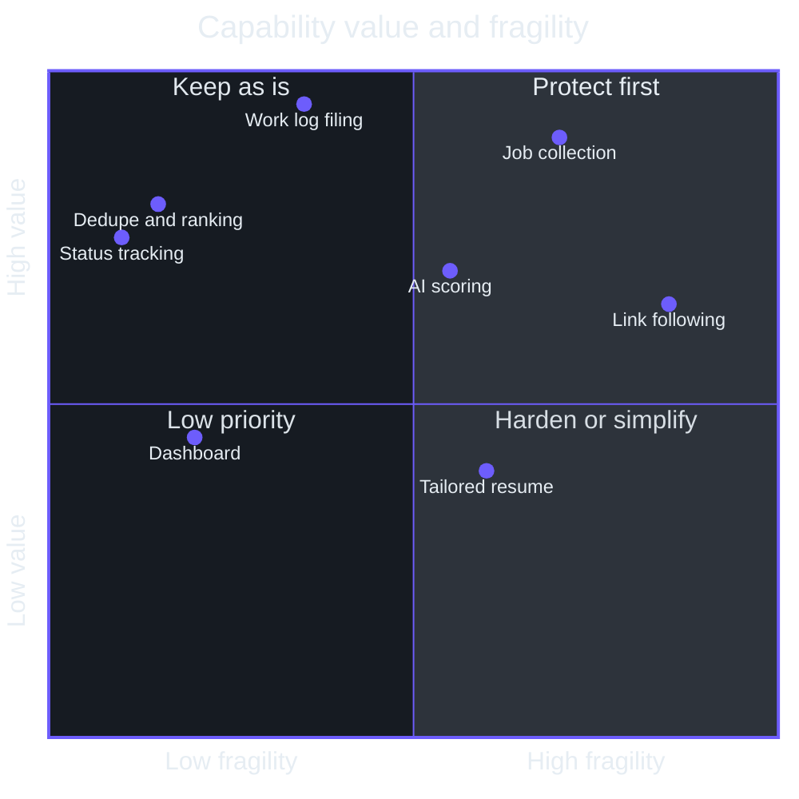
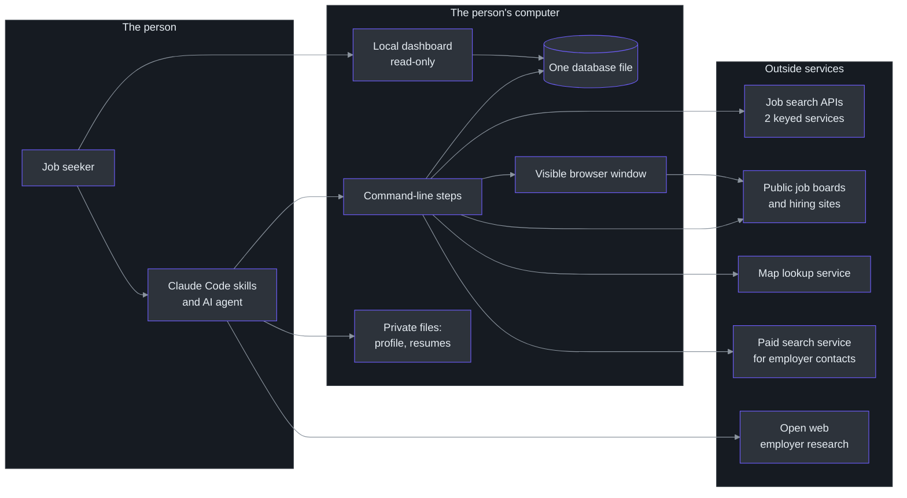
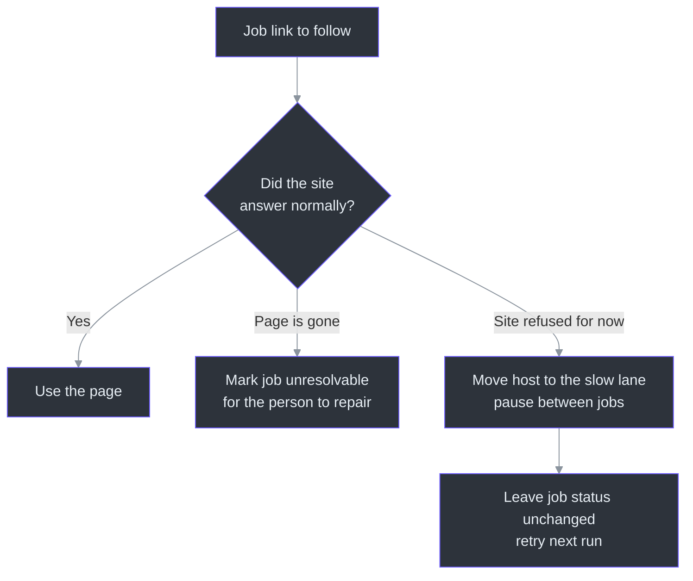
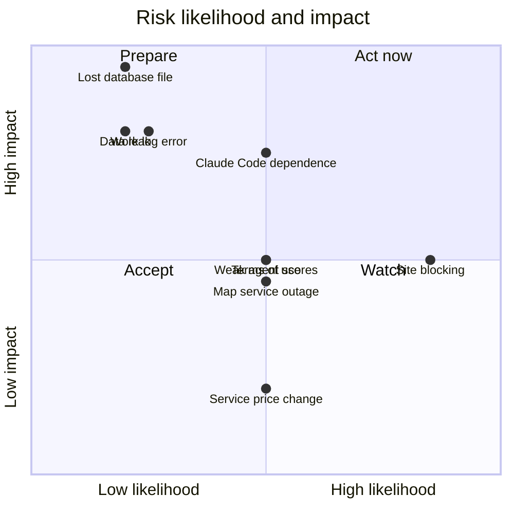
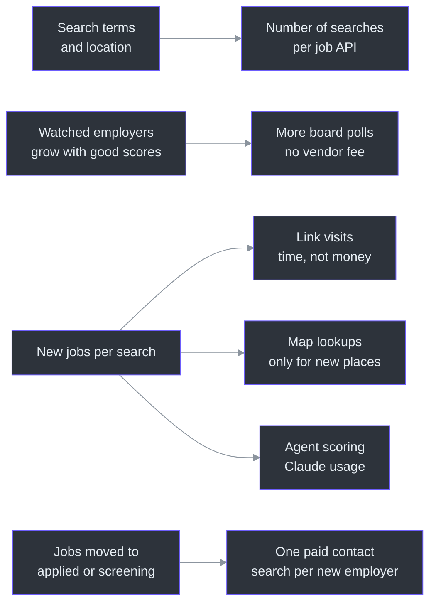

# Executive Guide

This guide is for someone who has to decide what to do with this tool. That might be its builder, deciding where the next weekend of work goes. It might be a friend who wants to run their own copy. It might be a person judging whether the tool is worth extending.

It is a personal tool. One person built it to run their own job search. There is no team, no on-call rotation, no customers and no service level. The guide keeps the usual executive sections, but each one is answered honestly for a team of one.

The guide uses no code. Where a claim needs proof, it links to the source file on GitHub.

## 1. System Overview

The tool finds job postings, ranks them, tracks applications, and files the weekly unemployment work log for the Texas Workforce Commission. It runs on one laptop. Claude Code skills drive it: the person types a short command, and an AI agent runs the steps and does the judging.

| Question | Answer | Source |
| --- | --- | --- |
| Who uses it? | One person: the builder. | [CLAUDE.md:3](https://github.com/mablahblah/job-assistant/blob/main/CLAUDE.md#L3) |
| What problem does it solve? | Checking many job sites by hand is slow and repetitive, and no single site surfaces the right roles well. | [docs/APP.md:9](https://github.com/mablahblah/job-assistant/blob/main/docs/APP.md#L9) |
| What is the business value? | Time saved, better job choices, and a legal record of search activity that is filed without manual bookkeeping. | [docs/APP.md:13](https://github.com/mablahblah/job-assistant/blob/main/docs/APP.md#L13) |
| Where does it run? | On the person's own computer. Nothing is hosted. | [lib/tools/web-server.ts:131](https://github.com/mablahblah/job-assistant/blob/main/lib/tools/web-server.ts#L131) |
| Who pays for it? | The person. The paid parts are small and are listed in the cost section. | [.env.example:13](https://github.com/mablahblah/job-assistant/blob/main/.env.example#L13) |

The stated goal is that the job search becomes "a short daily task, not a full-time job" ([docs/APP.md:13](https://github.com/mablahblah/job-assistant/blob/main/docs/APP.md#L13)). Real job searches already run on the current version of the tool ([CLAUDE.md:20](https://github.com/mablahblah/job-assistant/blob/main/CLAUDE.md#L20)).

### The one decision this guide supports

The question is not "does it work?" It works. The question is "what is the next hour of effort best spent on?" The honest options are:

| Option | What it means | When it is right |
| --- | --- | --- |
| Keep using it as is | Run searches, score, apply. Fix only what breaks. | The search is active and the tool already finds good jobs. |
| Invest further | Add job sources, harden the weak spots, add backups. | Too few good jobs surface, or the single points of failure worry you. |
| Hand it to someone else | Let another person run their own copy. | A friend is job hunting. Expect a half day of setup and some edits to personal files. |
| Retire it | Stop when the search ends. | The person is employed. The code and the history stay on disk. |

The recommendations section at the end picks among these.

## 2. Capability Map

The table shows what the tool can and cannot do today. "Built" means the step is coded, tested, and used on real searches. The statuses come from the code and the changelog, not from the README.

| Capability | Status | Maturity | Depends on | Source |
| --- | --- | --- | --- | --- |
| Collect jobs from 14 sources in one run | Built | High. 14 sources are registered. | Two paid or keyed job APIs, plus public job boards | [lib/collectors/registry.ts:19](https://github.com/mablahblah/job-assistant/blob/main/lib/collectors/registry.ts#L19) |
| Follow a job link back to the employer's own posting | Built | Medium. Some sites refuse automated visits. | A visible browser window | [lib/tools/resolution-browser.ts:23](https://github.com/mablahblah/job-assistant/blob/main/lib/tools/resolution-browser.ts#L23) |
| Read a posting for description, place, pay and dates | Built | High for 11 named hiring sites, medium for the general reader | None outside the posting page | [lib/parsers/registry.ts:37](https://github.com/mablahblah/job-assistant/blob/main/lib/parsers/registry.ts#L37) |
| Remove duplicate jobs across sources | Built | High | None | [docs/CHANGELOG.md:77](https://github.com/mablahblah/job-assistant/blob/main/docs/CHANGELOG.md#L77) |
| Decide whether a job is close enough, by real geography | Built | High | A map lookup service | [lib/tools/geocoder.ts:13](https://github.com/mablahblah/job-assistant/blob/main/lib/tools/geocoder.ts#L13) |
| Score each job and each employer with an AI agent | Built | Medium. The quality is the agent's judgement. | Claude Code, plus web access for employer research | [.claude/skills/score-backlog/SKILL.md:1](https://github.com/mablahblah/job-assistant/blob/main/.claude/skills/score-backlog/SKILL.md#L1) |
| Rank jobs by a weighted total | Built | High | Scores from the step above | [lib/utils/score-total.ts:83](https://github.com/mablahblah/job-assistant/blob/main/lib/utils/score-total.ts#L83) |
| Watch good employers directly on later searches | Built | Medium | Employer scores, three supported hiring-site boards | [docs/CHANGELOG.md:73](https://github.com/mablahblah/job-assistant/blob/main/docs/CHANGELOG.md#L73) |
| Track a job through twelve statuses | Built | High | None | [lib/utils/job-status.ts:24](https://github.com/mablahblah/job-assistant/blob/main/lib/utils/job-status.ts#L24) |
| File Texas work log entries | Built | High, with one paid lookup for contact details | A paid search service | [lib/utils/work-log-activity.ts:19](https://github.com/mablahblah/job-assistant/blob/main/lib/utils/work-log-activity.ts#L19) |
| Show everything in a local read-only dashboard | Built | Medium. Read-only by design. | None | [docs/architecture.md:65](https://github.com/mablahblah/job-assistant/blob/main/docs/architecture.md#L65) |
| Add a job found by hand from its link | Built | Medium | Claude Code reads the page | [.claude/skills/add-external-jobs/SKILL.md:23](https://github.com/mablahblah/job-assistant/blob/main/.claude/skills/add-external-jobs/SKILL.md#L23) |
| Write a tailored PDF resume for a job | Built | Medium. Depends on a second project on the same machine. | A separate portfolio project | [.claude/skills/generate-resume/SKILL.md:102](https://github.com/mablahblah/job-assistant/blob/main/.claude/skills/generate-resume/SKILL.md#L102) |
| Run automatically on a schedule | Not built | Not applicable. Every run is started by the person. | Not applicable | [docs/architecture.md:110](https://github.com/mablahblah/job-assistant/blob/main/docs/architecture.md#L110) |
| Edit data from the dashboard | Not built, by design | Not applicable | Not applicable | [docs/architecture.md:65](https://github.com/mablahblah/job-assistant/blob/main/docs/architecture.md#L65) |
| Serve more than one user | Not built | Not applicable. Personal files and one database file. | Not applicable | [.gitignore:12](https://github.com/mablahblah/job-assistant/blob/main/.gitignore#L12) |

### Capability coverage at a glance

<!-- Sources: lib/collectors/registry.ts:19, lib/tools/resolution-browser.ts:23, lib/utils/score-total.ts:83, lib/utils/job-status.ts:24, lib/utils/work-log-activity.ts:19, .claude/skills/generate-resume/SKILL.md:102 -->

The placement of each point is a judgement by the author of this guide, not a measurement. The reasoning is in the risk section: collection and link following depend on outside sites that can change or refuse access, so they are the most fragile. The work log is the most valuable because it is a legal filing.

## 3. Architecture at a Glance

The tool is a set of small programs on one computer. Each step reads its work from one database file and writes its result back. Because every step ends in a write, a run that stops partway keeps everything finished so far ([docs/CHANGELOG.md:67](https://github.com/mablahblah/job-assistant/blob/main/docs/CHANGELOG.md#L67)).

<!-- Sources: scripts/job-search.ts, lib/tools/web-server.ts:131, lib/tools/geocoder.ts:13, lib/tools/company-search.ts:42, lib/tools/resolution-browser.ts:23, docs/architecture.md:110-156, .gitignore:12-22 -->

### How a job search flows, in business terms

| Stage | What happens | Why it exists | Source |
| --- | --- | --- | --- |
| Clean up | Old jobs are marked expired. | An old posting wastes attention. | [docs/architecture.md:23](https://github.com/mablahblah/job-assistant/blob/main/docs/architecture.md#L23) |
| Collect | Jobs are pulled from 14 sources. | One list instead of many tabs. | [lib/collectors/registry.ts:19](https://github.com/mablahblah/job-assistant/blob/main/lib/collectors/registry.ts#L19) |
| Merge | Duplicates become one job. | The same job often appears on several sites. | [docs/CHANGELOG.md:77](https://github.com/mablahblah/job-assistant/blob/main/docs/CHANGELOG.md#L77) |
| Follow | The tool finds the employer's own posting. | Aggregator copies are often incomplete. | [docs/architecture.md:15](https://github.com/mablahblah/job-assistant/blob/main/docs/architecture.md#L15) |
| Read | The posting's details are extracted. | Pay, place and description drive the ranking. | [lib/parsers/registry.ts:37](https://github.com/mablahblah/job-assistant/blob/main/lib/parsers/registry.ts#L37) |
| Judge distance | Each job is tested against the person's location. | Jobs that are too far away are noise. | [docs/architecture.md:29](https://github.com/mablahblah/job-assistant/blob/main/docs/architecture.md#L29) |
| Score | An AI agent rates the job and the employer. | Ranking by fit, not by recency alone. | [.claude/skills/score-backlog/SKILL.md:6](https://github.com/mablahblah/job-assistant/blob/main/.claude/skills/score-backlog/SKILL.md#L6) |
| Show | The dashboard lists the best matches first. | The person decides what to apply to. | [lib/views/job-table.ts:223](https://github.com/mablahblah/job-assistant/blob/main/lib/views/job-table.ts#L223) |

Scoring is the only step that is not a plain command. An agent has to think, and a command cannot pause while an agent thinks, so scoring is split into a "gather" command and a "save" command with the agent in between ([docs/architecture.md:37](https://github.com/mablahblah/job-assistant/blob/main/docs/architecture.md#L37)).

## 4. Team Topology

There is one owner. The useful question for a team of one is "what happens if that person is unavailable?", so this section reports the bus factor honestly.

| Component | Owner | Criticality | Bus factor | Note |
| --- | --- | --- | --- | --- |
| Collectors and parsers | Builder | High | 1 | Each is written to fit one site. The rules for adding one are written down in the project rules. |
| The database and its commands | Builder | Critical | 1 | One file holds all history. See the risk section. |
| Scoring rules and profile | Builder | High | 1 | The public rules are tracked. The personal profile is private and kept off the repository. |
| Work log and status changes | Builder | Critical | 1 | A legal record. |
| Dashboard | Builder | Low | 1 | Read-only. A failure here loses no data. |
| Resume generation | Builder | Medium | 1 | Needs a second project that is not in this repository. |

A bus factor of 1 is normal for a personal tool. It matters only if someone else is meant to run the tool. The mitigation is documentation, and the repository has an unusually large amount: a written architecture file, path-scoped rules for each kind of file, and 235 test files ([docs/architecture.md:1](https://github.com/mablahblah/job-assistant/blob/main/docs/architecture.md#L1), [CLAUDE.md:51](https://github.com/mablahblah/job-assistant/blob/main/CLAUDE.md#L51)). The test file count comes from listing tracked files.

One more detail matters to a would-be adopter. Several planning folders are deliberately kept private and off the repository ([.gitignore:24](https://github.com/mablahblah/job-assistant/blob/main/.gitignore#L24)). A new owner would not inherit the builder's plans, backlog, or research.

## 5. Technology Investment Thesis

The thesis is: keep the code simple and deterministic, and use an AI agent only where judgement is needed. The names below are from the dependency list ([package.json:24](https://github.com/mablahblah/job-assistant/blob/main/package.json#L24)).

| Technology | Purpose | Alternatives considered | Risk level | Source |
| --- | --- | --- | --- | --- |
| TypeScript run directly, no build step | Fast edits, one language everywhere | A compiled build | Low | [CLAUDE.md:7](https://github.com/mablahblah/job-assistant/blob/main/CLAUDE.md#L7) |
| One SQLite database file | Zero setup, no server to run | A hosted database | Medium. One file, no replication. | [prisma/schema.prisma:8](https://github.com/mablahblah/job-assistant/blob/main/prisma/schema.prisma#L8) |
| Prisma with a libsql adapter | Typed access to the database | Raw queries | Low. A known quirk is documented. | [docs/APP.md:49](https://github.com/mablahblah/job-assistant/blob/main/docs/APP.md#L49) |
| Playwright browser automation | Follow links that need a real browser | Plain web requests | Medium. A visible window is required. | [lib/tools/resolution-browser.ts:19](https://github.com/mablahblah/job-assistant/blob/main/lib/tools/resolution-browser.ts#L19) |
| A page-reading library that needs no browser | Read saved pages quickly and test offline | Always use a browser | Low | [CLAUDE.md:10](https://github.com/mablahblah/job-assistant/blob/main/CLAUDE.md#L10) |
| Claude Code skills | Orchestrate steps and do judging | A scheduled script with a model API | Medium. Depends on one vendor's tool. | [.claude/skills/job-search/SKILL.md:1](https://github.com/mablahblah/job-assistant/blob/main/.claude/skills/job-search/SKILL.md#L1) |
| Server-rendered HTML dashboard | A simple local screen | A web app framework | Low | [CLAUDE.md:11](https://github.com/mablahblah/job-assistant/blob/main/CLAUDE.md#L11) |
| Vitest | Fast tests, including offline replays of site pages | Other test runners | Low | [package.json:21](https://github.com/mablahblah/job-assistant/blob/main/package.json#L21) |
| Apify client | Paid employer contact lookup | A different search API | Medium. Pay per use. | [lib/tools/company-search.ts:42](https://github.com/mablahblah/job-assistant/blob/main/lib/tools/company-search.ts#L42) |

### Why this thesis is sound for one person

| Principle | Effect | Source |
| --- | --- | --- |
| Knowledge about a job site is data, never code | Site rules can change without touching shared logic. | [CLAUDE.md:115](https://github.com/mablahblah/job-assistant/blob/main/CLAUDE.md#L115) |
| Only collectors and parsers are written for a particular site | A broken site breaks one file, not the whole tool. | [.claude/rules/part-ownership.md:3](https://github.com/mablahblah/job-assistant/blob/main/.claude/rules/part-ownership.md#L3) |
| Every step ends in a database write | A crash loses little. A rerun resumes. | [docs/CHANGELOG.md:67](https://github.com/mablahblah/job-assistant/blob/main/docs/CHANGELOG.md#L67) |
| No guard for a failure nobody has seen | Less code to maintain. Risks are written down instead. | [CLAUDE.md:111](https://github.com/mablahblah/job-assistant/blob/main/CLAUDE.md#L111) |
| The source ranking decides which copy of a fact wins | Better data beats more data, and the person can reorder it. | [prisma/schema.prisma:309](https://github.com/mablahblah/job-assistant/blob/main/prisma/schema.prisma#L309) |

The line numbers for the two working agreements in this table were read from the project instructions file. They are tied to the file at the time of writing and may shift.

### The investment so far

The changelog shows where effort went. Each entry is a version and a theme.

| Version | Theme | What it bought | Source |
| --- | --- | --- | --- |
| 0.1.0 | First dashboard and 7 sources | A usable list | [docs/CHANGELOG.md:125](https://github.com/mablahblah/job-assistant/blob/main/docs/CHANGELOG.md#L125) |
| 0.2.0 | Honest posting dates | Old jobs stop looking new | [docs/CHANGELOG.md:107](https://github.com/mablahblah/job-assistant/blob/main/docs/CHANGELOG.md#L107) |
| 0.3.0 | Tailored PDF resume | Faster applications | [docs/CHANGELOG.md:95](https://github.com/mablahblah/job-assistant/blob/main/docs/CHANGELOG.md#L95) |
| 1.0.0 | One command for a whole search, job history, watched employers | Reliability and learning | [docs/CHANGELOG.md:61](https://github.com/mablahblah/job-assistant/blob/main/docs/CHANGELOG.md#L61) |
| 1.1.0 to 1.3.0 | Readers for more hiring sites | Fewer jobs set aside unread | [docs/CHANGELOG.md:33](https://github.com/mablahblah/job-assistant/blob/main/docs/CHANGELOG.md#L33) |
| 1.4.0 | A reader for any website | 135 stuck jobs recovered | [docs/CHANGELOG.md:25](https://github.com/mablahblah/job-assistant/blob/main/docs/CHANGELOG.md#L25) |
| 1.5.0 | Add jobs found by hand | A way in for outside leads | [docs/CHANGELOG.md:13](https://github.com/mablahblah/job-assistant/blob/main/docs/CHANGELOG.md#L13) |
| 1.6.0 | Find a job by link or loose words | Resume and status commands are easier to use | [docs/CHANGELOG.md:5](https://github.com/mablahblah/job-assistant/blob/main/docs/CHANGELOG.md#L5) |

The pattern is clear. Early work added breadth. Later work removed jobs that were stuck unread. The latest work improves day-to-day use. That pattern suggests the tool is past its building phase and in its polishing phase.

## 6. Risk Assessment

Each risk is rated by the author of this guide. The ratings are judgement, not measurement. The evidence for each is cited. "Owner" is always the builder.

| # | Risk | Likelihood | Impact | Mitigation in place | Gap | Owner |
| --- | --- | --- | --- | --- | --- | --- |
| R1 | Job sites block or change under the scraper | High | Medium | Two lanes with a pause for sites that refuse. A refusal is retried next run. A general reader is the fallback. | Fast lane has no pacing of its own. | Builder |
| R2 | One database file is lost or damaged | Low | Critical | A dated backup is written before each schema change. | No automatic backup of the live file. No copy off the machine. | Builder |
| R3 | A work log entry is wrong or missing | Low | High | Entries are written before the slow lookups. They copy employer and title so later changes cannot alter them. | The contact details come from a search and can be wrong. They are flagged for a check. | Builder |
| R4 | Paid or keyed services change terms or price | Medium | Low | Each service is wrapped in one file. Missing keys give a clear message. | No spending alert. | Builder |
| R5 | The map service stops or throttles | Medium | Medium | A place that cannot be looked up is retried next run. Looked-up places are stored. | Jobs stay unjudged until it returns. | Builder |
| R6 | The AI agent scores poorly or inconsistently | Medium | Medium | Written rubrics. Scores carry a written reason. A guessed score is marked as a guess and expires sooner. | No second opinion, no audit of agreement. | Builder |
| R7 | Dependence on Claude Code | Medium | High | Every step is also a plain command. | The judging steps need an agent. | Builder |
| R8 | Private data leaves the repository by accident | Low | High | A strict ignore list covers databases, resumes, secrets, and personal planning files. | The list is a manual control. | Builder |
| R9 | Automated page visits break a site's terms of use | Medium | Medium | A blocked-site list. A pause for refusing sites. | No written terms review. See below. | Builder |
| R10 | The tool is abandoned when the search ends | High | Low | Everything is local and keeps working. | None needed. | Builder |

### R1. Job sites blocking the scraper

This is the most likely risk, and the code is open about it. Plain requests are turned away by sites that screen for automated traffic, so every request says it is a browser ([lib/tools/page-fetcher.ts:8](https://github.com/mablahblah/job-assistant/blob/main/lib/tools/page-fetcher.ts#L8)). The link-following step uses a visible browser window, because headless requests were refused and headed ones were not in the builder's measurements ([lib/tools/resolution-browser.ts:19](https://github.com/mablahblah/job-assistant/blob/main/lib/tools/resolution-browser.ts#L19)).

The cost of that choice is that the screen is held while a search runs. The settings explain it: a headed browser holds focus, so the machine is unusable for as long as it runs ([prisma/schema.prisma:322](https://github.com/mablahblah/job-assistant/blob/main/prisma/schema.prisma#L322)).

The tool also learned from a bad day. Before refusals were told apart from dead pages, one bad afternoon at one source took 100 of 334 jobs out of play for good ([docs/architecture.md:17](https://github.com/mablahblah/job-assistant/blob/main/docs/architecture.md#L17)). Now a refusal leaves the job alone so the next run tries again.

<!-- Sources: docs/architecture.md:17-19, prisma/schema.prisma:316-339, prisma/schema.prisma:531-535 -->

The slow-lane pause is set from a measurement. About 25 page visits per five minutes passed against one aggregator, and about 30 were refused, so the pause is twelve seconds ([prisma/schema.prisma:331](https://github.com/mablahblah/job-assistant/blob/main/prisma/schema.prisma#L331), [scripts/db-seed.ts:54](https://github.com/mablahblah/job-assistant/blob/main/scripts/db-seed.ts#L54)). The architecture file is plain about the limit: the two lanes cut the cost of a block but do not prevent one, because the fast lane has no pacing of its own ([docs/architecture.md:19](https://github.com/mablahblah/job-assistant/blob/main/docs/architecture.md#L19)).

A related control is a list of fourteen web addresses that a job is never worth following to. It holds paywalled aggregators and spam destinations ([lib/utils/blacklist.ts:5](https://github.com/mablahblah/job-assistant/blob/main/lib/utils/blacklist.ts#L5)). Note that the project's own principle says knowledge about a job site is data, not code ([CLAUDE.md:115](https://github.com/mablahblah/job-assistant/blob/main/CLAUDE.md#L115)). A list of sites written in a source file sits uneasily with that principle. This is an observation, and it is a small cleanup item rather than a risk.

### R2. A single SQLite file

All history lives in one file: jobs, employer scores, the trace of every job's path, and the work log. The ignore list keeps database files and their backups out of the repository on purpose, because they hold the real job search ([.gitignore:12](https://github.com/mablahblah/job-assistant/blob/main/.gitignore#L12)).

What protects it today:

| Control | Effect | Source |
| --- | --- | --- |
| A schema change writes a dated backup first | A bad migration can be undone | [CLAUDE.md:34](https://github.com/mablahblah/job-assistant/blob/main/CLAUDE.md#L34) |
| One command is the only way to change the schema | No hand edits | [CLAUDE.md:41](https://github.com/mablahblah/job-assistant/blob/main/CLAUDE.md#L41) |
| The rebuild command refuses to touch the real database | Protects against a typo | [CLAUDE.md:41](https://github.com/mablahblah/job-assistant/blob/main/CLAUDE.md#L41) |
| Every command checks the database matches the code | Catches a drifted schema before work is lost | [docs/architecture.md:11](https://github.com/mablahblah/job-assistant/blob/main/docs/architecture.md#L11) |
| Work log entries stand free of the jobs they describe | A deleted job cannot erase a filing | [prisma/schema.prisma:652](https://github.com/mablahblah/job-assistant/blob/main/prisma/schema.prisma#L652) |

What is missing, as far as the code and docs show: a scheduled backup of the live file, and any copy kept off the machine. This is an inference from the absence of such a step in the commands list ([CLAUDE.md:22](https://github.com/mablahblah/job-assistant/blob/main/CLAUDE.md#L22)). If the laptop's disk fails, the work log history goes with it. Because the work log is a legal record, this is the single most important gap.

### R3. The legal work log

The Texas Workforce Commission counts three activities: applied, phone screen, and interview ([lib/utils/job-status.ts:49](https://github.com/mablahblah/job-assistant/blob/main/lib/utils/job-status.ts#L49)). Moving a job to one of those statuses writes an entry with the Commission's own wording ([lib/utils/work-log-activity.ts:19](https://github.com/mablahblah/job-assistant/blob/main/lib/utils/work-log-activity.ts#L19)). The code comments call it "a legal filing that cannot be regenerated once the week it belongs to has passed" ([lib/utils/job-status.ts:55](https://github.com/mablahblah/job-assistant/blob/main/lib/utils/job-status.ts#L55)).

Design choices that protect it:

| Choice | Why it matters | Source |
| --- | --- | --- |
| The entry copies the employer name and job title | A later change to the job cannot alter what was filed. | [prisma/schema.prisma:665](https://github.com/mablahblah/job-assistant/blob/main/prisma/schema.prisma#L665) |
| No update path exists for an entry | An entry cannot be rewritten by accident. | [prisma/schema.prisma:656](https://github.com/mablahblah/job-assistant/blob/main/prisma/schema.prisma#L656) |
| Statuses and entries are written before any lookup | A run cut short loses a lookup, never a filing. | [docs/architecture.md:147](https://github.com/mablahblah/job-assistant/blob/main/docs/architecture.md#L147) |
| The lists of statuses live in one file | A typo cannot silently stop entries being written. | [lib/utils/job-status.ts:44](https://github.com/mablahblah/job-assistant/blob/main/lib/utils/job-status.ts#L44) |
| A job with no employer name stops and asks | A filing with a blank employer is worthless. | [docs/architecture.md:49](https://github.com/mablahblah/job-assistant/blob/main/docs/architecture.md#L49) |
| Doubtful contact details are flagged | The person checks them before filing. | [prisma/schema.prisma:200](https://github.com/mablahblah/job-assistant/blob/main/prisma/schema.prisma#L200) |

The remaining exposure is that the person is responsible for what is filed. The tool prepares entries. It does not submit anything to the state, as far as the code shows. Contact details come from a search and are best-effort. Anyone adopting this for their own claim should treat the work log as a draft record, and should check the rules of their own state, because the wording and the three activity types are specific to Texas.

### R4 to R10 in brief

| Risk | Evidence | Reading |
| --- | --- | --- |
| Keyed service changes | Missing keys return a plain message and the run continues. [lib/collectors/jsearch.ts:116](https://github.com/mablahblah/job-assistant/blob/main/lib/collectors/jsearch.ts#L116) | A lost key costs one source, not the run. |
| Map service throttling | A refusal stores nothing and is never retried in the same run. [lib/tools/geocoder.ts:5](https://github.com/mablahblah/job-assistant/blob/main/lib/tools/geocoder.ts#L5) | Jobs wait for the next run. |
| Agent quality | A guessed score is awarded a 3 by rule and marked as a guess. [prisma/schema.prisma:177](https://github.com/mablahblah/job-assistant/blob/main/prisma/schema.prisma#L177) | The guess is visible and expires sooner. |
| Claude Code dependence | The skill files say the pipeline command "runs the whole pipeline" on its own. [.claude/skills/job-search/SKILL.md:13](https://github.com/mablahblah/job-assistant/blob/main/.claude/skills/job-search/SKILL.md#L13) | Collection works without an agent. Scoring does not. |
| Data leak | The ignore list names databases, secrets, resumes, and planning files. [.gitignore:2](https://github.com/mablahblah/job-assistant/blob/main/.gitignore#L2) | Strong, but manual. |
| Site terms | Requests identify as a browser. [lib/tools/page-fetcher.ts:10](https://github.com/mablahblah/job-assistant/blob/main/lib/tools/page-fetcher.ts#L10) | The author has not found a terms review in the repository. For personal use at low volume the exposure is small, but it is not zero. |
| Abandonment | Everything runs locally. | No cost when idle. |

### Risk heat map

<!-- Sources: .gitignore:12-22, lib/tools/page-fetcher.ts:8-11, lib/tools/resolution-browser.ts:19-23, lib/tools/geocoder.ts:5-9, docs/architecture.md:17-19 -->

## 7. Cost and Scaling Model

Costs are small and mostly pay-per-use. Exact prices are not in the repository, so this section gives the shape of each cost and says where the number would have to come from. Where a limit comes from code, it is cited. Where it comes from the outside vendor, the guide says so.

### Services and who pays

| Service | Used for | How it is paid | Limit visible in code | Source |
| --- | --- | --- | --- | --- |
| Adzuna job API | Collecting jobs | Free key from the vendor. Terms are the vendor's. | Up to 50 results per search, one page, with a warning when more matched. | [lib/collectors/adzuna.ts:152](https://github.com/mablahblah/job-assistant/blob/main/lib/collectors/adzuna.ts#L152) |
| JSearch via RapidAPI | Collecting jobs | A RapidAPI subscription. Plan size is the vendor's. | Always two searches per run, three pages each, jobs from the past week. | [lib/collectors/jsearch.ts:131](https://github.com/mablahblah/job-assistant/blob/main/lib/collectors/jsearch.ts#L131) |
| Geocode.maps.co | Turning place names into coordinates | A free tier, one request per second, per the template note. | One lookup every 1.1 seconds, held by the tool itself. | [lib/tools/geocoder.ts:16](https://github.com/mablahblah/job-assistant/blob/main/lib/tools/geocoder.ts#L16) |
| Apify search actor | Finding an employer's address, phone and website | Pay per use on the person's Apify account. | One search per employer, 60 second limit, one employer is never searched twice once filled in. | [lib/tools/company-search.ts:30](https://github.com/mablahblah/job-assistant/blob/main/lib/tools/company-search.ts#L30) |
| Public job boards and hiring sites | Collecting and reading postings | Free. Subject to each site's terms. | A 15 second timeout per request. | [lib/utils/fetch-utils.ts:1](https://github.com/mablahblah/job-assistant/blob/main/lib/utils/fetch-utils.ts#L1) |
| Claude Code | Running skills, scoring jobs, researching employers, resumes | The person's Claude subscription or usage | One helper per employer. Ten jobs per helper. | [.claude/skills/score-backlog/SKILL.md:42](https://github.com/mablahblah/job-assistant/blob/main/.claude/skills/score-backlog/SKILL.md#L42) |

### What drives cost

<!-- Sources: lib/collectors/adzuna.ts:141-180, lib/collectors/jsearch.ts:131-153, lib/tools/geocoder.ts:16, docs/architecture.md:35, docs/architecture.md:51, .claude/skills/score-backlog/SKILL.md:42-71 -->

### Cost drivers in plain terms

| Driver | Behaviour | Scales with | Source |
| --- | --- | --- | --- |
| Adzuna calls | Two searches for each search term: one nationwide for remote work, one near the person. | Number of search terms times two | [lib/collectors/adzuna.ts:141](https://github.com/mablahblah/job-assistant/blob/main/lib/collectors/adzuna.ts#L141) |
| JSearch calls | All search terms are joined into one query, so the count stays at two searches. | Fixed per run | [lib/collectors/jsearch.ts:127](https://github.com/mablahblah/job-assistant/blob/main/lib/collectors/jsearch.ts#L127) |
| Map lookups | A place is looked up once and stored. In the builder's data, 3,975 lookups resolved to 789 distinct places. | New places only | [docs/architecture.md:35](https://github.com/mablahblah/job-assistant/blob/main/docs/architecture.md#L35) |
| Contact searches | Run when a job reaches a status that files a log entry, and never repeated for a completed employer. | New employers the person engages with | [docs/architecture.md:51](https://github.com/mablahblah/job-assistant/blob/main/docs/architecture.md#L51) |
| Agent work | One helper per employer, plus one helper per ten jobs that carry a description. Jobs with no description get a helper each. | Unscored backlog size | [.claude/skills/score-backlog/SKILL.md:69](https://github.com/mablahblah/job-assistant/blob/main/.claude/skills/score-backlog/SKILL.md#L69) |
| Employer scores age out | A researched score expires after a number of days. A guessed one expires sooner. | Time, so research repeats | [prisma/schema.prisma:349](https://github.com/mablahblah/job-assistant/blob/main/prisma/schema.prisma#L349) |

The Adzuna count of calls per search term is read directly from the loop in the collector. The guide does not state a dollar figure because no price is in the repository.

Two cost controls are worth naming. First, a minimum pay floor is asked of Adzuna in the request, so its one page is not spent on jobs that would be dropped ([lib/collectors/adzuna.ts:12](https://github.com/mablahblah/job-assistant/blob/main/lib/collectors/adzuna.ts#L12)). Second, an expired job stops before any paid map request is spent on it ([docs/architecture.md:29](https://github.com/mablahblah/job-assistant/blob/main/docs/architecture.md#L29)).

### Scaling limits and when to invest

| Dimension | Today | First limit | Trigger for investment |
| --- | --- | --- | --- |
| Users | One | The personal profile, personal settings, and one database file are all single-person. | A second person wants to use it. |
| Jobs stored | Hundreds to low thousands, inferred from the trace counts in the docs | SQLite handles far more. | Not near a limit. |
| Sources | 14 | Each new site adds one collector, one reader, and a registry entry plus a seed run. | A source is missing that matters. |
| Run time | Minutes. The browser holds the screen. | Link visits are paced per site. | Searches start to feel too slow. |
| Job API depth | One page from Adzuna, three pages from JSearch | Postings beyond the page are not seen. | The warning about unseen postings becomes common. |
| Machine | A laptop | A visible browser needs a screen. | Wanting unattended runs. |

The last row matters most for the future. A scheduled, unattended run is blocked by two facts: the browser must be visible, and scoring needs an agent in the loop. Both are design choices rather than defects, but together they set the ceiling on automation.

## 8. Dependency Map

```mermaid
graph TB
    TOOL["Job search assistant<br>on one laptop"]
    subgraph Services["Outside services"]
        A1["Adzuna"]
        A2["JSearch via RapidAPI"]
        A3["Geocode.maps.co"]
        A4["Apify search actor"]
    end
    subgraph Sites["Outside websites"]
        S1["Hiring site boards<br>Greenhouse, Lever, Ashby,<br>Workday, and others"]
        S2["Design job boards<br>Dribbble, UIUX Jobs Board"]
        S3["Employer career pages"]
    end
    subgraph Platform["Platforms"]
        P1["Claude Code and the AI agent"]
        P2["Local operating system<br>and browser engine"]
        P3["A portfolio project<br>used for resumes"]
    end
    TOOL --> A1
    TOOL --> A2
    TOOL --> A3
    TOOL --> A4
    TOOL --> S1
    TOOL --> S2
    TOOL --> S3
    TOOL --> P1
    TOOL --> P2
    TOOL --> P3
    classDef box fill:#2d333b,stroke:#6d5dfc,color:#e6edf3
    class TOOL,A1,A2,A3,A4,S1,S2,S3,P1,P2,P3 box
    style Services fill:#161b22,stroke:#30363d,color:#e6edf3
    style Sites fill:#161b22,stroke:#30363d,color:#e6edf3
    style Platform fill:#161b22,stroke:#30363d,color:#e6edf3
    linkStyle default stroke:#8b949e
```

<!-- Sources: lib/collectors/registry.ts:19-34, lib/tools/geocoder.ts:13, lib/tools/company-search.ts:42, lib/collectors/dribbble.ts:18, lib/collectors/uiuxjobsboard.ts:18, lib/collectors/greenhouse.ts:20, .claude/skills/generate-resume/SKILL.md:102 -->

| Dependency | Type | Risk if unavailable | Fallback | Source |
| --- | --- | --- | --- | --- |
| Adzuna | Service | Fewer jobs from aggregators. The run continues and reports an error line. | The other 13 sources | [lib/collectors/adzuna.ts:125](https://github.com/mablahblah/job-assistant/blob/main/lib/collectors/adzuna.ts#L125) |
| JSearch | Service | Same as above. | The other 13 sources | [lib/collectors/jsearch.ts:116](https://github.com/mablahblah/job-assistant/blob/main/lib/collectors/jsearch.ts#L116) |
| Hiring site boards | Public website | A site that sends a broken reply is skipped and named in warnings. | Other boards and aggregators | [docs/CHANGELOG.md:43](https://github.com/mablahblah/job-assistant/blob/main/docs/CHANGELOG.md#L43) |
| Design job boards | Public website | Fewer design-specific jobs. | Aggregators | [lib/collectors/dribbble.ts:18](https://github.com/mablahblah/job-assistant/blob/main/lib/collectors/dribbble.ts#L18) |
| Geocode.maps.co | Service | Jobs cannot be judged on distance. They stay in the backlog, marked unjudged. | Retry next run | [lib/tools/geocoder.ts:127](https://github.com/mablahblah/job-assistant/blob/main/lib/tools/geocoder.ts#L127) |
| Apify search actor | Service | Contact details are not filled in. The work log entry itself is still written. | The person fills them in by hand | [docs/architecture.md:51](https://github.com/mablahblah/job-assistant/blob/main/docs/architecture.md#L51) |
| Claude Code | Platform | No scoring, no skills. Plain commands still collect and show jobs. | None for scoring | [.claude/skills/job-search/SKILL.md:46](https://github.com/mablahblah/job-assistant/blob/main/.claude/skills/job-search/SKILL.md#L46) |
| Browser engine | Library | Link following stops. | Pages that need no browser still read | [lib/tools/rendered-page-fetcher.ts:14](https://github.com/mablahblah/job-assistant/blob/main/lib/tools/rendered-page-fetcher.ts#L14) |
| Portfolio project | Separate project on the same machine | Tailored resumes cannot be made. | Write the resume by hand | [.claude/skills/generate-resume/SKILL.md:102](https://github.com/mablahblah/job-assistant/blob/main/.claude/skills/generate-resume/SKILL.md#L102) |
| SQLite file | Local file | Everything is lost without a copy. | A dated backup before schema changes | [CLAUDE.md:34](https://github.com/mablahblah/job-assistant/blob/main/CLAUDE.md#L34) |

The resume dependency deserves a flag for anyone adopting the tool. The resume skill reads a separate project at a fixed place under the user's projects folder. A new owner would need that project too, or would have to rewrite the resume step.

## 9. Key Metrics and Observability

The tool does not have dashboards for operations or alerts. It has something more useful for a personal tool: a record of every job's path through the pipeline, which can answer questions after the fact.

| Metric or signal | What it answers | Where it comes from | Source |
| --- | --- | --- | --- |
| Run summary | How many jobs each step handled, per source and per reason | Read back from the trace rows after each run | [docs/architecture.md:57](https://github.com/mablahblah/job-assistant/blob/main/docs/architecture.md#L57) |
| Errors and warnings list | Which source failed or degraded | Printed first in every run's output | [.claude/skills/job-search/SKILL.md:29](https://github.com/mablahblah/job-assistant/blob/main/.claude/skills/job-search/SKILL.md#L29) |
| Job trace | What happened to every job, and why it was dropped | One row per event | [prisma/schema.prisma:618](https://github.com/mablahblah/job-assistant/blob/main/prisma/schema.prisma#L618) |
| Unjudged marker | Which jobs could not be fully checked | Shown in the dashboard | [docs/CHANGELOG.md:59](https://github.com/mablahblah/job-assistant/blob/main/docs/CHANGELOG.md#L59) |
| Source yield | Which sources produce jobs the person applies to | Answerable from the trace | [docs/CHANGELOG.md:71](https://github.com/mablahblah/job-assistant/blob/main/docs/CHANGELOG.md#L71) |
| Exit status | Whether a run stopped early | Non-zero exit | [.claude/skills/job-search/SKILL.md:58](https://github.com/mablahblah/job-assistant/blob/main/.claude/skills/job-search/SKILL.md#L58) |

There are no target values, because no service level is defined. The table below proposes what would be useful targets. These are suggestions from the author of this guide, not existing commitments.

| Proposed target | Why |
| --- | --- |
| Zero work log entries lost | It is a legal record. |
| A copy of the database less than a week old, off the machine | Closes the biggest gap. |
| Fewer than a set share of jobs left unjudged after a run | Shows source health. |
| Share of applications that came from each source | Tells where to invest in collectors. |

The dashboard is deliberately read-only and records nothing about being viewed, so glances at the backlog never distort the counts ([docs/architecture.md:65](https://github.com/mablahblah/job-assistant/blob/main/docs/architecture.md#L65)). It listens only on the local machine at a default port ([scripts/serve.ts:20](https://github.com/mablahblah/job-assistant/blob/main/scripts/serve.ts#L20), [lib/tools/web-server.ts:132](https://github.com/mablahblah/job-assistant/blob/main/lib/tools/web-server.ts#L132)). The address printed is a localhost address. Whether the server is reachable from other machines on a network depends on how the port is bound, which this guide did not verify.

## 10. Roadmap Alignment

The product-planning folders are private and are not read for this guide. What can be said comes from the public changelog, the project instructions, and the architecture file. The project instructions say the unified pipeline rebuild is complete, with phases 1 through 12 done ([docs/architecture.md:9](https://github.com/mablahblah/job-assistant/blob/main/docs/architecture.md#L9)).

<!-- Sources: docs/architecture.md:9, docs/CHANGELOG.md:5-95, .env.example:25-35, docs/APP.md:44 -->

| Workstream | Business priority it serves | State | Blocked by | Source |
| --- | --- | --- | --- | --- |
| Find more of the right jobs | Faster path to an offer | Continuous | Sites that refuse automated visits | [docs/CHANGELOG.md:25](https://github.com/mablahblah/job-assistant/blob/main/docs/CHANGELOG.md#L25) |
| Keep the legal record safe | Compliance | Built. Backup gap open. | Nothing external | [prisma/schema.prisma:652](https://github.com/mablahblah/job-assistant/blob/main/prisma/schema.prisma#L652) |
| Make applying faster | Time per application | Resume and status skills built | The separate portfolio project | [docs/CHANGELOG.md:95](https://github.com/mablahblah/job-assistant/blob/main/docs/CHANGELOG.md#L95) |
| Smarter aggregator handling | Better data from aggregator links | Listed as planned in the app overview, which is dated | Unknown | [docs/APP.md:44](https://github.com/mablahblah/job-assistant/blob/main/docs/APP.md#L44) |

The last row is the app overview's own text. That file is older than the changelog, so the "planned" label may be out of date. The resolution step in the current architecture already does much of what that line describes.

## 11. Technical Debt Summary

The top items, by business impact. Effort is a rough size: small is under a day, medium is a few days, large is a week or more. These sizes are estimates by the author of this guide.

| # | Issue | Business impact | Effort to fix | Priority | Source |
| --- | --- | --- | --- | --- | --- |
| 1 | No automatic backup or off-machine copy of the database | A disk failure loses the work log and all history. | Small | High | [.gitignore:12](https://github.com/mablahblah/job-assistant/blob/main/.gitignore#L12) |
| 2 | Stale documentation. The architecture file says seven collectors and four parsers, but the registries list 14 and 11. | A new owner is misled. | Small | High | [docs/architecture.md:13](https://github.com/mablahblah/job-assistant/blob/main/docs/architecture.md#L13), [lib/collectors/registry.ts:19](https://github.com/mablahblah/job-assistant/blob/main/lib/collectors/registry.ts#L19) |
| 3 | Machine-specific and person-specific assumptions: a fixed path to a second project, and a name pattern in resume file names | The tool cannot be handed to another person without edits. | Medium | Medium | [.claude/skills/generate-resume/SKILL.md:102](https://github.com/mablahblah/job-assistant/blob/main/.claude/skills/generate-resume/SKILL.md#L102) |
| 4 | The fast lane for link following has no pacing | More refused visits on a bad day. | Medium | Medium | [docs/architecture.md:19](https://github.com/mablahblah/job-assistant/blob/main/docs/architecture.md#L19) |
| 5 | An old database path kept in the settings template only for a one-time migration | Confusion. | Small | Low | [.env.example:11](https://github.com/mablahblah/job-assistant/blob/main/.env.example#L11) |
| 6 | A list of blocked sites written in code, against the project's own principle | A small inconsistency. | Small | Low | [lib/utils/blacklist.ts:5](https://github.com/mablahblah/job-assistant/blob/main/lib/utils/blacklist.ts#L5) |
| 7 | A pay target and salary steps fixed in code | Changing them means editing code. | Small | Low | [lib/utils/score-total.ts:27](https://github.com/mablahblah/job-assistant/blob/main/lib/utils/score-total.ts#L27) |
| 8 | The Adzuna pay floor is a constant, with a note that it moves to settings when a second source needs it | Same as above. | Small | Low | [lib/collectors/adzuna.ts:22](https://github.com/mablahblah/job-assistant/blob/main/lib/collectors/adzuna.ts#L22) |

Item 3 mentions a resume file name pattern. The pattern includes the builder's name. The guide does not repeat it.

The code itself is in good health relative to its age. It has a written rule for where each kind of behaviour goes, a naming rule, and a test next to nearly every file ([CLAUDE.md:51](https://github.com/mablahblah/job-assistant/blob/main/CLAUDE.md#L51)). That lowers the cost of every item above.

## 12. Recommendations

Five recommendations for the next stretch of effort, in order of impact. They assume the person is still searching. If the search has ended, recommendation 1 still applies, because the work log history may be needed later.

| # | Recommendation | Why | Effort | Expected result |
| --- | --- | --- | --- | --- |
| 1 | Add a backup routine for the database file, with one copy off the machine | The work log is a legal record and the database is a single file. | Small | The largest risk drops from critical to low. |
| 2 | Refresh the architecture file | It describes a system that no longer exists. | Small | Anyone reading the repository sees the real tool. |
| 3 | Decide whether to hand the tool to another person | The answer sets whether the remaining items matter. | Decision | If no, skip recommendations 4 and 5. If yes, do them. |
| 4 | Make personal assumptions into settings | Path to the resume project, resume file naming, pay target, and location should be set once, not edited in code. | Medium | A second person can run it in a half day. |
| 5 | Measure source yield before adding any new source | The trace already records where jobs come from and what happened to them. | Small | New collectors are added where they pay off, not where they are easy. |

### Decision guide

| If this is true | Then |
| --- | --- |
| The search is active and the tool is finding good jobs | Do recommendation 1 now and stop. The rest can wait. |
| Good jobs are being missed | Do recommendation 5 first. Add sources only where the trace shows a gap. |
| A friend wants to use it | Do recommendations 2, 3 and 4. Expect the work log rules to need a state-specific rewrite if they are outside Texas. |
| The search is over | Take a final backup of the database, keep the work log history, and stop. |

### What not to do

| Temptation | Why to resist |
| --- | --- |
| Add a scheduler for unattended runs | The visible browser and the agent-in-the-loop scoring make it brittle. The gain is small for one person. |
| Add editing to the dashboard | The read-only design is deliberate. It keeps views from distorting counts. |
| Add guards for failures nobody has seen | The project's own rule says to write the risk down instead. |
| Add a new source for one example job | The project's own rule says to build broadly, not for the case in front of you. |

Both rules in the last two rows are in the project instructions ([CLAUDE.md:111](https://github.com/mablahblah/job-assistant/blob/main/CLAUDE.md#L111)).

## Related Pages

| Page | Why read it |
| --- | --- |
| [Product Manager Guide](./product-manager-guide.md) | The same tool described from the user's side, with journeys and privacy. |
| [Staff Engineer Guide](./staff-engineer-guide.md) | The reasons behind the design choices. |
| [Contributor Guide](./contributor-guide.md) | How to set up and change the code. |
| [Overview](../getting-started/overview.md) | A short introduction. |
| [System Design](../deep-dive/architecture/system-design.md) | The architecture in depth. |
| [Job Search Run](../deep-dive/architecture/job-search-run.md) | One run, step by step. |
| [Collection](../deep-dive/pipeline/collection.md) | The 14 sources and how they are polled. |
| [Resolution](../deep-dive/pipeline/resolution.md) | Link following and the two lanes. |
| [Status Change and Work Log](../deep-dive/agent-workflows/status-change-and-work-log.md) | How the legal record is written. |
| [Data Model](../deep-dive/data/data-model.md) | What the database holds. |
| [Database Commands](../deep-dive/data/database-commands.md) | Migration and backup behaviour. |
| [Project Rules](../deep-dive/quality/project-rules.md) | The working agreements behind the thesis. |

## References

| Reference | Used for |
| --- | --- |
| [CLAUDE.md](https://github.com/mablahblah/job-assistant/blob/main/CLAUDE.md) | Purpose, stack, commands, and working agreements |
| [docs/architecture.md](https://github.com/mablahblah/job-assistant/blob/main/docs/architecture.md) | The system as built. Partly stale on counts of collectors and parsers. |
| [docs/CHANGELOG.md](https://github.com/mablahblah/job-assistant/blob/main/docs/CHANGELOG.md) | The history of what was built and why |
| [docs/APP.md](https://github.com/mablahblah/job-assistant/blob/main/docs/APP.md) | Original brief and goals |
| [prisma/schema.prisma](https://github.com/mablahblah/job-assistant/blob/main/prisma/schema.prisma) | What is stored and the settings that tune the pipeline |
| [.env.example](https://github.com/mablahblah/job-assistant/blob/main/.env.example) | Which outside services need keys |
| [.gitignore](https://github.com/mablahblah/job-assistant/blob/main/.gitignore) | What stays private |
| [lib/collectors/registry.ts](https://github.com/mablahblah/job-assistant/blob/main/lib/collectors/registry.ts) | The 14 job sources |
| [lib/parsers/registry.ts](https://github.com/mablahblah/job-assistant/blob/main/lib/parsers/registry.ts) | The posting readers |
| [lib/tools/geocoder.ts](https://github.com/mablahblah/job-assistant/blob/main/lib/tools/geocoder.ts) | The map service limits |
| [lib/tools/company-search.ts](https://github.com/mablahblah/job-assistant/blob/main/lib/tools/company-search.ts) | The paid employer search |
| [lib/collectors/jsearch.ts](https://github.com/mablahblah/job-assistant/blob/main/lib/collectors/jsearch.ts) | The JSearch limits |
| [lib/collectors/adzuna.ts](https://github.com/mablahblah/job-assistant/blob/main/lib/collectors/adzuna.ts) | The Adzuna limits |
| [lib/utils/job-status.ts](https://github.com/mablahblah/job-assistant/blob/main/lib/utils/job-status.ts) | Statuses and work log triggers |
| [lib/utils/score-total.ts](https://github.com/mablahblah/job-assistant/blob/main/lib/utils/score-total.ts) | How jobs are ranked |
| [.claude/skills/](https://github.com/mablahblah/job-assistant/tree/main/.claude/skills) | The skills that drive the tool |
