# Product Manager Guide

This guide explains the job search assistant from the point of view of the person using it. It says what the tool does, what each task feels like, where the tool stops, and what happens to the person's information.

The tool is personal. One person built it to run their own job search. There is no sign-up, no team account and no support desk. When this guide says "the user", it means that one person, or a friend who sets up their own copy.

Plain words are used throughout. Where a word has a special meaning inside the tool, the glossary near the end explains it. Each claim links to the file that backs it, so a curious reader can check.

## 1. What This System Does

The assistant looks for jobs so the user does not have to. It checks many job sites, removes repeats, throws out jobs that are too old or too far away, and ranks what is left by how well each job fits. It also keeps track of the jobs the user applies to, and it prepares the weekly record that unemployment benefits in Texas ask for.

The user starts each task by typing a short command to an AI helper called Claude Code. The helper runs the steps, does the judging that needs thought, and reports back. A simple web page on the user's own computer shows the results.

| What the user wants | What the assistant does | Source |
| --- | --- | --- |
| Find new jobs | Checks 14 sources and builds one list | [lib/collectors/registry.ts:19](https://github.com/mablahblah/job-assistant/blob/main/lib/collectors/registry.ts#L19) |
| Know which jobs are worth the time | Rates each job and each employer, then ranks them | [lib/utils/score-total.ts:83](https://github.com/mablahblah/job-assistant/blob/main/lib/utils/score-total.ts#L83) |
| Keep track of applications | Moves each job through twelve stages | [lib/utils/job-status.ts:24](https://github.com/mablahblah/job-assistant/blob/main/lib/utils/job-status.ts#L24) |
| Report job search activity to Texas | Writes an entry whenever a job reaches a stage that counts | [lib/utils/job-status.ts:49](https://github.com/mablahblah/job-assistant/blob/main/lib/utils/job-status.ts#L49) |
| Add a lead found elsewhere | Reads a pasted link and treats it like any other job | [.claude/skills/add-external-jobs/SKILL.md:23](https://github.com/mablahblah/job-assistant/blob/main/.claude/skills/add-external-jobs/SKILL.md#L23) |
| Apply with a matching resume | Picks the best resume pieces for one job and makes a PDF | [.claude/skills/generate-resume/SKILL.md:126](https://github.com/mablahblah/job-assistant/blob/main/.claude/skills/generate-resume/SKILL.md#L126) |

## 2. User Journey Map

The user does six main things. Each has its own journey below. The first diagram shows how they fit together over a typical week.

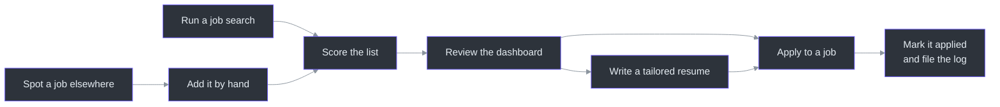

<!-- Sources: .claude/skills/job-search/SKILL.md:46-54, .claude/skills/add-external-jobs/SKILL.md:68-72, .claude/skills/change-status/SKILL.md:58-71, .claude/skills/generate-resume/SKILL.md:32-66 -->

### Journey 1. Run a job search

The user asks the helper to run a search. The helper tells the user a browser window will open and hold the screen for a while ([.claude/skills/job-search/SKILL.md:21](https://github.com/mablahblah/job-assistant/blob/main/.claude/skills/job-search/SKILL.md#L21)). When the search ends, the helper shows a summary and offers the dashboard.

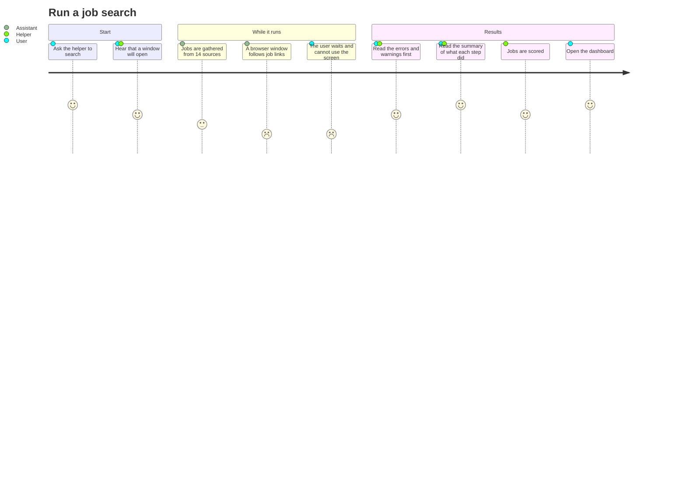

<!-- Sources: .claude/skills/job-search/SKILL.md:11-54, lib/collectors/registry.ts:19, lib/tools/resolution-browser.ts:19-23 -->

| Step | What the user sees | What is happening | Source |
| --- | --- | --- | --- |
| 1 | The helper warns about a browser window | The tool uses a real window because sites turned away hidden ones. | [lib/tools/resolution-browser.ts:19](https://github.com/mablahblah/job-assistant/blob/main/lib/tools/resolution-browser.ts#L19) |
| 2 | Progress lines scroll by | Old jobs are cleared, new ones are gathered, repeats are merged. | [docs/architecture.md:110](https://github.com/mablahblah/job-assistant/blob/main/docs/architecture.md#L110) |
| 3 | A run label appears first | Every record from this search carries the label, so results can be traced later. | [.claude/skills/job-search/SKILL.md:29](https://github.com/mablahblah/job-assistant/blob/main/.claude/skills/job-search/SKILL.md#L29) |
| 4 | A list of errors and warnings | A source that failed or worked only partly is named. The search keeps going. | [.claude/skills/job-search/SKILL.md:30](https://github.com/mablahblah/job-assistant/blob/main/.claude/skills/job-search/SKILL.md#L30) |
| 5 | A summary block, shown exactly as printed | A count of what each step did. | [.claude/skills/job-search/SKILL.md:42](https://github.com/mablahblah/job-assistant/blob/main/.claude/skills/job-search/SKILL.md#L42) |
| 6 | Scoring starts straight away | See the next journey. | [.claude/skills/job-search/SKILL.md:48](https://github.com/mablahblah/job-assistant/blob/main/.claude/skills/job-search/SKILL.md#L48) |
| 7 | The address of the dashboard | The results are ready to read. | [.claude/skills/job-search/SKILL.md:53](https://github.com/mablahblah/job-assistant/blob/main/.claude/skills/job-search/SKILL.md#L53) |

What the search does in between, in the order it does it:

| Stage | Plain description |
| --- | --- |
| Clean up | Jobs that have gone stale are marked expired. |
| Gather | Jobs are collected from every source. |
| Tidy | Job titles and employer names are put in one consistent form. |
| Merge | The same job found twice becomes one job. |
| Follow | The assistant opens each link to reach the employer's own posting. |
| Read | It reads the posting for the description, the place, the pay and the dates. |
| Check distance | It decides whether the job is close enough, or open to the user's area for remote work. |
| Save | At every stage, the results are saved. |

Because each stage saves, a search that stops halfway keeps what it finished. Running it again picks up where it stopped ([docs/CHANGELOG.md:67](https://github.com/mablahblah/job-assistant/blob/main/docs/CHANGELOG.md#L67)).

If the search stops early, the helper must say so plainly, name the place and the reason, and say that earlier steps did save their work ([.claude/skills/job-search/SKILL.md:40](https://github.com/mablahblah/job-assistant/blob/main/.claude/skills/job-search/SKILL.md#L40)).

If nothing new is found, the helper says "No new jobs found" and moves on to scoring anyway, because earlier searches may have left jobs unscored ([.claude/skills/job-search/SKILL.md:44](https://github.com/mablahblah/job-assistant/blob/main/.claude/skills/job-search/SKILL.md#L44)).

### Journey 2. Score the list

Scoring is where the AI helper does the thinking. It reads each job and each employer and gives ratings. This runs automatically after a search, and the user can also ask for it alone.

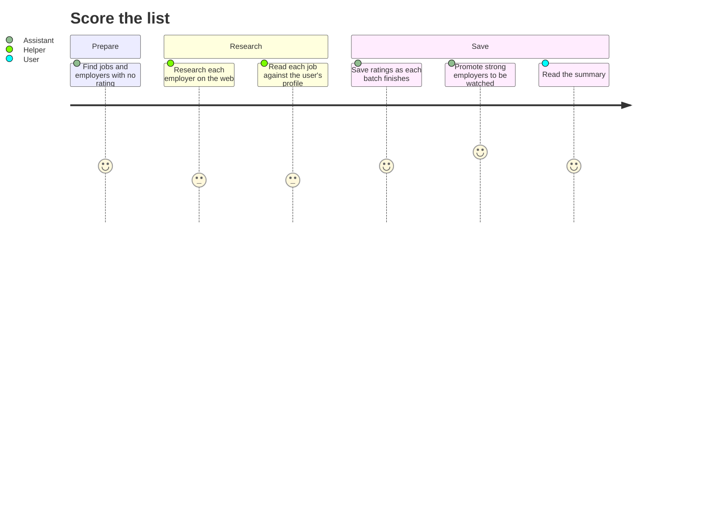

<!-- Sources: .claude/skills/score-backlog/SKILL.md:17-126, docs/architecture.md:37-43 -->

| Step | What happens | Source |
| --- | --- | --- |
| Gather | The assistant lists every job with no fit rating, and every employer missing a rating. | [.claude/skills/score-backlog/SKILL.md:28](https://github.com/mablahblah/job-assistant/blob/main/.claude/skills/score-backlog/SKILL.md#L28) |
| Nothing to score | If both lists are empty, the helper says "Nothing to score" and stops. | [.claude/skills/score-backlog/SKILL.md:37](https://github.com/mablahblah/job-assistant/blob/main/.claude/skills/score-backlog/SKILL.md#L37) |
| Employers | One helper per employer researches it on the web and rates it. | [.claude/skills/score-backlog/SKILL.md:42](https://github.com/mablahblah/job-assistant/blob/main/.claude/skills/score-backlog/SKILL.md#L42) |
| Jobs | Jobs are rated ten at a time. A job with no saved description gets its own helper, which opens the posting first. | [.claude/skills/score-backlog/SKILL.md:69](https://github.com/mablahblah/job-assistant/blob/main/.claude/skills/score-backlog/SKILL.md#L69) |
| Save | Ratings are saved after each batch. A stop halfway keeps the research already paid for. | [.claude/skills/score-backlog/SKILL.md:111](https://github.com/mablahblah/job-assistant/blob/main/.claude/skills/score-backlog/SKILL.md#L111) |
| Report | The helper shows the warnings, then the summary, unchanged. | [.claude/skills/score-backlog/SKILL.md:123](https://github.com/mablahblah/job-assistant/blob/main/.claude/skills/score-backlog/SKILL.md#L123) |

#### What the ratings mean

Each employer is rated from 1 to 5 on four things: how happy its employees are, how happy its customers are, work-life balance, and a fourth called political alignment ([docs/architecture.md:96](https://github.com/mablahblah/job-assistant/blob/main/docs/architecture.md#L96)). Each job gets one fit rating from 1 to 5 with a short written reason.

When the helper finds nothing public about an employer, the rules give it a 3. That is a guess, and the tool marks it as a guess so it is not mistaken for research. A guessed rating also expires sooner ([prisma/schema.prisma:177](https://github.com/mablahblah/job-assistant/blob/main/prisma/schema.prisma#L177)).

The ranking number is a weighted total.

| Part | Most it can add | Source |
| --- | --- | --- |
| Job fit | 40 | [lib/utils/score-total.ts:11](https://github.com/mablahblah/job-assistant/blob/main/lib/utils/score-total.ts#L11) |
| Employee happiness | 25 | [lib/utils/score-total.ts:12](https://github.com/mablahblah/job-assistant/blob/main/lib/utils/score-total.ts#L12) |
| Work-life balance | 25 | [lib/utils/score-total.ts:14](https://github.com/mablahblah/job-assistant/blob/main/lib/utils/score-total.ts#L14) |
| Political alignment | 25 | [lib/utils/score-total.ts:15](https://github.com/mablahblah/job-assistant/blob/main/lib/utils/score-total.ts#L15) |
| Customer happiness | 10 | [lib/utils/score-total.ts:13](https://github.com/mablahblah/job-assistant/blob/main/lib/utils/score-total.ts#L13) |

The total can be adjusted up or down by two things.

| Adjustment | Effect | Source |
| --- | --- | --- |
| Freshness | A job posted today gets a 20 percent boost. It stays level for three days. After that it loses 5 percent a day until it reaches half, and it stops there, because an old posting that is still open is still a real opening. | [lib/utils/score-total.ts:42](https://github.com/mablahblah/job-assistant/blob/main/lib/utils/score-total.ts#L42) |
| Pay | Pay near a target the user has set leaves the total alone. Pay above it lifts the total. Pay below it lowers it. Unknown pay changes nothing. | [lib/utils/score-total.ts:54](https://github.com/mablahblah/job-assistant/blob/main/lib/utils/score-total.ts#L54) |

A rating that has not been given yet counts as the middle of the scale. That keeps new jobs from sinking beneath jobs the helper has already reached ([lib/utils/score-total.ts:21](https://github.com/mablahblah/job-assistant/blob/main/lib/utils/score-total.ts#L21)).

Freshness uses the date a job was first posted. The date of its latest edit is not used, because an edit does not mean the role just opened ([lib/utils/score-total.ts:39](https://github.com/mablahblah/job-assistant/blob/main/lib/utils/score-total.ts#L39)).

#### Employers that earn extra attention

An employer whose four ratings average above a set bar gets watched directly from then on. Its job board is checked on every later search, so its jobs reach the user first-hand ([docs/architecture.md:43](https://github.com/mablahblah/job-assistant/blob/main/docs/architecture.md#L43), [scripts/db-seed.ts:60](https://github.com/mablahblah/job-assistant/blob/main/scripts/db-seed.ts#L60)). The list is empty at first. An employer earns a place only by being rated well ([docs/CHANGELOG.md:75](https://github.com/mablahblah/job-assistant/blob/main/docs/CHANGELOG.md#L75)).

Only some hiring sites can be watched this way. The architecture notes say three, but the changelog later adds Workday, UltiPro and five more hiring sites whose boards are watched ([docs/architecture.md:43](https://github.com/mablahblah/job-assistant/blob/main/docs/architecture.md#L43), [docs/CHANGELOG.md:35](https://github.com/mablahblah/job-assistant/blob/main/docs/CHANGELOG.md#L35)). The architecture notes are out of date here, so the larger number is the better guide.

### Journey 3. Review the dashboard

The dashboard is a web page that opens on the user's own computer. It shows four lists on one page, and a small control switches between them ([docs/architecture.md:65](https://github.com/mablahblah/job-assistant/blob/main/docs/architecture.md#L65)).

| List | What it holds | How it is sorted | Source |
| --- | --- | --- | --- |
| Backlog | New jobs the user has not decided on | Highest total first | [lib/views/job-table.ts:223](https://github.com/mablahblah/job-assistant/blob/main/lib/views/job-table.ts#L223) |
| Applied | Jobs the user has applied to and not been rejected from | Most recently changed first | [lib/utils/job-status.ts:8](https://github.com/mablahblah/job-assistant/blob/main/lib/utils/job-status.ts#L8) |
| Ruled out | Jobs removed by the tool or the user | Most recently changed first | [lib/utils/job-status.ts:67](https://github.com/mablahblah/job-assistant/blob/main/lib/utils/job-status.ts#L67) |
| Work log | Every recorded search activity, grouped by week | Newest first | [docs/architecture.md:106](https://github.com/mablahblah/job-assistant/blob/main/docs/architecture.md#L106) |

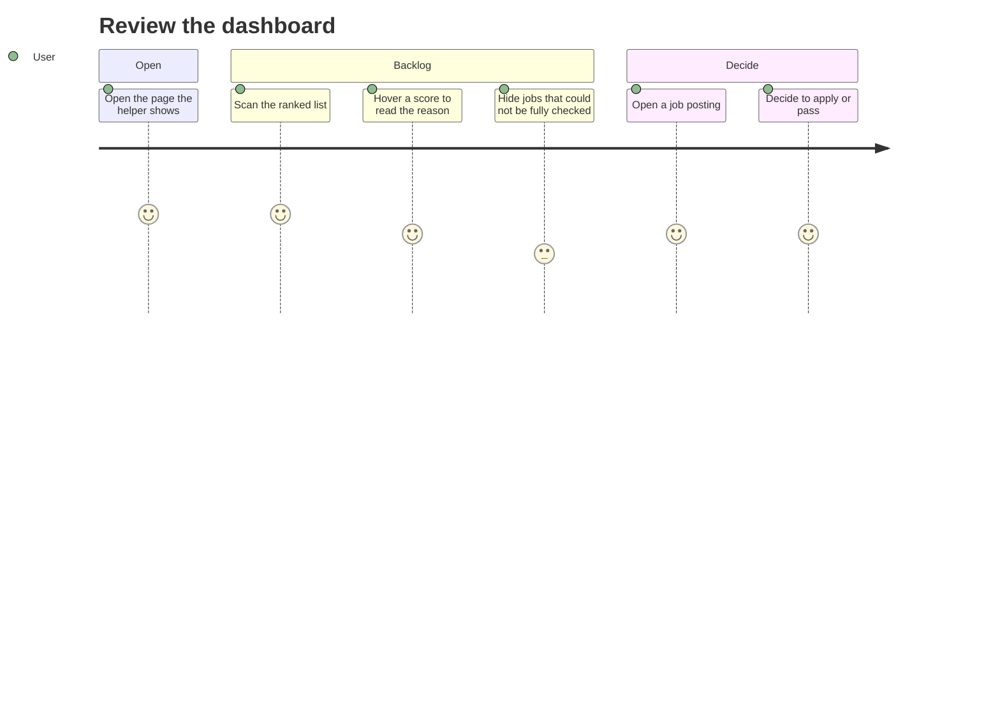

<!-- Sources: lib/views/job-table.ts:223-241, docs/architecture.md:65-71, docs/CHANGELOG.md:59-93 -->

What the user can see and do:

| Feature | Behaviour | Source |
| --- | --- | --- |
| Hover a score | The written reason for the job's rating appears. | [docs/CHANGELOG.md:88](https://github.com/mablahblah/job-assistant/blob/main/docs/CHANGELOG.md#L88) |
| Warning marker on unjudged jobs | A job the tool could not follow, read or place shows a marker where its score would be. Pointing at it names what is missing. | [docs/CHANGELOG.md:59](https://github.com/mablahblah/job-assistant/blob/main/docs/CHANGELOG.md#L59) |
| Switch to hide unjudged jobs | It counts them and remembers the choice for next time. | [docs/CHANGELOG.md:59](https://github.com/mablahblah/job-assistant/blob/main/docs/CHANGELOG.md#L59) |
| Two dates | The page shows when a job was first posted and when it was posted again, with reposts marked. | [docs/CHANGELOG.md:90](https://github.com/mablahblah/job-assistant/blob/main/docs/CHANGELOG.md#L90) |
| Total hidden after applying | Once a job is applied to or ruled out, the total no longer helps, so it is hidden. The ratings stay. | [docs/CHANGELOG.md:89](https://github.com/mablahblah/job-assistant/blob/main/docs/CHANGELOG.md#L89) |
| Work log by week | Weeks run Sunday to Saturday. A week with nothing filed still appears and says so. | [docs/architecture.md:106](https://github.com/mablahblah/job-assistant/blob/main/docs/architecture.md#L106) |

The dashboard cannot change anything. It only shows. To change a job, the user goes back to the helper. This is on purpose, so that looking at the page never alters records ([docs/architecture.md:65](https://github.com/mablahblah/job-assistant/blob/main/docs/architecture.md#L65)).

If the saved data and the tool are out of step, the page refuses to start and names the problem instead. A blank page would look exactly like an empty list, and that would mislead ([docs/architecture.md:67](https://github.com/mablahblah/job-assistant/blob/main/docs/architecture.md#L67)).

#### The twelve stages of a job

| Stage | Meaning | Who sets it | Source |
| --- | --- | --- | --- |
| backlog | New and undecided | The tool | [lib/utils/job-status.ts:25](https://github.com/mablahblah/job-assistant/blob/main/lib/utils/job-status.ts#L25) |
| expired | Posted too long ago, or the posting is gone | The tool | [lib/utils/job-status.ts:26](https://github.com/mablahblah/job-assistant/blob/main/lib/utils/job-status.ts#L26) |
| too far | Too far away to work | The tool | [lib/utils/job-status.ts:27](https://github.com/mablahblah/job-assistant/blob/main/lib/utils/job-status.ts#L27) |
| won't apply | The user decided to pass | The user | [lib/utils/job-status.ts:28](https://github.com/mablahblah/job-assistant/blob/main/lib/utils/job-status.ts#L28) |
| unresolvable | The tool could not follow the job's link to the employer | The tool | [lib/utils/job-status.ts:29](https://github.com/mablahblah/job-assistant/blob/main/lib/utils/job-status.ts#L29) |
| unparseable | The tool could not read the posting, or it names no place | The tool | [lib/utils/job-status.ts:30](https://github.com/mablahblah/job-assistant/blob/main/lib/utils/job-status.ts#L30) |
| rejected | The employer said no | The user | [lib/utils/job-status.ts:31](https://github.com/mablahblah/job-assistant/blob/main/lib/utils/job-status.ts#L31) |
| app. sent | The user has applied | The user | [lib/utils/job-status.ts:32](https://github.com/mablahblah/job-assistant/blob/main/lib/utils/job-status.ts#L32) |
| screening | A phone screen is under way or done | The user | [lib/utils/job-status.ts:33](https://github.com/mablahblah/job-assistant/blob/main/lib/utils/job-status.ts#L33) |
| interview | An interview is under way or done | The user | [lib/utils/job-status.ts:34](https://github.com/mablahblah/job-assistant/blob/main/lib/utils/job-status.ts#L34) |
| test | A skills test or assignment | The user | [lib/utils/job-status.ts:35](https://github.com/mablahblah/job-assistant/blob/main/lib/utils/job-status.ts#L35) |
| offer | An offer was made | The user | [lib/utils/job-status.ts:36](https://github.com/mablahblah/job-assistant/blob/main/lib/utils/job-status.ts#L36) |

The meanings of "test" and "offer" are inferred from their names. The code only lists them. The rule on who sets a status comes from the project rules: each step sets only the status that names its own result, and a change by hand sets the status the user chose ([.claude/rules/part-ownership.md](https://github.com/mablahblah/job-assistant/blob/main/.claude/rules/part-ownership.md)).

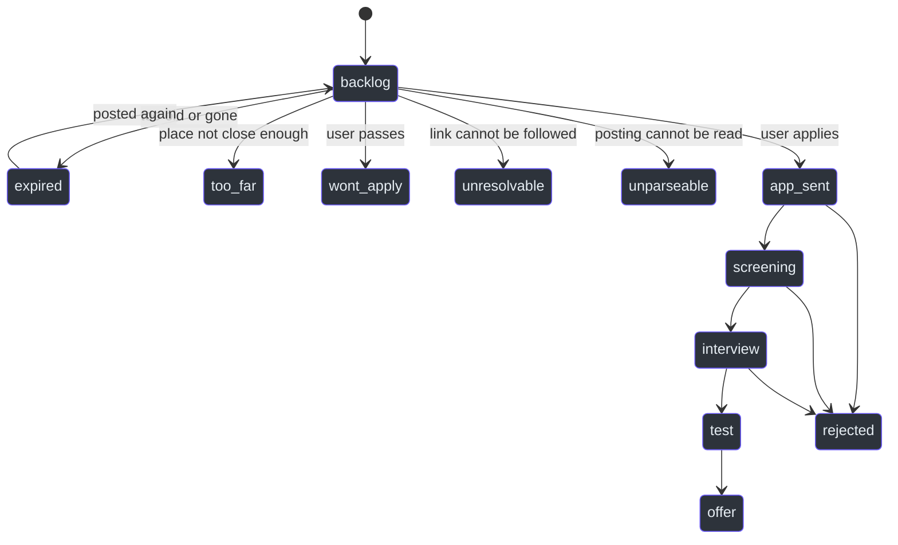

<!-- Sources: lib/utils/job-status.ts:8-14, lib/utils/job-status.ts:24-37, lib/utils/job-status.ts:67-74, docs/architecture.md:27 -->

The arrows show the common paths. The user can set any of the twelve stages by hand, so the picture is a guide, not a rule. A job posted again can return to the backlog ([docs/architecture.md:27](https://github.com/mablahblah/job-assistant/blob/main/docs/architecture.md#L27)).

A job in an applied stage is protected. Later searches cannot overwrite it, and repeat-removal never deletes it ([lib/utils/job-status.ts:1](https://github.com/mablahblah/job-assistant/blob/main/lib/utils/job-status.ts#L1)).

### Journey 4. Mark a job applied and file the work log

When the user applies, they tell the helper in plain words. They can paste the job's link, or give the employer and a rough role. The helper finds the job, moves it to the new stage, and files the work log entry if the stage counts.

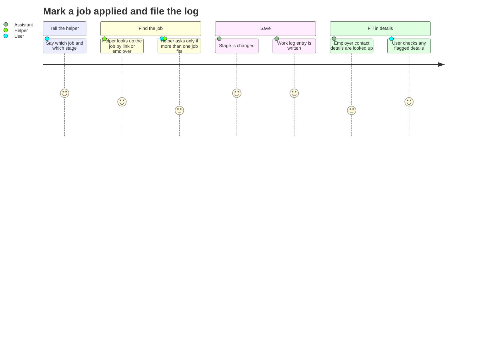

<!-- Sources: .claude/skills/change-status/SKILL.md:22-84, docs/architecture.md:45-51, lib/utils/work-log-activity.ts:19-21 -->

| Step | What happens | Source |
| --- | --- | --- |
| 1 | The user describes the move. Example in the skill: a link followed by "app. sent", or an employer and role followed by "rejected". | [.claude/skills/change-status/SKILL.md:8](https://github.com/mablahblah/job-assistant/blob/main/.claude/skills/change-status/SKILL.md#L8) |
| 2 | The helper checks the stage name against the twelve. An unknown name stops the request. | [.claude/skills/change-status/SKILL.md:25](https://github.com/mablahblah/job-assistant/blob/main/.claude/skills/change-status/SKILL.md#L25) |
| 3 | The helper finds the job. It tries the link first, then the employer. | [.claude/skills/change-status/SKILL.md:31](https://github.com/mablahblah/job-assistant/blob/main/.claude/skills/change-status/SKILL.md#L31) |
| 4 | If exactly one job matched, the helper does not ask which one. | [.claude/skills/change-status/SKILL.md:17](https://github.com/mablahblah/job-assistant/blob/main/.claude/skills/change-status/SKILL.md#L17) |
| 5 | If none match, it asks whether to search every stage before widening. | [.claude/skills/change-status/SKILL.md:52](https://github.com/mablahblah/job-assistant/blob/main/.claude/skills/change-status/SKILL.md#L52) |
| 6 | The stage is saved. A work log entry is written when the stage counts. | [.claude/skills/change-status/SKILL.md:58](https://github.com/mablahblah/job-assistant/blob/main/.claude/skills/change-status/SKILL.md#L58) |
| 7 | If the job has no employer name on file, the helper asks for one before changing it. | [.claude/skills/change-status/SKILL.md:72](https://github.com/mablahblah/job-assistant/blob/main/.claude/skills/change-status/SKILL.md#L72) |
| 8 | The helper shows which jobs had an entry written. | [.claude/skills/change-status/SKILL.md:84](https://github.com/mablahblah/job-assistant/blob/main/.claude/skills/change-status/SKILL.md#L84) |

The helper does not search every stage by default. It narrows by the move being made. Moving a job to "applied" looks only in the backlog. Moving it to "rejected" or a later stage looks only among jobs already applied to. That keeps the user from choosing between a new job and one closed months ago ([docs/architecture.md:53](https://github.com/mablahblah/job-assistant/blob/main/docs/architecture.md#L53)).

#### Which stages file a work log entry

| Stage | Files an entry? | Wording used in the entry | Source |
| --- | --- | --- | --- |
| app. sent | Yes | Applied for job | [lib/utils/work-log-activity.ts:19](https://github.com/mablahblah/job-assistant/blob/main/lib/utils/work-log-activity.ts#L19) |
| screening | Yes | Had phone screen | [lib/utils/work-log-activity.ts:20](https://github.com/mablahblah/job-assistant/blob/main/lib/utils/work-log-activity.ts#L20) |
| interview | Yes | Had interview | [lib/utils/work-log-activity.ts:21](https://github.com/mablahblah/job-assistant/blob/main/lib/utils/work-log-activity.ts#L21) |
| test | No | None | [lib/utils/job-status.ts:46](https://github.com/mablahblah/job-assistant/blob/main/lib/utils/job-status.ts#L46) |
| offer | No | None | [lib/utils/job-status.ts:46](https://github.com/mablahblah/job-assistant/blob/main/lib/utils/job-status.ts#L46) |
| All others | No | None | [lib/utils/job-status.ts:49](https://github.com/mablahblah/job-assistant/blob/main/lib/utils/job-status.ts#L49) |

The wording is fixed on purpose. The form rejects wording it does not recognise ([docs/architecture.md:100](https://github.com/mablahblah/job-assistant/blob/main/docs/architecture.md#L100)).

The employer's address, phone and website are stored with the employer, not inside each entry ([prisma/schema.prisma:187](https://github.com/mablahblah/job-assistant/blob/main/prisma/schema.prisma#L187)). They are found by a paid web search the first time one of that employer's jobs reaches a stage that files an entry. If a detail looks doubtful, the tool flags it so the user checks it before filing ([docs/architecture.md:51](https://github.com/mablahblah/job-assistant/blob/main/docs/architecture.md#L51)).

Two safety rules matter to the user:

| Rule | Why it matters | Source |
| --- | --- | --- |
| Entries are written before the slow search starts | If the command is cut short, a search is lost, but never a filing. | [docs/architecture.md:147](https://github.com/mablahblah/job-assistant/blob/main/docs/architecture.md#L147) |
| Entries survive the job being deleted | The record is a legal filing and cannot be recreated once its week has passed. | [prisma/schema.prisma:652](https://github.com/mablahblah/job-assistant/blob/main/prisma/schema.prisma#L652) |

The tool prepares the record. As far as the code shows, it does not send anything to the state. The user still fills in the weekly form. That is an inference from the absence of any such step.

### Journey 5. Add a job found by hand

Sometimes the user finds a job outside a search: on a friend's message, a social post, or a company page. The user pastes one link or a list.

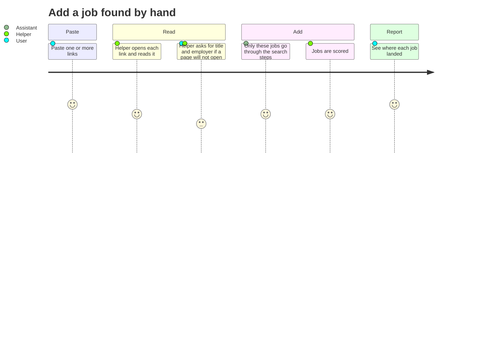

<!-- Sources: .claude/skills/add-external-jobs/SKILL.md:23-94, docs/CHANGELOG.md:13-19 -->

| Step | What happens | Source |
| --- | --- | --- |
| 1 | If no link was given, the helper says so and stops. | [.claude/skills/add-external-jobs/SKILL.md:25](https://github.com/mablahblah/job-assistant/blob/main/.claude/skills/add-external-jobs/SKILL.md#L25) |
| 2 | The helper reads each page for the job title, the employer, and the description. | [.claude/skills/add-external-jobs/SKILL.md:26](https://github.com/mablahblah/job-assistant/blob/main/.claude/skills/add-external-jobs/SKILL.md#L26) |
| 3 | A page that will not open, or opens on a sign-in wall or a bot check, is set aside. | [.claude/skills/add-external-jobs/SKILL.md:30](https://github.com/mablahblah/job-assistant/blob/main/.claude/skills/add-external-jobs/SKILL.md#L30) |
| 4 | The helper asks the user for the title and employer, one link at a time. It never guesses. | [.claude/skills/add-external-jobs/SKILL.md:16](https://github.com/mablahblah/job-assistant/blob/main/.claude/skills/add-external-jobs/SKILL.md#L16) |
| 5 | The helper warns that a browser window may open. | [.claude/skills/add-external-jobs/SKILL.md:44](https://github.com/mablahblah/job-assistant/blob/main/.claude/skills/add-external-jobs/SKILL.md#L44) |
| 6 | The jobs go through the same steps as a search. No other job is touched. | [docs/CHANGELOG.md:19](https://github.com/mablahblah/job-assistant/blob/main/docs/CHANGELOG.md#L19) |
| 7 | The helper scores the backlog, then reports. | [.claude/skills/add-external-jobs/SKILL.md:68](https://github.com/mablahblah/job-assistant/blob/main/.claude/skills/add-external-jobs/SKILL.md#L68) |

The final report has a fixed shape. It lists what was added, which jobs were added and scored, which were not added and why, and any warnings ([.claude/skills/add-external-jobs/SKILL.md:78](https://github.com/mablahblah/job-assistant/blob/main/.claude/skills/add-external-jobs/SKILL.md#L78)).

Three behaviours are worth knowing:

| Behaviour | Detail | Source |
| --- | --- | --- |
| A job the steps cannot fully judge still gets in | If its page names no place, or the place is not on a map, it reaches the backlog and is scored. The report says why it could not be judged for certain. | [docs/CHANGELOG.md:19](https://github.com/mablahblah/job-assistant/blob/main/docs/CHANGELOG.md#L19) |
| A link for a job the tool ruled out earlier is judged again | A job the user rejected or applied to keeps its stage. | [lib/utils/job-status.ts:81](https://github.com/mablahblah/job-assistant/blob/main/lib/utils/job-status.ts#L81) |
| Some jobs are left out | A link that fails for good, a job that is too far, or a dead posting is left out, with its reason. | [docs/CHANGELOG.md:19](https://github.com/mablahblah/job-assistant/blob/main/docs/CHANGELOG.md#L19) |

A job added by hand has the strongest standing when two sources disagree about a fact. The user's own entry is placed at the top of the source ranking and wins every contested field ([prisma/schema.prisma:304](https://github.com/mablahblah/job-assistant/blob/main/prisma/schema.prisma#L304)).

### Journey 6. Write a tailored resume

The user picks a job, and the helper builds a one-job resume from pieces the user has already approved. The helper does not write or change any resume wording. It only chooses which pieces to show ([.claude/skills/generate-resume/SKILL.md:26](https://github.com/mablahblah/job-assistant/blob/main/.claude/skills/generate-resume/SKILL.md#L26)).

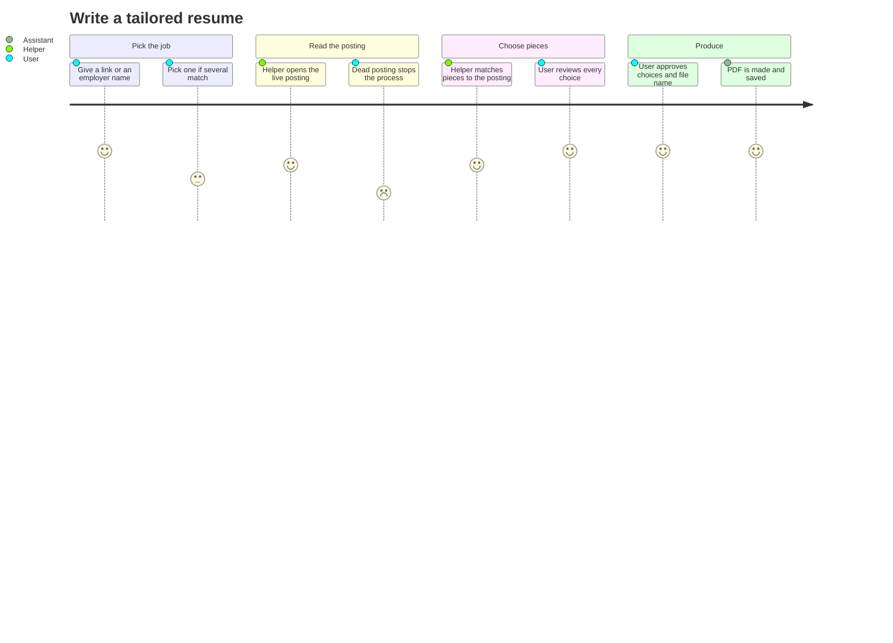

<!-- Sources: .claude/skills/generate-resume/SKILL.md:32-199, docs/CHANGELOG.md:99-101 -->

| Step | What happens | Source |
| --- | --- | --- |
| Find the job | By link first. Otherwise by employer. Role words such as "sr pd" help the helper pick between an employer's jobs. | [.claude/skills/generate-resume/SKILL.md:34](https://github.com/mablahblah/job-assistant/blob/main/.claude/skills/generate-resume/SKILL.md#L34) |
| Read the posting | The helper opens the live page and waits for it to finish loading. | [.claude/skills/generate-resume/SKILL.md:66](https://github.com/mablahblah/job-assistant/blob/main/.claude/skills/generate-resume/SKILL.md#L66) |
| If the page is dead | The helper asks the user to check. A confirmed dead posting ends the process, and the job's stage is left alone. | [.claude/skills/generate-resume/SKILL.md:90](https://github.com/mablahblah/job-assistant/blob/main/.claude/skills/generate-resume/SKILL.md#L90) |
| If the tool failed to open it | That is a fault of the tool, not of the job. The helper offers to retry or to use pasted page text. | [.claude/skills/generate-resume/SKILL.md:79](https://github.com/mablahblah/job-assistant/blob/main/.claude/skills/generate-resume/SKILL.md#L79) |
| Read the user's resume pieces | Titles, a summary opener, skills, tools and achievements. | [.claude/skills/generate-resume/SKILL.md:110](https://github.com/mablahblah/job-assistant/blob/main/.claude/skills/generate-resume/SKILL.md#L110) |
| Match | One title, one opener, three strengths ranked by importance, one achievement, a limited set of skills, tools and work lines. | [.claude/skills/generate-resume/SKILL.md:126](https://github.com/mablahblah/job-assistant/blob/main/.claude/skills/generate-resume/SKILL.md#L126) |
| Show everything | Every piece is shown, chosen and rejected alike, each chosen piece with a reason. | [.claude/skills/generate-resume/SKILL.md:133](https://github.com/mablahblah/job-assistant/blob/main/.claude/skills/generate-resume/SKILL.md#L133) |
| Approve | The user approves both the choices and the file name before anything is made. | [.claude/skills/generate-resume/SKILL.md:27](https://github.com/mablahblah/job-assistant/blob/main/.claude/skills/generate-resume/SKILL.md#L27) |
| Produce | A PDF is made that employer screening software can read, and saved in a private folder in the project. | [.claude/skills/generate-resume/SKILL.md:159](https://github.com/mablahblah/job-assistant/blob/main/.claude/skills/generate-resume/SKILL.md#L159) |

The resume pieces live in a separate project on the same computer, not in this tool ([.claude/skills/generate-resume/SKILL.md:102](https://github.com/mablahblah/job-assistant/blob/main/.claude/skills/generate-resume/SKILL.md#L102)). A friend who adopts the tool would need to supply their own.

The file name follows a fixed pattern: person, company, a short form of the role, and the year. The pattern is in the skill file. It is not repeated here, because it contains the builder's name ([.claude/skills/generate-resume/SKILL.md:150](https://github.com/mablahblah/job-assistant/blob/main/.claude/skills/generate-resume/SKILL.md#L150)).

## 3. Feature Capability Map

Status words:

| Word | Meaning |
| --- | --- |
| Live | Built and in use. |
| Partial | Works, with a known gap. |
| Not possible | Not built, or not allowed by design. |

| Feature | Status | What the user experiences | Limits | Source |
| --- | --- | --- | --- | --- |
| Run a full search with one command | Live | One request, then a summary | Holds the screen while it runs | [.claude/skills/job-search/SKILL.md:13](https://github.com/mablahblah/job-assistant/blob/main/.claude/skills/job-search/SKILL.md#L13) |
| 14 job sources | Live | One merged list | A source can be blocked or change without notice | [lib/collectors/registry.ts:19](https://github.com/mablahblah/job-assistant/blob/main/lib/collectors/registry.ts#L19) |
| Reads postings on 11 named hiring sites plus any other site | Live | Description, place, pay and dates filled in | The general reader may miss details | [lib/parsers/registry.ts:37](https://github.com/mablahblah/job-assistant/blob/main/lib/parsers/registry.ts#L37) |
| Removes repeats | Live | One entry per real job | Two postings with very different wording may remain separate | [docs/CHANGELOG.md:77](https://github.com/mablahblah/job-assistant/blob/main/docs/CHANGELOG.md#L77) |
| Distance check by real map | Live | A job open to the user's area counts, even for remote roles | Depends on a map service | [docs/CHANGELOG.md:81](https://github.com/mablahblah/job-assistant/blob/main/docs/CHANGELOG.md#L81) |
| Job and employer ratings | Live | Ranked list with reasons on hover | Quality is the helper's judgement | [.claude/skills/score-backlog/SKILL.md:6](https://github.com/mablahblah/job-assistant/blob/main/.claude/skills/score-backlog/SKILL.md#L6) |
| Watch good employers directly | Live | Their jobs arrive first-hand | Only on supported hiring sites | [docs/architecture.md:43](https://github.com/mablahblah/job-assistant/blob/main/docs/architecture.md#L43) |
| Twelve job stages | Live | Clear state per job | Set by hand for the later stages | [lib/utils/job-status.ts:24](https://github.com/mablahblah/job-assistant/blob/main/lib/utils/job-status.ts#L24) |
| Work log entries for Texas | Live | Entries written when the stage counts | Preparation only, and Texas only | [lib/utils/work-log-activity.ts:19](https://github.com/mablahblah/job-assistant/blob/main/lib/utils/work-log-activity.ts#L19) |
| Employer contact lookup | Live | Address, phone and website filled in | Best effort, with flags for doubts | [docs/architecture.md:51](https://github.com/mablahblah/job-assistant/blob/main/docs/architecture.md#L51) |
| Local dashboard | Live | Four lists on one page | Read-only | [docs/architecture.md:65](https://github.com/mablahblah/job-assistant/blob/main/docs/architecture.md#L65) |
| Find a job by link or loose words | Live | "sr pd" finds "Senior Product Designer" | Needs an employer name to fall back on | [docs/CHANGELOG.md:11](https://github.com/mablahblah/job-assistant/blob/main/docs/CHANGELOG.md#L11) |
| Add a job by hand | Live | Paste a link | Pages behind a sign-in need the user's help | [.claude/skills/add-external-jobs/SKILL.md:30](https://github.com/mablahblah/job-assistant/blob/main/.claude/skills/add-external-jobs/SKILL.md#L30) |
| Tailored resume PDF | Partial | A reviewed, named PDF | Needs a separate project on the same computer | [.claude/skills/generate-resume/SKILL.md:102](https://github.com/mablahblah/job-assistant/blob/main/.claude/skills/generate-resume/SKILL.md#L102) |
| History of every job | Live | Records of where a job came from and why it was dropped | Not shown on the dashboard | [docs/CHANGELOG.md:69](https://github.com/mablahblah/job-assistant/blob/main/docs/CHANGELOG.md#L69) |
| Runs on a schedule | Not possible | The user starts every run | Needs the window and the helper | [docs/architecture.md:110](https://github.com/mablahblah/job-assistant/blob/main/docs/architecture.md#L110) |
| Edit from the dashboard | Not possible | Looking only | By design | [docs/architecture.md:65](https://github.com/mablahblah/job-assistant/blob/main/docs/architecture.md#L65) |
| Several users | Not possible | One person's files and one saved list | Personal profile and settings | [.gitignore:12](https://github.com/mablahblah/job-assistant/blob/main/.gitignore#L12) |
| Phone or tablet access away from the computer | Not possible | Dashboard is a local page | No hosting | [lib/tools/web-server.ts:132](https://github.com/mablahblah/job-assistant/blob/main/lib/tools/web-server.ts#L132) |

The word "Partial" on the resume row is the author's label. The skill works as described, but it cannot run without the second project.

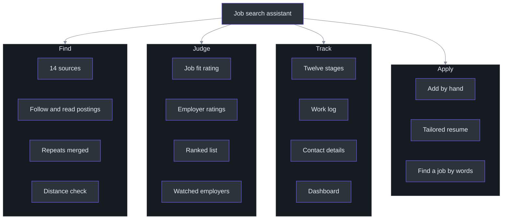

<!-- Sources: lib/collectors/registry.ts:19, lib/parsers/registry.ts:37, lib/utils/score-total.ts:83, lib/utils/job-status.ts:24, lib/utils/work-log-activity.ts:19, .claude/skills/add-external-jobs/SKILL.md, .claude/skills/generate-resume/SKILL.md -->

### Where jobs come from

The tool does not publish one fixed list of sites to the user, but the code names its sources. Some are job search services that gather many employers' jobs. Others are hiring sites that employers use for their own openings.

| Kind | Sources | Source |
| --- | --- | --- |
| Job search services (need a key) | Adzuna, JSearch | [lib/collectors/registry.ts:20](https://github.com/mablahblah/job-assistant/blob/main/lib/collectors/registry.ts#L20) |
| Design job boards | Dribbble, UIUX Jobs Board | [lib/collectors/registry.ts:25](https://github.com/mablahblah/job-assistant/blob/main/lib/collectors/registry.ts#L25) |
| Employer hiring sites, checked only for employers the user rated well | Greenhouse, Lever, Ashby, Workday, UltiPro, Gem, SmartRecruiters, BambooHR, Rippling, Workable | [lib/collectors/registry.ts:22](https://github.com/mablahblah/job-assistant/blob/main/lib/collectors/registry.ts#L22) |

The statement in the last row is partly an inference. The hiring-site sources read a saved list of employers' boards, and the list grows when an employer is rated well and a board is found ([lib/collectors/ats-boards.ts:19](https://github.com/mablahblah/job-assistant/blob/main/lib/collectors/ats-boards.ts#L19), [docs/CHANGELOG.md:73](https://github.com/mablahblah/job-assistant/blob/main/docs/CHANGELOG.md#L73)).

When two sources disagree about a fact, a ranked list of sources decides which one wins. The user can reorder that list ([prisma/schema.prisma:301](https://github.com/mablahblah/job-assistant/blob/main/prisma/schema.prisma#L301)).

## 4. Data Model (Product View)

The user deals with a handful of things. This picture uses everyday words. The arrows say "has" or "belongs to".

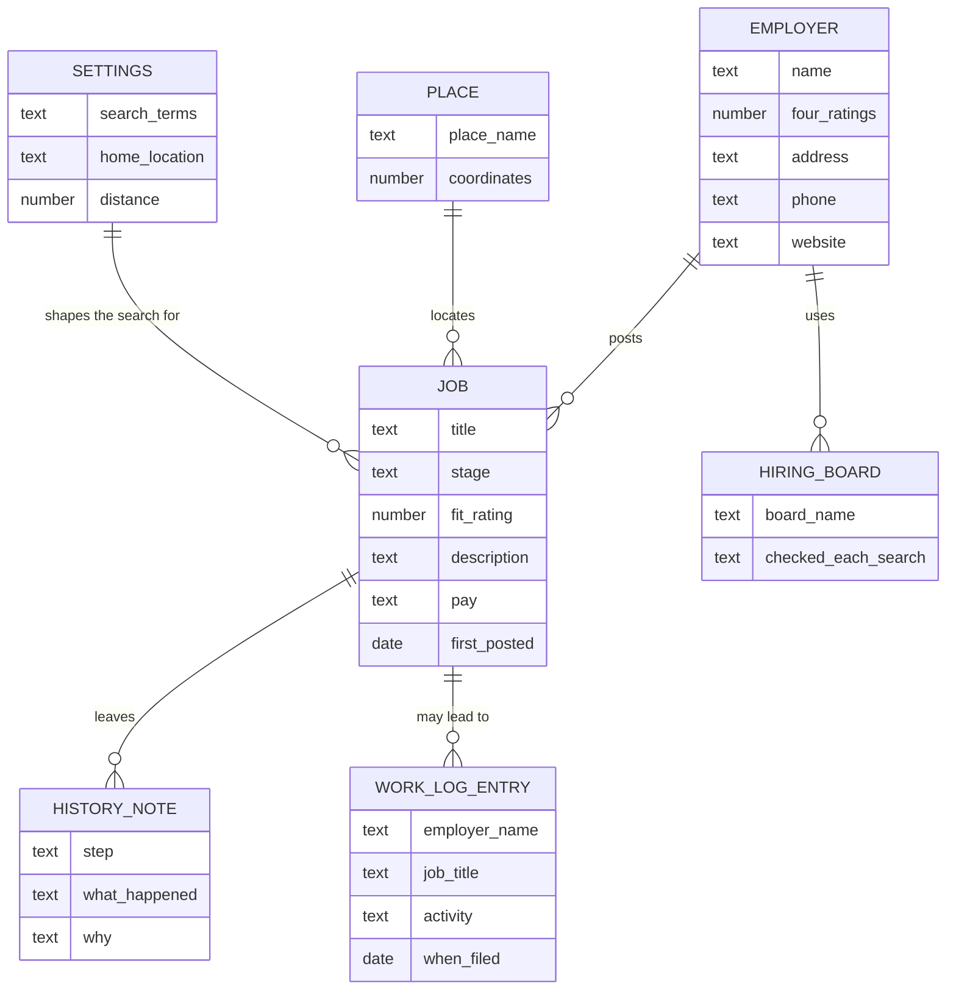

<!-- Sources: prisma/schema.prisma:14, prisma/schema.prisma:147, prisma/schema.prisma:219, prisma/schema.prisma:254, prisma/schema.prisma:275, prisma/schema.prisma:618, prisma/schema.prisma:657 -->

| Thing | What it is in plain words | Source |
| --- | --- | --- |
| Job | One job posting, with its title, stage, pay, description, places and dates. | [prisma/schema.prisma:14](https://github.com/mablahblah/job-assistant/blob/main/prisma/schema.prisma#L14) |
| Employer | A company, with four ratings, reasons, and contact details. | [prisma/schema.prisma:147](https://github.com/mablahblah/job-assistant/blob/main/prisma/schema.prisma#L147) |
| Hiring board | A record that an employer posts on a hiring site, and whether the tool checks it every search. | [prisma/schema.prisma:219](https://github.com/mablahblah/job-assistant/blob/main/prisma/schema.prisma#L219) |
| Place | A location text that was looked up once, with its map position and outline. | [prisma/schema.prisma:251](https://github.com/mablahblah/job-assistant/blob/main/prisma/schema.prisma#L251) |
| Settings | Search terms, home location, distance, how old a job may be, and tuning values. | [prisma/schema.prisma:275](https://github.com/mablahblah/job-assistant/blob/main/prisma/schema.prisma#L275) |
| History note | A record of one thing that happened to a job or an employer. | [prisma/schema.prisma:618](https://github.com/mablahblah/job-assistant/blob/main/prisma/schema.prisma#L618) |
| Work log entry | One filed activity. It stands apart from the job. | [prisma/schema.prisma:657](https://github.com/mablahblah/job-assistant/blob/main/prisma/schema.prisma#L657) |

Two of these links are deliberately loose. A history note and a work log entry hold a job's identity as plain text, not as a hard link. So they stay even if the job is deleted ([prisma/schema.prisma:625](https://github.com/mablahblah/job-assistant/blob/main/prisma/schema.prisma#L625), [prisma/schema.prisma:659](https://github.com/mablahblah/job-assistant/blob/main/prisma/schema.prisma#L659)). The picture shows them as ordinary lines to keep it readable.

## 5. Configuration

The user can change how the tool behaves without changing code. The values live in one settings record. Defaults are filled in once and never overwrite the user's choices ([scripts/db-seed.ts:12](https://github.com/mablahblah/job-assistant/blob/main/scripts/db-seed.ts#L12), [prisma/schema.prisma:272](https://github.com/mablahblah/job-assistant/blob/main/prisma/schema.prisma#L272)).

| Setting | What it controls | Source |
| --- | --- | --- |
| Search terms | The words every source searches for. The starting set has three terms. | [scripts/db-seed.ts:12](https://github.com/mablahblah/job-assistant/blob/main/scripts/db-seed.ts#L12) |
| Home location | The postcode all distance checks use. | [prisma/schema.prisma:279](https://github.com/mablahblah/job-assistant/blob/main/prisma/schema.prisma#L279) |
| Distance | How many miles around home count as close. | [prisma/schema.prisma:281](https://github.com/mablahblah/job-assistant/blob/main/prisma/schema.prisma#L281) |
| Age limit | How many days old a job may be before it is expired. | [prisma/schema.prisma:283](https://github.com/mablahblah/job-assistant/blob/main/prisma/schema.prisma#L283) |
| Source ranking | Which source wins a disagreement. The user's own entries sit at the top. | [prisma/schema.prisma:301](https://github.com/mablahblah/job-assistant/blob/main/prisma/schema.prisma#L301) |
| Repost gap | How far apart a job's two dates must be to count as posted again. | [prisma/schema.prisma:336](https://github.com/mablahblah/job-assistant/blob/main/prisma/schema.prisma#L336) |
| Watch bar | The average rating an employer needs to be watched directly. | [prisma/schema.prisma:341](https://github.com/mablahblah/job-assistant/blob/main/prisma/schema.prisma#L341) |
| Rating shelf life | How many days an employer rating stands, and a shorter time for guessed ratings. | [prisma/schema.prisma:345](https://github.com/mablahblah/job-assistant/blob/main/prisma/schema.prisma#L345) |
| Pacing for slow sites | How long to wait between visits to a site that turned the tool away. | [prisma/schema.prisma:331](https://github.com/mablahblah/job-assistant/blob/main/prisma/schema.prisma#L331) |
| Title vocabulary | Words that tell the tool what part of a title is the role. | [prisma/schema.prisma:286](https://github.com/mablahblah/job-assistant/blob/main/prisma/schema.prisma#L286) |

Who can change them: only the user, and today that means asking the helper or editing the settings record. The settings page does not exist. Changes need technical help. This is stated as an inference, because no screen for settings appears in the dashboard views.

## 6. Integration Capabilities

The tool does not offer a public service for partners. What it has is a short list of outside services it calls on the user's behalf. This table is written for someone deciding what else could be connected.

| Capability | What it uses | Needs a key | What limits it | Source |
| --- | --- | --- | --- | --- |
| Job search by keywords, nationwide and near home | Adzuna | Yes | Fifty results per search, one page | [lib/collectors/adzuna.ts:152](https://github.com/mablahblah/job-assistant/blob/main/lib/collectors/adzuna.ts#L152) |
| Job search with broad coverage | JSearch | Yes | Three pages, jobs from the past week | [lib/collectors/jsearch.ts:131](https://github.com/mablahblah/job-assistant/blob/main/lib/collectors/jsearch.ts#L131) |
| Turning a place name into a map position | Geocode.maps.co | Yes | One lookup a second | [lib/tools/geocoder.ts:16](https://github.com/mablahblah/job-assistant/blob/main/lib/tools/geocoder.ts#L16) |
| Finding an employer's contact details | A web search service | Yes, and it is paid | One search per employer, a 60 second limit | [lib/tools/company-search.ts:30](https://github.com/mablahblah/job-assistant/blob/main/lib/tools/company-search.ts#L30) |
| Reading job postings | The job sites themselves | No | A 15 second limit per request | [lib/utils/fetch-utils.ts:1](https://github.com/mablahblah/job-assistant/blob/main/lib/utils/fetch-utils.ts#L1) |

If a key is missing, that source reports a plain message and the search continues without it ([lib/collectors/adzuna.ts:125](https://github.com/mablahblah/job-assistant/blob/main/lib/collectors/adzuna.ts#L125), [lib/collectors/jsearch.ts:116](https://github.com/mablahblah/job-assistant/blob/main/lib/collectors/jsearch.ts#L116)). A missing map key is different. The map step stops with a clear message, because without it no job can be judged on distance ([lib/tools/geocoder.ts:102](https://github.com/mablahblah/job-assistant/blob/main/lib/tools/geocoder.ts#L102)).

## 7. Performance and Service Expectations

There is no promised service level. This is a personal tool on one computer. The table gives what the code and notes say about timing. Where nothing is measured, the table says so.

| Operation | Expected time | Limit | Source |
| --- | --- | --- | --- |
| A full search | Not measured in the files read for this guide. It holds the screen the whole time. | Limited by the pause between visits to slow sites | [prisma/schema.prisma:322](https://github.com/mablahblah/job-assistant/blob/main/prisma/schema.prisma#L322) |
| One visit to a job site | Gives up after 15 seconds | 15 seconds | [lib/utils/fetch-utils.ts:1](https://github.com/mablahblah/job-assistant/blob/main/lib/utils/fetch-utils.ts#L1) |
| One map lookup | About one second apart, by design | One a second | [lib/tools/geocoder.ts:16](https://github.com/mablahblah/job-assistant/blob/main/lib/tools/geocoder.ts#L16) |
| Slow-site pause | 12 seconds between jobs by default | Set from a test against one site | [scripts/db-seed.ts:54](https://github.com/mablahblah/job-assistant/blob/main/scripts/db-seed.ts#L54) |
| One contact search | Gives up after 60 seconds | 60 seconds | [lib/tools/company-search.ts:30](https://github.com/mablahblah/job-assistant/blob/main/lib/tools/company-search.ts#L30) |
| The dashboard | Not measured | Local page | [scripts/serve.ts:20](https://github.com/mablahblah/job-assistant/blob/main/scripts/serve.ts#L20) |
| Availability | No target | Only available when the user starts it | Not applicable |

## 8. Known Limitations and Constraints

| # | Limitation | What the user feels | Workaround | Planned fix | Source |
| --- | --- | --- | --- | --- | --- |
| 1 | A browser window opens and holds the screen during a search | The computer is busy until the search ends | Start a search before a break | None stated | [prisma/schema.prisma:322](https://github.com/mablahblah/job-assistant/blob/main/prisma/schema.prisma#L322) |
| 2 | Job sites can turn the tool away | A job stays unread and shows a warning marker | Run again later. The next search tries again. | Two-lane pacing exists. A full fix is not stated. | [docs/CHANGELOG.md:57](https://github.com/mablahblah/job-assistant/blob/main/docs/CHANGELOG.md#L57) |
| 3 | Only part of the matches from the job search services is seen | Some postings are never shown | Add the missing job by hand | Not stated | [lib/collectors/adzuna.ts:109](https://github.com/mablahblah/job-assistant/blob/main/lib/collectors/adzuna.ts#L109) |
| 4 | The dashboard cannot change anything | Every change goes through the helper | Ask the helper | By design | [docs/architecture.md:65](https://github.com/mablahblah/job-assistant/blob/main/docs/architecture.md#L65) |
| 5 | Employer reasons are saved but not shown | Only the job's own reason shows on hover | Ask the helper | A panel for them is a backlog item | [docs/architecture.md:71](https://github.com/mablahblah/job-assistant/blob/main/docs/architecture.md#L71) |
| 6 | Work log wording and rules are Texas only | A user in another state gets entries that may not match their form | Treat the log as a draft | None stated | [lib/utils/work-log-activity.ts:11](https://github.com/mablahblah/job-assistant/blob/main/lib/utils/work-log-activity.ts#L11) |
| 7 | Contact details come from a web search | An address or phone may be wrong | Check any flagged item before filing | Flags exist | [docs/architecture.md:51](https://github.com/mablahblah/job-assistant/blob/main/docs/architecture.md#L51) |
| 8 | No automatic copy of the saved data | A disk failure loses everything | Copy the file by hand | None stated. The author of this guide infers this from the absence of a backup step. | [.gitignore:12](https://github.com/mablahblah/job-assistant/blob/main/.gitignore#L12) |
| 9 | The resume step needs a second project | It stops without it | Write the resume by hand | None stated | [.claude/skills/generate-resume/SKILL.md:102](https://github.com/mablahblah/job-assistant/blob/main/.claude/skills/generate-resume/SKILL.md#L102) |
| 10 | Ratings are the AI helper's judgement | Two runs can differ | Read the reasons on hover and overrule | None stated | [.claude/skills/score-backlog/SKILL.md:92](https://github.com/mablahblah/job-assistant/blob/main/.claude/skills/score-backlog/SKILL.md#L92) |
| 11 | A job with no place anywhere is set aside | A good remote job with a vague posting may be missed | Add it by hand | Not stated | [docs/CHANGELOG.md:27](https://github.com/mablahblah/job-assistant/blob/main/docs/CHANGELOG.md#L27) |
| 12 | One user only | A friend needs a separate copy and their own profile | Set up a copy | Not stated | [.gitignore:21](https://github.com/mablahblah/job-assistant/blob/main/.gitignore#L21) |
| 13 | Not started on its own | The user must start every search | Ask the helper each time | Not stated | [docs/architecture.md:110](https://github.com/mablahblah/job-assistant/blob/main/docs/architecture.md#L110) |

Two older documents describe a different tool and should be ignored: the front-page readme (it describes a different kind of app and a flow with design generation and scheduled collection) and parts of the architecture notes that give old counts of sources. The tool today has 14 sources, not seven ([lib/collectors/registry.ts:19](https://github.com/mablahblah/job-assistant/blob/main/lib/collectors/registry.ts#L19)).

## 9. Data and Privacy

Everything the tool keeps lives on the user's own computer. Nothing is stored on a server run by the builder. The tool does send some information to outside services in order to do its work. Those flows are listed below.

### What is kept, and where

| Data | Where it lives | How long | Private by default? | Source |
| --- | --- | --- | --- | --- |
| Jobs and their ratings | One saved-list file on the computer | Until deleted. Old jobs are marked expired, not erased. | Yes. The file is excluded from the project's shared copy. | [.gitignore:12](https://github.com/mablahblah/job-assistant/blob/main/.gitignore#L12) |
| Employers, ratings, reasons and contact details | Same file | Ratings expire after a set number of days and are researched again. | Yes | [prisma/schema.prisma:349](https://github.com/mablahblah/job-assistant/blob/main/prisma/schema.prisma#L349) |
| The work log | Same file | Kept, because it is a legal record. Never revised. | Yes | [prisma/schema.prisma:652](https://github.com/mablahblah/job-assistant/blob/main/prisma/schema.prisma#L652) |
| History of each job's path | Same file | Kept. Outlives the job. | Yes | [prisma/schema.prisma:618](https://github.com/mablahblah/job-assistant/blob/main/prisma/schema.prisma#L618) |
| Looked-up places | Same file | Kept, so each place is looked up once | Yes | [prisma/schema.prisma:251](https://github.com/mablahblah/job-assistant/blob/main/prisma/schema.prisma#L251) |
| Settings, such as search words and home location | Same file | Kept | Yes | [prisma/schema.prisma:275](https://github.com/mablahblah/job-assistant/blob/main/prisma/schema.prisma#L275) |
| Service keys | A private settings file | Kept until changed | Yes. Only a blank template is shared. | [.gitignore:2](https://github.com/mablahblah/job-assistant/blob/main/.gitignore#L2) |
| Generated resumes | A private folder | Kept until deleted | Yes | [.gitignore:17](https://github.com/mablahblah/job-assistant/blob/main/.gitignore#L17) |
| The personal fit profile used for scoring | A private file next to the scoring rules. A made-up example is shared instead. | Kept | Yes | [.gitignore:21](https://github.com/mablahblah/job-assistant/blob/main/.gitignore#L21) |
| Planning notes, research and the backlog of ideas | Private folders | Kept | Yes | [.gitignore:24](https://github.com/mablahblah/job-assistant/blob/main/.gitignore#L24) |

The kinds of personal information the tool holds are: the user's search words, a home location, a fit profile that describes the user's background and wishes, a stock of resume wording, which employers the user applied to and when, and the contact details of employers. The guide does not quote any of it.

The shared copy of the project holds only code and a made-up example profile. A recent change split the scoring profile into public rules, a private profile and a made-up example, and set a neutral starting location in the shared files, in order to keep personal details out ([docs/CHANGELOG.md](https://github.com/mablahblah/job-assistant/blob/main/docs/CHANGELOG.md)). This is described from the recent commit messages and the ignore list, and the guide did not re-verify every tracked file.

### What leaves the computer

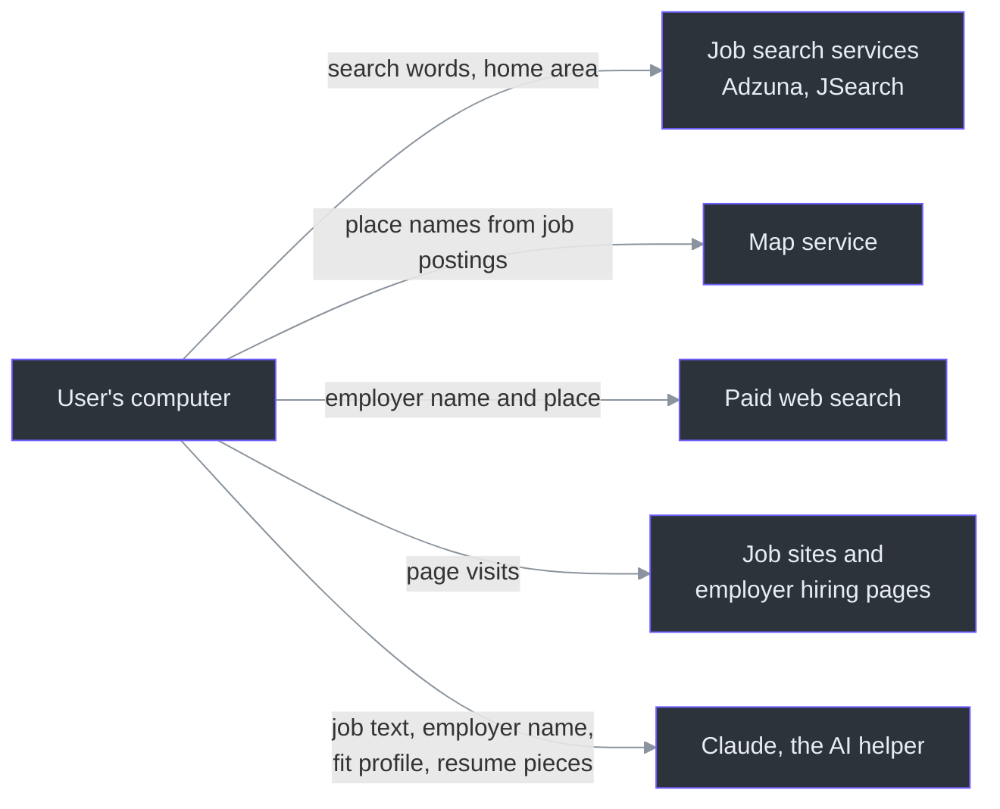

<!-- Sources: lib/collectors/adzuna.ts:141-180, lib/collectors/jsearch.ts:125-153, lib/tools/geocoder.ts:74-86, lib/tools/company-search.ts:44-58, lib/tools/page-fetcher.ts:8-11, .claude/skills/score-backlog/SKILL.md:42-94, .claude/skills/generate-resume/SKILL.md:100-126 -->

| Outside service | What it can see | When | Source |
| --- | --- | --- | --- |
| Adzuna | The search words and the home area for the near-home search | Every search | [lib/collectors/adzuna.ts:141](https://github.com/mablahblah/job-assistant/blob/main/lib/collectors/adzuna.ts#L141) |
| JSearch, through RapidAPI | The search words joined together, and the home area for the local search | Every search | [lib/collectors/jsearch.ts:125](https://github.com/mablahblah/job-assistant/blob/main/lib/collectors/jsearch.ts#L125) |
| Map service | The place names found in job postings. It may also see the home location text if the tool looks that up, which this guide infers but did not confirm. | Whenever a new place appears | [lib/tools/geocoder.ts:74](https://github.com/mablahblah/job-assistant/blob/main/lib/tools/geocoder.ts#L74) |
| Paid web search | An employer's name and the place the job is in | When a job reaches a stage that files a work log entry | [docs/architecture.md:51](https://github.com/mablahblah/job-assistant/blob/main/docs/architecture.md#L51) |
| Job sites and employer hiring pages | A visit from the user's computer that says it is an ordinary browser | Every search and every manual add | [lib/tools/page-fetcher.ts:8](https://github.com/mablahblah/job-assistant/blob/main/lib/tools/page-fetcher.ts#L8) |
| Claude and its web access | The text of job postings, employer names, the fit profile, and the resume pieces | During scoring and resume making | [.claude/skills/score-backlog/SKILL.md:65](https://github.com/mablahblah/job-assistant/blob/main/.claude/skills/score-backlog/SKILL.md#L65) |

What is not sent: the work log is not sent to any outside service. The generated resumes stay in a private folder. Neither of these claims was verified against every code path, but no tracked source file for sending them was found.

### Compliance

| Topic | Status | Source |
| --- | --- | --- |
| Texas Workforce Commission wording | Used exactly for the three activities | [lib/utils/work-log-activity.ts:11](https://github.com/mablahblah/job-assistant/blob/main/lib/utils/work-log-activity.ts#L11) |
| A legal record that cannot be rewritten | Entries cannot be edited | [prisma/schema.prisma:652](https://github.com/mablahblah/job-assistant/blob/main/prisma/schema.prisma#L652) |
| Privacy law and data retention policy | No written policy found. It is one person's own data. | Not applicable |
| Terms of use of job sites | No review found in the files read | Not applicable |
| Keys committed by mistake | An earlier leak was fixed and keys were rotated | [docs/APP.md:42](https://github.com/mablahblah/job-assistant/blob/main/docs/APP.md#L42) |

A friend using their own copy would send their own search words, home area and background to the same outside services. That is worth saying before they start.

## 10. Glossary

| Term | Meaning |
| --- | --- |
| Assistant | The tool as a whole. |
| Helper | The AI that runs the tool's skills and does the judging. |
| Skill | A named task the helper knows how to run, such as "search for jobs". |
| Backlog | The list of new jobs the user has not decided on. |
| Stage | Where a job is in the process. There are twelve. |
| Applied stages | The five stages from "app. sent" to "offer". |
| Ruled out | A job that was expired, too far, passed on, unreadable, or rejected. |
| Unjudged | A job the tool could not fully check. It shows a warning marker. |
| Source | A place the tool gets jobs from. |
| Hiring site | A service employers use to post and manage their jobs. |
| Job search service | A service that gathers jobs from many employers. |
| Follow | Opening a job's link to reach the employer's own posting. |
| Read | Pulling the description, place, pay and dates out of a posting. |
| Repeat | The same job found by two sources. |
| Repost | A job the employer listed again under a new date. |
| Fit rating | The helper's 1 to 5 score for how well a job suits the user. |
| Employer ratings | Four 1 to 5 scores for a company. |
| Guess | A rating the helper awarded because it found nothing public. |
| Total | The ranking number for a job. |
| Watched employer | An employer whose job board is checked on every search. |
| Work log | The record of job search activity that Texas asks for each week. |
| Benefit week | Sunday to Saturday. The unit a work log is filed by. |
| Contact details | An employer's address, phone and website. |
| Run | One job search. |
| Run label | The code shown at the start of a search that ties its records together. |
| Dashboard | The local web page that shows the lists. |
| Place | A location that was looked up once and saved. |
| Source ranking | The order that decides which source wins when two disagree. |

## 11. FAQ

**Does the tool apply to jobs for me?**
No. It finds, ranks and tracks jobs. The user applies. It can help prepare a resume, but nothing is sent to an employer ([.claude/skills/generate-resume/SKILL.md:26](https://github.com/mablahblah/job-assistant/blob/main/.claude/skills/generate-resume/SKILL.md#L26)).

**Does it send my work log to the state?**
No sending step was found. It prepares entries. The user fills in the weekly form. This is an inference from the code, which contains no such step.

**Which activities does Texas count?**
Applying, a phone screen and an interview. A skills test and an offer do not file an entry ([lib/utils/job-status.ts:49](https://github.com/mablahblah/job-assistant/blob/main/lib/utils/job-status.ts#L49)).

**What if I move a job to the wrong stage by mistake?**
The stage can be changed again. The work log is different. An entry cannot be revised, and the code has no way to remove one ([prisma/schema.prisma:656](https://github.com/mablahblah/job-assistant/blob/main/prisma/schema.prisma#L656)). How to correct a wrong entry is not covered in the files read.

**Why does a window open and take over my screen?**
Job sites turned away hidden browsers, and did not turn away visible ones in the builder's tests ([lib/tools/resolution-browser.ts:19](https://github.com/mablahblah/job-assistant/blob/main/lib/tools/resolution-browser.ts#L19)).

**Why is a job showing a warning marker?**
The tool could not follow the link, read the posting, or check the place, or it finished all three and was never rated. Pointing at the marker says which ([docs/CHANGELOG.md:59](https://github.com/mablahblah/job-assistant/blob/main/docs/CHANGELOG.md#L59)).

**Why did a good job not appear?**
Four common causes. The source did not list it. The source listed it but only part of the matches fit on one page. The posting named no place. The place was too far away. The first two apply to the job search services ([lib/collectors/adzuna.ts:109](https://github.com/mablahblah/job-assistant/blob/main/lib/collectors/adzuna.ts#L109)). Adding the job by hand is the fix.

**Why is a job's score missing after I applied?**
By design. Once a job is applied to or ruled out, the total is hidden because it no longer helps. The ratings remain ([docs/CHANGELOG.md:89](https://github.com/mablahblah/job-assistant/blob/main/docs/CHANGELOG.md#L89)).

**Can I change what it searches for?**
Yes. The search words, home location and distance are settings. Changing them today needs the helper or technical help ([prisma/schema.prisma:275](https://github.com/mablahblah/job-assistant/blob/main/prisma/schema.prisma#L275)).

**What does it cost to run?**
The tool is free to run. The outside services have their own plans, and one of them, the contact search, is paid per use. Exact prices are not in the files. See the [Executive Guide](./executive-guide.md) for the cost drivers.

**Can I use it from my phone?**
No. The dashboard is a page on the computer where the tool runs ([lib/tools/web-server.ts:132](https://github.com/mablahblah/job-assistant/blob/main/lib/tools/web-server.ts#L132)).

**Can two people share one copy?**
Not safely. The data, the profile and the settings are for one person. A second person should have their own copy ([.gitignore:21](https://github.com/mablahblah/job-assistant/blob/main/.gitignore#L21)).

**Can a friend in another state use it?**
The job finding and ranking work anywhere in the United States, because the sources are national. The work log is written for Texas. Another state would need different wording and rules (the rule about wording is at [docs/architecture.md:100](https://github.com/mablahblah/job-assistant/blob/main/docs/architecture.md#L100)).

**What happens if a job site is down?**
That source is named in the errors or warnings and the search goes on without it ([.claude/skills/job-search/SKILL.md:30](https://github.com/mablahblah/job-assistant/blob/main/.claude/skills/job-search/SKILL.md#L30)).

**What happens if I stop a search halfway?**
Whatever finished is saved. Running again picks up from there ([docs/CHANGELOG.md:67](https://github.com/mablahblah/job-assistant/blob/main/docs/CHANGELOG.md#L67)).

**Is my data safe if the computer breaks?**
Not without a copy. The tool writes a dated backup before it changes the layout of the saved data, but there is no regular backup ([CLAUDE.md:34](https://github.com/mablahblah/job-assistant/blob/main/CLAUDE.md#L34)). Copying the file now and then is wise, especially for the work log.

**Does the tool remember jobs I deleted so they do not come back?**
The first version did that ([docs/CHANGELOG.md:151](https://github.com/mablahblah/job-assistant/blob/main/docs/CHANGELOG.md#L151)). Whether the current version still does was not confirmed.

## Related Pages

| Page | Why read it |
| --- | --- |
| [Executive Guide](./executive-guide.md) | Risks, costs and recommendations. |
| [Contributor Guide](./contributor-guide.md) | How to set up and change the tool. |
| [Staff Engineer Guide](./staff-engineer-guide.md) | The reasons behind the design. |
| [Overview](../getting-started/overview.md) | A short introduction. |
| [Commands and Skills](../getting-started/commands-and-skills.md) | The full list of tasks. |
| [Quick Reference](../getting-started/quick-reference.md) | A one-page summary. |
| [Scoring](../deep-dive/agent-workflows/scoring.md) | How ratings are made. |
| [Status Change and Work Log](../deep-dive/agent-workflows/status-change-and-work-log.md) | How stages and entries work. |
| [External Jobs and Resumes](../deep-dive/agent-workflows/external-jobs-and-resumes.md) | Adding jobs by hand and making resumes. |
| [Dashboard](../deep-dive/dashboard/dashboard.md) | What each list shows. |
| [Data Model](../deep-dive/data/data-model.md) | What is kept. |

## References

| Reference | Used for |
| --- | --- |
| [.claude/skills/job-search/SKILL.md](https://github.com/mablahblah/job-assistant/blob/main/.claude/skills/job-search/SKILL.md) | The search journey |
| [.claude/skills/score-backlog/SKILL.md](https://github.com/mablahblah/job-assistant/blob/main/.claude/skills/score-backlog/SKILL.md) | The scoring journey |
| [.claude/skills/change-status/SKILL.md](https://github.com/mablahblah/job-assistant/blob/main/.claude/skills/change-status/SKILL.md) | The applied and work log journey |
| [.claude/skills/add-external-jobs/SKILL.md](https://github.com/mablahblah/job-assistant/blob/main/.claude/skills/add-external-jobs/SKILL.md) | The add-by-hand journey |
| [.claude/skills/generate-resume/SKILL.md](https://github.com/mablahblah/job-assistant/blob/main/.claude/skills/generate-resume/SKILL.md) | The resume journey |
| [docs/CHANGELOG.md](https://github.com/mablahblah/job-assistant/blob/main/docs/CHANGELOG.md) | What changed and when |
| [docs/APP.md](https://github.com/mablahblah/job-assistant/blob/main/docs/APP.md) | The original goals |
| [docs/architecture.md](https://github.com/mablahblah/job-assistant/blob/main/docs/architecture.md) | How the tool behaves. Source counts in it are out of date. |
| [prisma/schema.prisma](https://github.com/mablahblah/job-assistant/blob/main/prisma/schema.prisma) | What is kept |
| [lib/utils/job-status.ts](https://github.com/mablahblah/job-assistant/blob/main/lib/utils/job-status.ts) | The twelve stages |
| [lib/utils/score-total.ts](https://github.com/mablahblah/job-assistant/blob/main/lib/utils/score-total.ts) | The ranking number |
| [.gitignore](https://github.com/mablahblah/job-assistant/blob/main/.gitignore) | What stays private |
| [.env.example](https://github.com/mablahblah/job-assistant/blob/main/.env.example) | Which outside services need keys |
