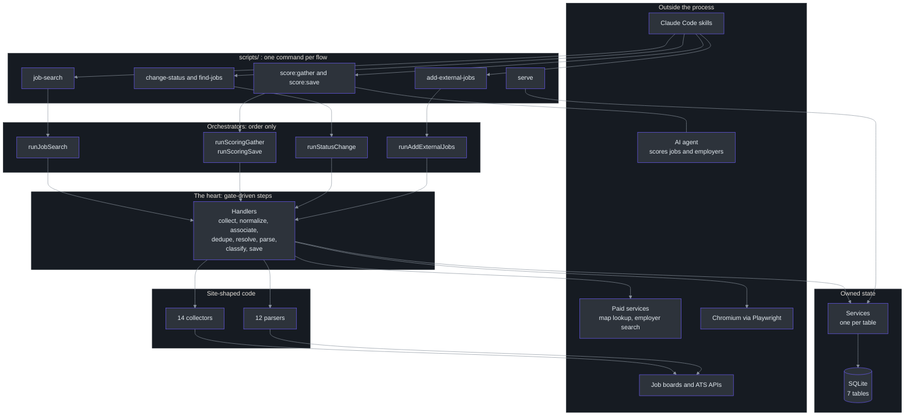
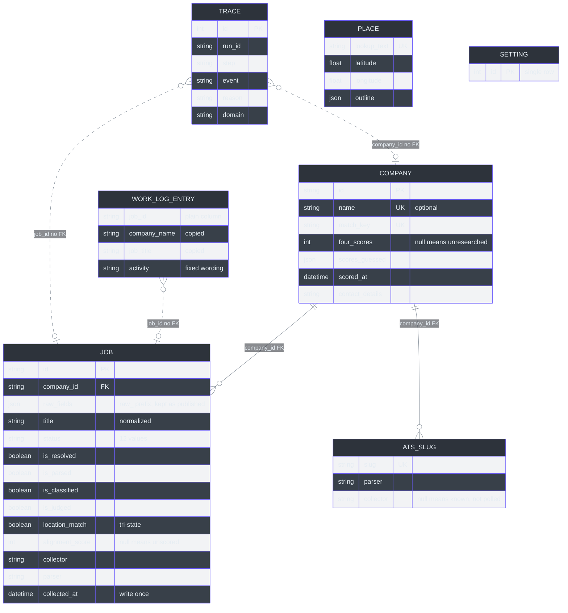
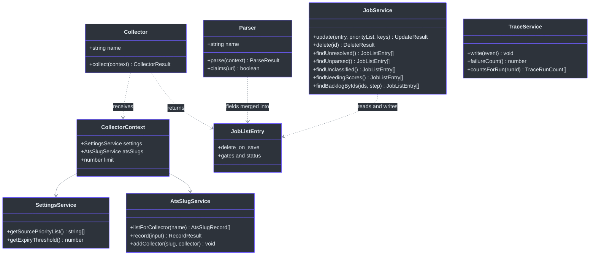
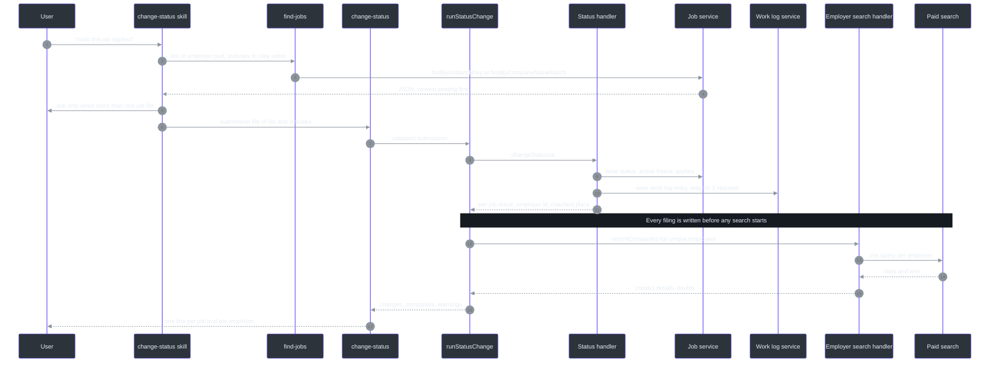
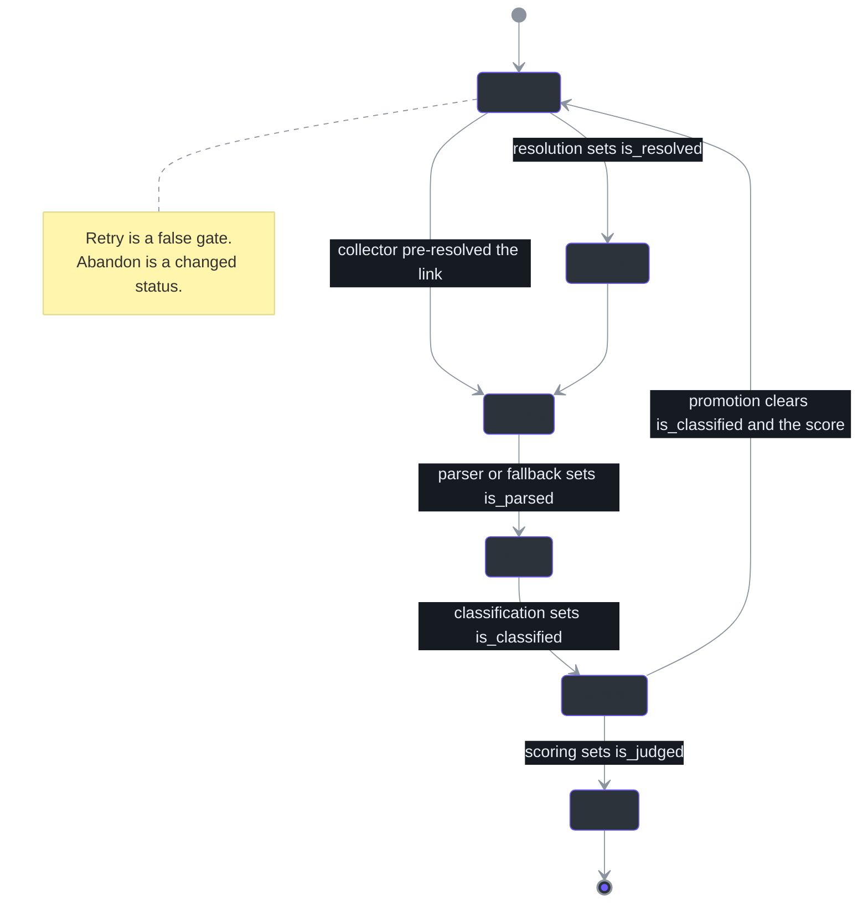
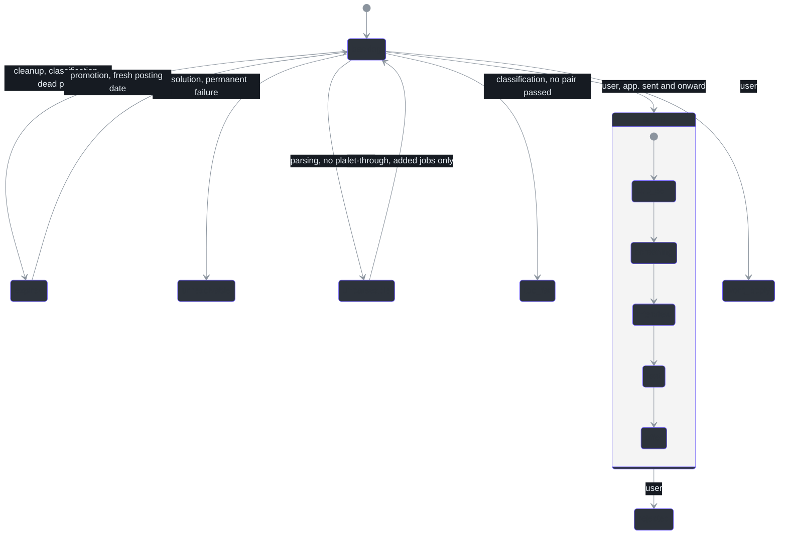
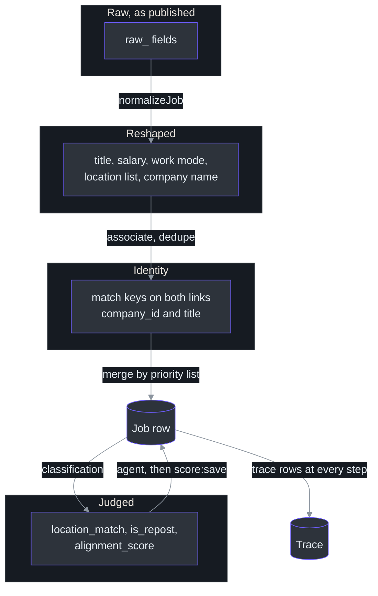
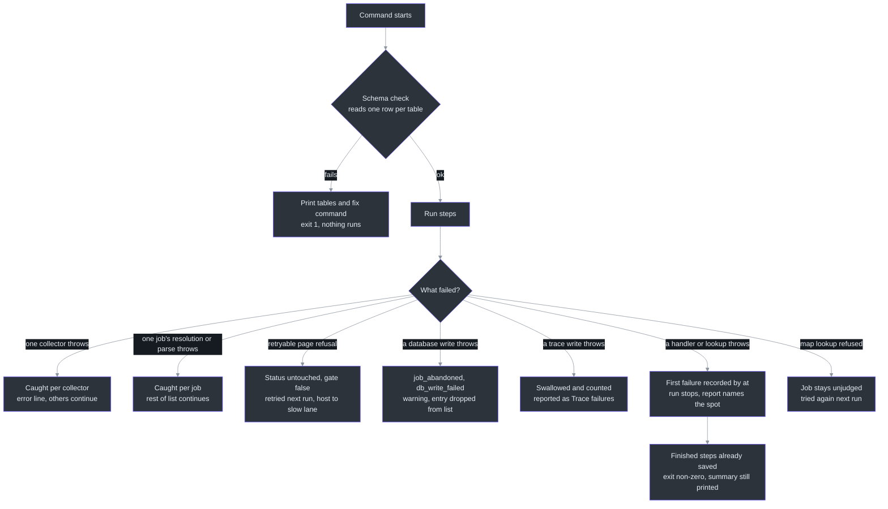

# Staff Engineer Guide

This guide is for staff and principal engineers who want the reasons, not a tour. It is opinionated. Where the code and the project's own architecture document disagree, the code is treated as the truth, and the disagreement is called out.

Claims carry a citation. Where something is inferred and not read, the text says "inferred".

## 1. Executive summary

The system is a single-user, single-machine batch pipeline. It collects job postings from fourteen sources, normalizes and de-duplicates them into one SQLite file, follows aggregator links to the employer's own page, reads each posting, judges it on age and location, and hands the survivors to an AI agent for scoring against written rubrics. A second flow, started by the user, records application status changes and files a Texas unemployment work log entry. A read-only dashboard shows the result.

It owns: ingestion, identity resolution (what is the same job), field-level merge across sources, lifecycle state, a trace of every job's path, and a legal-record table. It delegates: judgement of fit to an AI agent through two commands and a rubric, page rendering to Playwright, geocoding and employer contact search to paid outside services, and all configuration to a single settings row.

| Dimension | Value | Source |
|---|---|---|
| Language and runtime | TypeScript run by `tsx`, no build step, on Node | [package.json:5-23](https://github.com/mablahblah/job-assistant/blob/main/package.json#L5-L23) |
| Store | One SQLite file through Prisma and the libsql adapter | [lib/db/pipeline-db.ts:14-18](https://github.com/mablahblah/job-assistant/blob/main/lib/db/pipeline-db.ts#L14-L18) |
| Entry points | Commands under `scripts/`, called by Claude Code skills | [package.json:5-23](https://github.com/mablahblah/job-assistant/blob/main/package.json#L5-L23) |
| Sources | 14 collectors, 11 dedicated parsers, 1 general parser | [lib/collectors/registry.ts:19-34](https://github.com/mablahblah/job-assistant/blob/main/lib/collectors/registry.ts#L19-L34), [lib/parsers/registry.ts:37-49](https://github.com/mablahblah/job-assistant/blob/main/lib/parsers/registry.ts#L37-L49) |
| Tables | 7 | [prisma/schema.prisma:14-673](https://github.com/mablahblah/job-assistant/blob/main/prisma/schema.prisma#L14-L673) |
| Users | One person | [docs/architecture.md:3-9](https://github.com/mablahblah/job-assistant/blob/main/docs/architecture.md#L3-L9) |
| Tracked tests | 235 files ending `.test.ts`, 33 of them flow tests | inferred from `git ls-files` |

The codebase looks like a normal layered application. Its distinguishing feature is not the layers. It is a discipline about where state lives, covered next.

## 2. The core architectural insight

### 2.1 Statement

**Every step reads its own work out of the database by a phase-gate predicate and ends with a database write. No step receives a list from the step before it.**

The database is the only handoff between steps. The queue between two steps is not a queue table or an in-memory list. It is a `WHERE` clause over columns on the `Job` row: a status, and a set of booleans that each step flips when it has handled a job.

I verified this in the code before writing it down.

| Evidence | What it shows | Source |
|---|---|---|
| The orchestrator header | "the database is the only handoff between steps" | [lib/orchestrators/job-search.ts:1-16](https://github.com/mablahblah/job-assistant/blob/main/lib/orchestrators/job-search.ts#L1-L16) |
| The save handler header | Save runs at four points "so every phase ends in a write and no phase depends on the one before it holding its list in memory" | [lib/handlers/save.ts:1-9](https://github.com/mablahblah/job-assistant/blob/main/lib/handlers/save.ts#L1-L9) |
| Resolution's input | `findUnresolved()` asks for `status = backlog` and `is_resolved = false`, with no run filter | [lib/services/job-service.ts:416-422](https://github.com/mablahblah/job-assistant/blob/main/lib/services/job-service.ts#L416-L422) |
| Parsing's input | `findUnparsed()`: backlog, resolved, not parsed | [lib/services/job-service.ts:427-433](https://github.com/mablahblah/job-assistant/blob/main/lib/services/job-service.ts#L427-L433) |
| Classification's input | `findUnclassified()`: backlog, resolved, parsed, not classified | [lib/services/job-service.ts:488-494](https://github.com/mablahblah/job-assistant/blob/main/lib/services/job-service.ts#L488-L494) |
| Scoring's input | `findNeedingScores()`: all three gates true and `alignment_score` null | [lib/services/job-service.ts:469-486](https://github.com/mablahblah/job-assistant/blob/main/lib/services/job-service.ts#L469-L486) |
| The orchestrator comment at the resolution step | "it queries the database for whatever still needs a source URL" | [lib/orchestrators/job-search.ts:364-369](https://github.com/mablahblah/job-assistant/blob/main/lib/orchestrators/job-search.ts#L364-L369) |
| The rule that states it | "The next one starts by asking the database for the jobs carrying the right marker" | [.claude/rules/part-ownership.md:25-27](https://github.com/mablahblah/job-assistant/blob/main/.claude/rules/part-ownership.md#L25-L27) |
| Added jobs narrow the question, never replace it | `findBacklogByIds(ids, step)` applies the same gate to a list of ids | [lib/services/job-service.ts:445-452](https://github.com/mablahblah/job-assistant/blob/main/lib/services/job-service.ts#L445-L452), [lib/orchestrators/add-external-jobs.ts:161-161](https://github.com/mablahblah/job-assistant/blob/main/lib/orchestrators/add-external-jobs.ts#L161-L161) |

### 2.2 Two honest qualifications

The statement is true at step boundaries. It is not true everywhere.

1. **Inside one step, a list is in memory.** Collection builds a list. Normalize, associate, dedupe and save then pass that list from one handler to the next. See [lib/orchestrators/job-search.ts:307-362](https://github.com/mablahblah/job-assistant/blob/main/lib/orchestrators/job-search.ts#L307-L362). The save at the end of the step is what restores the invariant.
2. **Collection is the one step with no database input.** It has no gate to read. Its input is the outside world. See [.claude/rules/handler-contract.md:9-9](https://github.com/mablahblah/job-assistant/blob/main/.claude/rules/handler-contract.md#L9-L9).

A third point is worth knowing. The orchestrator keeps a `report.jobs` list by merging the saved lists of later steps into it. That list exists to report on. No step reads it for input. See [lib/orchestrators/job-search.ts:436-450](https://github.com/mablahblah/job-assistant/blob/main/lib/orchestrators/job-search.ts#L436-L450).

### 2.3 The pattern in Python pseudocode

This is not code from the repository. It is the shape of the idea, written in Python so the pattern is visible without TypeScript.

```python
# Each step is a pure function of (rows matching its gate) -> (rows with its gate flipped).
# The orchestrator does not pass data. It only fixes the order.

def run_pipeline(db, services):
    for step in STEPS:                       # backlog_cleanup, collect, resolve, parse, ...
        rows = db.query(step.gate_predicate)  # e.g. status == "backlog" and not is_resolved
        out  = step.handle(rows)              # may flip step.gate, may change status
        db.save(out)                          # the step ends here, always

# What a step must therefore satisfy:
#   1. idempotent: running it twice over the same rows is safe
#   2. self-selecting: it asks for exactly what it owns
#   3. owner of its own flag: it flips one gate and no other
```

A job that fails in a retryable way keeps the gate false and is selected again next run. A job that fails for good has its status changed, which removes it from every later predicate. So retry and abandon are both expressed as state on the row, not as control flow.

### 2.4 What this buys

| Benefit | How it shows up | Source |
|---|---|---|
| Crash safety | A step that throws leaves earlier steps' rows in place. The report names the first failure | [lib/orchestrators/job-search.ts:653-666](https://github.com/mablahblah/job-assistant/blob/main/lib/orchestrators/job-search.ts#L653-L666) |
| Backlog catch-up | A job collected weeks ago and never resolved is still picked up | [lib/services/job-service.ts:73-77](https://github.com/mablahblah/job-assistant/blob/main/lib/services/job-service.ts#L73-L77) |
| An agent in the middle | Scoring can pause for judgement because nothing is held in memory across the pause | [lib/orchestrators/scoring.ts:1-8](https://github.com/mablahblah/job-assistant/blob/main/lib/orchestrators/scoring.ts#L1-L8) |
| Reuse by other callers | The same handlers run for added jobs, scoring and status changes | [.claude/rules/part-ownership.md:19-21](https://github.com/mablahblah/job-assistant/blob/main/.claude/rules/part-ownership.md#L19-L21) |
| Trivial test seams | Every handler takes its services as arguments, so a fake stands in | [.claude/rules/handler-contract.md:17-17](https://github.com/mablahblah/job-assistant/blob/main/.claude/rules/handler-contract.md#L17-L17) |
| Restartability without a scheduler | Re-running the one command is the recovery procedure | inferred from the above |

### 2.5 What it costs

| Cost | Detail | Source |
|---|---|---|
| Every step must be idempotent | Handlers return copies and never mutate their input, and save merges rather than overwrites | [lib/services/job-service.ts:321-352](https://github.com/mablahblah/job-assistant/blob/main/lib/services/job-service.ts#L321-L352) |
| Whole-set reads | `findBacklog()` reads the entire backlog on every run, and `findExpiredWithin()` reads every expired job then filters in code | [lib/services/job-service.ts:437-443](https://github.com/mablahblah/job-assistant/blob/main/lib/services/job-service.ts#L437-L443), [lib/services/job-service.ts:458-466](https://github.com/mablahblah/job-assistant/blob/main/lib/services/job-service.ts#L458-L466) |
| Gate discipline is manual | A step that forgets to flip its gate re-selects the same jobs forever. A test cannot see this unless it runs the step twice | inferred |
| A job that cannot be judged is retried each run | Classification leaves an unreadable-place job unjudged. Its places are looked up again, though a run never asks twice for the same text | [lib/handlers/classification.ts:76-101](https://github.com/mablahblah/job-assistant/blob/main/lib/handlers/classification.ts#L76-L101) |
| Stale flags must be kept out of writes | Every list read omits the gate columns so a save cannot overwrite a flag another step owns | [lib/services/job-service.ts:162-171](https://github.com/mablahblah/job-assistant/blob/main/lib/services/job-service.ts#L162-L171) |

The last row is the subtle one. Because a read feeds a later write, a stale copy of someone else's flag could be written back. The service solves it by omitting those columns from every list read. That is the price of letting the same row travel through several owners.

## 3. System architecture

### 3.1 The whole system



<!-- Sources: lib/orchestrators/job-search.ts:151-188, lib/orchestrators/scoring.ts:47-228, lib/orchestrators/status-change.ts:43-93, lib/orchestrators/add-external-jobs.ts:1-6, lib/collectors/registry.ts:19-34, lib/parsers/registry.ts:37-49, scripts/serve.ts:20-60, .claude/rules/part-ownership.md:1-54 -->

The heart of the system is the handler layer together with the services under it. Everything else is either order (the orchestrators), site knowledge (collectors and parsers), or a boundary to the outside (tools).

### 3.2 The invariant in one picture

```mermaid
%%{init: {'theme':'base','themeVariables':{'primaryColor':'#2d333b','primaryBorderColor':'#6d5dfc','primaryTextColor':'#e6edf3','lineColor':'#8b949e','secondaryColor':'#161b22','tertiaryColor':'#161b22'}}}%%
flowchart LR
    DB1[("Job rows<br>gates and status")] -- "is_resolved = false" --> R["Resolve"]
    R -- "save" --> DB2[("Job rows")]
    DB2 -- "resolved and not parsed" --> P["Parse"]
    P -- "save" --> DB3[("Job rows")]
    DB3 -- "parsed and not classified" --> K["Classify"]
    K -- "save" --> DB4[("Job rows")]
    DB4 -- "classified and no score" --> S["Gather for scoring"]
```



<!-- Sources: lib/services/job-service.ts:416-422, lib/services/job-service.ts:427-433, lib/services/job-service.ts:488-494, lib/services/job-service.ts:469-486 -->

Every arrow between two steps goes through the same database. That is the whole idea.

### 3.3 Comparison with common alternatives

| Aspect | This design | Message queue between stages | In-memory pipeline of generators | Workflow engine such as Temporal |
|---|---|---|---|---|
| Handoff | A predicate over row columns | A durable message per job | Python generator or Node stream chaining | A durable workflow state |
| Restart after a crash | Run the command again | Consumers resume | Start over | The engine resumes |
| Moving parts | One file | A broker | None | A service plus workers |
| Late arrival of a job to a step | Free: the predicate sees it | Needs a re-enqueue | Not possible | Needs a new workflow |
| Observability | Trace table, by SQL | Broker metrics | Logs | Engine UI |
| Fit for one user, one machine | Excellent | Overkill | Fine until it crashes | Overkill |

The design is the cheapest durable pipeline there is, and it only works because the scale is a single user and a single writer. Section 12 returns to where it stops working.

## 4. Domain model

### 4.1 Entities



<!-- Sources: prisma/schema.prisma:14-142, prisma/schema.prisma:147-210, prisma/schema.prisma:219-241, prisma/schema.prisma:254-273, prisma/schema.prisma:275-355, prisma/schema.prisma:618-650, prisma/schema.prisma:657-673 -->

### 4.2 Data invariants

| Entity | Invariant | Enforced by | Source |
|---|---|---|---|
| Job | A row in an active status changes nothing except its status, and is never deleted | Job service, in code | [lib/services/job-service.ts:328-336](https://github.com/mablahblah/job-assistant/blob/main/lib/services/job-service.ts#L328-L336), [lib/services/job-service.ts:376-380](https://github.com/mablahblah/job-assistant/blob/main/lib/services/job-service.ts#L376-L380) |
| Job | `collected_at` and `id` are written once | Merge strips them from updates | [lib/utils/job-merge.ts:57-57](https://github.com/mablahblah/job-assistant/blob/main/lib/utils/job-merge.ts#L57-L57), [lib/services/job-service.ts:346-349](https://github.com/mablahblah/job-assistant/blob/main/lib/services/job-service.ts#L346-L349) |
| Job | The link and its match key never drift | The service writes both on every write | [lib/services/job-service.ts:252-264](https://github.com/mablahblah/job-assistant/blob/main/lib/services/job-service.ts#L252-L264) |
| Job | `alignment_score` has no default, because null is the "needs scoring" signal | Schema | [prisma/schema.prisma:119-124](https://github.com/mablahblah/job-assistant/blob/main/prisma/schema.prisma#L119-L124) |
| Job | `location_match` is tri-state: true, false, and empty meaning unreadable | Schema and classification | [prisma/schema.prisma:104-108](https://github.com/mablahblah/job-assistant/blob/main/prisma/schema.prisma#L104-L108) |
| Job | Every `Job` column belongs to exactly one merge group | A test that fails on an unnamed column | [docs/architecture.md:187-187](https://github.com/mablahblah/job-assistant/blob/main/docs/architecture.md#L187-L187) |
| Company | `name` and `match_key` are each unique, so a duplicate employer is impossible whatever the matching code does | Database | [prisma/schema.prisma:149-156](https://github.com/mablahblah/job-assistant/blob/main/prisma/schema.prisma#L149-L156) |
| Company | A null score means unresearched, never defaulted | No column default | [prisma/schema.prisma:157-164](https://github.com/mablahblah/job-assistant/blob/main/prisma/schema.prisma#L157-L164) |
| Company | A guessed category goes stale sooner than a researched one | Cleanup uses a shorter expiry | [prisma/schema.prisma:177-182](https://github.com/mablahblah/job-assistant/blob/main/prisma/schema.prisma#L177-L182) |
| AtsSlug | `slug` is unique, because a job carries a slug without its board | Database | [prisma/schema.prisma:221-224](https://github.com/mablahblah/job-assistant/blob/main/prisma/schema.prisma#L221-L224) |
| AtsSlug | A board is polled by whichever collector claimed it first | Service ignores a later claim | [docs/architecture.md:171-171](https://github.com/mablahblah/job-assistant/blob/main/docs/architecture.md#L171-L171) |
| Trace | A row names a job or a company, never both | Type system, `never` fields | [lib/services/trace-service.ts:55-74](https://github.com/mablahblah/job-assistant/blob/main/lib/services/trace-service.ts#L55-L74) |
| Trace | A trace outlives what it describes | No foreign key | [prisma/schema.prisma:624-631](https://github.com/mablahblah/job-assistant/blob/main/prisma/schema.prisma#L624-L631) |
| WorkLogEntry | An entry survives deletion of its job and employer | Copied fields, no relation | [prisma/schema.prisma:652-668](https://github.com/mablahblah/job-assistant/blob/main/prisma/schema.prisma#L652-L668) |
| WorkLogEntry | A failed write reaches the caller | The service does not swallow errors | [docs/architecture.md:232-232](https://github.com/mablahblah/job-assistant/blob/main/docs/architecture.md#L232-L232) |
| Setting | A missing value throws; there are no defaults in the reader | Settings service | [lib/services/settings-service.ts:37-41](https://github.com/mablahblah/job-assistant/blob/main/lib/services/settings-service.ts#L37-L41) |
| Place | A place that resolved to nothing is not stored | Place service | [docs/architecture.md:223-223](https://github.com/mablahblah/job-assistant/blob/main/docs/architecture.md#L223-L223) |

### 4.3 Three modelling choices worth defending

**Raw beside normalized.** Every published value is stored under a `raw_` name, and the cleaned value sits beside it. A normalizer can be improved and rerun only if the original survives. The one in-place rewrite is `raw_company_name`, which makes the trace's "from" value the only record of the source's spelling. See [prisma/schema.prisma:542-546](https://github.com/mablahblah/job-assistant/blob/main/prisma/schema.prisma#L542-L546). I would have kept a second column there too, and I count this as a small inconsistency in an otherwise strict rule.

**Splitting "we know the board" from "we poll the board."** The old design had a platform and slug pair on `Company`. That tied two facts together. The board row separates them. A company can have several boards. Filling the `collector` column is itself the act of putting a company on the polling list. See [prisma/schema.prisma:212-218](https://github.com/mablahblah/job-assistant/blob/main/prisma/schema.prisma#L212-L218). This turns "promotion" into a single column write instead of a state machine.

**Copying into the legal record.** `WorkLogEntry` copies the employer name and job title and stores the job id with no relation. The pipeline is allowed to delete a job. A filing cannot be redone after its week ends. See [docs/DECISIONS.md:20-20](https://github.com/mablahblah/job-assistant/blob/main/docs/DECISIONS.md#L20-L20). This is the one place where denormalization is the correct normalization.

## 5. Key abstractions and interfaces

### 5.1 The load-bearing types



<!-- Sources: lib/collectors/collector.ts:9-33, lib/parsers/parser.ts:14-65, lib/services/job-service.ts:55-158, lib/services/trace-service.ts:107-111, lib/services/settings-service.ts:11-31, lib/types/job-list-entry.ts:83-97 -->

### 5.2 Why the interfaces are small

| Abstraction | Surface | Design reason | Source |
|---|---|---|---|
| `Collector` | A name and one function | Collectors differ in everything except the contract, so the orchestrator knows only the contract | [lib/collectors/collector.ts:1-3](https://github.com/mablahblah/job-assistant/blob/main/lib/collectors/collector.ts#L1-L3) |
| `Parser` | A name, `parse`, optional `claims` | The domain a parser owns lives in the registry, not on the parser, so one place decides ownership | [lib/parsers/parser.ts:1-5](https://github.com/mablahblah/job-assistant/blob/main/lib/parsers/parser.ts#L1-L5) |
| `ResolutionPage` | Only the browser methods resolution calls | A real Playwright page satisfies it without an adapter, and so does a scripted fake | [lib/tools/resolution-page.ts:1-5](https://github.com/mablahblah/job-assistant/blob/main/lib/tools/resolution-page.ts#L1-L5) |
| `ActorRunner` in company search | The call is passed in | The vendor client uses axios, and every other fake in the suite stubs `fetch`, which would silently miss it | [lib/tools/company-search.ts:19-32](https://github.com/mablahblah/job-assistant/blob/main/lib/tools/company-search.ts#L19-L32) |
| `Geocoder` | One `lookUp` | Pacing lives inside it so no caller has to remember to wait | [lib/tools/geocoder.ts:94-111](https://github.com/mablahblah/job-assistant/blob/main/lib/tools/geocoder.ts#L94-L111) |
| Service per table | A small object of functions | The only code that reaches a table | [.claude/rules/services.md:7-13](https://github.com/mablahblah/job-assistant/blob/main/.claude/rules/services.md#L7-L13) |

A pattern worth naming: **the type system carries rules.** A handler result is `{ jobs } | { companies }` with the other spelled `never`, so a result cannot carry both. See [lib/orchestrators/job-search.ts:58-67](https://github.com/mablahblah/job-assistant/blob/main/lib/orchestrators/job-search.ts#L58-L67). A trace event has either a job id or a company id, never both, enforced the same way. A status-to-activity map is typed against the list of triggering statuses, so adding a status to one and not the other fails to compile. See [docs/architecture.md:230-230](https://github.com/mablahblah/job-assistant/blob/main/docs/architecture.md#L230-L230). These are cheap, local, and survive refactors.

### 5.3 Where the abstractions leak

| Leak | Why | Source |
|---|---|---|
| `JobListEntry` is `Partial<Job>` plus `delete_on_save` | A single in-memory shape serves every step, so a step can read a field its predecessor never set. The cost is that "required at this point" is not in the type | [lib/types/job-list-entry.ts:83-97](https://github.com/mablahblah/job-assistant/blob/main/lib/types/job-list-entry.ts#L83-L97) |
| A `Json` column is cast once, by hand | Prisma types it loosely. The single cast is documented, and nothing prevents a second | [lib/services/job-service.ts:234-239](https://github.com/mablahblah/job-assistant/blob/main/lib/services/job-service.ts#L234-L239) |
| The dashboard's `serve` script reads through `JobService`, which now also holds search and dashboard reads | The job service has grown to seventeen methods across four concerns | [lib/services/job-service.ts:139-157](https://github.com/mablahblah/job-assistant/blob/main/lib/services/job-service.ts#L139-L157) |

The last row is a mild criticism. The service "owns one table", but the table has many readers, so the service interface keeps growing. I would split the dashboard reads into a read-model service before the file passes a thousand lines. It is 553 lines now.

---

## 6. Request lifecycle: a status change

The job search is the obvious flow, and the contributor guide covers it. The status change is the more instructive one, because its ordering is the design.



<!-- Sources: lib/orchestrators/status-change.ts:43-93, lib/services/job-service.ts:500-533, lib/utils/job-status.ts:44-53, docs/architecture.md:47-53, docs/architecture.md:229-231 -->

Design points a reviewer should check against the code.

| Point | What the code does | Source |
|---|---|---|
| Legal write before slow work | The search handler is called only after `changeStatuses` returns | [lib/orchestrators/status-change.ts:57-86](https://github.com/mablahblah/job-assistant/blob/main/lib/orchestrators/status-change.ts#L57-L86) |
| Whole-submission refusal | If any status is not one of the twelve, the whole file is refused. Half a batch landing is worse than none | [docs/architecture.md:45-45](https://github.com/mablahblah/job-assistant/blob/main/docs/architecture.md#L45-L45) |
| Dedup of employer lookups | A set of company ids ensures ten jobs at one employer cost one paid search | [lib/orchestrators/status-change.ts:72-84](https://github.com/mablahblah/job-assistant/blob/main/lib/orchestrators/status-change.ts#L72-L84) |
| No trace rows | "A status change made by hand is not a job passing through a pipeline step" | [lib/orchestrators/status-change.ts:15-16](https://github.com/mablahblah/job-assistant/blob/main/lib/orchestrators/status-change.ts#L15-L16) |
| Search only for written entries | A job without an entry has no filing for the details to appear on | [lib/orchestrators/status-change.ts:65-69](https://github.com/mablahblah/job-assistant/blob/main/lib/orchestrators/status-change.ts#L65-L69) |
| The role is never searched | The agent picks the job from the employer's list | [docs/DECISIONS.md:34-34](https://github.com/mablahblah/job-assistant/blob/main/docs/DECISIONS.md#L34-L34) |

The structural choice is that two handlers are called in a fixed order by an orchestrator that writes nothing itself. The order is not a comment someone can move. It is the call sequence.

## 7. State transitions

### 7.1 Two state machines, not one

A job has two kinds of state. The gates are monotone progress markers. The status is the lifecycle label. They are separate on purpose: a gate answers "has this step handled the job", while a status answers "is the job still in play."



<!-- Sources: lib/handlers/resolution.ts:69-77, lib/handlers/parsing.ts:60-65, lib/handlers/classification.ts:136-141, lib/handlers/promotion.ts:53-62, lib/collectors/gem.ts:25-35, prisma/schema.prisma:50-57 -->

The promotion transition is the only backward edge. A job that an employer posted again returns to the backlog with `is_classified` false and its score emptied, so classification reaches its own conclusion and scoring queues it again. See [lib/handlers/promotion.ts:53-62](https://github.com/mablahblah/job-assistant/blob/main/lib/handlers/promotion.ts#L53-L62) and the reasoning at [docs/architecture.md:27-27](https://github.com/mablahblah/job-assistant/blob/main/docs/architecture.md#L27-L27).

### 7.2 The status lifecycle



<!-- Sources: lib/utils/job-status.ts:8-37, .claude/rules/part-ownership.md:44-46, lib/handlers/resolution.ts:46-96, lib/handlers/let-through.ts:34-47, lib/handlers/promotion.ts:53-62 -->

The labels `too_far`, `wont_apply` and `app_sent` stand for `too far`, `won't apply` and `app. sent`. Mermaid cannot draw spaces or punctuation in a state name. The order inside `active` is the natural order of the words. The code does not enforce it (inferred: the status change only checks that a status is one of the twelve).

**Who may set what** is itself an invariant. Each step sets only the status that names its own outcome. See [.claude/rules/part-ownership.md:44-46](https://github.com/mablahblah/job-assistant/blob/main/.claude/rules/part-ownership.md#L44-L46). This is what lets the reader of the trace table say "a job is `unresolvable`, so resolution did it" without reading any code.

### 7.3 Retry versus abandon in resolution

The cleanest illustration of "state as control flow" is resolution's failure split.

| Failure | Meaning | What changes on the row | Effect | Source |
|---|---|---|---|---|
| `page_refused` (403, 429, 5xx) | A source turned us away for now | Gate stays false, status untouched | Re-queued next run, and the host goes to the slow lane | [lib/handlers/resolution.ts:58-67](https://github.com/mablahblah/job-assistant/blob/main/lib/handlers/resolution.ts#L58-L67) |
| `page_load_failed` | The browser could not load a page | Same | Re-queued | [lib/handlers/resolution.ts:58-60](https://github.com/mablahblah/job-assistant/blob/main/lib/handlers/resolution.ts#L58-L60) |
| Any other failure | A dead end about this posting | Status becomes `unresolvable` | Parked for the user to repair | [lib/handlers/resolution.ts:46-48](https://github.com/mablahblah/job-assistant/blob/main/lib/handlers/resolution.ts#L46-L48) |
| Blocked host, collected job | Never worth following to | Marked for deletion | Row deleted unless the user entered it | [lib/handlers/resolution.ts:86-96](https://github.com/mablahblah/job-assistant/blob/main/lib/handlers/resolution.ts#L86-L96) |
| Blocked host, hand-entered job | No collector would find it again | `unresolvable`, not deleted | Repairable | [lib/handlers/resolution.ts:86-90](https://github.com/mablahblah/job-assistant/blob/main/lib/handlers/resolution.ts#L86-L90) |

The recorded reason for the split is a measured loss: one bad afternoon at one source took 100 of 334 jobs out of the pipeline for good, before the split. See [docs/architecture.md:17-17](https://github.com/mablahblah/job-assistant/blob/main/docs/architecture.md#L17-L17).

## 8. A concurrency design in Go pseudocode

Resolution runs two lanes. The adaptive part is the interesting engineering. Nothing names a host. Which hosts reach the slow lane is decided by what they did during the run, and the set starts empty each time. Below is the algorithm, written as Go pseudocode, because goroutines and channels make the shape clearer than promises do. It is a sketch of [lib/handlers/resolution.ts:129-280](https://github.com/mablahblah/job-assistant/blob/main/lib/handlers/resolution.ts#L129-L280), not a port.

```go
// Pseudocode. refused is shared state, guarded in the real code by the
// single-threaded event loop; in Go it would need a mutex.
func Resolve(jobs []Job, fastN, slowN int, pause time.Duration) []Result {
    queue := InterleaveByHost(jobs)   // round-robin: one job per host in turn
    refused := map[string]bool{}      // empty at the start of every call
    var slow []Job
    results := make([]Result, len(jobs)) // result order matches input order

    // Fast lane: fastN workers pull from one shared cursor.
    var wg sync.WaitGroup
    next := atomic.Int64{}
    for i := 0; i < fastN; i++ {
        wg.Add(1)
        go func() {
            defer wg.Done()
            for {
                idx := int(next.Add(1)) - 1
                if idx >= len(queue) { return }
                job := queue[idx]
                if refused[job.Host] {            // host already proved hostile
                    slow = append(slow, job)      // no result, no trace row yet
                    continue
                }
                res := Follow(job)
                if res.Reason == "page_refused" { // only a refusal demotes a host
                    refused[job.Host] = true
                    slow = append(slow, job)      // the proving job is retried slowly
                    continue
                }
                results[job.Pos] = res
                WriteTrace(job, res)
            }
        }()
    }
    wg.Wait()

    // Slow lane: runs after the fast lane, with a pause between jobs.
    // A worker's first job is not paused: the whole fast lane was cool-off time.
    for w := 0; w < min(slowN, len(slow)); w++ {
        go slowWorker(slow, pause)  // final answer, even if refused again
    }
    return results
}
```

Why this shape is right:

| Property | Reason | Source |
|---|---|---|
| Round-robin by host before any work | The database returns the queue grouped by collector, which puts one site's jobs back to back, the order a rate limit punishes hardest. A shuffle could still deal five in a row | [lib/utils/interleave-by-host.ts:1-8](https://github.com/mablahblah/job-assistant/blob/main/lib/utils/interleave-by-host.ts#L1-L8) |
| Hosts, not owned domains | Two subdomains of one company can be different systems with different limits | [lib/utils/interleave-by-host.ts:14-18](https://github.com/mablahblah/job-assistant/blob/main/lib/utils/interleave-by-host.ts#L14-L18) |
| Only a refusal demotes a host | A 404 is about one posting. Demoting a site over one dead posting would cost the rest of its jobs | [lib/handlers/resolution.ts:226-234](https://github.com/mablahblah/job-assistant/blob/main/lib/handlers/resolution.ts#L226-L234) |
| The proving job is retried in the slow lane | Its fast attempt is discarded, so exactly one trace row exists per attempted job | [lib/handlers/resolution.ts:200-204](https://github.com/mablahblah/job-assistant/blob/main/lib/handlers/resolution.ts#L200-L204) |
| The set starts empty every run | A host that was fine yesterday gets a fresh chance | [lib/handlers/resolution.ts:193-199](https://github.com/mablahblah/job-assistant/blob/main/lib/handlers/resolution.ts#L193-L199) |
| The fast lane has no pacing | The lanes cut the cost of a block. They do not prevent one | [docs/architecture.md:19-19](https://github.com/mablahblah/job-assistant/blob/main/docs/architecture.md#L19-L19) |
| Defaults 3 fast, 1 slow, 12 s pause | The pause was measured against the strictest host met: about 25 visits per five minutes passed and about 30 were refused | [scripts/db-seed.ts:52-54](https://github.com/mablahblah/job-assistant/blob/main/scripts/db-seed.ts#L52-L54), [prisma/schema.prisma:331-335](https://github.com/mablahblah/job-assistant/blob/main/prisma/schema.prisma#L331-L335) |

The lanes are an honest trade. They reduce damage but do not prevent a block, and the document says so. A token-bucket per host would prevent it. The project chose not to build one because "no guardrail for a failure nobody has seen" is a working agreement, and the failure it has seen is bounded by the slow lane.

## 9. Design tradeoffs

Each tradeoff below states what was chosen, what it costs, and when I would revisit it.

### 9.1 Scoring as two commands

**Chosen.** An agent does the judging, so scoring is a gather command, a pause, and a save command, called once per batch. See [lib/orchestrators/scoring.ts:1-8](https://github.com/mablahblah/job-assistant/blob/main/lib/orchestrators/scoring.ts#L1-L8).

**Alternatives.** A synchronous call to a model inside the pipeline. A long-running agent process that polls.

**Why this wins here.** A command cannot pause while an agent thinks. The pause is also an approval point: the user's agent reads a rubric and writes judgements, and the save half writes them through the same services every other part uses. Scoring is also the one step that "never writes directly". See [.claude/rules/part-ownership.md:41-41](https://github.com/mablahblah/job-assistant/blob/main/.claude/rules/part-ownership.md#L41-L41).

**What it costs.** Two commands and a file on disk between them. A run id has to be carried across by hand. The gather command warns when a handed run id matches no trace rows, because a typo would silently file scoring under a run that never happened. See [docs/architecture.md:279-279](https://github.com/mablahblah/job-assistant/blob/main/docs/architecture.md#L279-L279).

**Subtle detail.** A score answer carries only an id. The save half rebuilds an id-to-collector map from the "needs a score" list, so nothing trusts the agent to hand a collector back. See [lib/orchestrators/scoring.ts:244-248](https://github.com/mablahblah/job-assistant/blob/main/lib/orchestrators/scoring.ts#L244-L248). This is a trust boundary: model output is treated as untrusted for any field the system can derive.

**Revisit when.** Scoring needs to run unattended on a schedule.

### 9.2 A read-only dashboard

**Chosen.** The dashboard writes nothing, not even a record that it was opened. See [docs/architecture.md:65-65](https://github.com/mablahblah/job-assistant/blob/main/docs/architecture.md#L65-L65).

**Why.** A page that filed a record of being read would put every glance into the same counting buckets a run is measured by. It also reads through services, so the page and the pipeline cannot disagree. See [scripts/serve.ts:1-8](https://github.com/mablahblah/job-assistant/blob/main/scripts/serve.ts#L1-L8).

**What it costs.** Changing a status from the page is not possible. The old page could. The document files that as a backlog item "to be built over the same code a command-line change runs". See [docs/architecture.md:317-317](https://github.com/mablahblah/job-assistant/blob/main/docs/architecture.md#L317-L317).

**A related choice.** The server refuses to listen when the schema check fails, because "an empty page reads exactly like an empty backlog". See [lib/tools/web-server.ts:115-120](https://github.com/mablahblah/job-assistant/blob/main/lib/tools/web-server.ts#L115-L120).

### 9.3 Site knowledge is data, not code

**Chosen.** "A rule may read a list of websites. A rule may not contain one." The blocked-host list is the example: the rule that consults it never changes, and growing the list is a data edit. See [docs/architecture.md:205-205](https://github.com/mablahblah/job-assistant/blob/main/docs/architecture.md#L205-L205).

**The measured case.** An earlier design branched on two named hosts inside the resolution logic. Every new source would have needed another branch. See [docs/architecture.md:293-293](https://github.com/mablahblah/job-assistant/blob/main/docs/architecture.md#L293-L293) (`isAdzuna` and its sibling).

**Pushed further.** The set of slow-lane hosts is not even configured. It is learned per run. The identifying query values, which separate two jobs on one board, are a setting: `opportunityid`. See [docs/DECISIONS.md:30-30](https://github.com/mablahblah/job-assistant/blob/main/docs/DECISIONS.md#L30-L30).

**Tension.** The parser registry and the company-promotion map are code that names sources. They are the "closed list" exceptions, and each is a single place where a source joins. See [lib/handlers/company-promotion.ts:26-42](https://github.com/mablahblah/job-assistant/blob/main/lib/handlers/company-promotion.ts#L26-L42).

### 9.4 A trace table, not a run table, and no stored counts

**Chosen.** One row per event, grouped by `run_id`. Every number the app reports is computed from rows when asked. See [docs/DECISIONS.md:18-18](https://github.com/mablahblah/job-assistant/blob/main/docs/DECISIONS.md#L18-L18).

**Why.** "A stored total is a second version of the truth, and it can only answer the questions someone thought of the day it was built." The same design lets one query answer what the pipeline dropped and where, by reading each job's latest row.

**What it costs.** Many rows. A run writes several rows per job per step (inferred from the step list at [prisma/schema.prisma:363-370](https://github.com/mablahblah/job-assistant/blob/main/prisma/schema.prisma#L363-L370)). There is no retention policy in the code (inferred: no delete of `Trace` rows was found).

**The sharp edge.** `Trace.detail` is JSON and cannot be grouped. So anything counted must be its own column. This is why `domain` is a column and not a field inside `detail`. See [prisma/schema.prisma:641-646](https://github.com/mablahblah/job-assistant/blob/main/prisma/schema.prisma#L641-L646).

### 9.5 A visible browser

**Chosen.** Resolution launches a headed Chromium. See [lib/tools/resolution-browser.ts:19-23](https://github.com/mablahblah/job-assistant/blob/main/lib/tools/resolution-browser.ts#L19-L23).

**Why.** Measured: a redirecting website refused 26 of 26 headless requests and none of 6 headed ones. The rendered-page fetcher for parsers, by contrast, is headless, because it "rarely fetches" aggregator redirects. See [lib/tools/rendered-page-fetcher.ts:73-77](https://github.com/mablahblah/job-assistant/blob/main/lib/tools/rendered-page-fetcher.ts#L73-L77).

**What it costs.** The browser holds the screen for the whole run. The mitigation is to open it only when there is work: a list with nothing to resolve never launches one. See [lib/orchestrators/job-search.ts:371-373](https://github.com/mablahblah/job-assistant/blob/main/lib/orchestrators/job-search.ts#L371-L373). Parsing opens a browser lazily, only when a parser asks to render a page. See [lib/orchestrators/job-search.ts:466-477](https://github.com/mablahblah/job-assistant/blob/main/lib/orchestrators/job-search.ts#L466-L477).

### 9.6 Merge by priority list, with no override rule

**Chosen.** One flat ordered list of `collector:x` and `parser:x` entries decides every contested field. No code rule sits above it. See [docs/DECISIONS.md:22-22](https://github.com/mablahblah/job-assistant/blob/main/docs/DECISIONS.md#L22-L22).

**Why.** A rule above the list would make reordering the list appear to do nothing.

**Code against docs.** The architecture document says a side is ranked by "the better of its collector entry and its parser entry". The code does something narrower. If the side has a parser entry in the list, that rank is used and the collector entry is not consulted. Only when the parser has no entry does the collector entry apply. See [lib/utils/source-priority.ts:61-74](https://github.com/mablahblah/job-assistant/blob/main/lib/utils/source-priority.ts#L61-L74). The difference matters when a parser is ranked below its collector. Trust the code.

**What it costs.** A new source missing from the list ranks last and loses every field it contests. The mitigation is a rule: any registry change runs the seed in the same change. See [.claude/rules/source-registry.md:7-9](https://github.com/mablahblah/job-assistant/blob/main/.claude/rules/source-registry.md#L7-L9). This is a manual step enforced only by convention.

### 9.7 Fakes with their own tests

**Chosen.** Stand-ins are real code, mirror the real rules, and are themselves tested. See [lib/services/job-service.fake.ts:1-6](https://github.com/mablahblah/job-assistant/blob/main/lib/services/job-service.fake.ts#L1-L6).

**Why.** A stateful fake that drifts from the real service passes tests it should fail. Alternatives, such as mocking libraries, would hide the drift.

**What it costs.** Every rule exists twice, and the fake test suite is large: the job service fake test is over a thousand lines. Inferred from [lib/services/job-service.fake.test.ts:1-1](https://github.com/mablahblah/job-assistant/blob/main/lib/services/job-service.fake.test.ts#L1-L1) and the file's length.

### 9.8 Swallowing trace failures

**Chosen.** The trace service never throws. It counts failures and carries on. See [lib/services/trace-service.ts:119-139](https://github.com/mablahblah/job-assistant/blob/main/lib/services/trace-service.ts#L119-L139).

**Why.** The write runs inside a collector's `try`, where a throw would read as a collector failure and cost every remaining job.

**The dangerous consequence, and its fix.** A schema mismatch makes every trace write fail silently. This happened. The fix is not to make traces throw. It is the schema check, which reads one row from each of the seven tables before any command runs. See [lib/db/schema-check.ts:1-11](https://github.com/mablahblah/job-assistant/blob/main/lib/db/schema-check.ts#L1-L11). I like this trade: the failure mode is closed at the door instead of at every call site.

## 10. Decision log

Sources are the permanent decision log (`docs/DECISIONS.md`) and the architecture document's "Ported From Legacy" and "Retired Concepts" sections. Dates appear where the log gives them. Alternatives marked "inferred" are read from the text, not stated in a list.

| # | Decision | Alternatives considered | Rationale | Source |
|---|---|---|---|---|
| 1 | One name for every column, `like_this`, the same in the database and in code (2026-08-26) | Prisma's second name for the code | Two names for one thing can disagree | [docs/DECISIONS.md:16-16](https://github.com/mablahblah/job-assistant/blob/main/docs/DECISIONS.md#L16-L16) |
| 2 | No count is ever stored (2026-08-30) | Stored totals, a run table | A stored total is a second version of the truth and answers only the questions foreseen | [docs/DECISIONS.md:18-18](https://github.com/mablahblah/job-assistant/blob/main/docs/DECISIONS.md#L18-L18) |
| 3 | A work log entry copies the employer name and title and holds the job id as plain text (2026-09-06) | A foreign key with `Restrict` on delete | A filing cannot be redone after its week passes, so it must not depend on a deletable row | [docs/DECISIONS.md:20-20](https://github.com/mablahblah/job-assistant/blob/main/docs/DECISIONS.md#L20-L20) |
| 4 | The source priority list decides contested fields, with no code rule above it (2026-09-06) | A confidence score per parser, hand-coded precedence | Reordering the list must visibly change the outcome | [docs/DECISIONS.md:22-22](https://github.com/mablahblah/job-assistant/blob/main/docs/DECISIONS.md#L22-L22) |
| 5 | A destructive command is stopped by the path it was given (2026-09-17) | Stopping by what the file contains | A name check cannot be fooled by contents. `.env` is read directly so a shell variable cannot mask the real file | [docs/DECISIONS.md:24-24](https://github.com/mablahblah/job-assistant/blob/main/docs/DECISIONS.md#L24-L24) |
| 6 | A parser is chosen by the site the link sits on; a claim is tried only after (2026-09-20) | Claims first | Measured: all 309 postings on a Greenhouse address carry a job number a claim would match | [docs/DECISIONS.md:26-26](https://github.com/mablahblah/job-assistant/blob/main/docs/DECISIONS.md#L26-L26) |
| 7 | A multi-part board identity is stored as one colon-joined text value (2026-09-21) | A new column per part | A new source then needs no schema change | [docs/DECISIONS.md:28-28](https://github.com/mablahblah/job-assistant/blob/main/docs/DECISIONS.md#L28-L28) |
| 8 | Links match on a key keeping only named query values (2026-09-21) | Dropping every query, keeping every query | One source carries identity in a query value; most carry throwaway tracking | [docs/DECISIONS.md:30-30](https://github.com/mablahblah/job-assistant/blob/main/docs/DECISIONS.md#L30-L30) |
| 9 | A job is dead only by its own page (2026-09-25) | Trusting end dates in feeds | End dates carry placeholders and feeds miss live postings. Better a dead job in the backlog than the reverse | [docs/DECISIONS.md:32-32](https://github.com/mablahblah/job-assistant/blob/main/docs/DECISIONS.md#L32-L32) |
| 10 | Job lookups never search titles (2026-10-08) | Fuzzy search | No search can decode "sr pd" for "Senior Product Designer". The agent picks from the employer's list | [docs/DECISIONS.md:34-34](https://github.com/mablahblah/job-assistant/blob/main/docs/DECISIONS.md#L34-L34) |
| 11 | Check the database against the code before anything else | Trust the live database | A column never pushed made every trace write fail silently and lost a run's record | [docs/architecture.md:11-11](https://github.com/mablahblah/job-assistant/blob/main/docs/architecture.md#L11-L11) |
| 12 | Two lanes in resolution, learned per run | Per-host config, one global pause | Nothing names a host. The set starts empty each run | [docs/architecture.md:19-19](https://github.com/mablahblah/job-assistant/blob/main/docs/architecture.md#L19-L19) |
| 13 | Retryable failures leave the status untouched | Park every failure | One bad afternoon cost 100 of 334 jobs | [docs/architecture.md:17-17](https://github.com/mablahblah/job-assistant/blob/main/docs/architecture.md#L17-L17) |
| 14 | Hybrid and in-person match on distance only; remote and unknown on distance or containment | One rule for all modes | An unreachable office is never accepted for sitting inside a large region | [docs/architecture.md:31-31](https://github.com/mablahblah/job-assistant/blob/main/docs/architecture.md#L31-L31) |
| 15 | Containment is decided by a place's outline, never by comparing names | Name comparison | A name comparison put Austin, Arkansas in the backlog | [docs/architecture.md:310-310](https://github.com/mablahblah/job-assistant/blob/main/docs/architecture.md#L310-L310) |
| 16 | An unreadable place leaves the job unjudged | Treat as far away | Unreadable is not the same as far | [docs/architecture.md:33-33](https://github.com/mablahblah/job-assistant/blob/main/docs/architecture.md#L33-L33) |
| 17 | A place is looked up once and reused | Look up each time | 3,975 lookups resolved to 789 distinct places | [docs/architecture.md:35-35](https://github.com/mablahblah/job-assistant/blob/main/docs/architecture.md#L35-L35) |
| 18 | Scoring is two commands | One command with a model call | A command cannot pause while an agent thinks | [docs/architecture.md:37-37](https://github.com/mablahblah/job-assistant/blob/main/docs/architecture.md#L37-L37) |
| 19 | Promotion tests the average of four scores | Test each category | The rubric awards 3 for "nothing public", which would block a strong employer on one unknown | [docs/architecture.md:43-43](https://github.com/mablahblah/job-assistant/blob/main/docs/architecture.md#L43-L43) |
| 20 | Status change refuses a whole submission with one bad status | Apply the valid part | Half a batch is worse than none | [docs/architecture.md:45-45](https://github.com/mablahblah/job-assistant/blob/main/docs/architecture.md#L45-L45) |
| 21 | The trigger for a filing is the arriving status | Hang it on the status-only write path | That path skips the first entry for every job | [docs/architecture.md:47-47](https://github.com/mablahblah/job-assistant/blob/main/docs/architecture.md#L47-L47) |
| 22 | A job with no employer name stops and asks | File with a blank name | A blank filing is worthless | [docs/architecture.md:49-49](https://github.com/mablahblah/job-assistant/blob/main/docs/architecture.md#L49-L49) |
| 23 | Every filing is written before any search starts | Search inline | A command cut short loses searches, never a filing | [docs/architecture.md:51-51](https://github.com/mablahblah/job-assistant/blob/main/docs/architecture.md#L51-L51) |
| 24 | The summary is read from trace rows | Use what the orchestrator returned | The return value holds list lengths only | [docs/architecture.md:57-57](https://github.com/mablahblah/job-assistant/blob/main/docs/architecture.md#L57-L57) |
| 25 | A board row separates "known" from "polled" | The old platform and slug pair on `Company` | The pair tied two facts together | [docs/architecture.md:313-313](https://github.com/mablahblah/job-assistant/blob/main/docs/architecture.md#L313-L313) |
| 26 | No run table | One row per run | The run id on every event identifies it | [docs/architecture.md:298-298](https://github.com/mablahblah/job-assistant/blob/main/docs/architecture.md#L298-L298) |
| 27 | The Ashby parser reads the JSON API, not a rendered page | Drive Playwright and scrape a data blob | The collector already reads that endpoint | [docs/architecture.md:292-292](https://github.com/mablahblah/job-assistant/blob/main/docs/architecture.md#L292-L292) |
| 28 | Dedupe is rebuilt: merge field by field, not pick a whole winner | Keep whichever came first; hand-listed replaceable statuses | The old function kept the first job and filled three named fields | [docs/architecture.md:294-294](https://github.com/mablahblah/job-assistant/blob/main/docs/architecture.md#L294-L294) |
| 29 | A company name is never built from a slug | `nameFromSlug` | Two of 21 seeded slugs built a name that could never match | [docs/architecture.md:315-315](https://github.com/mablahblah/job-assistant/blob/main/docs/architecture.md#L315-L315) |
| 30 | Similarity scoring on company names was rejected | Allow one character of difference | About 20 extra merges, nearly all wrong; `Cisco` with `DISCO` | [docs/architecture.md:296-296](https://github.com/mablahblah/job-assistant/blob/main/docs/architecture.md#L296-L296) |
| 31 | The ranking number is not stored on a job | A stored `calculateScore` result | A number computed from a formula goes stale when the formula changes | [docs/architecture.md:314-314](https://github.com/mablahblah/job-assistant/blob/main/docs/architecture.md#L314-L314) |
| 32 | A job's dashboard total is computed as the page is built | Read a stored column | Four of the five ratings sit on the employer, so a rescored employer moves all its jobs | [docs/architecture.md:69-69](https://github.com/mablahblah/job-assistant/blob/main/docs/architecture.md#L69-L69) |
| 33 | A refused delete keeps the row and warns | Delete anyway | An active row carries the user's application history | [docs/architecture.md:59-59](https://github.com/mablahblah/job-assistant/blob/main/docs/architecture.md#L59-L59) |
| 34 | The geocoder holds its own pacing timer | Trust every caller to wait | The one-lookup-a-second limit is kept in one place | [docs/architecture.md:35-35](https://github.com/mablahblah/job-assistant/blob/main/docs/architecture.md#L35-L35) |
| 35 | The geocoder throws when its key is absent | Return empty | A missing key used to make every job fail to classify silently | [docs/architecture.md:224-224](https://github.com/mablahblah/job-assistant/blob/main/docs/architecture.md#L224-L224) |

Entries 1 to 10 are the project's explicit permanent decisions. Entries 11 to 35 are design choices the architecture document records with a reason. The permanent log's own header says it holds decisions that reach beyond any single feature, and that it is read before planning so settled choices are not relitigated. See [docs/DECISIONS.md:3-7](https://github.com/mablahblah/job-assistant/blob/main/docs/DECISIONS.md#L3-L7). The architecture entries carry less weight: they are recorded reasons, not signed-off decisions.

## 11. Dependency rationale

| Dependency | Purpose | What it replaced or avoided | Source |
|---|---|---|---|
| TypeScript, `tsx` | Types with no build step | No separate compile output to keep in sync | [package.json:6-20](https://github.com/mablahblah/job-assistant/blob/main/package.json#L6-L20), [tsconfig.json:1-19](https://github.com/mablahblah/job-assistant/blob/main/tsconfig.json#L1-L19) |
| `@prisma/client`, `prisma` | Typed queries and migrations | Hand-written SQL | [package.json:25-34](https://github.com/mablahblah/job-assistant/blob/main/package.json#L25-L34) |
| `@prisma/adapter-libsql`, `@libsql/client` | Prisma over a local SQLite file | A native SQLite driver (inferred; no predecessor is documented) | [lib/db/pipeline-db.ts:8-17](https://github.com/mablahblah/job-assistant/blob/main/lib/db/pipeline-db.ts#L8-L17) |
| `playwright` | A real browser for resolution and for rendered pages | Plain fetch cannot follow script-driven redirects | [lib/tools/resolution-browser.ts:10-23](https://github.com/mablahblah/job-assistant/blob/main/lib/tools/resolution-browser.ts#L10-L23) |
| `linkedom` | Reads HTML offline with no browser | A browser for card parsing, which would be slow and untestable | [lib/collectors/uiuxjobsboard-cards.ts:6-8](https://github.com/mablahblah/job-assistant/blob/main/lib/collectors/uiuxjobsboard-cards.ts#L6-L8) |
| `@mozilla/readability` | Extracts the main text of a page | Hand-written selectors per site | [lib/utils/page-text.ts:7-7](https://github.com/mablahblah/job-assistant/blob/main/lib/utils/page-text.ts#L7-L7) |
| `tldts` | Owned domain from the public suffix list | "Take the last two labels", which misreads `adzuna.co.uk` as `co.uk` | [lib/utils/registrable-domain.ts:1-1](https://github.com/mablahblah/job-assistant/blob/main/lib/utils/registrable-domain.ts#L1-L1), [docs/architecture.md:215-215](https://github.com/mablahblah/job-assistant/blob/main/docs/architecture.md#L215-L215) |
| `stemmer` | Stems search terms of four characters or more | Substring matching, which matches inside words | [lib/utils/search-term-analyzer.ts:5-5](https://github.com/mablahblah/job-assistant/blob/main/lib/utils/search-term-analyzer.ts#L5-L5), [docs/architecture.md:197-197](https://github.com/mablahblah/job-assistant/blob/main/docs/architecture.md#L197-L197) |
| `apify-client` | A paid search for employer contact details | The old fire-and-forget search that Node killed on exit | [lib/tools/company-search.ts:8-8](https://github.com/mablahblah/job-assistant/blob/main/lib/tools/company-search.ts#L8-L8), [docs/architecture.md:289-289](https://github.com/mablahblah/job-assistant/blob/main/docs/architecture.md#L289-L289) |
| `dotenv` | Reads `.env` | None documented | [lib/db/pipeline-db.ts:6-6](https://github.com/mablahblah/job-assistant/blob/main/lib/db/pipeline-db.ts#L6-L6) |
| `vitest` | Test runner | None documented | [vitest.config.ts:1-20](https://github.com/mablahblah/job-assistant/blob/main/vitest.config.ts#L1-L20) |
| `eslint`, `@typescript-eslint/*` | Lint | None documented | [.eslintrc.json:1-8](https://github.com/mablahblah/job-assistant/blob/main/.eslintrc.json#L1-L8) |

Notable by absence: there is no web framework (the server is `node:http`), no HTTP client library (the collectors use `fetch` with a timeout wrapper), no dependency-injection container, and no scheduler. Each absence is consistent with the single-user scale. See [lib/tools/web-server.ts:8-8](https://github.com/mablahblah/job-assistant/blob/main/lib/tools/web-server.ts#L8-L8) and [lib/utils/fetch-utils.ts:3-17](https://github.com/mablahblah/job-assistant/blob/main/lib/utils/fetch-utils.ts#L3-L17).

External paid or keyed services:

| Service | Used for | Key | Failure behaviour | Source |
|---|---|---|---|---|
| Adzuna and JSearch | Aggregator searches | `ADZUNA_APP_ID`, `ADZUNA_API_KEY`, `RAPIDAPI_KEY` | A failing collector becomes an error line; the others continue | [.env.example:13-18](https://github.com/mablahblah/job-assistant/blob/main/.env.example#L13-L18), [lib/handlers/collection.ts:149-157](https://github.com/mablahblah/job-assistant/blob/main/lib/handlers/collection.ts#L149-L157) |
| Geocode.maps.co | Location to coordinates | `GEOCODE_MAPS_API_KEY` | Throws if the key is absent; a refused lookup leaves a job unjudged | [lib/tools/geocoder.ts:105-110](https://github.com/mablahblah/job-assistant/blob/main/lib/tools/geocoder.ts#L105-L110) |
| Apify | Employer contact search | `APIFY_API_TOKEN` | A failure costs one employer, who is searched again later | [docs/architecture.md:231-231](https://github.com/mablahblah/job-assistant/blob/main/docs/architecture.md#L231-L231) |
| Public ATS JSON APIs | Hiring-board collectors and parsers | None | A dead board is a warning, not a collector failure | [lib/collectors/gem.ts:62-66](https://github.com/mablahblah/job-assistant/blob/main/lib/collectors/gem.ts#L62-L66) |

## 12. Data flow and state

### 12.1 Where state lives

| State | Where | Lifetime | Rebuildable | Source |
|---|---|---|---|---|
| Job rows and gates | `Job` table | Until deleted by dedupe or kept as history | No: they are the product | [prisma/schema.prisma:14-142](https://github.com/mablahblah/job-assistant/blob/main/prisma/schema.prisma#L14-L142) |
| Employer research | `Company` table | Until it ages out of the score expiry (90 days seeded, 30 for guessed) | By re-researching | [scripts/db-seed.ts:62-65](https://github.com/mablahblah/job-assistant/blob/main/scripts/db-seed.ts#L62-L65) |
| Board knowledge | `AtsSlug` | Permanent | By re-parsing postings | [prisma/schema.prisma:219-241](https://github.com/mablahblah/job-assistant/blob/main/prisma/schema.prisma#L219-L241) |
| Geocode cache | `Place` | Permanent | By re-querying a paid service | [prisma/schema.prisma:251-270](https://github.com/mablahblah/job-assistant/blob/main/prisma/schema.prisma#L251-L270) |
| Configuration | `Setting`, one row | Permanent | By re-seeding absent values only | [scripts/db-seed.ts:14-68](https://github.com/mablahblah/job-assistant/blob/main/scripts/db-seed.ts#L14-L68) |
| History | `Trace` | Unbounded (inferred) | No | [prisma/schema.prisma:618-650](https://github.com/mablahblah/job-assistant/blob/main/prisma/schema.prisma#L618-L650) |
| Legal record | `WorkLogEntry` | Permanent | Never | [prisma/schema.prisma:657-673](https://github.com/mablahblah/job-assistant/blob/main/prisma/schema.prisma#L657-L673) |
| In-run lists | Process memory | One step | Yes: the database is the source | [lib/orchestrators/job-search.ts:307-362](https://github.com/mablahblah/job-assistant/blob/main/lib/orchestrators/job-search.ts#L307-L362) |
| Refused-hosts set | Process memory | One resolution call | Yes | [lib/handlers/resolution.ts:193-199](https://github.com/mablahblah/job-assistant/blob/main/lib/handlers/resolution.ts#L193-L199) |
| Pacing timer | Process memory, per geocoder instance | One process | Yes | [lib/tools/geocoder.ts:94-111](https://github.com/mablahblah/job-assistant/blob/main/lib/tools/geocoder.ts#L94-L111) |

The pattern: everything with long-term value is in a table, and everything in process memory is cheap to lose. That is the same insight, restated as a storage rule.

### 12.2 How data moves



<!-- Sources: lib/handlers/normalization.ts:40-260, lib/handlers/association.ts:221-303, lib/handlers/dedupe.ts:77-135, lib/utils/job-merge.ts:200-260, lib/handlers/classification.ts:109-199, lib/orchestrators/scoring.ts:228-260 -->

### 12.3 Storage choice comparison

| Question | SQLite file (chosen) | Client-server database | Flat files |
|---|---|---|---|
| Concurrent writers | One. Saves are sequential by design | Many | None |
| Setup cost for one user | None | Install and run a server | None |
| Querying the trace by `GROUP BY` | Yes | Yes | No |
| Backup | Copy the file. `db:migrate` writes a dated copy first | Dump tools | Copy |
| Fit | Right | Over-provisioned | Wrong for the trace |

Sequential saves are a stated property: "Two entries pointing at one row have to settle in the order they arrived." See [docs/architecture.md:179-179](https://github.com/mablahblah/job-assistant/blob/main/docs/architecture.md#L179-L179). This makes correctness easy and throughput low. At this scale that is the right side of the trade.

## 13. Failure modes and error handling

### 13.1 Propagation paths



<!-- Sources: scripts/job-search.ts:49-52, lib/handlers/collection.ts:149-157, lib/handlers/parsing.ts:154-175, lib/handlers/resolution.ts:58-67, lib/handlers/save.ts:122-145, lib/services/trace-service.ts:119-139, lib/utils/run-failure.ts:18-39, lib/handlers/classification.ts:179-198 -->

### 13.2 The failure catalogue

| Failure | Detection | Containment | Recovery | Source |
|---|---|---|---|---|
| Database does not match the schema | Probe read per table | Command exits before any work | `npm run db:migrate` | [lib/db/schema-drift.ts:15-25](https://github.com/mablahblah/job-assistant/blob/main/lib/db/schema-drift.ts#L15-L25) |
| Missing setting | Settings service throws | Run stops, names the setting | `npm run db:seed` | [lib/services/settings-service.ts:37-41](https://github.com/mablahblah/job-assistant/blob/main/lib/services/settings-service.ts#L37-L41) |
| Missing home location coordinates | `home_location` lookup throws | Run stops before classification | Fix the setting | [lib/orchestrators/job-search.ts:558-575](https://github.com/mablahblah/job-assistant/blob/main/lib/orchestrators/job-search.ts#L558-L575) |
| A collector throws | Per-collector try | Others continue | Next run | [lib/handlers/collection.ts:149-157](https://github.com/mablahblah/job-assistant/blob/main/lib/handlers/collection.ts#L149-L157) |
| A dead board | `res.ok` false | Warning, other boards continue | Next run | [lib/collectors/gem.ts:62-66](https://github.com/mablahblah/job-assistant/blob/main/lib/collectors/gem.ts#L62-L66) |
| A job cannot travel (no link, title or identity) | Usability check | Dropped with a coded reason and a warning | Source fixes | [lib/handlers/collection.ts:104-118](https://github.com/mablahblah/job-assistant/blob/main/lib/handlers/collection.ts#L104-L118) |
| Two writes race for one id | Unique-constraint error `P2002` | Falls back to the update path | Automatic | [lib/services/job-service.ts:308-318](https://github.com/mablahblah/job-assistant/blob/main/lib/services/job-service.ts#L308-L318) |
| Delete against an active job | `delete` returns `blockedBy` | Row kept, warning | User reconciles | [lib/handlers/save.ts:71-108](https://github.com/mablahblah/job-assistant/blob/main/lib/handlers/save.ts#L71-L108) |
| Parse throws or returns nothing | Per-job try in `parseSingleJob` | General parser tries next, then the location rule | Job stays or becomes `unparseable` | [lib/handlers/parsing.ts:80-152](https://github.com/mablahblah/job-assistant/blob/main/lib/handlers/parsing.ts#L80-L152) |
| Browser will not close | Named `browser_close` step | Reported under its own name, never replacing the first failure | None needed | [lib/orchestrators/job-search.ts:451-456](https://github.com/mablahblah/job-assistant/blob/main/lib/orchestrators/job-search.ts#L451-L456) |
| A mistyped run id for scoring | Gather finds no trace rows | Warns | Pass the right id | [docs/architecture.md:279-279](https://github.com/mablahblah/job-assistant/blob/main/docs/architecture.md#L279-L279) |
| Submission with one invalid status | Validation | Whole file refused | Fix the file | [docs/architecture.md:45-45](https://github.com/mablahblah/job-assistant/blob/main/docs/architecture.md#L45-L45) |
| Cut-short status change | Order of handlers | Searches lost, filings kept | Run again | [lib/orchestrators/status-change.ts:4-13](https://github.com/mablahblah/job-assistant/blob/main/lib/orchestrators/status-change.ts#L4-L13) |

### 13.3 The thing that is not handled

Nothing detects a gate that never flips. If a handler had a bug that left `is_parsed` false for a class of jobs without changing status, those jobs would be re-read every run forever and no failure would appear. The trace would show them entering the parsing step again and again (inferred). The project's agreement, "no guardrail for a failure nobody has seen", is the reason there is no watchdog. I would add a cheap invariant check to the run summary: the count of jobs entering a step across consecutive runs. It is written here as a risk, not coded around, which is the project's own convention.

## 14. Performance characteristics

| Area | Characteristic | Source |
|---|---|---|
| Geocoding | One request a second at most. The timer is 1100 ms, held inside the tool | [lib/tools/geocoder.ts:16-16](https://github.com/mablahblah/job-assistant/blob/main/lib/tools/geocoder.ts#L16-L16) |
| Geocode cost | 3,975 lookups collapsed to 789 distinct places in the live data, so a run pays only for unseen places | [docs/architecture.md:35-35](https://github.com/mablahblah/job-assistant/blob/main/docs/architecture.md#L35-L35) |
| Resolution | 3 jobs at a time in the fast lane. Slow lane is 1 job at a time with a 12 second pause. A page waits up to 15 seconds to settle. At most 4 pages per job | [scripts/db-seed.ts:52-54](https://github.com/mablahblah/job-assistant/blob/main/scripts/db-seed.ts#L52-L54), [lib/resolvers/resolve-job-url.ts:15-15](https://github.com/mablahblah/job-assistant/blob/main/lib/resolvers/resolve-job-url.ts#L15-L15), [docs/architecture.md:204-204](https://github.com/mablahblah/job-assistant/blob/main/docs/architecture.md#L204-L204) |
| Slow lane worst case | The pause is per job, so 100 refused jobs cost about 20 minutes | arithmetic: 100 x 12 s |
| Dedupe | Three indexed lookups per entry against stored rows, run every time | [lib/handlers/dedupe.ts:233-262](https://github.com/mablahblah/job-assistant/blob/main/lib/handlers/dedupe.ts#L233-L262) |
| Save | One entry at a time, awaited | [lib/handlers/save.ts:147-150](https://github.com/mablahblah/job-assistant/blob/main/lib/handlers/save.ts#L147-L150) |
| Backlog reads | The whole backlog each run, twice if scoring runs | [lib/services/job-service.ts:437-443](https://github.com/mablahblah/job-assistant/blob/main/lib/services/job-service.ts#L437-L443) |
| Expired reads | Every expired job is read, then filtered in code, because the age rule cannot be asked of SQL | [lib/services/job-service.ts:454-466](https://github.com/mablahblah/job-assistant/blob/main/lib/services/job-service.ts#L454-L466) |
| Employer search | One query per employer, 60 second limit | [lib/tools/company-search.ts:30-32](https://github.com/mablahblah/job-assistant/blob/main/lib/tools/company-search.ts#L30-L32) |
| Fetch | Every source call passes through a timeout wrapper | [lib/utils/fetch-utils.ts:3-17](https://github.com/mablahblah/job-assistant/blob/main/lib/utils/fetch-utils.ts#L3-L17) |
| Dashboard | Everything built in one pass, since the page is read-only and small | [docs/architecture.md:243-243](https://github.com/mablahblah/job-assistant/blob/main/docs/architecture.md#L243-L243) |
| Indexes | Two on match keys, one on company and title, one on `AtsSlug.collector` | [prisma/schema.prisma:135-141](https://github.com/mablahblah/job-assistant/blob/main/prisma/schema.prisma#L135-L141), [prisma/schema.prisma:240-240](https://github.com/mablahblah/job-assistant/blob/main/prisma/schema.prisma#L240-L240) |

**Hot paths.** Dedupe and save, because they run at four positions over the whole set. **Bottlenecks.** The headed browser and the geocoder, both bound by outside limits, not by this code. **Scaling limit.** The job count in the table. The code has no pagination, so two reads (the backlog and the expired set) grow with the table. At the measured scale of a few thousand jobs (the document cites 2,208 jobs on 2026-09 in one measurement) this is invisible. See [docs/architecture.md:228-228](https://github.com/mablahblah/job-assistant/blob/main/docs/architecture.md#L228-L228).

**Where I would look first if it slows down.**

1. `findExpiredWithin`. The set of expired jobs only grows. Moving the age cutoff into SQL needs the age rule to be expressible in a query. Alternatively keep an `expired_at` column. That would be a schema change, so it belongs in the backlog, not a patch.
2. `findByCompanyNameMatch`, which uses `LIKE` on an unindexed company name. It serves a human typing a name, so it is cheap enough today.
3. The trace table, which has no retention policy.

## 15. Security model

This is a personal tool on one machine. The model is small, but there are real boundaries.

| Boundary | Control | Gap | Source |
|---|---|---|---|
| Secrets | In `.env`, which is untracked. `.env.example` lists names only | None found in tracked files | [.env.example:1-28](https://github.com/mablahblah/job-assistant/blob/main/.env.example#L1-L28) |
| Authentication | None | The dashboard has no login | [lib/tools/web-server.ts:105-136](https://github.com/mablahblah/job-assistant/blob/main/lib/tools/web-server.ts#L105-L136) |
| Network exposure | `server.listen(port, ...)` with no host argument | Node then listens on all interfaces, not only localhost (inferred from Node's documented default). The page includes employer addresses and phone numbers | [lib/tools/web-server.ts:131-134](https://github.com/mablahblah/job-assistant/blob/main/lib/tools/web-server.ts#L131-L134) |
| Dashboard writes | None possible: it reads through services | None | [docs/architecture.md:65-65](https://github.com/mablahblah/job-assistant/blob/main/docs/architecture.md#L65-L65) |
| Static files | Only `.css` and `.js` under `public/` are served | None | [lib/tools/web-server.ts:38-41](https://github.com/mablahblah/job-assistant/blob/main/lib/tools/web-server.ts#L38-L41) |
| Output escaping | Every stored value passes an escape helper that accepts absent values | Depends on every view remembering to call it | [docs/architecture.md:251-251](https://github.com/mablahblah/job-assistant/blob/main/docs/architecture.md#L251-L251) |
| Untrusted model output | A score answer carries only an id. The collector is derived from the row, not trusted | Score ranges are the agent's to respect (inferred: no range check was read) | [lib/orchestrators/scoring.ts:244-248](https://github.com/mablahblah/job-assistant/blob/main/lib/orchestrators/scoring.ts#L244-L248) |
| Untrusted web content | A parser failure never executes content. Search results are used only when the result title names the employer | A page could still mislead a parser | [docs/architecture.md:231-231](https://github.com/mablahblah/job-assistant/blob/main/docs/architecture.md#L231-L231) |
| Scraped HTML | Read by `linkedom` or Readability, not executed in this process | A browser is used for resolution and rendered reads, so pages run scripts there | [lib/tools/rendered-page-fetcher.ts:73-77](https://github.com/mablahblah/job-assistant/blob/main/lib/tools/rendered-page-fetcher.ts#L73-L77) |
| Destructive commands | Explicit target, refusal of the real database, a dated backup before migrate | A user can still delete files by hand | [scripts/db-create.ts:33-56](https://github.com/mablahblah/job-assistant/blob/main/scripts/db-create.ts#L33-L56), [scripts/db-migrate.ts:69-71](https://github.com/mablahblah/job-assistant/blob/main/scripts/db-migrate.ts#L69-L71) |
| Personal data | Private files are untracked. The repository ships a made-up example profile | The data lives in one SQLite file in clear text | [.claude/skills/score-backlog/.alignment-info.example.md:1-1](https://github.com/mablahblah/job-assistant/blob/main/.claude/skills/score-backlog/.alignment-info.example.md#L1-L1) |

**Data sensitivity.** The database holds job search activity and an unemployment filing record. It is not regulated data in the sense of payments, but it has legal weight. The work log table is the one with durability requirements.

**What I would change first.** Bind the dashboard to the loopback address. It is a one-argument change and removes the only network exposure. It is written here as a risk because the project's convention is that a risk is written down until a failure has been measured.

## 16. Testing strategy

### 16.1 Philosophy

| Principle | How it appears | Source |
|---|---|---|
| No test reaches a real site, browser, map or paid service | Every outside thing has a fake | [lib/tools/geocoder.fake.ts:1-34](https://github.com/mablahblah/job-assistant/blob/main/lib/tools/geocoder.fake.ts#L1-L34) |
| Tests are specifications | A test name states a behaviour. A header lists "Covers" | [lib/orchestrators/ultipro-dedupe.flow.test.ts:1-22](https://github.com/mablahblah/job-assistant/blob/main/lib/orchestrators/ultipro-dedupe.flow.test.ts#L1-L22) |
| Measured facts justify tests | Headers cite a date and a count | [lib/orchestrators/ultipro-dedupe.flow.test.ts:14-17](https://github.com/mablahblah/job-assistant/blob/main/lib/orchestrators/ultipro-dedupe.flow.test.ts#L14-L17) |
| Rules are tested | A test reads util files and fails on a forbidden import | [lib/utils/import-direction.test.ts:1-48](https://github.com/mablahblah/job-assistant/blob/main/lib/utils/import-direction.test.ts#L1-L48) |
| The schema checker's list is held against the schema | A hand-kept list going stale is the failure the checker exists to catch | [lib/db/schema-check.ts:21-24](https://github.com/mablahblah/job-assistant/blob/main/lib/db/schema-check.ts#L21-L24) |
| Fakes are tested | `.fake.test.ts` holds a fake to the real rules | [.claude/rules/naming.md:36-36](https://github.com/mablahblah/job-assistant/blob/main/.claude/rules/naming.md#L36-L36) |
| Time is fixed | `TZ` is pinned and the instant of a run is passed in | [vitest.config.ts:17-18](https://github.com/mablahblah/job-assistant/blob/main/vitest.config.ts#L17-L18) |

### 16.2 Layers

| Layer | Count and examples | What it proves |
|---|---|---|
| Unit | Most of 235 files | One file's behaviour |
| Events | `*-events.test.ts` | The exact trace rows a handler writes |
| Fakes | `*.fake.test.ts` | The stand-in matches the real thing |
| Flow | 33 files, for example `ultipro-dedupe.flow.test.ts` | A real orchestrator over a real throwaway database |
| Command | `scripts/*.test.ts` | Each command, including refusal cases |

### 16.3 What is not tested, or not tested here

| Gap | Why it matters | Note |
|---|---|---|
| Real sites | Sites change; fixtures age | Fixtures carry measurement dates. A command to refresh one deliberately is a backlog item. See [docs/architecture.md:255-255](https://github.com/mablahblah/job-assistant/blob/main/docs/architecture.md#L255-L255) |
| The headed browser against a real redirector | The 26-of-26 headless refusal can only be seen live | Measured once and recorded |
| The dashboard in a real browser | `public/scripts/dashboard.test.ts` exists, and `page.test.ts` covers the markup | Visual regressions would pass |
| Coverage | There is no coverage script (inferred from the scripts list) | [package.json:5-23](https://github.com/mablahblah/job-assistant/blob/main/package.json#L5-L23) |
| Load | Nothing tests a large backlog | See section 14 |

### 16.4 A sharp point about flow tests

Flow tests build a database by spawning `npx tsx` for create and seed, then run the real orchestrator. They are slow and they exercise real SQL, which is the point. They are the only tests that would catch a gate that never flips, because only they run a step over the output of the step before it.

## 17. Known technical debt

| Issue | Risk | Affected files | Source |
|---|---|---|---|
| The architecture document is stale: it says seven collectors and four parsers | Medium: a newcomer plans against the wrong system | `docs/architecture.md` | [docs/architecture.md:255-257](https://github.com/mablahblah/job-assistant/blob/main/docs/architecture.md#L255-L257), [lib/collectors/registry.ts:19-34](https://github.com/mablahblah/job-assistant/blob/main/lib/collectors/registry.ts#L19-L34) |
| The architecture doc misstates parser versus collector ranking ("the better of") | Low to medium: affects how a user reorders the priority list | `docs/architecture.md`, `lib/utils/source-priority.ts` | [docs/architecture.md:189-189](https://github.com/mablahblah/job-assistant/blob/main/docs/architecture.md#L189-L189), [lib/utils/source-priority.ts:61-74](https://github.com/mablahblah/job-assistant/blob/main/lib/utils/source-priority.ts#L61-L74) |
| The dashboard binds to all interfaces | Medium: contact details on the local network | `lib/tools/web-server.ts` | [lib/tools/web-server.ts:131-134](https://github.com/mablahblah/job-assistant/blob/main/lib/tools/web-server.ts#L131-L134) |
| `findExpiredWithin` reads every expired row | Low now, grows with time | `lib/services/job-service.ts` | [lib/services/job-service.ts:454-466](https://github.com/mablahblah/job-assistant/blob/main/lib/services/job-service.ts#L454-L466) |
| Trace has no retention | Low now | `prisma/schema.prisma` | inferred |
| `JobService` carries 17 methods for four readers | Low: a design smell | `lib/services/job-service.ts` | [lib/services/job-service.ts:55-158](https://github.com/mablahblah/job-assistant/blob/main/lib/services/job-service.ts#L55-L158) |
| `DATABASE_URL` and `dev.db` remain for one data move | Low | `.env.example`, `scripts/db-migrate-data.ts` | [.env.example:7-11](https://github.com/mablahblah/job-assistant/blob/main/.env.example#L7-L11) |
| Registry changes need a manual `db:seed` | Medium: forgetting silently demotes a source | `.claude/rules/source-registry.md` | [.claude/rules/source-registry.md:7-9](https://github.com/mablahblah/job-assistant/blob/main/.claude/rules/source-registry.md#L7-L9) |
| Test suite needs `npx tsx` subprocesses for flow tests | Low: slow | `lib/orchestrators/*.flow.test.ts` | [lib/orchestrators/ultipro-dedupe.flow.test.ts:49-51](https://github.com/mablahblah/job-assistant/blob/main/lib/orchestrators/ultipro-dedupe.flow.test.ts#L49-L51) |
| `raw_company_name` is rewritten in place, breaking the raw-beside-normalized rule | Low | `lib/handlers/normalization.ts` | [prisma/schema.prisma:542-546](https://github.com/mablahblah/job-assistant/blob/main/prisma/schema.prisma#L542-L546) |
| A dedupe wording "four trace points" and similar counts in the doc may drift | Low | `docs/architecture.md` | inferred |

## 18. Where to go deep

Read in this order. Each file is the shortest path to one idea.

| Order | File | What you learn | Source |
|---|---|---|---|
| 1 | `lib/orchestrators/job-search.ts` | The whole pipeline order and the first-failure pattern | [lib/orchestrators/job-search.ts:151-667](https://github.com/mablahblah/job-assistant/blob/main/lib/orchestrators/job-search.ts#L151-L667) |
| 2 | `lib/services/job-service.ts` | The gate predicates, the active freeze, and the stale-flag omission | [lib/services/job-service.ts:162-494](https://github.com/mablahblah/job-assistant/blob/main/lib/services/job-service.ts#L162-L494) |
| 3 | `lib/handlers/save.ts` | The end of every step | [lib/handlers/save.ts:1-150](https://github.com/mablahblah/job-assistant/blob/main/lib/handlers/save.ts#L1-L150) |
| 4 | `lib/utils/job-merge.ts` and `lib/utils/job-identity.ts` | Identity and field-level merge | [lib/utils/job-merge.ts:200-260](https://github.com/mablahblah/job-assistant/blob/main/lib/utils/job-merge.ts#L200-L260), [lib/utils/job-identity.ts:1-80](https://github.com/mablahblah/job-assistant/blob/main/lib/utils/job-identity.ts#L1-L80) |
| 5 | `.claude/rules/part-ownership.md` | The kinds and what each refuses | [.claude/rules/part-ownership.md:1-50](https://github.com/mablahblah/job-assistant/blob/main/.claude/rules/part-ownership.md#L1-L50) |
| 6 | `lib/handlers/resolution.ts` | The adaptive two-lane design | [lib/handlers/resolution.ts:129-280](https://github.com/mablahblah/job-assistant/blob/main/lib/handlers/resolution.ts#L129-L280) |
| 7 | `lib/orchestrators/scoring.ts` | Why a pipeline cannot hold an agent | [lib/orchestrators/scoring.ts:47-260](https://github.com/mablahblah/job-assistant/blob/main/lib/orchestrators/scoring.ts#L47-L260) |
| 8 | `lib/orchestrators/status-change.ts` | Ordering as design | [lib/orchestrators/status-change.ts:43-93](https://github.com/mablahblah/job-assistant/blob/main/lib/orchestrators/status-change.ts#L43-L93) |
| 9 | `prisma/schema.prisma` | The model, and the trace vocabulary in comments | [prisma/schema.prisma:357-617](https://github.com/mablahblah/job-assistant/blob/main/prisma/schema.prisma#L357-L617) |
| 10 | `lib/orchestrators/ultipro-dedupe.flow.test.ts` | How a flow test is built | [lib/orchestrators/ultipro-dedupe.flow.test.ts:171-260](https://github.com/mablahblah/job-assistant/blob/main/lib/orchestrators/ultipro-dedupe.flow.test.ts#L171-L260) |

---

## Related Pages

| Page | Why |
|---|---|
| [Contributor Guide](./contributor-guide.md) | The same system, taught from the ground up |
| [Executive Guide](./executive-guide.md) | The leadership view of risk and cost |
| [Product Manager Guide](./product-manager-guide.md) | The user's view |
| [Overview](../getting-started/overview.md) | The project in one page |
| [System Design](../deep-dive/architecture/system-design.md) | Part kinds and the handler contract |
| [The Job Search Run](../deep-dive/architecture/job-search-run.md) | The orchestrator in detail |
| [Tracing and the Run Summary](../deep-dive/architecture/tracing-and-run-summary.md) | The trace design |
| [Data Model](../deep-dive/data/data-model.md) | Every field |
| [Services](../deep-dive/data/services.md) | The service layer and fakes |
| [Database Commands and Safety](../deep-dive/data/database-commands.md) | Destructive-command safeguards |
| [Collection](../deep-dive/pipeline/collection.md) | The 14 collectors |
| [Dedupe and Save](../deep-dive/pipeline/dedupe-and-save.md) | Identity and merge |
| [Resolution](../deep-dive/pipeline/resolution.md) | Two lanes |
| [Parsing](../deep-dive/pipeline/parsing.md) | The registry and fallback |
| [Judging Steps](../deep-dive/pipeline/judging-steps.md) | Cleanup, promotion, classification |
| [Scoring](../deep-dive/agent-workflows/scoring.md) | Two-command scoring |
| [Status Changes and the Work Log](../deep-dive/agent-workflows/status-change-and-work-log.md) | The legal record |
| [The Read-Only Dashboard](../deep-dive/dashboard/dashboard.md) | The dashboard |
| [Testing](../deep-dive/quality/testing.md) | Fakes and flow tests |
| [Project Rules](../deep-dive/quality/project-rules.md) | The rule files |

## References

| Source | Supports |
|---|---|
| [docs/architecture.md:1-317](https://github.com/mablahblah/job-assistant/blob/main/docs/architecture.md#L1-L317) | The system as built, design reasons, ported and retired concepts |
| [docs/DECISIONS.md:16-34](https://github.com/mablahblah/job-assistant/blob/main/docs/DECISIONS.md#L16-L34) | The ten permanent decisions |
| [lib/orchestrators/job-search.ts:1-667](https://github.com/mablahblah/job-assistant/blob/main/lib/orchestrators/job-search.ts#L1-L667) | The core insight |
| [lib/services/job-service.ts:73-494](https://github.com/mablahblah/job-assistant/blob/main/lib/services/job-service.ts#L73-L494) | The gate predicates |
| [lib/handlers/save.ts:1-9](https://github.com/mablahblah/job-assistant/blob/main/lib/handlers/save.ts#L1-L9) | The invariant, stated by the code |
| [prisma/schema.prisma:1-673](https://github.com/mablahblah/job-assistant/blob/main/prisma/schema.prisma#L1-L673) | The model and the trace vocabulary |
| [.claude/rules/part-ownership.md:1-50](https://github.com/mablahblah/job-assistant/blob/main/.claude/rules/part-ownership.md#L1-L50) | Ownership and status rules |
| [lib/handlers/resolution.ts:129-280](https://github.com/mablahblah/job-assistant/blob/main/lib/handlers/resolution.ts#L129-L280) | The adaptive lanes |
| [lib/orchestrators/scoring.ts:1-260](https://github.com/mablahblah/job-assistant/blob/main/lib/orchestrators/scoring.ts#L1-L260) | Two-command scoring |
